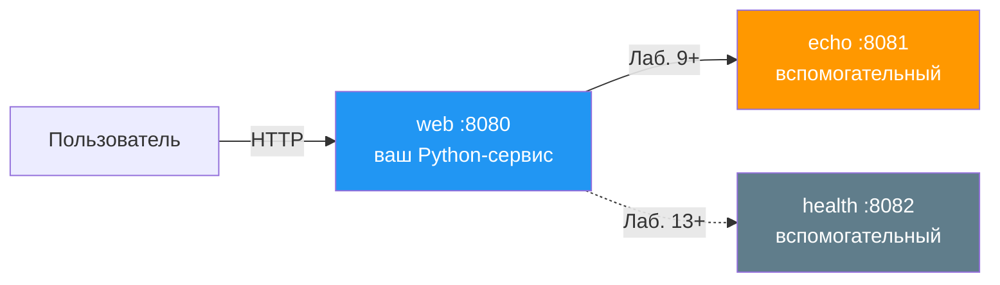
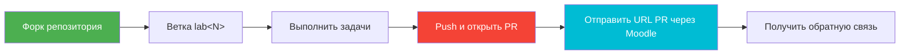

# DevOps-инженерия: ключевые практики


Освойте **DevOps уровня production** на практических лабораторных работах. Вы берёте один веб-сервис и неделя за неделей контейнеризуете его, настраиваете CI/CD, разворачиваете для него инфраструктуру, делаете его наблюдаемым, оркестрируете в Kubernetes и доставляете через GitOps и прогрессивную доставку — в итоге получая мультисервисную, самовосстанавливающуюся, полностью наблюдаемую систему и портфолио, доказывающее, что вы умеете запускать ПО в production.

> *«You build it, you run it» — «Ты это создаёшь — ты это и эксплуатируешь»*. — Werner Vogels

---

## Карта курса

Сюжетная линия: **разработка → интеграция → провижининг → наблюдение → оркестрация → доставка → эксплуатация в масштабе**. Каждая лабораторная опирается на предыдущую; ваш сервис вырастает из одного контейнера в кластер из трёх сервисов.

| Неделя | Лаб. | Модуль | Ключевые темы и инструменты (май 2026) |
|:---:|:---:|--------|---------------------------------|
| 1 | 1 | Разработка веб-приложений | Python 3.13, Flask/FastAPI, эндпоинты состояния (health) |
| 2 | 2 | Контейнеризация | Docker 29, multi-stage, distroless, сканирование Trivy, GHCR |
| 3 | 3 | Непрерывная интеграция | GitHub Actions, пирамида тестирования, безопасность цепочки поставок |
| 4 | 4 | Инфраструктура как код | Terraform 1.15 **+ Pulumi 3.243**, state, OpenTofu |
| 5 | 5 | Управление конфигурацией | ansible-core 2.21, роли, идемпотентность, Vault |
| 6 | 6 | Непрерывное развёртывание | Продвинутый Ansible, Compose v2, CI/CD с OIDC |
| 7 | 7 | Логирование | Loki 3.7, **Grafana Alloy 1.16** (Promtail EOL), LogQL |
| 8 | 8 | Мониторинг | Prometheus 3.x, PromQL, RED/USE, Grafana 13 |
| 9 | 9 | Kubernetes | K8s 1.36 "Haru", Deployments, Services — **присоединяется 2-й сервис** |
| 10 | 10 | Helm | **Helm 4.1**, чарты, шаблонизация, хуки, OCI-реестры |
| 11 | 11 | Управление секретами | K8s Secrets, **OpenBao 2.5**, External Secrets Operator |
| 12 | 12 | Конфигурация и хранилище | ConfigMaps, PV/PVC, StorageClass, горячая перезагрузка |
| 13 | 13 | GitOps | **ArgoCD 3.4**, ApplicationSet — **присоединяется 3-й сервис** |
| 14 | 14 | Прогрессивная доставка | Argo Rollouts 1.8, canary, blue-green, AnalysisTemplate |
| 15 | 15 | StatefulSets | Headless-сервисы, volumeClaimTemplates, операторы |
| 16 | 16 | Мониторинг кластера | kube-prometheus, ServiceMonitor, init-контейнеры |
| — | **Бонусные лабораторные** | | |
| — | 17 | Развёртывание на периферии (Edge) | Cloudflare Workers, изоляты V8, глобальный edge |
| — | 18 | Воспроизводимые сборки | Nix flakes, детерминированные сборки |

> 📅 **Расписание на 16 недель.** Если семестр короче, лекции объединяются попарно (две в неделю), чтобы темп лабораторных оставался один в неделю. Лекции 1–16 соответствуют лабораторным 1–16 один к одному; бонусные лабораторные 17–18 покрываются лекцией 16.

---

## Проект: сервис, который вырастает в систему

Вы начинаете с **одного** Python-сервиса (лаб. 1) и никогда его не выбрасываете — каждая лабораторная добавляет production-возможность к *тому же* проекту. Позже к нему присоединяются два вспомогательных сервиса, предоставленных курсом, чтобы концепции оркестрации стали осязаемыми:



| Сервис | Роль | Владелец | Когда появляется |
|---------|------|-------|-----------------|
| **web** | Ваш Python-веб-сервис — стержень проекта | **Вы его создаёте** | Лаб. 1 |
| **echo** | Go-компаньон — делает `Service` и kube-DNS осмысленными | Вспомогательный сервис курса (`plumbing/echo/`) | Лаб. 9 |
| **health** | Go-компаньон — даёт ArgoCD ApplicationSet третью цель | Вспомогательный сервис курса (`plumbing/health/`) | Лаб. 13 |

Вы никогда не пишете вспомогательные сервисы — вы разворачиваете их и связываете. Они предоставляют метрики Prometheus, так что ваш стек наблюдаемости из лаб. 7-8-16 подхватывает их автоматически.

---

## Что поставляется vs. что создаёте вы

| В этом репозитории (предоставлено курсом) | В ВАШЕМ форке (создаёте вы) |
|--------------------------------|----------------------------|
| `lectures/` — 16 лекций | `app_python/` — ваш сервис |
| `labs/` — 18 спецификаций лабораторных | `k8s/` — ваши манифесты (лаб. 9+) |
| `plumbing/` — сервисы echo + health | `ansible/`, `terraform/` — ваш IaC (лаб. 4-6) |
| `README.md` — этот файл | `.github/workflows/` — ваш CI (лаб. 3+) |
| | `monitoring/` — ваша конфигурация Prometheus/Loki (лаб. 7-8) |

Каталоги, создаваемые студентами, добавлены в `.gitignore` в этом репозитории, чтобы исходный репозиторий оставался чистым. Вы коммитите их в *свой* форк.

---

## Структура лабораторных

Каждая основная лабораторная (1-16) стоит **10 баллов за основные задачи + до 2 бонусных баллов**:

- **Основные задачи** в сумме дают **10 баллов**. Разбивка зависит от лабораторной (например, 6+4 или 2+3+3+2) — задача 1 всегда автономна, так что последующие лабораторные никогда не зависят от пропущенной задачи.
- **Бонусные задачи** в сумме дают **2 балла**, фиксированно. Это действительно сложные расширения, а не рутинная работа.
- **Бонусные лабораторные (17, 18)** имеют ту же форму 10 + 2 и являются альтернативой экзамену.

Каждую лабораторную завершают критерии приёмки и таблица рубрики. Минимальный проходной балл за лабораторную: 6/10.

---

## Оценивание

Пять компонентов. Суммарный максимум **139%**, но с потолком **100%** — поэтому есть несколько путей к «отлично», и ни один компонент не обязателен.

| Компонент | Сырой балл | Вес | За что |
|-----------|----:|-------:|---------|
| **Основные лабораторные 1-16** (основные задачи) | 160 | **70%** | Добросовестная еженедельная работа над проектом — базовый уровень |
| **Бонусные задачи** (2 балла × 16 лабораторных, фиксированно) | 32 | **14%** | Выход за рамки по темам недели |
| **Таблицы лидеров викторин** (5 скользящих окон, топ-10 делят пул) | — | **5%** | Вовлечённость + освоение лекций |
| **Бонусные лабораторные 17 + 18** (по 10 баллов) | 20 | **20%** | Освоение edge + воспроизводимых сборок; альтернатива экзамену |
| **Итоговый экзамен** | — | **30%** | Необязателен — письменный, комплексный |
| **Сумма (с потолком 100%)** | | **139%** | |

### Пути к «отлично» (≥90%)

- **Практический путь:** все основные лабораторные (70%) + бонусы (14%) + обе бонусные лабораторные (20%) → 104% → потолок, «отлично» без экзамена.
- **Экзаменационный путь:** все основные лабораторные (70%) + бонусы (14%) + хороший экзамен (30%) → «отлично» без бонусных лабораторных.
- **Смешанный:** основные лабораторные + часть бонусов + одна бонусная лабораторная + достойный экзамен.

<details>
<summary>📊 Шкала оценок</summary>

| Оценка | Процент |
|-------|-----------|
| **A** | 90-100% |
| **B** | 75-89% |
| **C** | 60-74% |
| **D** | ниже 60% |

</details>

---

## Таблицы лидеров викторин

К каждой лекции прилагается викторина из 15 вопросов. Викторины питают **5 скользящих окон таблицы лидеров** в течение семестра:

| Окно | Лекции | Недели |
|:---:|----------|:---:|
| 1 | лек. 1-3 | 1-3 |
| 2 | лек. 4-6 | 4-6 |
| 3 | лек. 7-9 | 7-9 |
| 4 | лек. 10-12 | 10-12 |
| 5 | лек. 13-16 | 13-16 |

Топ-10 студентов в каждом окне делят небольшой пул баллов этого окна (≈1% каждый, ~5% всего). Студенты, присоединившиеся позже, всё ещё могут выиграть в последующих окнах.

---

## Технологический стек (зафиксирован на май 2026)

| Слой | Инструмент | Версия |
|-------|------|---------|
| Среда выполнения | Python | 3.13 |
| Контейнер | Docker Engine | 29.5 |
| Реестр | GHCR | — |
| Сканирование | Trivy | v0.69.3+ (безопасен после CVE-2026-33634) |
| CI/CD | GitHub Actions | раннеры ubuntu-24.04 |
| IaC | Terraform / OpenTofu / Pulumi | 1.15 / 1.12 / 3.243 |
| Управление конфигурацией | ansible-core | 2.21 |
| Логи | Loki + Grafana Alloy | 3.7 / 1.16 |
| Метрики | Prometheus + Grafana | 3.x / 13 |
| Оркестрация | Kubernetes | 1.36 "Haru" |
| Локальный кластер | k3d (k3s-in-Docker) | 5.7 |
| Упаковка | Helm | 4.1 |
| Секреты | OpenBao | 2.5 |
| GitOps | ArgoCD | 3.4 |
| Прогрессивная доставка | Argo Rollouts | 1.8 |

---

## Процесс сдачи



```bash
git checkout -b lab1
# ... выполните лабораторную ...
git add app_python/
git commit -m "Complete lab1"
git push -u origin lab1
# Откройте PR из your-fork:lab1 → your-fork:main, отправьте URL PR в Moodle
```

<details>
<summary>📝 Чек-лист сдачи</summary>

- [ ] Все основные задачи выполнены
- [ ] Документация написана (`docs/LABNN.md`)
- [ ] Скриншоты/вывод CLI там, где требуется
- [ ] Код протестирован и работает
- [ ] Markdown прошёл проверку
- [ ] PR открыт, URL отправлен

</details>

---

## Ключевые книги и ресурсы

**Основы DevOps**
- *The Phoenix Project* — Gene Kim и др. (2013)
- *The DevOps Handbook* (2-е изд.) — Kim, Humble, Debois, Willis (2021)
- *Accelerate* — Forsgren, Humble, Kim (2018)

**Инструменты**
- *Docker Deep Dive* — Nigel Poulton
- *Terraform: Up & Running* (4-е изд.) — Yevgeniy Brikman
- *Ansible for DevOps* — Jeff Geerling
- *Kubernetes Up & Running* (3-е изд.) — Burns, Beda, Hightower
- *Learning Helm* (2-е изд.) — Butcher, Farina, Dolitsky

**Наблюдаемость и надёжность**
- *Observability Engineering* — Majors, Fong-Jones, Miranda
- *Site Reliability Engineering* — Beyer и др. (бесплатно на sre.google/books) — в паре с элективом «Введение в SRE»

**Онлайн**
- [DORA State of DevOps](https://dora.dev/research/)
- [CNCF Cloud Native Landscape](https://landscape.cncf.io)
- [12 Factor App](https://12factor.net)

---

**Готовы? Начните с [лабораторной 1](labs/lab01.md).** Вопросы → Moodle курса или консультационные часы.
