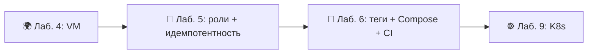

# Лабораторная работа 5 — Основы Ansible


> **Цель:** настроить виртуальную машину, которую вы спровижинили в лабораторной работе 4, написав три переиспользуемые роли Ansible (`common`, `docker`, `app_deploy`), а затем доказать, что всё это идемпотентно — второй запуск даёт `changed=0`.
> **Результат сдачи:** PR из ветки `lab05` с проектом `ansible/` (три роли, два playbook, зашифрованный файл Vault, документация).

---

## Обзор

В этой лабораторной работе вы отработаете:
- Написание **идемпотентных** задач с модулями FQCN (`ansible.builtin.*`, `community.docker.*`)
- Организацию задач в **роли** (`tasks/`, `handlers/`, `defaults/`, `templates/`) вместо одного огромного playbook
- Использование **handlers**, чтобы сервис перезапускался только когда его конфигурация действительно изменилась
- Шифрование секретов с помощью **Ansible Vault**, чтобы они безопасно хранились в Git
- Чтение вывода PLAY RECAP: `changed=N` при первом запуске, `changed=0` при втором — критерий приёмки управления конфигурацией

> ⚠️ **Область:** лабораторная 4 *спровижинила* машину (Terraform/Pulumi выдал ей IP). Лабораторная 5 *настраивает* то, что внутри. Лабораторная 6 добавит поверх этих ролей теги, блоки, Compose и CI-воркфлоу — и **переименует `app_deploy` → `web_app`** через `git mv`. Имена ролей, которые вы выберете на этой неделе, не станут постоянными для `app_deploy`; всё остальное переносится без изменений.

> 💡 **Нет облачной VM? Можно целиться в localhost** — задайте `ansible_connection: local` в инвентаре и пропустите `become:` в задачах, требующих root в песочнице без sudo. Оценивается *логика* роли; чистое выполнение против localhost с `--check` (где `become` — единственная помеха) принимается как результат сдачи. Захватите оба PLAY RECAP точно так же (`changed=N`, затем `changed=0`).

> **Замечание про «LTS»:** у `ansible-core` **нет формального ярлыка LTS**. Движок с открытым исходным кодом обязуется обеспечивать ~6 месяцев исправлений безопасности на каждый minor-релиз; сейчас поддерживаются версии **2.18, 2.19, 2.20, 2.21**. Используйте **2.21**. Коммерческая *Ansible Automation Platform* от Red Hat предлагает расширенную поддержку — это другой продукт. Слайды в интернете, которые говорят «2.17 LTS», предшествуют прояснению этой политики.

---

## Состояние проекта

**У вас должно быть из предыдущих лабораторных работ:**
- Лабораторная 2: Docker-образ вашего Python-сервиса, запушенный в Docker Hub (или любой реестр)
- Лабораторная 4: доступная Ubuntu VM (облачная или локальная libvirt) с беспарольным `sudo` для вашего пользователя входа

**Эта лабораторная работа добавляет:**
- `ansible/` — три роли, два playbook, статический инвентарь, зашифрованный Vault, документацию

К лабораторной 6 эти же роли получат теги + блоки + CI-воркфлоу; к лабораторной 9 тот же образ будет работать в Kubernetes. Решения, которые вы примете на этой неделе — гранулярность ролей, раскладка переменных, FQCN — переживут лабораторную 5.

---

## Настройка

Control node (ваш ноутбук или CI-раннер):

```bash
python3 --version          # 3.11+
python3 -m venv .venv && source .venv/bin/activate
pip install "ansible-core==2.21.*"
ansible --version          # ожидается: ansible [core 2.21.x] / python 3.11+
ansible-galaxy collection install community.docker community.general
```

Целевая VM (из лабораторной 4):
- Ubuntu 24.04 LTS (или 22.04)
- SSH-доступ по вашему ключу
- **Беспарольный `sudo`** для пользователя входа (по умолчанию у cloud-init — без этого `become:` падает)
- Присутствует Python 3 (по умолчанию в Ubuntu)

Создайте структуру каталогов (файлы вы заполните сами):

```
ansible/
├── ansible.cfg
├── inventory/
│   └── hosts.ini
├── group_vars/
│   └── all/
│       └── vault.yml             # зашифрован; создаётся в задаче 3
├── roles/
│   ├── common/
│   │   ├── tasks/main.yml
│   │   └── defaults/main.yml
│   ├── docker/
│   │   ├── tasks/main.yml
│   │   ├── handlers/main.yml
│   │   ├── defaults/main.yml
│   │   └── templates/daemon.json.j2
│   └── app_deploy/
│       ├── tasks/main.yml
│       ├── handlers/main.yml
│       └── defaults/main.yml
├── playbooks/
│   ├── provision.yml             # применяет common + docker
│   └── deploy.yml                # применяет app_deploy
└── docs/
    └── LAB05.md                  # ваш отчёт о сдаче
```

> Создавайте только те подкаталоги, которые действительно используете. Роли без handlers не нужен `handlers/`.

---

## Задача 1 — Инвентарь и каркас ролей (2 балла)

### 1.1 — Почему FQCN и почему сейчас

После разделения `ansible-core` / `ansible` в 2021 году модули упоминаются по их **полному имени коллекции (Fully-Qualified Collection Name)**: `ansible.builtin.apt`, а не голое `apt`; `community.docker.docker_container`, а не голое `docker_container`. Это важно по двум причинам:

1. **Устранение неоднозначности.** Две коллекции могут поставлять модуль с одинаковым коротким именем. Голые имена молча разрешаются в тот, который загрузился первым — Heisenbug, готовый случиться на CI-раннере с другим набором коллекций.
2. **Задел на будущее.** Сокращение по короткому имени устарело; новые модули выпускаются только с FQCN. CI-воркфлоу лабораторной 6 будет линтить ваши роли на голые имена.

Голые имена «работают» в 2026 году так же, как `from __future__ import ...` «работал» в Python 2 — до того дня, когда перестанут. Используйте FQCN везде.

### 1.2 — Статический инвентарь

`ВАША ЗАДАЧА`: напишите `inventory/hosts.ini`, который помещает вашу VM из лабораторной 4 в группу `webservers`. Обязательные ключи на хост: `ansible_host` (IP), `ansible_user` (`ubuntu`) и блок `[webservers:vars]` с `ansible_ssh_private_key_file` (путь к вашему ключу из лабораторной 4) и `ansible_python_interpreter=/usr/bin/python3`.

Скелет (заполните пропуски; всё в `___` — ваше):

```ini
[webservers]
lab-vm ansible_host=___ ansible_user=___        # ВАША ЗАДАЧА: IP виртуальной машины + SSH-пользователь (Lab 4: ubuntu)

[webservers:vars]
ansible_ssh_private_key_file=___                 # ВАША ЗАДАЧА: путь к вашему приватному ключу из Lab 4 (Lab 4 по умолчанию: ~/.ssh/lab04)
ansible_python_interpreter=___                   # ВАША ЗАДАЧА: обычно /usr/bin/python3
```

<details>
<summary>💡 Целимся в localhost вместо этого (песочница без sudo)</summary>

Если у вас нет под рукой VM из лабораторной 4 и вы хотите запустить на самом control node:

```ini
[webservers]
lab-vm ansible_host=localhost ansible_user=___ ansible_connection=local   # локальное выполнение, без SSH

[webservers:vars]
ansible_python_interpreter=/usr/bin/python3
```

`ansible_connection: local` заставляет Ansible полностью пропустить SSH и выполнять модули `exec` в процессе. Те же роли запускаются; задачи, требующие root (`apt`, `service`), требуют локального `sudo`. Если в вашей песочнице нет беспарольного sudo, примите, что эти задачи не применятся по-настоящему, но их *логика* всё ещё проверяется в режиме `--check` — отметьте это явно в вашем `docs/LAB05.md` и захватите PLAY RECAP из `--check` как доказательство идемпотентности.

</details>

### 1.3 — `ansible.cfg`

`ВАША ЗАДАЧА`: напишите `ansible.cfg` с этими ключами (точные заголовки секций ищите в документации — не копируйте со Stack Overflow, половина ответов там глобально ставит `host_key_checking=False`, что является удобством для лабораторной, а не практикой для прода):

- `[defaults]`: `inventory` (путь к вашему инвентарю), `roles_path` (путь к каталогу ваших ролей), `host_key_checking` (False для лабораторной; поймите, почему в проде ставят True), `retry_files_enabled` (False)
- `[privilege_escalation]`: `become`, `become_method`, `become_user`

```ini
[defaults]
inventory = ___                                   # ВАША ЗАДАЧА
roles_path = ___                                  # ВАША ЗАДАЧА
host_key_checking = ___                           # ВАША ЗАДАЧА (лабораторная: False; объясните, почему в проде True)
retry_files_enabled = ___                         # ВАША ЗАДАЧА

[privilege_escalation]
become = ___                                      # ВАША ЗАДАЧА
become_method = ___                               # ВАША ЗАДАЧА
become_user = ___                                 # ВАША ЗАДАЧА
```

### 1.4 — Проверка связности

```bash
cd ansible/
ansible all -m ansible.builtin.ping
ansible webservers -a "uname -a"
```

ping должен вернуть `pong` (иллюстративно — ваше имя хоста будет другим):

```text
lab-vm | SUCCESS => { "changed": false, "ping": "pong" }
```

### 1.5 — Доказательство работы

Вставьте в `docs/LAB05.md`:

- вывод `ansible --version` (должен показывать 2.21.x)
- вывод `ansible all -m ansible.builtin.ping` (тот самый `pong`)
- вывод `ansible webservers -a "uname -a"` (доказывает SSH + доступ к оболочке)
- два предложения о том, **почему важен FQCN** (своими словами)

---

## Задача 2 — Роли провижининга: `common` + `docker` (3 балла)

*Роль* — это дерево каталогов с общепринятыми подпапками. Подключите её к playbook одной строкой. Правило: если вы копипастите одни и те же задачи между двумя playbook, это роль.

### 2.1 — Роль `common` — базовые пакеты + часовой пояс

`ВАША ЗАДАЧА`: напишите `roles/common/defaults/main.yml` и `roles/common/tasks/main.yml`. Файл defaults содержит *переменные, которые пользователь может захотеть переопределить*; файл tasks содержит фактическую работу.

`roles/common/defaults/main.yml`:

```yaml
---
common_packages:                                  # ВАША ЗАДАЧА: список минимум из 4 базовых пакетов
  - ___                                           #   (curl/git/vim/htop/ca-certificates — выберите разумный набор)
  - ___
  - ___
  - ___
common_timezone: ___                              # ВАША ЗАДАЧА: Etc/UTC или ваш регион
```

`roles/common/tasks/main.yml` — имена модулей даны (это *выбор из лекции*); аргументы — ваши:

```yaml
---
- name: ___                                       # ВАША ЗАДАЧА: однострочное описание действия
  ansible.builtin.apt:                            # модуль дан
    update_cache: ___                             # ВАША ЗАДАЧА
    cache_valid_time: ___                         # ВАША ЗАДАЧА: почему значение > 0? прочитайте документацию модуля apt
  when: ___                                       # ВАША ЗАДАЧА: ограничьте хостами семейства Debian (подсказка: ansible_os_family)

- name: ___                                       # ВАША ЗАДАЧА
  ansible.builtin.package:                        # модуль дан — обратите внимание: НЕ `apt:`; см. «Частые ловушки»
    name: ___                                     # ВАША ЗАДАЧА: сошлитесь на переменную из defaults
    state: ___                                    # ВАША ЗАДАЧА: present? latest? обоснуйте свой выбор в docs/LAB05.md
  become: ___                                     # ВАША ЗАДАЧА: true или false? почему?
  tags: [___]                                     # ВАША ЗАДАЧА: выберите тег — лабораторная 6 задействует таксономию тегов

- name: ___                                       # ВАША ЗАДАЧА: задать системный часовой пояс
  community.general.timezone:                     # модуль дан
    name: ___                                     # ВАША ЗАДАЧА: сошлитесь на common_timezone
  become: ___                                     # ВАША ЗАДАЧА
  tags: [___]                                     # ВАША ЗАДАЧА
```

Несколько *почему*, на которые вы должны ответить в `docs/LAB05.md` (по одному предложению):

- **`become: true` выборочно, а не повсеместно.** Почему задаче с часовым поясом нужен root, а `ping` — нет? Почему `become: true` на *play* — это code smell, когда единственный повышатель привилегий — одна задача? (Подсказка: радиус поражения + читаемость.)
- **`state: present` против `state: latest`.** Оба ставят пакет. Почему `present` даёт воспроизводимые запуски, а `latest` тихо ломает идемпотентность в тот момент, когда upstream публикует новую версию?
- **Почему тегировать задачи сейчас?** Лабораторная 6 будет запускать `ansible-playbook --tags docker`, чтобы развернуть только Docker-часть. Если вы не протегируете сейчас, первый шаг лабораторной 6 — «вернитесь и протегируйте всё». Вырабатывайте привычку.

### 2.2 — Роль `docker` — установка Docker engine

`roles/docker/defaults/main.yml`:

```yaml
---
docker_user: ___                                  # ВАША ЗАДАЧА: пользователь входа, которого добавить в группу docker
docker_log_max_size: ___                          # ВАША ЗАДАЧА: разумное значение, например "10m"
```

`roles/docker/templates/daemon.json.j2` — шаблон Jinja2, рендерится в `/etc/docker/daemon.json`:

```jinja
{
  "log-driver": "___",                            # ВАША ЗАДАЧА: выберите драйвер (json-file или local)
  "log-opts": { "max-size": "{{ ___ }}" }         # ВАША ЗАДАЧА: сошлитесь на ваш default
}
```

`roles/docker/handlers/main.yml`:

```yaml
---
- name: ___                                       # ВАША ЗАДАЧА: имя handler — сделайте его коротким, вы будете на него `notify:`
  ansible.builtin.service:                        # модуль дан
    name: ___                                     # ВАША ЗАДАЧА
    state: ___                                    # ВАША ЗАДАЧА: restarted? reloaded? почему?
```

`roles/docker/tasks/main.yml` — основная тяжёлая работа. Имена модулей даны (они следуют примеру со слайда 20 лекции); аргументы — это навык:

```yaml
---
- name: ___                                       # ВАША ЗАДАЧА: установить предварительные зависимости
  ansible.builtin.apt:                            # модуль дан
    name: ___                                     # ВАША ЗАДАЧА: список — apt-transport-https, ca-certificates, curl, gnupg, lsb-release
    state: ___                                    # ВАША ЗАДАЧА
    update_cache: ___                             # ВАША ЗАДАЧА

- name: ___                                       # ВАША ЗАДАЧА: добавить официальный APT-ключ Docker
  ansible.builtin.get_url:                        # модуль дан (deb822_repository тоже валиден — выберите один и обоснуйте)
    url: ___                                      # ВАША ЗАДАЧА: URL загрузки gpg-ключа Docker
    dest: ___                                     # ВАША ЗАДАЧА: путь внутри /etc/apt/keyrings/
    mode: ___                                     # ВАША ЗАДАЧА: режим файла (строка, например "0644")

- name: ___                                       # ВАША ЗАДАЧА: добавить APT-репозиторий Docker
  ansible.builtin.apt_repository:                 # модуль дан
    repo: ___                                     # ВАША ЗАДАЧА — используйте {{ ansible_distribution_release }}, чтобы работало на jammy + noble
    state: ___                                    # ВАША ЗАДАЧА
    filename: ___                                 # ВАША ЗАДАЧА: стабильное имя файла в /etc/apt/sources.list.d/

- name: ___                                       # ВАША ЗАДАЧА: установить docker-ce + cli + containerd.io
  ansible.builtin.apt:                            # модуль дан
    name: ___                                     # ВАША ЗАДАЧА: список из трёх пакетов
    state: ___                                    # ВАША ЗАДАЧА
    update_cache: ___                             # ВАША ЗАДАЧА
  notify: ___                                     # ВАША ЗАДАЧА: укажите ваш handler выше

- name: ___                                       # ВАША ЗАДАЧА: отрендерить daemon.json
  ansible.builtin.template:                       # модуль дан
    src: ___                                      # ВАША ЗАДАЧА: имя файла в templates/
    dest: ___                                     # ВАША ЗАДАЧА: /etc/docker/daemon.json
    mode: ___                                     # ВАША ЗАДАЧА
  notify: ___                                     # ВАША ЗАДАЧА: срабатывает ТОЛЬКО если отрендеренный файл отличается

- name: ___                                       # ВАША ЗАДАЧА: убедиться, что сервис docker запущен + включён
  ansible.builtin.service:                        # модуль дан
    name: ___                                     # ВАША ЗАДАЧА
    state: ___                                    # ВАША ЗАДАЧА
    enabled: ___                                  # ВАША ЗАДАЧА

- name: ___                                       # ВАША ЗАДАЧА: добавить пользователя в группу docker
  ansible.builtin.user:                           # модуль дан
    name: ___                                     # ВАША ЗАДАЧА: {{ docker_user }}
    groups: ___                                   # ВАША ЗАДАЧА
    append: ___                                   # ВАША ЗАДАЧА: true — почему `append` здесь критичен? что делает значение по умолчанию?

- name: ___                                       # ВАША ЗАДАЧА: установить Docker SDK для Python
  ansible.builtin.pip:                            # модуль дан — без этого модули community.docker.* падают
    name: ___                                     # ВАША ЗАДАЧА: имя пакета (это уже не "docker-py")
    state: ___                                    # ВАША ЗАДАЧА
```

*Почему*, на которые вы должны ответить:

- **Почему `{{ ansible_distribution_release }}`?** Оно разрешается в `noble` на Ubuntu 24.04 и `jammy` на 22.04 — одна роль, оба дистрибутива. (Берётся из `gather_facts: true` — оставьте его включённым.)
- **Почему `notify:` на задаче с шаблоном, а не на задаче с apt?** Установка пакета одноразовая. Изменение конфигурационного файла должно перезапускать Docker только когда файл *действительно меняется*. В этом назначение handler: свежий первый запуск перезапускает Docker один раз; второй запуск видит файл неизменным и полностью пропускает handler. Нет `changed`, нет перезапуска, нет простоя.
- **Почему `append: true` на задаче с пользователем?** Без него Ansible *заменяет* список групп пользователя — выбивая его из `sudo`, `adm` и всех групп, в которых он уже был. Это самая частая ловушка Ansible на общих машинах.

### 2.3 — Playbook провижининга

`playbooks/provision.yml` — тонкий по замыслу, вся логика живёт в ролях:

```yaml
---
- name: Provision web servers
  hosts: ___                                      # ВАША ЗАДАЧА: целевая группа
  become: ___                                     # ВАША ЗАДАЧА: true на уровне play ИЛИ false + become на каждую задачу — аргументируйте свой выбор
  gather_facts: ___                               # ВАША ЗАДАЧА: нужно для ansible_distribution_release
  roles:
    - ___                                         # ВАША ЗАДАЧА
    - ___                                         # ВАША ЗАДАЧА
```

### 2.4 — Запуск и проверка

```bash
ansible-playbook playbooks/provision.yml          # первый реальный запуск
```

Первый запуск в основном жёлтый (иллюстративно; ваш счётчик `changed` будет другим):

```text
PLAY RECAP **********************************************************
lab-vm : ok=11  changed=8  unreachable=0  failed=0
```

### 2.5 — Доказательство работы

Вставьте в `docs/LAB05.md`:

- содержимое обоих файлов (`common/tasks/main.yml`, `docker/tasks/main.yml`) — в блоке YAML
- **полную строку PLAY RECAP** из `ansible-playbook playbooks/provision.yml`
- вывод `ansible webservers -a "docker --version"`, доказывающий наличие Docker на машине
- ваш ответ одним абзацем на каждое *почему* в 2.1 и 2.2

---

## Задача 3 — Роль развёртывания приложения + Vault (3 балла)

### 3.1 — Шифрование учётных данных с помощью Ansible Vault

```bash
ansible-vault create group_vars/all/vault.yml
```

Вам будет предложено ввести пароль Vault. **Сохраните этот пароль сейчас** в gitignored-файле, чтобы четыре повторных запуска в задаче 4 не заставляли вас вводить его заново:

```bash
echo 'your-vault-password' > .vault_pass
chmod 600 .vault_pass
# .vault_pass уже в вашем .gitignore (см. «Как сдавать»)
```

Скажите Ansible использовать его (один из двух способов — выберите один):

- На команду: `ansible-playbook playbooks/deploy.yml --vault-password-file .vault_pass`
- В `ansible.cfg`: добавьте `vault_password_file = .vault_pass` в секцию `[defaults]`

(Форма `--ask-vault-pass` из §3.4 ниже — альтернатива с запросом каждый раз — используйте то, что предпочитаете.)

`ВАША ЗАДАЧА`: поместите внутрь свои учётные данные Docker Hub и конфигурацию приложения (файл шифруется AES-256 на диске — безопасно коммитить; пароль — НЕТ).

```yaml
---
dockerhub_username: ___                           # ВАША ЗАДАЧА: ваше имя пользователя Docker Hub
dockerhub_password: ___                           # ВАША ЗАДАЧА: ACCESS TOKEN (dckr_pat_…), а не пароль для входа
docker_image: ___                                 # ВАША ЗАДАЧА: например "{{ dockerhub_username }}/devops-info-service"
docker_image_tag: ___                             # ВАША ЗАДАЧА: предпочтите неизменяемый тег (SHA) вместо "latest"
app_port: ___                                     # ВАША ЗАДАЧА
app_container_name: ___                           # ВАША ЗАДАЧА
```

Убедитесь, что оно расшифровывается:

```bash
ansible-vault view group_vars/all/vault.yml
```

> Почему *access token* Docker Hub, а не пароль аккаунта? Access token имеет область действия (read-only / read-write / admin), отзывается по отдельности и появляется в журнале аудита DH. Утечка пароля компрометирует весь аккаунт.

### 3.2 — Роль `app_deploy`

`roles/app_deploy/defaults/main.yml`:

```yaml
---
app_restart_policy: ___                           # ВАША ЗАДАЧА: unless-stopped или on-failure — почему?
app_health_path: ___                              # ВАША ЗАДАЧА: /health (совпадает с вашим сервисом из лабораторной 1)
```

`roles/app_deploy/handlers/main.yml`:

```yaml
---
- name: ___                                       # ВАША ЗАДАЧА: имя handler (`restart app` подойдёт)
  community.docker.docker_container:              # модуль дан
    name: ___                                     # ВАША ЗАДАЧА: {{ app_container_name }}
    state: ___                                    # ВАША ЗАДАЧА
    restart: ___                                  # ВАША ЗАДАЧА
```

`roles/app_deploy/tasks/main.yml` — имена модулей даны (это выбор `community.docker.*` из лекции); аргументы — это навык:

```yaml
---
- name: ___                                       # ВАША ЗАДАЧА: войти в Docker Hub
  community.docker.docker_login:                  # модуль дан
    username: ___                                 # ВАША ЗАДАЧА
    password: ___                                 # ВАША ЗАДАЧА
  no_log: ___                                     # ВАША ЗАДАЧА: true — почему?

- name: ___                                       # ВАША ЗАДАЧА: скачать образ
  community.docker.docker_image:                  # модуль дан
    name: ___                                     # ВАША ЗАДАЧА: {{ docker_image }}
    tag: ___                                      # ВАША ЗАДАЧА
    source: ___                                   # ВАША ЗАДАЧА: pull
    force_source: ___                             # ВАША ЗАДАЧА: false — обоснуйте ответ (идемпотентность)

- name: ___                                       # ВАША ЗАДАЧА: запустить контейнер
  community.docker.docker_container:              # модуль дан
    name: ___                                     # ВАША ЗАДАЧА
    image: ___                                    # ВАША ЗАДАЧА: "{{ docker_image }}:{{ docker_image_tag }}"
    state: ___                                    # ВАША ЗАДАЧА
    restart_policy: ___                           # ВАША ЗАДАЧА
    ports:
      - ___                                       # ВАША ЗАДАЧА: "host:container" — например "{{ app_port }}:5000"
    pull: ___                                     # ВАША ЗАДАЧА: never/always/missing — почему never при повторном запуске?

- name: ___                                       # ВАША ЗАДАЧА: дождаться, пока порт начнёт принимать соединения
  ansible.builtin.wait_for:                       # модуль дан
    host: ___                                     # ВАША ЗАДАЧА
    port: ___                                     # ВАША ЗАДАЧА
    timeout: ___                                  # ВАША ЗАДАЧА

- name: ___                                       # ВАША ЗАДАЧА: убедиться, что /health возвращает HTTP 200
  ansible.builtin.uri:                            # модуль дан
    url: ___                                      # ВАША ЗАДАЧА: полный URL, оканчивающийся на {{ app_health_path }}
    status_code: ___                              # ВАША ЗАДАЧА
    return_content: ___                           # ВАША ЗАДАЧА
  register: ___                                   # ВАША ЗАДАЧА: сохраните ответ, чтобы документация могла его показать
```

*Почему* (по одному предложению в `docs/LAB05.md`):

- **`no_log: true` на задаче входа** — без него ваш токен Docker Hub появляется открытым текстом в логе сборки CI. Логи CI общедоступны в публичных репозиториях. Кнопки «удалить» там нет.
- **`pull: never` на задаче запуска** — предыдущий шаг скачивания уже получил нужный образ. `pull: always` на `docker_container` повторно скачивает при каждом запуске, что (а) косметически ломает идемпотентность и (б) тратит лишний обмен с реестром.
- **Почему коллекция `community.docker`, а не `community.general`?** Docker-модули были выделены в отдельную коллекцию в 2020 году ради более быстрого темпа релизов. `community.general.docker_*` больше не существует — ответы со Stack Overflow могут всё ещё ссылаться на него; они устарели.

### 3.3 — Playbook развёртывания

`playbooks/deploy.yml`:

```yaml
---
- name: Deploy application
  hosts: ___                                      # ВАША ЗАДАЧА
  become: ___                                     # ВАША ЗАДАЧА: почему true? зачем модулю docker_container root?
  gather_facts: ___                               # ВАША ЗАДАЧА
  roles:
    - ___                                         # ВАША ЗАДАЧА
```

### 3.4 — Запуск и проверка

```bash
ansible-playbook playbooks/deploy.yml --ask-vault-pass    # или --vault-password-file .vault_pass
curl -fsS http://<VM-IP>:<app_port>/health | jq .         # ожидается HTTP 200 + JSON
```

### 3.5 — Доказательство работы

Вставьте в `docs/LAB05.md`:

- содержимое `app_deploy/tasks/main.yml` (блок YAML)
- PLAY RECAP из `ansible-playbook playbooks/deploy.yml` (запуск №1)
- вывод `ansible webservers -a "docker ps --format '{{.Names}}\t{{.Status}}'"` (ваш контейнер работает)
- `curl -s http://<VM-IP>:<port>/health | jq .` против VM (HTTP 200, настоящий JSON, который выдаёт ваш сервис из лабораторной 1)
- доказательство, что файл Vault зашифрован: `head -1 group_vars/all/vault.yml`, показывающий `$ANSIBLE_VAULT;1.1;AES256`

---

## Задача 4 — Доказательство идемпотентности (1 балл)

Это главный критерий приёмки. Убийственная особенность управления конфигурацией — запуск одного и того же playbook дважды даёт тот же эффект, что и однократный запуск.

```bash
# Файл пароля Vault на месте (см. задачу 3.1) ИЛИ добавьте --ask-vault-pass к каждой строке
ansible-playbook playbooks/provision.yml          # запуск №1
ansible-playbook playbooks/provision.yml          # запуск №2
ansible-playbook playbooks/deploy.yml             # запуск №1 (уже сделан в задаче 3)
ansible-playbook playbooks/deploy.yml             # запуск №2
```

> 💡 Как только `group_vars/all/vault.yml` существует, **каждый** playbook (включая `provision.yml`) загружает его при старте и требует пароль Vault — хотя `provision.yml` и не *использует* секреты. Либо задайте `vault_password_file` в `ansible.cfg` один раз, либо добавьте `--ask-vault-pass` ко всем четырём командам выше.

**Второй запуск каждого должен сообщать `changed=0`.** (Иллюстративно.)

```text
# provision.yml, запуск №1
lab-vm : ok=11  changed=8  unreachable=0  failed=0
# provision.yml, запуск №2
lab-vm : ok=11  changed=0  unreachable=0  failed=0       # ← changed=0 = идемпотентно ✓

# deploy.yml, запуск №1
lab-vm : ok=6   changed=4  unreachable=0  failed=0
# deploy.yml, запуск №2
lab-vm : ok=6   changed=0  unreachable=0  failed=0       # ← changed=0 = идемпотентно ✓
```

Если что-то всё ещё меняется при запуске №2, **задача не идемпотентна — исправьте её**. Обычные виновники:

- Случайный `ansible.builtin.shell` или `command` (нет модели состояния). Оберните через `creates:`/`removes:` или замените правильным модулем.
- Шаблон, который рендерит метку времени или случайное значение.
- `state: latest` на пакете — в момент, когда upstream-репозиторий получает новую версию, вы будете видеть `changed=1` навсегда.
- `force_source: true` на `docker_image` — всегда перекачивает.

Убедитесь, что нет дрейфа, с помощью dry-run:

```bash
ansible-playbook playbooks/provision.yml --check --diff
```

### 4.1 — Доказательство работы

Вставьте в `docs/LAB05.md`:

- оба PLAY RECAP из `provision.yml` (запуск №1 changed=N, запуск №2 changed=0)
- оба PLAY RECAP из `deploy.yml` (той же формы)
- вывод dry-run `--check --diff` (никаких изменений, никаких диффов)
- анализ одним абзацем: какие задачи изменились при запуске №1, почему они сообщили `ok` при запуске №2 и что вы исправили, если что-то осталось `changed=1`

---

## Задача 5 — Документация (1 балл)

`ansible/docs/LAB05.md` — обязательные разделы по порядку:

1. **Архитектура** — версия `ansible-core`, целевая ОС, почему три роли (а не один монолитный playbook)
2. **Роли** — для каждой из `common`, `docker`, `app_deploy`: назначение, ключевые переменные, поведение handler
3. **Ответы на *почему*** из задач 2 и 3 (FQCN, выборочный `become`, `state: present` против `latest`, `append: true`, handler на шаблоне против apt, `no_log`, `pull: never`)
4. **Доказательство идемпотентности** — оба PLAY RECAP (задача 4) с анализом одним абзацем
5. **Vault** — как хранятся учётные данные, стратегия обращения с паролем, доказательство зашифрованного заголовка
6. **Проверка развёртывания** — `docker ps` и вывод `curl` для `/health`

---

## Бонусная задача — Динамический инвентарь (2 балла)

Обнаруживайте вашу VM (или VM) из лабораторной 4 автоматически через плагин облачного инвентаря вместо жёсткого прописывания IP. Статический список портится в момент, когда VM пересоздаётся и получает новый адрес — инвентарь должен узнать это *до* того, как Ansible сможет что-то настроить.

`ВАША ЗАДАЧА`:

1. Установите коллекцию для вашего облака из лабораторной 4:
   ```bash
   ansible-galaxy collection install ___        # ВАША ЗАДАЧА: amazon.aws / google.cloud / azure.azcollection / yandex.cloud
   ```
2. Напишите `inventory/<cloud>.yml`, который:
   - Устанавливает `plugin:` в FQCN плагина инвентаря (например, `amazon.aws.aws_ec2`)
   - Фильтрует до **работающих** инстансов, помеченных тегом для этого курса (используйте `filters:`)
   - Использует `compose:`, чтобы задать `ansible_host` как публичный IP (имя поля различается — см. подсказки ниже)
   - Использует `keyed_groups:`, чтобы автоматически построить группу (например, `webservers` из тега `Role`)
3. Направьте Ansible на него (`-i inventory/<cloud>.yml` или обновите `ansible.cfg`)
4. Запустите:
   ```bash
   ansible-inventory -i inventory/<cloud>.yml --graph
   ansible all -i inventory/<cloud>.yml -m ansible.builtin.ping
   ansible-playbook -i inventory/<cloud>.yml playbooks/provision.yml --check --diff
   ```

Скелет (AWS — адаптируйте имена полей под ваше облако):

```yaml
# inventory/aws.yml
plugin: ___                                       # ВАША ЗАДАЧА: amazon.aws.aws_ec2
regions:
  - ___                                           # ВАША ЗАДАЧА
filters:
  ___: ___                                        # ВАША ЗАДАЧА: tag:Project=devops-core
  instance-state-name: ___                        # ВАША ЗАДАЧА: running
keyed_groups:
  - key: ___                                      # ВАША ЗАДАЧА: tags.Role
    prefix: ___                                   # ВАША ЗАДАЧА
compose:
  ansible_host: ___                               # ВАША ЗАДАЧА: public_ip_address (для AWS)
```

<details>
<summary>💡 Подсказки по полям для каждого облака</summary>

| Облако | Коллекция | Плагин | Поле публичного IP |
|---|---|---|---|
| AWS | `amazon.aws` | `aws_ec2` | `public_ip_address` |
| GCP | `google.cloud` | `gcp_compute` | `networkInterfaces[0].accessConfigs[0].natIP` |
| Azure | `azure.azcollection` | `azure_rm` | `public_ipv4_addresses[0]` |
| Yandex | `yandex.cloud` | `yandex_compute` | вложено в `network_interfaces[0]` |

Документация: [Inventory plugins](https://docs.ansible.com/ansible-core/2.21/plugins/inventory.html) · [aws_ec2](https://docs.ansible.com/ansible/latest/collections/amazon/aws/aws_ec2_inventory.html)

</details>

### Бонусное доказательство работы

Вставьте в `docs/LAB05.md`:

- полный `inventory/<cloud>.yml` (без секретов — аутентификация через переменные окружения / IAM-роль)
- вывод `ansible-inventory --graph`, показывающий автоматически обнаруженный хост (или хосты)
- PLAY RECAP из `ansible all -i inventory/<cloud>.yml -m ansible.builtin.ping`
- один абзац: какой плагин вы использовали и почему, как вы аутентифицировались (переменные окружения? профиль инстанса IAM? конфигурация облачного SDK?) и что происходит, когда IP VM меняется (ничего — никаких ручных правок)

---

## Как сдавать

```bash
git switch -c lab05

# Держите секреты вне Git
cat >> .gitignore <<'EOF'
# Ansible
*.retry
.vault_pass
__pycache__/
EOF

git add ansible/ .gitignore
git commit -m "feat(lab05): ansible roles — common, docker, app_deploy + idempotency proof"
git push -u origin lab05
```

**Проверьте перед пушем:** `.vault_pass` отсутствует, приватные SSH-ключи отсутствуют, закоммичен только *зашифрованный* `vault.yml`.

Откройте **два** PR:

- `your-fork:lab05` → `course-repo:master` *(на проверку)*
- `your-fork:lab05` → `your-fork:master` *(сливается в ваш собственный main по завершении)*

Чек-лист PR:

```text
- [ ] Задача 1 выполнена — инвентарь + ansible.cfg + ping успешен
- [ ] Задача 2 выполнена — роли common + docker применены; PLAY RECAP захвачен
- [ ] Задача 3 выполнена — роль app_deploy + зашифрованный Vault; curl /health даёт HTTP 200
- [ ] Задача 4 выполнена — идемпотентность: оба PLAY RECAP запуска №2 показывают changed=0
- [ ] Задача 5 выполнена — docs/LAB05.md покрывает все шесть разделов с ответами на *почему*
- [ ] Бонус — динамический инвентарь: ansible-inventory --graph + ping против него
```

---

## Критерии приёмки

### Задача 1 (2 балла)
- ✅ Установлен `ansible-core` 2.21 (`ansible --version`)
- ✅ Создан каркас трёх ролей (`common`, `docker`, `app_deploy`) с общепринятыми подкаталогами
- ✅ Настроены статический инвентарь + `ansible.cfg`
- ✅ `ansible all -m ansible.builtin.ping` возвращает `pong`

### Задача 2 (3 балла)
- ✅ Роль `common` устанавливает базовые пакеты, задаёт часовой пояс — проходит с `become: true` только там, где нужен root
- ✅ Роль `docker` устанавливает Docker Engine, рендерит `daemon.json`, управляет сервисом, добавляет пользователя в группу `docker` с `append: true`
- ✅ Все задачи используют модули FQCN
- ✅ Handler перезапускает Docker **только** при изменении шаблона (`notify:` на задаче с шаблоном)
- ✅ `provision.yml` чисто применяет обе роли

### Задача 3 (3 балла)
- ✅ Учётные данные хранятся в зашифрованном файле Vault (`head -1` показывает `$ANSIBLE_VAULT;1.1;AES256`)
- ✅ Роль `app_deploy` скачивает образ из лабораторной 2 и запускает его как контейнер
- ✅ `no_log: true` на задаче входа
- ✅ `/health` возвращает HTTP 200; вывод `curl` захвачен

### Задача 4 (1 балл)
- ✅ PLAY RECAP запуска №1 показывает `changed > 0`
- ✅ PLAY RECAP запуска №2 показывает `changed=0` — для **обоих** `provision.yml` и `deploy.yml`
- ✅ `--check --diff` не показывает дрейфа

### Задача 5 (1 балл)
- ✅ `docs/LAB05.md` покрывает все шесть разделов

### Бонусная задача (2 балла)
- ✅ Плагин облачного инвентаря настроен для провайдера из лабораторной 4
- ✅ `ansible-inventory --graph` показывает автоматически обнаруженные хосты
- ✅ Playbook успешно запускается против динамического инвентаря

---

## Рубрика

| Задача | Баллы | Критерии |
|------|-------:|----------|
| **Задача 1** — Инвентарь и каркас | **2** | FQCN ping, cfg, раскладка из трёх ролей |
| **Задача 2** — Роли `common` + `docker` | **3** | Идемпотентные задачи, handler на шаблоне, FQCN, `append: true`, *почему* задокументированы |
| **Задача 3** — `app_deploy` + Vault | **3** | Образ из лабораторной 2 работает, `/health` 200, зашифрованный Vault, `no_log` |
| **Задача 4** — Идемпотентность | **1** | Запуск №2 `changed=0` для обоих playbook |
| **Задача 5** — Документация | **1** | Все шесть разделов завершены |
| **Бонус** — Динамический инвентарь | **2** | Облачный плагин автоматически обнаруживает хосты |
| **Итого** | **12** | 10 основных + 2 бонусных |

**Критические требования:**
- ОБЯЗАТЕЛЬНО использовать структуру на основе ролей (а не монолитный playbook)
- ОБЯЗАТЕЛЬНО использовать модули FQCN везде
- ОБЯЗАТЕЛЬНО продемонстрировать идемпотентность (запуск №2 changed=0 для обоих playbook — это главное в лабораторной)
- ОБЯЗАТЕЛЬНО использовать Ansible Vault; НЕЛЬЗЯ коммитить `.vault_pass` или секреты открытым текстом

---

## Ресурсы

<details>
<summary>📚 Ansible Core 2.21</summary>

- [ansible-core 2.21 docs](https://docs.ansible.com/ansible-core/2.21/)
- [Roles](https://docs.ansible.com/ansible-core/2.21/playbook_guide/playbooks_reuse_roles.html)
- [Handlers](https://docs.ansible.com/ansible-core/2.21/playbook_guide/playbooks_handlers.html)
- [Inventory](https://docs.ansible.com/ansible-core/2.21/inventory_guide/intro_inventory.html)
- [FQCN](https://docs.ansible.com/ansible-core/2.21/reference_appendices/glossary.html#term-FQCN)
- *Ansible for DevOps* — Jeff Geerling (изд. 2024)

</details>

<details>
<summary>🔒 Vault и секреты</summary>

- [Ansible Vault](https://docs.ansible.com/ansible-core/2.21/vault_guide/index.html)
- [no_log](https://docs.ansible.com/ansible-core/2.21/reference_appendices/logging.html)

</details>

<details>
<summary>🐳 Docker-модули и динамический инвентарь</summary>

- [community.docker collection](https://docs.ansible.com/ansible/latest/collections/community/docker/index.html)
- [docker_login](https://docs.ansible.com/ansible/latest/collections/community/docker/docker_login_module.html) · [docker_image](https://docs.ansible.com/ansible/latest/collections/community/docker/docker_image_module.html) · [docker_container](https://docs.ansible.com/ansible/latest/collections/community/docker/docker_container_module.html)
- [Install Docker on Ubuntu](https://docs.docker.com/engine/install/ubuntu/)
- [Inventory plugins](https://docs.ansible.com/ansible-core/2.21/plugins/inventory.html)

</details>

<details>
<summary>⚠️ Частые ловушки (из реальных dry-run)</summary>

- **`become: true` без беспарольного sudo** — play падает с `sudo: a password is required`. Исправьте на VM (cloud-init обычно создаёт пользователя входа с `NOPASSWD: ALL` в `/etc/sudoers.d/`); на собранных вручную хостах добавьте пользователя сами. Минималистичные контейнеры вообще не будут его иметь.
- **`ansible.builtin.apt` на не-Debian хосте** — сразу падает на RHEL/Fedora/Alpine. Если ваша роль `common` когда-нибудь может целиться в не-Debian машину, используйте `ansible.builtin.package` (автоматически перенаправляет в apt/dnf/yum/zypper) и позвольте модулю выбрать. Для Debian-специфики (PPA, файлы репозиториев) оставляйте `apt:`, но ограничивайте через `when: ansible_os_family == "Debian"`.
- **`community.docker.docker_container` падает с `Failed to import the required Python library (Docker SDK for Python)`** — *целевой* машине нужен `pip install docker`. Именно поэтому последняя задача роли `docker` устанавливает его через `ansible.builtin.pip`. Без него `docker_container` ошибётся, ничего не сделав.
- **Динамический инвентарь сообщает `No inventory was parsed`** — облачная коллекция не установлена (`ansible-galaxy collection install amazon.aws`), файл не назван `*.aws_ec2.yml` / `*.yml` в соответствии с `plugin:`, или ваши переменные окружения аутентификации (`AWS_ACCESS_KEY_ID` / `GOOGLE_APPLICATION_CREDENTIALS` / `AZURE_*`) не заданы. Запустите `ansible-inventory -i inventory/<cloud>.yml --list -vvv`, чтобы увидеть настоящую ошибку — `--graph` её проглатывает.
- **Забыт `append: true` на задаче с пользователем** — Ansible *заменяет* список групп пользователя, выбивая его из `sudo`/`adm`. Если вы зашли по SSH как `ubuntu` и запустили это, следующий вход не удастся. Всегда `append: true` при добавлении в группу.
- **`state: latest` на пакете** — каждый новый upstream-релиз переключает запуск №2 с `changed=0` на `changed=1`. Используйте `state: present` для воспроизводимых запусков.
- **Файл Vault коммитится без `--encrypt`** — `git diff` показывает ваши токены открытым текстом. Восстановление: `git reset --hard HEAD~1`, ротируйте токен (он сожжён), перешифруйте. Всегда `ansible-vault create` (а не `vi`).
- **`provision.yml` внезапно запрашивает пароль Vault.** Как только `group_vars/all/vault.yml` существует, Ansible загружает его в каждом play — даже в `provision.yml`, который не ссылается на секреты. Либо задайте `vault_password_file = .vault_pass` в `ansible.cfg` один раз, либо передавайте `--ask-vault-pass`/`--vault-password-file` во *все четыре* запуска в задаче 4. Пропуск этого — причина №1, по которой студенты вводят пароль 8 раз во время доказательства идемпотентности.

</details>

<details>
<summary>🛠️ Инструменты разработчика, которые стоит знать</summary>

- [ansible-lint](https://ansible.readthedocs.io/projects/lint/) — ловит нарушения FQCN, отсутствующий `name:`, запахи `state: latest`. CI лабораторной 6 использует его.
- [Molecule](https://ansible.readthedocs.io/projects/molecule/) — запускает каждую роль в контейнере и тестирует её изолированно.
- `ansible-playbook -vvv` — три v печатают SSH-команду + JSON модуля. Незаменимо для отладки «почему он сказал `changed`?»

</details>

---

## Взгляд вперёд

| Лабораторная | Что добавляет к этим ролям |
|---:|---|
| 6 | Теги (`--tags docker`), блоки + `rescue:`/`always:`, шаблоны Compose, CI-воркфлоу |
| 9 / 10 | Тот же образ развёрнут в k3d через Helm — Ansible становится бутстраппером, а не деплойером |
| 11 | Замена Ansible Vault на OpenBao как хранилище секретов времени выполнения |



---

**Удачи.** 🚀

> **Помните:** скажите серверу, *где он должен оказаться*, а не *как* туда добраться. Критерий приёмки — `changed=0` при запуске №2. Держите учётные данные в Vault, держите роли маленькими, документируйте *почему*.
