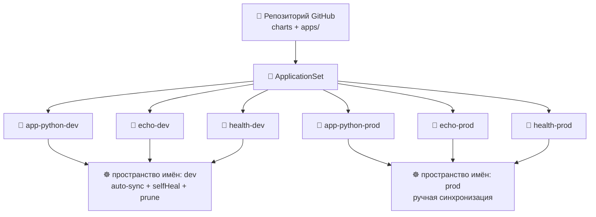

# Лабораторная работа 13 — GitOps с ArgoCD


> **Цель:** сделать Git единственным источником истины для вашего кластера. Установить **ArgoCD 3.4**, вручную объявить манифесты `Application` для **трёх** сервисов в **двух** средах, а затем свернуть все шесть в один **ApplicationSet**, который кластер непрерывно согласовывает.
> **Результат сдачи:** PR из ветки `lab13` с `k8s/argocd/` (apps + ApplicationSet + values) и `docs/LAB13.md`. Больше никакого `helm upgrade` с ноутбука.

---

## Обзор

До лабораторной 12 вы развёртывали, набирая `helm upgrade` с ноутбука (или CI-раннера). Это **push**-модель: человек или конвейер заходит *внутрь* кластера с учётными данными cluster-admin. **GitOps** переворачивает это: агент *внутри* кластера следит за Git, забирает желаемое состояние и непрерывно его согласовывает. Кластер обращается к Git; внутрь никто не заходит.

В этой лабораторной вы будете практиковать:

- Выбор и **фиксацию версии чарта ArgoCD, у которого `appVersion` находится в ветке 3.4.x** (никакого копипаста из туториалов — читайте индекс чарта)
- Написание CRD `Application` с нуля по базовой форме — `source` / `destination` / `syncPolicy` своими руками
- Две дисциплины синхронизации: dev с `automated{prune,selfHeal}`, prod с ручной синхронизацией — и письменное объяснение *почему*
- Генерацию **шести** Application из одного шаблона **ApplicationSet** Matrix(List, List) — паттерн, который оправдывает себя только при ≥ 3 приложениях
- Доказательство работы цикла GitOps: удалите workload, и ArgoCD воссоздаст его; сделайте `kubectl edit` для Service, и ArgoCD откатит изменение в течение 3 минут

> ⚠️ **Область применения:** без Argo Rollouts (это лабораторная 14), без мультикластерности, без SSO/OIDC. Ограничьтесь одним ArgoCD внутри кластера, управляющим одним кластером. Выберите *другую* бонусную задачу вместо установки новых контроллеров.

> ⚠️ **Примечание о версиях:** ArgoCD **2.x больше не поддерживается (EOL)** (релиз 3.2 в ноябре 2025 года прекратил поддержку 2.x). В этой лабораторной используется **3.4**. Если найденный онлайн-туториал использует манифесты 2.x, CRD `Application`/`ApplicationSet` совместимы, но сверяйтесь с документацией 3.x, ссылки на которую приведены в конце.

---

## Состояние проекта

**У вас должно быть из предыдущих лабораторных:**

- Кластер k3d на Kubernetes **1.36** (лабораторная 9)
- Helm-чарт для `app-python` в `k8s/lab10-app/` с `values-dev.yaml` / `values-prod.yaml` (лабораторная 10) — лабораторная 13 развернёт этот чарт через ArgoCD вместо `helm upgrade`
- Служебный сервис **`echo`** из лабораторной 9 (`ghcr.io/inno-devops-labs/echo:v1`, порт 8081)

**Эта лабораторная добавляет:**

- ArgoCD 3.4, установленный через Helm-чарт `argo/argo-cd` (в пространстве имён `argocd`)
- Служебный сервис **`health`** — **третий** сервис в вашей топологии, поставляемый в `plumbing/health/` (`ghcr.io/inno-devops-labs/health:v1`, порт 8082)
- `k8s/argocd/apps/` — шесть написанных вручную манифестов `Application` (задачи 2–3), позже заменяемых одним `ApplicationSet` (задача 4)
- `docs/LAB13.md` — ваш отчёт о сдаче

К лабораторной 14 перед теми же шестью Application появятся CRD `Rollout` для прогрессивной доставки, так что цикл GitOps, который вы строите здесь, станет основой, на которой работает всё остальное.

---

## Три сервиса

| Сервис | Источник | Образ | Порт | Вы его собираете? |
|---|---|---|---|---|
| 🐍 **app-python** | Ваш сервис из лабораторных 1 → 12 | из вашего CI | 8080 | ✅ Да — ваш код |
| 🦫 **echo** | Служебный сервис курса (лабораторная 9+) | `ghcr.io/inno-devops-labs/echo:v1` | 8081 | ❌ Нет — предсобран |
| 💚 **health** | Служебный сервис курса — **новый в этой лабораторной** | `ghcr.io/inno-devops-labs/health:v1` | 8082 | ❌ Нет — предсобран |

`health` поставляется в `plumbing/health/` (см. `plumbing/health/README.md`). Ссылайтесь на опубликованный образ напрямую — **не** собирайте его через `docker build`. Он предоставляет `GET /`, `GET /healthz` и `GET /metrics`. Его единственная цель в этой лабораторной — быть третьей целью развёртывания, чтобы `ApplicationSet` перестал быть игрушечным паттерном.



---

## Подготовка

Убедитесь, что предпосылки из предыдущих лабораторных живы: `kubectl get nodes` (3 узла в состоянии Ready на v1.36.x из лабораторной 9) и `helm version` (4.1.x из лабораторной 10). Затем добавьте репозиторий чартов Argo — `helm repo add argo https://argoproj.github.io/argo-helm && helm repo update`. Вы будете искать в нём в задаче 1.

Структура каталогов, которую вы создадите: `k8s/argocd/install/argocd-values.yaml` (задача 1), шесть манифестов Application в `k8s/argocd/apps/` (задачи 2 и 3 — `{app-python,echo,health}-{dev,prod}.yaml`) и `k8s/argocd/applicationset.yaml` (задача 4, которая удаляет эти шесть). Ваш отчёт идёт в `docs/LAB13.md`. Служебные файлы (`plumbing/health/Dockerfile`, `main.go`, …) вы **не** редактируете — они даны готовыми.

---

## Задача 1 — Установка ArgoCD 3.4 (2 балла)

### 1.1 — Найдите версию чарта с `appVersion` в 3.4.x

`ВАША ЗАДАЧА`: Helm-чарт `argo/argo-cd` и само приложение ArgoCD версионируются независимо. Выберите версию **чарта**, у которой **`appVersion`** попадает в **3.4.x** (2.x больше не поддерживается — вы потеряете этот балл, если ваш сервер сообщает 2.x или превью 3.3.x).

Подсказка: `helm search repo argo/argo-cd --versions` выводит `CHART VERSION` и `APP VERSION` рядом. Прочитайте таблицу; выберите самую свежую стабильную строку, где `APP VERSION` начинается с `3.4.`.

В `docs/LAB13.md` запишите **два** выбранных номера версий и предложение, объясняющее, чем версия чарта отличается от appVersion.

### 1.2 — Установка через Helm с зафиксированным файлом values

`ВАША ЗАДАЧА`: создайте **`k8s/argocd/install/argocd-values.yaml`** с *минимальными* переопределениями для установки, дружественной к k3d. Не берите слепо значения по умолчанию из апстрима. Как минимум решите и настройте:

- каким должен быть `server.service.type` — `ClusterIP` (вы будете делать `kubectl port-forward`) или `LoadBalancer` (klipper в k3d публикует его) — выберите один и обоснуйте в отчёте
- `configs.params."server.insecure"` — true подходит для лабораторной (TLS будет завершаться на port-forward); опишите компромисс
- блок `resources:` как минимум для `controller` и `repoServer`, укладывающийся в бюджет двух агентов k3d

Затем установите — подставьте выбранную вами версию чарта:

```bash
# ВАША ЗАДАЧА ниже:
#   --version: версия чарта, которую вы выбрали в 1.1
#   --values:  путь к вашему файлу переопределений (например, k8s/argocd/install/argocd-values.yaml)
kubectl create namespace argocd
helm install argocd argo/argo-cd \
  --namespace argocd \
  --version YOUR-TASK \
  --values YOUR-TASK
# дождитесь сервера командой `kubectl rollout status deploy/argocd-server -n argocd --timeout=180s`
```

Скелет `k8s/argocd/install/argocd-values.yaml` — содержимое напишите сами:

```yaml
# k8s/argocd/install/argocd-values.yaml
# Переопределения для чарта argo/argo-cd в кластере k3d.
# Оставляйте значения по умолчанию для всего, что не нужно менять.

server:
  service:
    type: YOUR-TASK            # ClusterIP или LoadBalancer — на ваш выбор, обоснуйте
  # YOUR-TASK: любые другие переопределения server (например, requests/limits ресурсов)

configs:
  params:
    server.insecure: "YOUR-TASK"   # "true", если хотите обычный HTTP через port-forward

controller:
  resources:
    requests:
      cpu: YOUR-TASK
      memory: YOUR-TASK
    limits:
      cpu: YOUR-TASK
      memory: YOUR-TASK

repoServer:
  resources:
    requests:
      cpu: YOUR-TASK
      memory: YOUR-TASK
```

### 1.3 — Доступ к UI и установка подходящего CLI

`ВАША ЗАДАЧА`: сделайте port-forward `svc/argocd-server` на ноутбук, получите начальный пароль администратора из Secret `argocd-initial-admin-secret` в пространстве имён `argocd` (он закодирован в base64 в `.data.password`), установите подходящий бинарник CLI **3.4.x** и войдите. Команда `argocd version` должна показывать **и** `argocd: v3.4.x` (клиент), **и** `argocd-server: v3.4.x` (сервер).

Подсказка: пароль лежит в Secret — `kubectl get secret -n argocd` покажет, что там есть. Не копируйте base64; декодируйте его.

### 1.4 — Подтверждение работы

**Вставьте в `docs/LAB13.md`:**

- `helm search repo argo/argo-cd --versions | head -5` — выбранная вами строка выделена
- `kubectl get pods -n argocd -o wide` — все основные pod'ы в состоянии Running (ожидается ≥ 6: `argocd-server`, `argocd-application-controller`, `argocd-applicationset-controller`, `argocd-repo-server`, `argocd-redis`, `argocd-notifications-controller`; `dex-server` только если вы его включили)
- `argocd version` — клиент и сервер оба **3.4.x**
- Полное содержимое `k8s/argocd/install/argocd-values.yaml`
- Одно предложение о вашем выборе `server.service.type` + одно предложение о `server.insecure`

---

## Задача 2 — CRD Application для трёх сервисов (3 балла)

### 2.1 — Разложите структуру GitOps-репозитория

`ВАША ЗАДАЧА`: в `k8s/argocd/apps/` вы создадите **шесть** манифестов `Application` в задачах 2 и 3 (3 сервиса × 2 среды). Пока начните с трёх Application для **dev**. В `docs/LAB13.md` включите абзац с пояснением: на какой **чарт** ссылается каждая Application (чарт из лабораторной 10 для `app-python`; небольшие чарты, которые вы пишете для `echo` и `health`, просто развёртывающие предсобранные образы + Service).

> Подсказка: простейший чарт `echo`/`health` — это `Chart.yaml` + `templates/deployment.yaml` + `templates/service.yaml`, по три файла на каждый. Образ должен быть `ghcr.io/inno-devops-labs/echo:v1` и `ghcr.io/inno-devops-labs/health:v1`. **Не** пересобирайте их.

### 2.2 — Напишите три CRD `Application` вручную (среда dev)

`ВАША ЗАДАЧА`: напишите `app-python-dev.yaml`, `echo-dev.yaml`, `health-dev.yaml` в `k8s/argocd/apps/`. Форма показана; **каждое** значение выбираете вы. Пока начните с **ручной синхронизации** (без блока `automated:`) — включите её в задаче 3.

```yaml
# k8s/argocd/apps/app-python-dev.yaml   (echo-dev.yaml и health-dev.yaml аналогичны)
apiVersion: argoproj.io/v1alpha1
kind: Application
metadata:
  name: YOUR-TASK                # например, app-python-dev — по этому имени индексирует контроллер
  namespace: argocd              # ArgoCD следит за Application в СВОЁМ пространстве имён
  finalizers:
    - YOUR-TASK                  # resources-finalizer, который каскадно удаляет ресурсы K8s
                                 # при `kubectl delete app`. Найдите его сами.
spec:
  project: default
  source:
    repoURL: YOUR-TASK           # https://github.com/<you>/<your-fork>.git
    targetRevision: YOUR-TASK    # ветка (dev) или тег/SHA (prod) — выберите одно, объясните в отчёте
    path: YOUR-TASK              # например, k8s/lab10-app для app-python; k8s/charts/echo для echo
    helm:                        # если ваш чарт принимает values, объявите их здесь
      valueFiles:
        - YOUR-TASK               # например, values-dev.yaml
  destination:
    server: https://kubernetes.default.svc       # API-сервер внутри кластера
    namespace: YOUR-TASK         # пространство имён K8s, куда попадает WORKLOAD (например, dev)
  syncPolicy:
    # Блока `automated:` ПОКА НЕТ — задача 3 включает его только для dev.
    syncOptions:
      - YOUR-TASK                # опция, автоматически создающая целевое пространство имён
```

Что нужно выяснить, пока вы их пишете:

- `metadata.name` живёт в пространстве имён `argocd`, а `spec.destination.namespace` — это то, куда идёт **workload**; это два разных пространства имён. Не путайте их.
- `repoURL` должен указывать на **GitOps-репозиторий** (ваш форк), доступный из кластера. Для публичных HTTPS-репозиториев учётные данные не нужны; для приватных вы бы зарегистрировали Secret `argocd-repo-creds` (вне рамок, но стоит упомянуть одним предложением в отчёте).
- Блок `finalizers:` **несущий**. Без него `kubectl delete app` оставляет Deployment/Service работающими в пространстве имён рабочей нагрузки. Попробуйте оба варианта, если хотите увидеть разницу.

### 2.3 — Разверните и запустите первую синхронизацию вручную

Примените три CR Application (`kubectl apply -f k8s/argocd/apps/`) и убедитесь, что они появляются в `argocd app list` со статусом **OutOfSync** (пока нет блока `automated:`, CR существуют, но ничего не согласовано). Затем запустите каждый командой `argocd app sync <name>` — это эквивалент ручного нажатия синхронизации. Убедитесь, что каждый достигает **`Synced / Healthy`**, с помощью `kubectl get app -n argocd -o wide`.

### 2.4 — Докажите работу цикла GitOps

`ВАША ЗАДАЧА`: измените что-нибудь недорогое в Git (например, `replicaCount: 1` → `2` в `values.yaml` вашего чарта `app-python`), закоммитьте, запушьте. Затем, **не выполняя никаких `kubectl apply` или `helm upgrade`**, наблюдайте за ArgoCD:

1. Application помечается **OutOfSync** в течение ~3 минут (интервал согласования по умолчанию) или раньше, если нажать **REFRESH** в UI
2. Примените изменение (ручная синхронизация) и вернитесь к **Synced / Healthy**

Это главный смысл GitOps: Git изменился, кластер последовал. Ни один человек не заходил в кластер.

### 2.5 — Подтверждение работы

**Вставьте в `docs/LAB13.md`:**

- Содержимое трёх манифестов Application
- `kubectl get app -n argocd -o wide` — три строки, **Synced / Healthy**
- `kubectl get deploy,svc -n dev` — шесть ресурсов (по одному Deployment + одному Service на сервис), которые вы **никогда** не применяли вручную через `kubectl apply`
- SHA git-коммита вашего изменения для «цикла GitOps» + скриншот или `argocd app history app-python-dev`, показывающий синхронизацию после этого коммита

---

## Задача 3 — Мультисредовость: dev (авто) vs prod (вручную) (3 балла)

### 3.1 — Два пространства имён, два набора values

`ВАША ЗАДАЧА`: предоставьте `values-dev.yaml` и `values-prod.yaml` для **каждого** чарта (у вашего чарта `app-python` они уже есть из лабораторной 10; нужно добавить аналогичные для мини-чартов `echo` и `health`, написанных в задаче 2). Они должны различаться **осмысленно** — как минимум по двум из: число реплик, requests/limits ресурсов, фиксация тега образа, тип сервиса. Опишите таблицу в `docs/LAB13.md`.

### 3.2 — Переведите dev на авто-синхронизацию, добавьте три Application для prod

`ВАША ЗАДАЧА`: отредактируйте три dev-Application, добавив блок `automated:`, и **напишите три новые** prod-Application (`app-python-prod.yaml`, `echo-prod.yaml`, `health-prod.yaml`), нацеленные на пространство имён `prod` **без** блока `automated:`.

**Политика синхронизации dev — заполните `YOUR-TASK`:**

```yaml
syncPolicy:
  automated:
    prune: YOUR-TASK              # удалять ресурсы кластера, удалённые из Git?
    selfHeal: YOUR-TASK           # возвращать ручные изменения кластера к состоянию Git?
    allowEmpty: YOUR-TASK         # применять, когда рендер даёт ноль манифестов? (читайте документацию)
  syncOptions:
    - CreateNamespace=true
    - YOUR-TASK                    # опция, использующая server-side apply в K8s
                                   # — требуется для чистого сосуществования HPA/VPA
```

**Политика синхронизации prod — заполните `YOUR-TASK`:**

```yaml
spec:
  source:
    repoURL: YOUR-TASK
    targetRevision: YOUR-TASK     # ТЕГ или ветка release/* — НЕ `main`. Почему? См. 3.3.
    path: YOUR-TASK
    helm:
      valueFiles:
        - YOUR-TASK                # например, values-prod.yaml
  destination:
    namespace: YOUR-TASK           # prod
  syncPolicy:
    # БЕЗ блока `automated:` — prod ручной. Человек нажимает SYNC или запускает `argocd app sync`.
    syncOptions:
      - YOUR-TASK
```

### 3.3 — Объясните операционный компромисс

В `docs/LAB13.md` напишите 4–6 предложений, отвечающих на вопросы:

- Почему `prune: true` + `selfHeal: true` разумно для **dev**, но опасно для **prod**?
- Почему `targetRevision: main` в prod-Application обесценивает смысл процесса релизов?
- Каков режим отказа, если включить `prune: true` с неверным `path:`, и как вы это смягчите?

В этом и состоит настоящее обучение: YAML механический, а *выбор политики* — это навык.

### 3.4 — Проверьте обе среды и запустите prod вручную

Примените шесть Application. Dev должен авто-синхронизироваться в течение ~3 минут (или сразу, если нажать REFRESH); prod остаётся в **OutOfSync**, пока вы вручную не выполните `argocd app sync app-python-prod` / `echo-prod` / `health-prod`. Подтвердите с помощью `kubectl get app -n argocd -o wide`, затем сравните `kubectl get pods -n dev` и `kubectl get pods -n prod` — число реплик (и любые другие отличия, которые вы задали в файлах values) должно различаться.

### 3.5 — Подтверждение работы

**Вставьте в `docs/LAB13.md`:**

- Таблица values dev-vs-prod (реплики, ресурсы, фиксация тега образа, что угодно ещё)
- Все шесть манифестов Application
- `kubectl get app -n argocd -o wide` — шесть строк, каждая **Synced / Healthy**
- Описание операционного компромисса на 4–6 предложений

---

## Задача 4 — ApplicationSet (главная тема введения третьего сервиса) (2 балла)

### 4.1 — Почему один шаблон для шести приложений

При **трёх** сервисах × **двух** средах шесть написанных вручную Application, которые вы только что создали, делят ~95% своего YAML — различаются только `name`, `path` и `namespace`. Добавить сегодня четвёртый сервис означает написать два новых файла и не забыть синхронизировать их с существующими шестью. Именно эту боль решает `ApplicationSet`: один шаблон + **генератор**, перечисляющий комбинации.

Один генератор List на шесть элементов сработал бы, но теряет структуру (сервисы и среды концептуально независимы). Правильная форма — **Matrix(List services, List envs)** — перекрёстное соединение двух небольших списков. Добавить четвёртый сервис? Одна строка в списке сервисов. Добавить третью среду (staging)? Одна строка в списке сред.

> 💡 Именно в этом педагогическая причина, по которой лабораторная вводит третий сервис. С одним или двумя сервисами ApplicationSet — это `kubectl apply` с лишними шагами. С шестью сгенерированными Application ценность очевидна. Меньше 3 = игрушка; 3 = по-настоящему.

### 4.2 — Напишите ApplicationSet

`ВАША ЗАДАЧА`: напишите `k8s/argocd/applicationset.yaml`, который генерирует все шесть Application. Kind, внешняя форма `spec.generators` и целевой сервер показаны; **тело matrix, элементы списков и каждая ссылка-плейсхолдер `{{...}}` внутри шаблона — за вами**.

```yaml
# k8s/argocd/applicationset.yaml
apiVersion: argoproj.io/v1alpha1
kind: ApplicationSet
metadata:
  name: all-apps
  namespace: argocd
spec:
  # goTemplate: true включает {{- if eq ... }} / | default — нужно, если вы хотите
  # политику синхронизации для каждой среды в ОДНОМ ApplicationSet. По умолчанию fasttemplate (без логики).
  goTemplate: YOUR-TASK                # true или false — на ваш выбор, обоснуйте
  generators:
    - matrix:
        generators:
          - list:
              elements:
                # YOUR-TASK: три строки, по одной на сервис. Каждой строке нужно как минимум:
                #   svc:  короткое имя  (например, app-python)
                #   path: путь к чарту в репозитории (например, k8s/lab10-app)
                - YOUR-TASK
                - YOUR-TASK
                - YOUR-TASK
          - list:
              elements:
                # YOUR-TASK: две строки, по одной на среду. Каждой строке нужно как минимум:
                #   env:      dev или prod
                #   autoSync: "true" / "false"  (в шаблоне вы будете ветвиться по этому значению)
                - YOUR-TASK
                - YOUR-TASK
  template:
    metadata:
      name: YOUR-TASK                  # используйте оба значения генератора, например {{.svc}}-{{.env}}
      finalizers:
        - resources-finalizer.argocd.argoproj.io
    spec:
      project: default
      source:
        repoURL: YOUR-TASK             # URL вашего форка
        targetRevision: YOUR-TASK      # ветка для dev, тег для prod — см. подсказку ниже
        path: YOUR-TASK                # сошлитесь на path из списка сервисов
        helm:
          valueFiles:
            - YOUR-TASK                # например, values-{{.env}}.yaml
      destination:
        server: https://kubernetes.default.svc
        namespace: YOUR-TASK           # сошлитесь на значение env
      syncPolicy:
        # YOUR-TASK: в режиме fasttemplate у ApplicationSet нет `if`. Выберите ОДИН вариант:
        #   (a) goTemplate: true выше, затем {{- if eq .autoSync "true" }}automated: {...}{{- end }}
        #   (b) оставьте fasttemplate, напишите ДВА ApplicationSet (один с `automated:`, один без)
        #       и поместите список сред в каждый — три сервиса на ApplicationSet.
        # Какой бы вариант вы ни выбрали, ОБЪЯСНИТЕ его в docs/LAB13.md.
        syncOptions:
          - CreateNamespace=true
          - ServerSideApply=true
```

Подводные камни, которые нужно обойти при написании (это настоящие ловушки — см. Типичные ошибки внизу):

- **fasttemplate vs goTemplate.** Движок шаблонов по умолчанию (fasttemplate) — это тупая подстановка строк: `{{ values.foo | default "bar" }}` сломается. Установите `goTemplate: true`, если хотите pipes / `if` / `default`. Синтаксис плейсхолдеров тоже меняется: `{{svc}}` → `{{.svc}}`.
- **Политика синхронизации для каждой среды.** В режиме fasttemplate у ArgoCD нет встроенного `if`. Вы либо включаете `goTemplate: true` (Go-шаблонный `if`), либо пишете **два** ApplicationSet. Подсказка выше показывает оба варианта — выберите один.
- **`targetRevision` для каждой среды.** Если вы используете Matrix List для сред, каждая Application получает **один и тот же** `targetRevision`, если только не положить его в сам элемент списка сред. Добавление `targetRevision: main` для dev и `targetRevision: v1.0.0` для prod в строки списка сред — самое чистое решение.

### 4.3 — Замените шесть написанных вручную манифестов

Когда ApplicationSet сгенерирует Application, имена которых совпадают с именами из задач 2/3 (`app-python-dev`, `echo-dev`, `health-dev`, `app-python-prod`, `echo-prod`, `health-prod`), выполните `kubectl apply -f k8s/argocd/applicationset.yaml`, убедитесь с помощью `kubectl get applications -n argocd`, что появилось ровно шесть, затем **`git rm`** шесть отдельных файлов из `k8s/argocd/apps/` в том же PR.

Если у отдельной Application то же имя, что у сгенерированной, ArgoCD откажется брать её под управление — сначала выполните `kubectl delete app <name> -n argocd`, затем повторно примените ApplicationSet.

### 4.4 — Докажите цикл согласования GitOps (selfHeal)

`ВАША ЗАДАЧА`: вызовите самовосстановление ArgoCD в **dev** и зафиксируйте доказательства. Два сценария:

1. **Удалите workload** — выбирайте по метке, а не по имени (имя отрендеренного Deployment зависит от helper-шаблона: для `app-python` с релизом `app-python-dev` и чартом `lab10-app` канонический helper рендерит `app-python-dev-lab10-app-web`, а не `app-python-dev`):
   ```bash
   kubectl delete deploy -l app.kubernetes.io/instance=app-python-dev -n dev
   ```
   С `selfHeal: true` ArgoCD воссоздаёт Deployment в следующем цикле согласования (по умолчанию 3 минуты; нажмите REFRESH в UI, чтобы сделать это раньше). Это **самовосстановление ArgoCD** (дрейф конфигурации → откат), отличное от самовосстановления Kubernetes (удалённый Pod воссоздаётся его ReplicaSet).
2. **Внесите дрейф в метку** — `kubectl label deploy -l app.kubernetes.io/instance=echo-dev -n dev owner=me --overwrite`. Наблюдайте diff в UI и откат.

В `docs/LAB13.md` объясните разницу между самовосстановлением Kubernetes (ReplicaSet → Pod) и самовосстановлением ArgoCD (Git → состояние кластера). Они работают на разных уровнях; selfHeal не спасёт вас от CrashLoopBackOff.

### 4.5 — Подтверждение работы

**Вставьте в `docs/LAB13.md`:**

- Полное содержимое `applicationset.yaml`
- Заметка о том, какой путь вы выбрали (goTemplate или два ApplicationSet) и почему
- `kubectl get app -n argocd -o wide` — **шесть** строк, сгенерированных `all-apps`, каждая **Synced / Healthy**, все шесть взяты из Git без ручного `kubectl apply` рабочей нагрузки
- Два снимка самовосстановления (удаление + дрейф метки) с отметками времени, показывающими откат
- Одно предложение о различии самовосстановления K8s и ArgoCD

---

## Бонусная задача — выберите ОДНУ Day-2-возможность (2 балла)

`ВАША ЗАДАЧА`: выберите **одну** из трёх формулировок ниже и реализуйте её. Меньше подсказок, чем в основных задачах, — дизайн выбираете вы.

### Вариант A — Уведомления ArgoCD при сбое синхронизации

Настройте **argocd-notifications-controller** (он уже есть в вашей установке из задачи 1), чтобы он отправлял webhook при сбое синхронизации Application или ухудшении его health. Минимальная планка: настройте триггер + шаблон + сервис доставки webhook (request-bin работает офлайн) в `argocd-notifications-cm`, подпишите одну Application через аннотацию, вызовите сбой (запушьте манифест с неверным тегом образа) и зафиксируйте полезную нагрузку алерта.

### Вариант B — Sync waves + хук PreSync

Упорядочьте ресурсы внутри одной Application так, чтобы `Namespace` + `ConfigMap` поднимались на wave `-1`, `Deployment` — на wave `0`, а `Service` — на wave `1`. Добавьте хук **PreSync** `Job` (например, фейковую «миграцию БД», которая просто делает `sleep 5; echo done`) с `hook-delete-policy: HookSucceeded`, чтобы Job автоматически очищался. Зафиксируйте `kubectl get jobs -n dev`, показывающий, что хук выполнился и был удалён.

### Вариант C — Мультикластерность: разверните `health` во втором кластере k3d

Поднимите второй кластер k3d (`k3d cluster create devops-edge`), зарегистрируйте его в ArgoCD (`argocd cluster add <context>` — это создаёт `Secret` в пространстве имён `argocd` с kubeconfig), затем напишите ApplicationSet с генератором **Cluster**, который развёртывает **только** `health` в кластеры, совпадающие по метке. Два кластера × один сервис = две новые Application.

Что бы вы ни выбрали, опишите дизайн в `docs/LAB13.md` (абзац), сделанное изменение и один фрагмент CLI-доказательства, подтверждающий, что это сработало.

---

## Как сдавать

```bash
git switch -c lab13
git add k8s/argocd/ docs/LAB13.md
git commit -m "feat(lab13): gitops with argocd 3.4 — applicationset for 3 services × 2 envs"
git push -u origin lab13
```

Откройте **два** PR:

- `your-fork:lab13` → `course-repo:master` *(проверяется)*
- `your-fork:lab13` → `your-fork:master` *(сливается в ваш собственный main по завершении)*

Чек-лист PR:

```text
- [ ] Задача 1 — ArgoCD 3.4 установлен; версия чарта + версии сервера/CLI задокументированы
- [ ] Задача 2 — три dev-Application, первая ручная синхронизация, цикл GitOps доказан
- [ ] Задача 3 — шесть Application в dev (авто) + prod (вручную), компромисс описан
- [ ] Задача 4 — ApplicationSet Matrix(List, List) заменяет шесть манифестов; selfHeal доказан
- [ ] Бонус — Notifications / sync waves / мультикластерность (один из трёх)
```

---

## Критерии приёмки

### Задача 1 (2 балла)
- ✅ Выбранная версия чарта имеет `appVersion` в **3.4.x** (видно в `helm search`)
- ✅ `k8s/argocd/install/argocd-values.yaml` написан, а не скопирован из туториала
- ✅ `argocd version` показывает **и клиент, и сервер 3.4.x**
- ✅ Все основные pod'ы в состоянии Running в пространстве имён `argocd`

### Задача 2 (3 балла)
- ✅ Три dev-Application написаны вручную в `k8s/argocd/apps/`
- ✅ У каждой есть `finalizers` и настоящий `repoURL` (ваш форк)
- ✅ Все три достигают **Synced / Healthy** после ручного `argocd app sync`
- ✅ Цикл GitOps доказан: git-коммит вызвал синхронизацию (история это показывает)

### Задача 3 (3 балла)
- ✅ `values-dev.yaml` и `values-prod.yaml` для каждого чарта с **осмысленными** отличиями
- ✅ Шесть Application: dev с `automated:{prune,selfHeal}`, prod **без** `automated:`
- ✅ Prod `targetRevision` — тег или ветка `release/*` (не `main`)
- ✅ Описание операционного компромисса на 4–6 предложений в `docs/LAB13.md`

### Задача 4 (2 балла)
- ✅ Один `ApplicationSet` с генератором Matrix(List × List) в `k8s/argocd/`
- ✅ Генерирует **шесть** Application, имена которых совпадают с именами из задачи 3
- ✅ Отдельные манифесты из задачи 3 удалены в том же PR
- ✅ Политика синхронизации для каждой среды реализована (goTemplate `if` ИЛИ два ApplicationSet) и объяснена
- ✅ selfHeal доказан снимками удаления + дрейфа метки

### Бонус (2 балла)
- ✅ Один вариант полностью настроен (Notifications, sync waves или мультикластерность)
- ✅ Настоящие доказательства — полезная нагрузка алерта, логи Job-хука или список pod'ов второго кластера

---

## Рубрика

| Задача | Баллы | Критерии |
|------|-------:|----------|
| **Задача 1** — Установка ArgoCD 3.4 | **2** | Зафиксированный чарт с appVersion 3.4.x, values написаны вручную, UI + CLI проверены |
| **Задача 2** — Три CRD Application | **3** | Написанные вручную dev-Application app-python/echo/health; ручная синхронизация; цикл GitOps |
| **Задача 3** — Мультисредовость (dev авто / prod вручную) | **3** | Шесть Application, различающиеся values, prod зафиксирован, компромисс описан |
| **Задача 4** — ApplicationSet Matrix(List, List) | **2** | Один шаблон генерирует 6 приложений; selfHeal доказан; отдельные манифесты удалены |
| **Бонус** — Day-2-возможность | **2** | Notifications ИЛИ sync waves ИЛИ мультикластерность — выберите одно и докажите |
| **Итого** | **12** | 10 основных + 2 бонусных |

---

## Ресурсы

<details>
<summary>📚 Документация (ArgoCD 3.x)</summary>

- [Документация ArgoCD](https://argo-cd.readthedocs.io/en/stable/) (3.x)
- [Чарт argo-helm — соответствие version / appVersion](https://github.com/argoproj/argo-helm/tree/main/charts/argo-cd)
- [Декларативная настройка (Application CRD)](https://argo-cd.readthedocs.io/en/stable/operator-manual/declarative-setup/)
- [Автоматическая синхронизация, selfHeal, prune](https://argo-cd.readthedocs.io/en/stable/user-guide/auto_sync/)
- [ApplicationSet — генераторы](https://argo-cd.readthedocs.io/en/stable/operator-manual/applicationset/Generators/)
- [Sync Waves и хуки ресурсов](https://argo-cd.readthedocs.io/en/stable/user-guide/sync-waves/)
- [Уведомления](https://argo-cd.readthedocs.io/en/stable/operator-manual/notifications/)
- [OpenGitOps — четыре принципа](https://opengitops.dev/)

</details>

<details>
<summary>📦 Служебные компоненты курса</summary>

- `plumbing/health/README.md` — **третий** сервис (порт 8082, `ghcr.io/inno-devops-labs/health:v1`)
- `plumbing/echo/README.md` — второй сервис (порт 8081, `ghcr.io/inno-devops-labs/echo:v1`)

</details>

<details>
<summary>⚠️ Типичные ошибки (из реальных прогонов)</summary>

- **`kubectl apply -f install.yaml` возвращает ненулевой код при первом проходе.** ArgoCD поставляет CRD `Application`/`AppProject` вместе с CR, которые их *используют*; CR применяются раньше, чем их CRD переходят в Established. Обходной путь: **применить дважды** или `kubectl apply --server-side`. Это не баг ArgoCD — так `kubectl apply -f` упорядочивает ресурсы по алфавиту. Установка через Helm в задаче 1 обходит это, потому что Helm упорядочивает ресурсы по kind.
- **`prune: true` удаляет применённый вручную Secret.** Классическая ловушка «куда делся мой Secret»: вы делаете `kubectl apply -f my-secret.yaml` в `dev`, ArgoCD согласовывает, видит Secret в кластере, но не в Git, помечает его на удаление и удаляет при следующей синхронизации. Либо закоммитьте Secret в Git (в зашифрованном виде — используйте паттерн OpenBao из лабораторной 11), либо перенесите его в пространство имён, которым ArgoCD не управляет. Не отключайте `prune`, чтобы «исправить» это, — так вы скрываете дрейф.
- **`selfHeal: true` маскирует настоящие баги.** Pod с неверной переменной окружения падает, вы делаете `kubectl set env`, чтобы исправить это во время инцидента; через 3 минуты selfHeal откатывает изменение, и вы снова падаете. selfHeal *откатывает* дрейф к состоянию из Git — исправление должно попасть *в* Git. Симптом: «каждые 3 минуты pod восстанавливается, а затем снова ломается» — это selfHeal делает свою работу, а не баг.
- **Права на репозиторий.** Публичный HTTPS-репозиторий работает без учётных данных. Приватному нужен либо (а) HTTPS + GitHub PAT, зарегистрированный как Secret `argocd-repo-creds`, либо (б) SSH + deploy key. Без учётных данных Application показывает статус синхронизации `Unknown`, а логи `repo-server` говорят `authentication required`. Панель «Repository Connection Status» в UI в разделе Settings → Repositories — самый быстрый инструмент отладки.
- **ApplicationSet `goTemplate: true` vs fasttemplate по умолчанию.** Fasttemplate — тупая подстановка строк: `{{ values.foo | default "bar" }}` **не** парсится, и в манифесте вы получите буквальную строку `default`. Установите `goTemplate: true`, чтобы использовать pipes в стиле Sprig, `if`, `default`. Синтаксис плейсхолдеров тоже меняется: fasttemplate использует `{{svc}}`, goTemplate — `{{.svc}}`. Когда баг в этом, логи `controller` содержат `template: ...`.
- **Забытый блок `finalizers:`.** `kubectl delete app health-dev -n argocd` удаляет CR Application, но **оставляет** нижележащие Deployment + Service в пространстве имён `dev`. Без finalizer у ArgoCD никогда не появляется шанс каскадно удалить рабочую нагрузку. Добавляйте его с первого дня.
- **`targetRevision: main` для prod.** Каждый мерж в main незаметно развёртывается в prod. Зафиксируйте тег или ветку `release/*` — вот почему prod существует отдельно.

</details>

<details>
<summary>🛠️ Инструменты, которые стоит знать</summary>

- [`argocd` CLI](https://argo-cd.readthedocs.io/en/stable/cli_installation/) — установите тот же патч, что и сервер
- [`argocd app diff`](https://argo-cd.readthedocs.io/en/stable/user-guide/commands/argocd_app_diff/) — посмотреть дрейф перед синхронизацией
- [`argocd app history` / `rollback`](https://argo-cd.readthedocs.io/en/stable/user-guide/commands/argocd_app_history/) — история ревизий для каждого приложения
- [Sealed Secrets](https://github.com/bitnami-labs/sealed-secrets) — шифрование Secret в Git
- [External Secrets Operator](https://external-secrets.io/) — получает значения Secret из OpenBao/Vault/AWS SM (путь лабораторной 11)

</details>

---

## Взгляд вперёд

| Лабораторная | Что она добавляет этому сервису |
|---:|---|
| 14 | Заменяет `Deployment` в каждом чарте на Argo `Rollout` — canary `25→50→75→100` и blue-green |
| 15 | StatefulSet'ы для stateful-нагрузок (стабильная идентичность, headless-сервис, PVC на каждый pod) |
| 16 | kube-prometheus-stack — сбор `/metrics` у `health` и `echo` через `ServiceMonitor` |

Теперь кластер обращается к Git; внутрь никто не заходит. С этого момента каждое изменение, которое вы доставляете, — это pull request, который ArgoCD обнаруживает и согласовывает. От «я это развернул» к «Git это развернул» — по одному мержу за раз. 🔄
