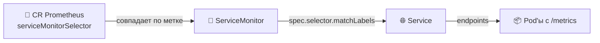

# Лабораторная работа 16 — Мониторинг Kubernetes и init-контейнеры


> **Цель:** заменить вручную отредактированный `prometheus.yml` из лабораторной 8 на управляемый оператором **kube-prometheus-stack**, затем научить `kubectl` запускать ваши pod'ы *в правильном порядке* с помощью **init-контейнеров** (и узнать, как `restartPolicy: Always` превращает тот же примитив в sidecar).
> **Результат сдачи:** PR из ветки `lab16`, добавляющий `monitoring-values.yaml`, `k8s/servicemonitor-app-python.yaml` (бонус), `k8s/init-demo.yaml` и `k8s/MONITORING.md`.

---

## Обзор

В лабораторной 8 вы запускали один контейнер `prom/prometheus` в Docker Compose с написанным вручную блоком `scrape_configs`. В Kubernetes pod'ы приходят и уходят, IP меняются, и вы не можете заново редактировать `prometheus.yml` каждый раз, когда планировщик перепланирует pod. **Prometheus Operator** решает это, наблюдая за CRD **`ServiceMonitor`** / **`PodMonitor`** и перегенерируя конфигурацию Prometheus при их изменении — ровно та философия GitOps, которую вы применяли к приложениям в лабораторных 13–14, теперь применённая к **конфигурации сбора метрик**.

Вы:

- Установите Helm-чарт **kube-prometheus-stack** (оператор + Prometheus + Alertmanager + Grafana + kube-state-metrics + node-exporter — сколько именно, выбираете вы).
- Напишете **ServiceMonitor с нуля** для вашего сервиса `app-python`. Стандартные селекторы чарта требуют, чтобы он нёс метку `release:` — в этом весь **паттерн двухуровневого селектора**, вокруг которого построен оператор.
- Используете **init-контейнеры**, чтобы делать работу *до* запуска основного контейнера (скачать файл в общий `emptyDir`, затем доказать, что основной контейнер его читает).
- Увидите, как тот же примитив превращается в **sidecar** переключением одного поля — `restartPolicy: Always` у init-контейнера, GA в Kubernetes 1.33.

> ⚠️ **Область применения:** без написания CRD AlertmanagerConfig, без recording rules как кода, без полного SLO-стека. Это появится в элективе «Введение в SRE». Сегодняшний урок — *обнаружение целей сбора через оператор* и *примитивы порядка запуска pod'ов*.

**Что вы будете практиковать:**

- CRD Prometheus Operator (`Prometheus`, `ServiceMonitor`, `PodMonitor`, `PrometheusRule`) и то, как оператор согласовывает их в конфигурацию сбора
- **Паттерн двухуровневого селектора** (Prometheus выбирает ServiceMonitor по метке → ServiceMonitor выбирает Service по метке → Service выбирает pod'ы)
- Переопределения values в Helm 4 для самоуверенного апстрим-чарта (lean vs full установка)
- Init-контейнеры как Kubernetes-нативное решение для «ждать зависимость» / «получить конфиг» / «выполнить миграцию»
- Sidecar-контейнеры — init-контейнеры с `restartPolicy: Always`, GA с 1.33

> 📚 В паре с **лекцией 8 — Метрики и мониторинг с Prometheus** (модель сбора и PromQL) и **лекцией 15 — StatefulSets** (где паттерн sidecar введён на границе GA). Перечитайте слайд лекции 8 о превью лабораторной 16 и слайд лекции 15 о sidecar-контейнерах, прежде чем начать.

---

## Состояние проекта

**У вас должно быть из предыдущих лабораторных:**

- Кластер k3d на Kubernetes 1.36 (лабораторная 9).
- Ваш Helm-чарт `lab10-app` из лабораторных 10–13, развёртывающий `app-python` (ваш код, порт **8080**, `/metrics` из лабораторной 8), плюс служебные сервисы курса `echo` (`ghcr.io/inno-devops-labs/echo:v1`, порт 8081) и `health` (`ghcr.io/inno-devops-labs/health:v1`, порт 8082). Все три предоставляют `GET /metrics` в текстовом формате Prometheus. На протяжении этой лабораторной «app-python» означает концептуальный *сервис* (приложение на Python, которое вы написали); фактическое имя K8s Service из вашего чарта будет `lab10-app-web` (fullname чарта `lab10-app` + суффикс компонента `-web`, как в лабораторной 10). Ваш ServiceMonitor будет выбирать по **метке** `app.kubernetes.io/name=lab10-app`, которая не зависит от имени Service и helper'ов.
- `kubectl`, `helm` v4.1.x, работающий `port-forward`.

**Эта лабораторная добавляет:**

- `monitoring-values.yaml` — переопределения Helm values для чарта (версия чарта зафиксирована, оставляемые компоненты, ресурсы/срок хранения)
- `k8s/servicemonitor-app-python.yaml` — ваш собственный ServiceMonitor (бонус, но, вероятно, вы напишете его в задаче 2)
- `k8s/init-demo.yaml` — один Pod, показывающий и паттерн init, и вариант sidecar
- `k8s/MONITORING.md` — ваш отчёт о сдаче

> 📦 **Напоминание о служебных компонентах курса:** `app-python` — **ваше** приложение. `echo` и `health` предсобраны, вы их никогда не собираете, и все три предоставляют `/metrics`. Весь смысл задачи 2 / бонуса в том, что вы *пишете ServiceMonitor* — вы не редактируете никакие файлы конфигурации Prometheus.

---

## Подготовка

```bash
helm version              # v4.1.x — как в лабораторной 10
helm repo add prometheus-community https://prometheus-community.github.io/helm-charts
helm repo update
kubectl get nodes         # ваш кластер k3d из лабораторной 9 должен быть запущен
kubectl create namespace monitoring
```

Найдите актуальную версию чарта (не плавайте на `latest` — фиксируйте её):

```bash
helm search repo prometheus-community/kube-prometheus-stack --versions | head
# На май 2026 чарт находится в ветке ~85.x. Фиксируйте ту версию, что актуальна на момент выполнения лабораторной.
```

Далее вы напишете `monitoring-values.yaml`; **не** устанавливайте чарт со значениями по умолчанию — по умолчанию запускается полный стек (alertmanager + node-exporter + kube-state-metrics + push gateway), который может не поместиться в ноутбучный кластер.

---

## Задача 1 — Разверните kube-prometheus-stack (2 балла)

**Цель:** установить стек мониторинга на основе оператора. Оценивается навык **выбрать версию чарта, выбрать, какие компоненты оставить, и написать values, расширяющие обнаружение ServiceMonitor** — а *не* копирование нашей команды установки.

### 1.1 — Опишите, что делает каждый компонент

`ВАША ЗАДАЧА`: в `MONITORING.md` опишите роль каждого компонента **своими словами** (по одному предложению — не скопированному из README чарта):

| Компонент | Что он делает в стеке |
|---|---|
| Prometheus Operator | ___ |
| Prometheus (server) | ___ |
| Alertmanager | ___ |
| Grafana | ___ |
| kube-state-metrics | ___ |
| node-exporter | ___ |

Вы можете решить **отключить** некоторые из них (задача 1.2). Но всё равно опишите все шесть.

### 1.2 — Напишите `monitoring-values.yaml`

У чарта ~85 разных YAML-ручек. Вам нужна лишь горстка — но именно эта горстка и есть урок:

`ВАША ЗАДАЧА`: напишите файл values, задающий **как минимум** четыре блока ниже.

```yaml
# monitoring-values.yaml — ваши переопределения для kube-prometheus-stack

prometheus:
  prometheusSpec:
    # ВАША ЗАДАЧА: расширьте обнаружение ServiceMonitor, чтобы ваш собственный монитор (задача 2 / бонус)
    # находился независимо от пространства имён и меток, которые он несёт.
    # Подсказка: здесь ДВА соседних поля, оба начинаются с
    # serviceMonitorSelector...  и  podMonitorSelector... — прочитайте
    # раздел "Selector Defaults" в README чарта. Почему два? Потому что у оператора
    # РАЗНЫЕ значения по умолчанию, когда поле nil, а когда {} — вот в чём ловушка.
    ___: ___
    ___: ___

    # ВАША ЗАДАЧА: задайте requests + limits ресурсов И срок хранения данных.
    # Подсказки: значения по умолчанию просят ~1Gi памяти, которых у ноутбучного k3d может не быть.
    # Срок хранения — строка ('10d' / '24h') внутри prometheusSpec, а НЕ внутри storage.
    resources: { ___ }
    retention: ___

grafana:
  # ВАША ЗАДАЧА: задайте ТОЛЬКО пароль администратора (лабораторная — никогда не хардкодьте prod-пароль).
  # По умолчанию 'prom-operator'; выберите любой, но опишите его в MONITORING.md.
  adminPassword: ___

# ВАША ЗАДАЧА: выберите профиль и отключите компоненты, которые не оставляете.
# Допустимы два профиля; выберите ОДИН и обоснуйте его в MONITORING.md:
#   - LEAN  — только оператор + Prometheus + Grafana (ноутбучный k3d, без метрик узлов)
#   - FULL  — оператор + Prometheus + Grafana + KSM + node-exporter + alertmanager
# Чтобы отключить компонент, задайте его блок верхнего уровня как { enabled: false }.
# (kube-state-metrics + node-exporter живут под СВОИМИ ключами верхнего уровня в
#  корне чарта, а не под prometheus.* — посмотрите вывод `helm show values`.)
```

> 🧠 **Почему существуют два поля селектора:** чарт зашивает стандартный селектор `release: <release-name>` в CR `Prometheus` оператора. Если оставить `serviceMonitorSelector` *nil*, оператор ведёт себя так, будто вы задали это совпадение метки, — то есть ваш ServiceMonitor нуждается в `labels: { release: monitoring }`, чтобы его подхватили. Установка `serviceMonitorSelectorNilUsesHelmValues: false` говорит оператору: *«если я дал тебе nil, считай это пустым селектором — совпадай со всем»*. Тот же трюк для PodMonitor. Название сбивает с толку, но это каноническая ручка.

### 1.3 — Установите с зафиксированной версией

`ВАША ЗАДАЧА`: напишите команду `helm install`, используя **зафиксированную** версию чарта, пространство имён `monitoring` и `monitoring-values.yaml`:

```bash
helm install ___ prometheus-community/kube-prometheus-stack \
  --namespace ___ --create-namespace \
  --version ___ \
  -f ___
```

После установки убедитесь, что *каждый* pod в `monitoring` достигает `Running`/`Ready` и CRD оператора появились. **ВАША ЗАДАЧА** — напишите две команды `kubectl` (одну для списка pod'ов в пространстве имён monitoring, другую для списка только CRD в группе `monitoring.coreos.com`):

```bash
kubectl ___
kubectl ___
# Ожидается (как минимум в выводе CRD): servicemonitors, podmonitors,
# prometheuses, alertmanagers, prometheusrules, probes, scrapeconfigs.
```

Если pod в состоянии `Pending`, это почти всегда ресурсы — перенастройте блок `resources:` или отключите более тяжёлые компоненты.

### 1.4 — Подтверждение работы

Вставьте в `MONITORING.md`:

- Зафиксированная версия чарта (например, `85.10.1`) и выбранный профиль (lean / full) с обоснованием одним предложением
- Ваша таблица шести компонентов из 1.1
- `kubectl get pods -n monitoring`, показывающий каждый выбранный pod `Running`/`Ready`
- `kubectl get crd | grep monitoring.coreos.com`, показывающий CRD оператора
- `kubectl get prometheus -n monitoring -o jsonpath='{.items[0].spec.serviceMonitorSelector}'` — доказывает, что селектор равен `{}` (т.е. совпадает со всем), а не стандартному совпадению `release: <release-name>`

---

## Задача 2 — Изучите Grafana и проверьте цели сбора (3 балла)

**Цель:** использовать поставляемые dashboard'ы и UI Prometheus, чтобы читать состояние *вашего* кластера, и написать ServiceMonitor, который подключает ваше приложение к конфигурации сбора, управляемой оператором. **Здесь паттерн оператора оправдывает себя.**

### 2.1 — Получите доступ к UI

`ВАША ЗАДАЧА`: найдите имена ваших Service (`kubectl get svc -n monitoring`) и напишите три команды `port-forward` — Grafana на `3000:80`, Prometheus на `9090:9090`, Alertmanager на `9093:9093` (только если вы его оставили). Чарт добавляет к каждому Service префикс с именем вашего релиза; если ваш релиз был `kps`, сервис Grafana — `kps-grafana` и т.д.

```bash
kubectl port-forward svc/___ -n monitoring 3000:___
kubectl port-forward svc/___ -n monitoring 9090:___
# (Alertmanager только если вы оставили его включённым в задаче 1.2)
kubectl port-forward svc/___ -n monitoring 9093:___
```

### 2.2 — Прочитайте кластер с помощью поставляемых dashboard'ов

Ответьте на каждый вопрос ниже скриншотом и **однострочным прочтением**. Значения на вашем кластере будут отличаться; вопрос в том, что график *означает*, а не в его числе.

1. **Ресурсы узла (метод USE):** загрузка CPU узла и использованная память. *Dashboard: "Node Exporter / Nodes"* — если вы выбрали lean и отключили node-exporter, замените на *"Kubernetes / Compute Resources / Cluster"* и объясните замену.
2. **Вычисления в пространстве имён:** какие pod'ы в `<your-app-ns>` используют больше/меньше всего CPU и памяти? *Dashboard: "Kubernetes / Compute Resources / Namespace (Pods)".*
3. **Детали по pod'у:** CPU throttling и memory working-set для одного pod'а `app-python`. *Dashboard: "Kubernetes / Compute Resources / Pod".*
4. **Состояние кластера (kube-state-metrics):** число pod'ов по фазам — напишите `sum by (phase) (kube_pod_status_phase)`, если оставили KSM; если нет, объясните, почему этот запрос не даёт результата при lean-установке.
5. **Алерты:** сколько алертов срабатывает? (Свежий кластер kube-prometheus-stack запускает всегда срабатывающий алерт `Watchdog` — объясните одним предложением, *для чего* нужен `Watchdog`.)

### 2.3 — Напишите ServiceMonitor для `app-python` (в этом урок)

Весь смысл оператора в том, что **вы больше никогда не редактируете файл конфигурации Prometheus**. Вы пишете `ServiceMonitor`, а оператор пишет блок сбора за вас. Паттерн двухуровневого селектора:



Три метки, три совпадения, в таком порядке. Сломайте любое — и цель незаметно не появится.

`ВАША ЗАДАЧА`: напишите `k8s/servicemonitor-app-python.yaml` с нуля. Форма дана, **поля, которые И ЕСТЬ навык**, пусты.

```yaml
apiVersion: monitoring.coreos.com/v1
kind: ServiceMonitor
metadata:
  name: app-python
  # ВАША ЗАДАЧА: какое пространство имён? Два допустимых ответа:
  #   - пространство имён вашего приложения (тогда в monitoring-values.yaml ДОЛЖНО быть
  #     serviceMonitorSelectorNilUsesHelmValues: false из задачи 1)
  #   - пространство имён monitoring (тогда добавьте ниже соседний 'namespaceSelector',
  #     указывающий на пространство имён приложения — Service находится в другом пространстве имён)
  # Выберите одно, опишите выбор в MONITORING.md.
  namespace: ___
  labels:
    # ВАША ЗАДАЧА: как минимум метка-дискриминатор релиза чарта, чтобы
    # селектор оператора ПО УМОЛЧАНИЮ тоже его подхватил. (На всякий случай:
    # работает, даже если serviceMonitorSelectorNilUsesHelmValues из задачи 1 регрессирует.)
    # Если ваш релиз был `monitoring`, пара ключ/значение метки — ...
    ___: ___
spec:
  # Уровень 2: ServiceMonitor → Service. Совпадение с Service по его меткам.
  selector:
    matchLabels:
      # ВАША ЗАДАЧА: метка, однозначно идентифицирующая ваш Service app-python.
      # Подсказка: ваши helper'ы из лабораторной 10 выводят  app.kubernetes.io/name=<chart-name>
      ___: ___
  # НЕОБЯЗАТЕЛЬНО — нужно только если этот ServiceMonitor живёт в ДРУГОМ пространстве имён,
  # чем Service, который он выбирает. Поведение по умолчанию — "только то же пространство имён".
  # namespaceSelector:
  #   matchNames: [<your-app-ns>]
  endpoints:
    # ВАША ЗАДАЧА: какой порт Service собирать, какой путь, как часто.
    # КРИТИЧНО: 'port' — это ИМЯ порта Service (строка), а не число.
    # У вашего Service app-python УЖЕ ДОЛЖЕН быть именованный порт — проверьте
    # service.yaml из лабораторной 10. Если нет, добавьте его и сначала выполните `helm upgrade`.
    - port: ___
      path: ___
      interval: ___
```

После применения проверьте из CLI (сначала сделайте port-forward к Prometheus). Скелет:

```bash
kubectl apply -f k8s/servicemonitor-app-python.yaml
# Подождите ~30s, пока оператор согласует, затем:
kubectl get servicemonitor -A          # ваш должен появиться

# ВАША ЗАДАЧА: пропустите /api/v1/targets Prometheus через jq, чтобы извлечь ТОЛЬКО вашу
# цель app-python, показав её health + время последнего сбора + URL. Фильтр:
#   .data.activeTargets[] | select(.labels.job == "<your-job-name>") | {health, lastScrape, scrapeUrl}
curl -s localhost:9090/api/v1/targets | jq '___'
```

> ⚠️ **Если ваша цель не появляется**, по порядку: (1) `kubectl describe prometheus -n monitoring <release>-kube-prometheus-prometheus` и поищите ваш ServiceMonitor в Status (оператор скажет, почему пропустил вас); (2) `kubectl get svc <app-python> -o yaml | grep -A3 ports:` — порт **именованный**? (3) точно ли `spec.selector.matchLabels` вашего ServiceMonitor совпадает с меткой на Service? (4) включает ли metadata.labels ServiceMonitor `release: <release>` *или* вы отключили этот селектор в задаче 1? Пропустить шаг 4 можно, только если вы сделали `nilUsesHelmValues: false` из задачи 1.

### 2.4 — PromQL на живом кластере

Как только ваши три сервиса собираются (`app-python` через ваш ServiceMonitor, `echo` + `health` через отдельные мониторы, написанные так же, — *или* через стандартное обнаружение сервисов оператором, если они несут нужные метки), те же запросы RED/USE из лабораторной 8 работают на более интересных данных:

`ВАША ЗАДАЧА`: напишите **три** запроса PromQL в `MONITORING.md` с однострочным прочтением каждого. Форма каждого дана — заполните тело. Не переиспользуйте лабораторную 8 дословно; форма данных изменилась (больше меток, k8s-нативные метки `job=`, селекторы namespace/pod).

```promql
# 1) "Все ли три моих сервиса собираются прямо сейчас?"
#    ВАША ЗАДАЧА: один запрос, возвращающий 1 на каждую UP-цель, отфильтрованный до ваших трёх job.
#    Подсказка: метрика — `up`; фильтруйте через {job=~"<regex>"}, чтобы совпасть с a|b|c.
___

# 2) RED — частота запросов на сервис за 5-минутное окно.
#    ВАША ЗАДАЧА: агрегируйте счётчик на каждый pod в rate на каждый сервис.
#    Подсказка: rate() от Counter, просуммированный по `job` (ServiceMonitor в k8s задаёт job=<SM-name>).
sum by (___) (rate(___[5m]))

# 3) USE — выберите ОДНО: уровень узла, если оставили node-exporter,
#    ИЛИ насыщение CPU на уровне кластера, если выбрали lean (используйте kube-state-metrics).
#    ВАША ЗАДАЧА: напишите запрос, который вы бы вывели на график dashboard'а SRE on-call.
___
```

### 2.5 — Подтверждение работы

Вставьте в `MONITORING.md`:

- Ваш `servicemonitor-app-python.yaml` (полное содержимое)
- Скриншот Prometheus → Status → Targets с `app-python` `UP`
- Вывод `kubectl get servicemonitor -A` (ваш появляется в списке)
- Три запроса PromQL + однострочные прочтения
- Пять ответов по dashboard'ам из 2.2 со скриншотами
- Однострочное объяснение алерта `Watchdog`

---

## Задача 3 — Init-контейнеры и sidecar'ы (3 балла)

**Цель:** использовать init-контейнеры для подготовительной работы *до* запуска основного контейнера, затем превратить тот же примитив в sidecar переключением одного поля.

> 📚 **Init-контейнеры** выполняются последовательно, каждый должен завершиться с `0` до следующего, и **все** init-контейнеры должны успешно завершиться до запуска контейнера приложения. Именно так вы ждёте зависимость, получаете конфиг или выполняете миграцию, *не* зашивая эту логику в образ приложения. **Sidecar** — это `restartPolicy: Always` у init-контейнера, GA с Kubernetes 1.33. Тот же список, другая семантика: init-контейнер *выполняется до завершения*; sidecar *продолжает работать* рядом с основным контейнером и снимается вместе с ним.

### 3.1 — Init-контейнер: скачать, затем отдать

`ВАША ЗАДАЧА`: в `k8s/init-demo.yaml` напишите один `kind: Pod`, доказывающий, что init-контейнер выполнился до завершения *до* запуска основного контейнера, а основной контейнер *потребляет* то, что записал init-контейнер.

Поток данных таков:

```
init-контейнер → записывает /work/index.html → том emptyDir → основной контейнер читает /usr/share/nginx/html/index.html
```

Форма дана; строки, которые И ЕСТЬ навык, пусты.

```yaml
apiVersion: v1
kind: Pod
metadata:
  name: initdemo
  labels: { app: initdemo }
spec:
  initContainers:
    - name: fetch-content
      # ВАША ЗАДАЧА: выберите крошечный образ с shell + echo или wget.
      # Подсказки: busybox:1.37, alpine:3.21. Образ ДОЛЖЕН уметь запускать `sh -c`.
      image: ___
      # ВАША ЗАДАЧА: однострочник shell, заканчивающийся exit 0.
      # Требования:
      #   - записывает НЕПУСТОЙ файл в /work/index.html
      #   - содержимое файла должно содержать строку ('ready', дату, что угодно),
      #     которую вы позже сможете проверить из основного контейнера
      # Подсказка: `sh -c 'echo "ready @ $(date -u +%FT%TZ)" > /work/index.html'`
      command: ['sh', '-c']
      args: ['___']
      volumeMounts:
        # ВАША ЗАДАЧА: смонтируйте общий emptyDir в /work
        - { name: ___, mountPath: ___ }

  containers:
    - name: app
      # ВАША ЗАДАЧА: образ веб-сервера, отдающий файлы из docroot.
      # Подсказка: nginx:1.27-alpine по умолчанию читает /usr/share/nginx/html.
      image: ___
      ports: [{ containerPort: 80 }]
      volumeMounts:
        # ВАША ЗАДАЧА: смонтируйте ТОТ ЖЕ emptyDir в docroot веб-сервера.
        # Init записал /work/index.html — каков путь docroot у nginx?
        - { name: ___, mountPath: ___ }

  volumes:
    - name: workdir
      emptyDir: {}
```

Проверьте — `ВАША ЗАДАЧА` состоит в том, чтобы заполнить две команды `kubectl` и один `curl`:

```bash
kubectl apply -f k8s/init-demo.yaml
kubectl get pod initdemo -w        # смотрите: Init:0/1 → PodInitializing → Running

# ВАША ЗАДАЧА: выведите ТОЛЬКО причину завершения первого init-контейнера
# (должна быть строка 'Completed'). Подсказка: jsonpath к .status.initContainerStatuses[0].
kubectl get pod initdemo -o jsonpath='___'

# ВАША ЗАДАЧА: докажите, что основной контейнер отдаёт файл, который записал init.
# Подсказка: port-forward, затем curl localhost:8080/index.html (или то имя файла,
# которое вы записали в 3.1) — тело ответа должно содержать строку, записанную init.
kubectl port-forward pod/initdemo ___
curl -s localhost:___/___
```

### 3.2 — Sidecar: тот же примитив, другая политика перезапуска

`ВАША ЗАДАЧА`: добавьте **второй** элемент в `initContainers:` того же Pod — но сделайте его *sidecar* (долго работающим, рядом с основным контейнером), установив `restartPolicy: Always` только у этого init-контейнера.

```yaml
spec:
  initContainers:
    - name: fetch-content     # из 3.1 — без изменений, выполняется до завершения
      # ...

    # НОВОЕ: sidecar — долго работающий, НЕ выполняется до завершения.
    - name: log-tail
      image: busybox:1.37
      # ВАША ЗАДАЧА: выберите поле, превращающее это из init → sidecar.
      # Подсказка: живёт на контейнере, допустимые значения 'Always' / 'OnFailure' / 'Never'.
      # GA в K8s 1.33 — ваш k3d 1.36 поддерживает изначально. Переключать feature gate НЕ нужно.
      ___: ___
      command: ['sh', '-c']
      # ВАША ЗАДАЧА: команда, работающая ВЕЧНО (никогда не завершается с 0).
      # Предложено: tail -F /work/index.html — печатает любые новые записи всё время жизни pod'а.
      args: ['___']
      volumeMounts:
        - { name: workdir, mountPath: /work }
```

Элемент sidecar **остаётся в `initContainers:`** — это не опечатка. Kubernetes 1.29 ввёл эту возможность; 1.33 сделал её GA. *Sidecar* — это просто init-контейнер с `restartPolicy: Always`; API не переехал, переехала *семантика*. Проверьте, что оба поведения сосуществуют — `ВАША ЗАДАЧА` написать три команды:

```bash
kubectl apply -f k8s/init-demo.yaml

# ВАША ЗАДАЧА: покажите pod с его числом READY. Когда sidecar поднят рядом
# с основным контейнером, READY должен быть 2/2 — это главное в GA 1.33.
kubectl ___

# ВАША ЗАДАЧА: выведите логи sidecar'а (он должен транслировать бесконечно).
kubectl logs initdemo -c ___

# ВАША ЗАДАЧА: докажите, что ДРУГОЙ init-контейнер (fetch-content) ВСЁ ЕЩЁ выполнился до завершения.
# Подсказка: jsonpath по .status.initContainerStatuses[*], показывающий имя и состояние каждого элемента.
kubectl get pod initdemo -o jsonpath='___'
```

### 3.3 — Выберите правильный примитив

В `MONITORING.md` ответьте (≤2 предложений на каждый), используя **init / sidecar / neither** (ни то ни другое):

1. Дождаться, пока Postgres Service начнёт принимать соединения, прежде чем запустится API.
2. Транслировать `/var/log/app.log` приложения в stdout, чтобы kubelet его подхватил.
3. Выполнять одноразовую миграцию БД при каждом обновлении чарта.
4. Обновлять ключ подписи JWT каждые 10 минут в течение жизни pod'а.

> 💡 Первый — хрестоматийная ловушка: неверный ответ — «init-контейнер с `sleep`, пока не откроется порт» — хрупкий и скрывающий настоящее исправление. Один из четырёх — **не** init *и не* sidecar вовсе — это примитив, который вы писали в лабораторной 10. Объясните, какой и почему.

### 3.4 — Подтверждение работы

Вставьте в `MONITORING.md`:

- Полный `k8s/init-demo.yaml`
- `kubectl get pod initdemo -o jsonpath='{.status.initContainerStatuses[0].state.terminated.reason}'`, показывающий `Completed`
- `curl` к `localhost:8080/index.html`, возвращающий строку, которую записал ваш init
- Снимок `kubectl logs initdemo -c log-tail` (достаточно нескольких строк)
- Ваши ответы на четыре вопроса о выборе примитива

---

## Задача 4 — Документация (2 балла)

`ВАША ЗАДАЧА`: напишите `k8s/MONITORING.md`, освещая по порядку:

1. **Выбор чарта** — зафиксированная версия, профиль lean vs full, таблица шести компонентов
2. **Обнаружение** — ваш `monitoring-values.yaml` (расширение селектора + ресурсы + срок хранения), `kubectl get prometheus -o jsonpath`, доказывающий, что селектор широкий, и объяснение **паттерна двухуровневого селектора** своими словами одним абзацем
3. **ServiceMonitor** — ваш `servicemonitor-app-python.yaml`, скриншот UI Prometheus, запрос `up{...}`
4. **Dashboard'ы** — пять прочтений из задачи 2 со скриншотами, плюс объяснение `Watchdog`
5. **Init + sidecar** — манифест, доказательство `Completed`, curl, логи sidecar'а, четыре ответа о выборе примитива
6. **Трудности и выводы** — как минимум одна настоящая (несовпадение селектора, отсутствующий именованный порт, размеры lean-профиля и т.д.)

> 📸 Скриншоты считаются. «У меня на машине работает» без доказательств даёт ноль за этот пункт.

---

## Бонусная задача — Своя метрика через второй ServiceMonitor (2 балла)

**Цель:** отдать *свою бизнес-метрику* из `app-python` и доказать, что оператор собирает её без дальнейших правок конфигурации — нативная для оператора замена написанному вручную `scrape_config`, который вы использовали в лабораторной 8.

Здесь меньше подсказок.

`ВАША ЗАДАЧА`:

1. **Добавьте бизнес-метрику с ограниченной кардинальностью** в `app-python` с помощью `prometheus_client`. Выберите **тип** метрики и **метки** сами — но **только ограниченные метки**. Пройдёт проверку кардинальности: `Counter` по небольшому перечислению (один из `/`, `/health`, `/info`) или `Gauge` для одного глобального числа. Не пройдёт: всё с `user_id`, `request_id` или неограниченными сегментами пути. **ВАША ЗАДАЧА** — напишите ≤ 10 строк Python и вставьте diff в `MONITORING.md`.
2. **Убедитесь, что у вашего Service `app-python` есть ИМЕНОВАННЫЙ порт** для `/metrics`. Если лабораторная 10 предоставляет только безымянный `port:`, добавьте второй порт — SM совпадает по имени:

   ```yaml
   # Отредактируйте блок ports: в шаблоне templates/service.yaml вашего чарта.
   ports:
     - { name: http, port: ___, targetPort: ___ }      # ВАША ЗАДАЧА: существующий порт приложения
     - { name: ___, port: ___, targetPort: ___ }       # ВАША ЗАДАЧА: ИМЕНОВАННЫЙ порт метрик для SM
                                                     # (нужен только если вы выносите /metrics на
                                                     # другой порт; проще переиспользовать
                                                     # существующий порт `http`, так как приложение отдаёт /metrics
                                                     # на том же слушателе, что и эндпоинты приложения)
   ```

3. **Напишите второй ServiceMonitor (или отредактируйте тот, что из задачи 2)**, чтобы он собирал новый именованный порт. Добавьте блок `relabelings:`, задающий читаемую метку `job`. Форма:

   ```yaml
   spec:
     endpoints:
       - port: ___                       # ВАША ЗАДАЧА: имя из порта Service выше
         path: ___                       # ВАША ЗАДАЧА: где prometheus_client отдаёт метрики
         interval: ___
         relabelings:
           # ВАША ЗАДАЧА: одно переписывание, задающее метке `job` своё значение.
           # Подсказка: action: replace, targetLabel: job, replacement: <your-value>
           - ___
   ```

4. **Проверьте** в UI Prometheus (Status → Targets), что новый эндпоинт `UP`, а метрика доступна для запросов. **ВАША ЗАДАЧА** — вставьте точный запрос PromQL, которым вы выводили свою метрику на график во времени (подсказка: `rate(<your-counter>[5m])` с подходящей агрегацией по меткам).

Вставьте в `MONITORING.md`:

- Python-diff, добавляющий метрику (≤ 10 строк)
- Блок именованного порта вашего Service
- Новый/отредактированный ServiceMonitor
- Скриншот Prometheus → Targets с новым эндпоинтом `UP`
- Скриншот панели Grafana с графиком вашей метрики

> 🧠 **Оператор vs лабораторная 8 (главное):** в лабораторной 8 вы добавляли `- job_name: app` в `prometheus.yml`, перезапускали контейнер и молились. Здесь вы добавляете объект `ServiceMonitor`, и оператор перегенерирует конфигурацию сбора за вас — декларативно, согласованно, переживая смену pod'ов и обновления оператора. Тот же результат, Kubernetes-нативные «трубы».

---

## Как сдавать

```bash
git switch -c lab16
git add monitoring-values.yaml k8s/
git commit -m "feat(lab16): kube-prometheus-stack + ServiceMonitor + init/sidecar demo"
git push -u origin lab16
```

Откройте **два** PR:

- `your-fork:lab16` → `course-repo:master` *(проверяется)*
- `your-fork:lab16` → `your-fork:master` *(сливается в ваш собственный main по завершении)*

Чек-лист PR:

```text
- [ ] Задача 1 — версия чарта зафиксирована, профиль + компоненты описаны, все pod'ы Running, CRD присутствуют
- [ ] Задача 2 — ServiceMonitor написан с нуля, app-python виден в Targets как UP, три запроса PromQL задокументированы, пять ответов по dashboard'ам со скриншотами
- [ ] Задача 3 — Pod initdemo и с init-контейнером (Completed), и с sidecar'ом (Running), четыре ответа о выборе примитива
- [ ] Задача 4 — MONITORING.md со всеми шестью разделами + доказательства
- [ ] Бонус — своя ограниченная метрика + именованный порт + второй ServiceMonitor собирается и выводится на график
```

---

## Критерии приёмки

### Задача 1 — Развёртывание стека (2 балла)
- ✅ **Версия чарта зафиксирована** (не `latest`); установлен в пространство имён `monitoring`
- ✅ Все выбранные pod'ы достигают `Running`/`Ready`; CRD оператора присутствуют (`servicemonitors`, `podmonitors`, `prometheuses`, …)
- ✅ Задано `serviceMonitorSelectorNilUsesHelmValues: false` (или эквивалент), чтобы мониторы обнаруживались по всему кластеру
- ✅ `kubectl get prometheus -o jsonpath='{...serviceMonitorSelector}'` возвращает `{}`
- ✅ Таблица шести компонентов заполнена своими словами

### Задача 2 — Grafana + ServiceMonitor (3 балла)
- ✅ Grafana + Prometheus доступны через port-forward (Alertmanager только если вы его оставили)
- ✅ Пять ответов по dashboard'ам со скриншотами
- ✅ **Ваш собственный** `ServiceMonitor` для `app-python`, написанный с нуля (не скопирован из README чарта)
- ✅ Prometheus → Targets показывает `app-python` `UP`
- ✅ Три запроса PromQL с однострочными прочтениями; `up{job=~"app-python|echo|health"}` = 1 для всех
- ✅ Алерт `Watchdog` объяснён

### Задача 3 — Init + sidecar (3 балла)
- ✅ Init-контейнер записывает непустой файл в общий `emptyDir`; основной контейнер его отдаёт
- ✅ `initContainerStatuses[0].state.terminated.reason` = `Completed`
- ✅ `curl` к основному контейнеру возвращает строку, которую записал init
- ✅ Sidecar (`restartPolicy: Always` у второго init-элемента) `Running` рядом с основным контейнером
- ✅ Четыре ответа о выборе примитива верны

### Задача 4 — Документация (2 балла)
- ✅ `MONITORING.md` освещает все шесть обязательных разделов с доказательствами
- ✅ Версия чарта + `monitoring-values.yaml` записаны
- ✅ Все скриншоты присутствуют и читаемы

### Бонус — Своя метрика (2 балла)
- ✅ Новая бизнес-метрика с ограниченной кардинальностью в `app-python`
- ✅ Service предоставляет **именованный** порт для `/metrics`
- ✅ Новый/отредактированный ServiceMonitor собирает её; она появляется `UP` в Targets
- ✅ Метрика выведена на график в Grafana

---

## Рубрика

| Задача | Баллы | Критерии |
|------|-------:|----------|
| **Задача 1** — Развёртывание стека | **2** | Чарт зафиксирован, компоненты описаны, все pod'ы живы, селектор расширен |
| **Задача 2** — ServiceMonitor + dashboard'ы | **3** | SM написан с нуля, цель UP, вопросы по dashboard'ам отвечены |
| **Задача 3** — Init + sidecar | **3** | Оба паттерна доказаны в одном pod'е, примитивы выбраны верно |
| **Задача 4** — Документация | **2** | `MONITORING.md` заполнен, со скриншотами |
| **Бонус** — Своя метрика | **2** | Своя метрика + именованный порт + SM собирается + график |
| **Итого** | **12** | 10 основных + 2 бонусных |

**Оценивание:**
- **10/10:** стек жив, ServiceMonitor написан чисто, init + sidecar оба доказаны, тщательная документация
- **8–9/10:** мониторинг работает end-to-end; незначительные пробелы в ответах по dashboard'ам или доказательствах init
- **6–7/10:** стек устанавливается, но ServiceMonitor полагается на значения по умолчанию, или отсутствует вариант sidecar
- **<6/10:** стек не жив, сбор не проверен или `init-demo.yaml` отсутствует в репозитории

---

## Ресурсы

<details>
<summary>📚 Документация</summary>

- [Чарт kube-prometheus-stack](https://github.com/prometheus-community/helm-charts/tree/main/charts/kube-prometheus-stack)
- [Prometheus Operator — дизайн](https://prometheus-operator.dev/docs/getting-started/design/)
- [ServiceMonitor & PodMonitor](https://prometheus-operator.dev/docs/developer/getting-started/)
- [Селекторы по умолчанию в чарте](https://github.com/prometheus-community/helm-charts/tree/main/charts/kube-prometheus-stack#prometheusspec)
- [Документация Prometheus 3.x](https://prometheus.io/docs/)
- [Документация Grafana](https://grafana.com/docs/)
- [Init-контейнеры](https://kubernetes.io/docs/concepts/workloads/pods/init-containers/)
- [Sidecar-контейнеры (GA 1.33)](https://kubernetes.io/docs/concepts/workloads/pods/sidecar-containers/)
- [Метод USE (Brendan Gregg)](https://www.brendangregg.com/usemethod.html) · [Метод RED (Tom Wilkie)](https://grafana.com/blog/the-red-method-how-to-instrument-your-services/)

</details>

<details>
<summary>⚠️ Типичные ошибки (из реальных прогонов)</summary>

- **ServiceMonitor в неправильном пространстве имён.** По умолчанию ServiceMonitor выбирает Service только в **своём** пространстве имён. Поместите SM в `monitoring/`, пока Service живёт в пространстве имён приложения, — и ничего не совпадёт. Исправление: либо поместите SM в пространство имён приложения, либо добавьте `spec.namespaceSelector.matchNames: [<app-ns>]` в SM в `monitoring/`.
- **Отсутствует метка `release:` на ServiceMonitor.** Стандартный `serviceMonitorSelector` чарта требует `release: <release-name>` на каждом мониторе. Если вы не задали `serviceMonitorSelectorNilUsesHelmValues: false` И не добавили метку `release:`, оператор незаметно игнорирует ваш SM. `kubectl describe prometheus -n monitoring <release>` показывает, какие мониторы пропущены и почему.
- **Порт Service не именован.** `endpoints.port` в ServiceMonitor — это **ИМЯ** порта Service (строка), а не число. `port: 5000` выглядит допустимо и проходит линт — но оператор не может его разрешить, и ваша цель никогда не появится. Всегда: `ports: [{ name: http, port: 80, targetPort: 5000 }]` и `endpoints: [{ port: http, ... }]`.
- **Конфликт с уже существующими CRD Prometheus.** kube-prometheus-stack поставляет свои самоуверенные CRD. Если вы уже отдельно установили апстрим Prometheus Operator или другой Helm-релиз того же чарта, CRD конфликтуют. Helm 4 откажется устанавливать с ошибкой «resource already exists». Чистое удаление: `helm uninstall <other-release> -n <ns>` И `kubectl delete crd $(kubectl get crd -o name | grep monitoring.coreos.com)` перед повторной установкой.
- **Init-контейнер, ожидающий Service через `sleep N`, — это запашок.** «Ждать базу данных» опросом хрупко (`sleep 5; nc -z db 5432; if [ $? -ne 0 ]; then sleep 10; fi` — работает, пока не перестанет). Kubernetes-нативное исправление: использовать **readiness gate** + sidecar, который переключает гейт, или исправить приложение, чтобы оно повторяло своё подключение к БД при старте. Init-контейнеры должны выполняться *до завершения*, а не *пока* что-то не станет истинным.
- **Sidecar-контейнерам нужен Kubernetes ≥ 1.29 (beta) / 1.33 (GA).** `restartPolicy: Always` у элемента `initContainers[]` — no-op на старых кластерах: контейнер становится обычным init и завершается, когда завершается его команда. В вашем k3d 1.36 есть поддержка GA; проверьте `kubectl version`, если вы нацелены на управляемый кластер старее 1.33.
- **Lean-профиль + dashboard'ы, зависящие от `node-exporter`.** Если вы отключите `nodeExporter` и `kube-state-metrics`, чтобы уместиться в ноутбук, dashboard'ы "Node Exporter / Nodes" и "Kubernetes / Cluster" опустеют. Это ожидаемо, а не баг. Замените на "Kubernetes / Compute Resources / Cluster" (только KSM) или поднимите полный профиль.
- **Watchdog — не ошибка.** kube-prometheus-stack поставляет `PrometheusRule` `Watchdog`, который *всегда срабатывает* — его цель *доказать, что конвейер алертинга работает*. Если `Watchdog` когда-нибудь перестанет срабатывать, ваш мониторинг сломан. Многие проверяющие видят «1 alert firing» в день 0 и паникуют; не надо.

</details>

<details>
<summary>📖 Учебные ресурсы</summary>

- [Документация Prometheus Operator — заметки о дизайне селекторов](https://prometheus-operator.dev/docs/getting-started/design/)
- [Sidecar-контейнеры Kubernetes — блог о GA (1.33)](https://kubernetes.io/blog/2025/04/01/kubernetes-v1-33-sidecar-containers-ga/)
- *Cloud Native Observability with Prometheus* (2023) — Wakeling & Hartmann, Manning — глава о паттерне оператора

</details>

---

## Взгляд вперёд

Теперь вы построили полный жизненный цикл DevOps в Kubernetes: приложение (лабораторные 1–3), контейнеры (лабораторная 2), CI/CD (лабораторные 3–5), конфигурация + логи + метрики (лабораторные 6–8), кластер (лабораторные 9–12), GitOps и прогрессивная доставка (лабораторные 13–14), stateful-нагрузки (лабораторная 15) и управляемый оператором мониторинг кластера (эта лабораторная). Стек наблюдаемости, который вы запускали локально в Compose для лабораторных 7–8, теперь управляется оператором и нативен для Kubernetes — те же метрики, тот же PromQL, обнаруживаемые автоматически через CRD вместо отредактированного вручную файла конфигурации.

**Необязательные элективы (альтернативы экзамену):**

- **Лабораторная 17:** разверните ваш сервис из лабораторной 1 в **Cloudflare Workers** (изоляты V8 на edge)
- **Лабораторная 18:** упакуйте его воспроизводимо с помощью **Nix** flakes

---

**Удачи!** 📊

> **Помните:** с оператором вы объявляете, *что* собирать; платформа решает, *как*. Если вы написали ServiceMonitor вручную и ни разу не тронули `prometheus.yml`, вы усвоили урок.
