# 📌 Лекция 1 — Введение в DevOps: от хаоса к потоку

## 📍 Слайд 1 – 🚀 Добро пожаловать в DevOps

* 🌍 **Программное обеспечение съедает мир** — но выпускать его надёжно сложно
* 😰 Команды страдают от медленных релизов, сломанных развёртываний и поиска виноватых
* 🌉 **DevOps закрывает разрыв** между **созданием** и **эксплуатацией** ПО
* 🎯 Этот курс: практические навыки, чтобы доставлять ПО так, как это на самом деле делают современные команды

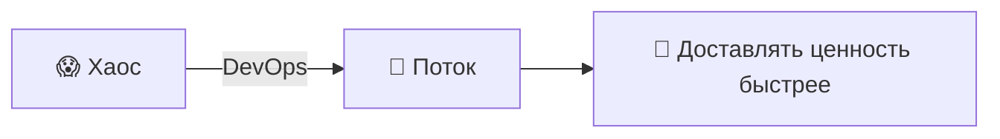

> 📚 **Рамка семестра:** каждая лабораторная в этом курсе восходит к проблеме, которую решает DevOps. Сегодня мы называем проблемы; в течение следующих 16 недель вы сами строите решения.

---

## 📍 Слайд 2 – 🎯 Результаты обучения

* ✅ Определять DevOps и его ключевые принципы (CAMS, Three Ways)
* ✅ Распознавать антипаттерны до-DevOps эпохи в реальных командах
* ✅ Сопоставлять практики DevOps (CI/CD, IaC, наблюдаемость) с проблемами, которые они решают
* ✅ Читать метрики DORA и отличать элитные команды от отстающих
* ✅ Ориентироваться в жизненном цикле DevOps и находить лабораторные этого курса внутри него

**🎓 К концу этой лекции:**

| # | Результат |
|---|---------|
| 1 | 🧠 Определить DevOps своими словами |
| 2 | 🔍 Распознать разрозненность, страх и рутину, с которыми DevOps был призван бороться |
| 3 | 🛠️ Сопоставить каждую практику DevOps с режимом отказа, который она устраняет |
| 4 | 🗺️ Разместить каждую лабораторную курса на жизненном цикле DevOps |

---

## 📍 Слайд 3 – 📜 Краткая история

* 📅 **2009** — Патрик Дебуа организует **DevOpsDays** в Генте, Бельгия. Появляется термин *«DevOps»*.
* 📅 **2009** — Джон Оллспо и Пол Хаммонд представляют *«10+ Deploys per Day»* на Velocity — культурный манифест.
* 📅 **2011** — Вернер Фогельс (CTO Amazon) сообщает, что Amazon развёртывает в продакшен **каждые 11,7 секунды** в пиковые часы.
* 📅 **2013** — **Docker** становится open-source. Контейнеры выходят в мейнстрим.
* 📅 **2014** — **Kubernetes** анонсирован Google. Оркестрация контейнеров набирает обороты.
* 📅 **2016** — Опубликован **The DevOps Handbook** (Ким, Хамбл, Дебуа, Уиллис).
* 📅 **2018** — *Accelerate* Николь Форсгрен публикует четыре метрики DORA.
* 📅 **2024** — DORA *State of DevOps* сообщает о **19% elite + 22% high performers** (41% вместе; последний отчёт с этой таксономией).
* 📅 **2025** — DORA упраздняет лестницу Elite/High/Medium/Low; заменяет её **семью архетипами команд**, сочетающими эффективность доставки с человеческими факторами (выгорание, трение, воспринимаемая ценность).

> 🤔 **Заметьте:** DevOps начался как движение *культуры*, а не как анонс инструмента.

---

## 📍 Слайд 4 – ❓ Большой вопрос

* 📊 **70%+** крупномасштабных IT-проектов испытывают значительные перерасходы по стоимости или срокам (McKinsey)
* ⏱️ Lead time до DevOps от коммита до продакшена: **недели — месяцы**
* 💥 Крупнейший источник сбоев — **изменения**: развёртывания, правки конфигурации, обновления зависимостей

> 💬 *«У меня на машине работает»* — каждый разработчик, когда-либо

**🤔 Обсуждение:**
* Почему доставка ПО так сложна?
* Почему команды боятся развёртываний?
* Как выглядело бы «хорошо» для вашей команды?

---

## 📍 Слайд 5 – 🔥 Раздел 1: Проблема до DevOps

* 👨‍💻 **Разработка** и ⚙️ **эксплуатация** были отдельными командами с противоположными целями
* 🚀 Разработчики хотели: **быстро выпускать функции** (их вознаграждали за скорость)
* 🛡️ Эксплуатация хотела: **держать системы стабильными** (их вознаграждали за uptime)
* 💥 Результат: **структурный конфликт, поиск виноватых и медленная доставка**

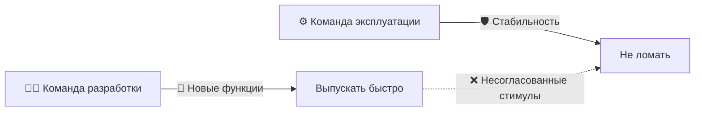

> 📖 *The Phoenix Project* (Ким, Бер, Спаффорд, 2013) драматизирует именно этот конфликт — обязательное чтение для этого курса.

---

## 📍 Слайд 6 – 🧱 Стена непонимания

* 🧱 **Стена** = невидимый барьер между разработкой и эксплуатацией
* 📦 Разработка «перебрасывает код через стену»; эксплуатация получает вину, когда он ломается
* 🔄 Эксплуатация отклоняет изменения, чтобы избежать риска; разработка обходит эксплуатацию

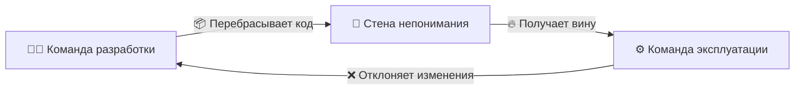

> 🤔 **Подумайте:** в вашем последнем студенческом проекте кто был бы «разработкой», а кто «эксплуатацией»?

---

## 📍 Слайд 7 – 😱 Ад ручных релизов

* 📅 Развёртывания — редкие события (раз в месяц или квартал)
* 🎰 Каждый релиз = **высокий риск, все на ушах**
* 📋 Ручные чек-листы, работа по выходным, никакого плана отката
* 💀 Одна ошибка = часы восстановления, разочарованные пользователи

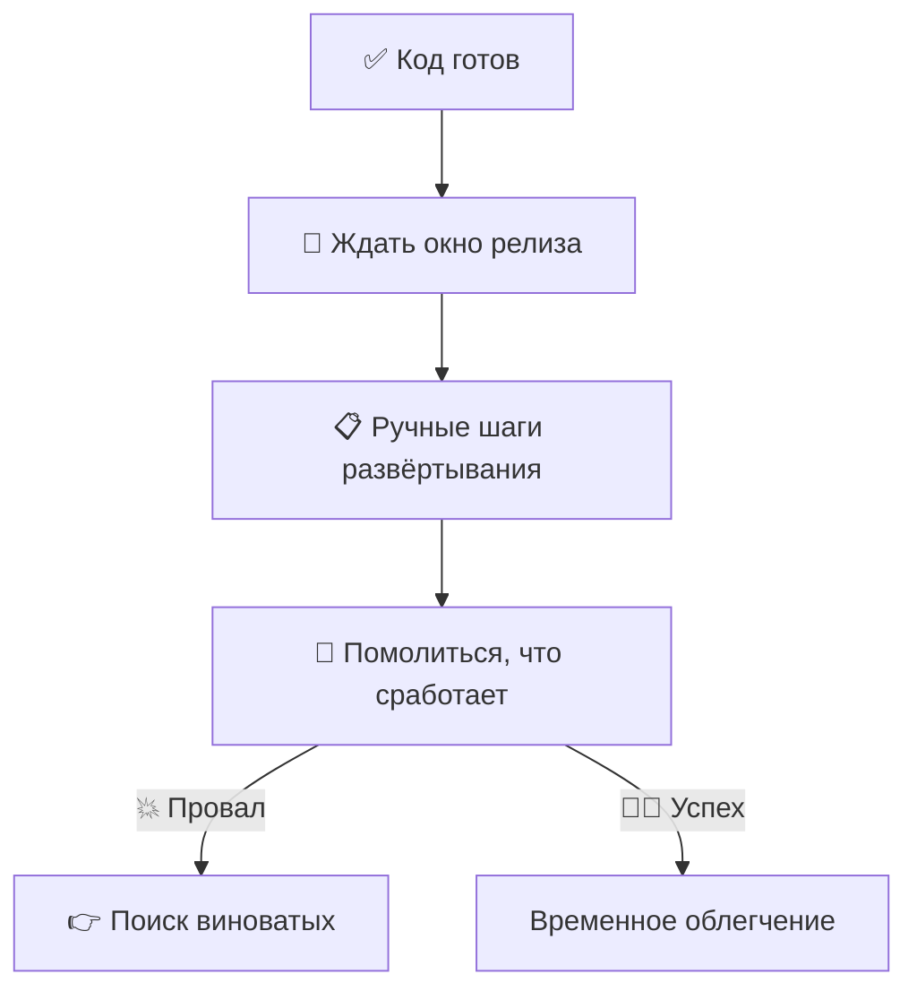

**📊 Цифры до DevOps (Accelerate, 2018):**
* 🐢 Lead time для изменений: **месяцы** (отстающие)
* 📉 Доля неудачных изменений: **40–60%** у отстающих
* ⏱️ Восстановление после инцидента: **неделя и больше**

---

## 📍 Слайд 8 – 😨 Страх и культура вины

* 🌙 Инцидент случается в 2 часа ночи — первый вопрос: *«Кто это сделал?»*
* 🙈 Инженеры скрывают ошибки; никто не развёртывает в пятницу
* 💀 Инновации замерзают; самый безопасный ход — ничего не делать

> ⚠️ **Страх убивает скорость.**

**Симптомы культуры вины:**
* 🔇 Люди боятся выступать на постмортемах
* 📝 Избыточная документация, написанная защищаясь
* 🐌 Медленное принятие решений, эскалации по любому поводу
* 🚪 Высокая текучка среди старших инженеров

> 📖 *«Без безвинных постмортемов организации никогда не учатся на инцидентах»* — Google SRE Book (Бейер и др.)

---

## 📍 Слайд 9 – 💸 Цена хаоса

| 🔥 Проблема | 💥 Последствие |
|------------|-----------|
| 🐢 Медленные релизы | Упущенная рыночная возможность, конкуренты выпускают первыми |
| 📋 Ручные процессы | Человеческие ошибки, выгорание, усталость от on-call |
| 👉 Культура вины | Старшие специалисты уходят, знания утекают |
| 🙈 Нет наблюдаемости | Режим тушения пожаров, MTTR в часах, а не минутах |

**📈 Конкретные примеры:**
* 🏢 **Amazon до DevOps (начало 2000-х):** монолитные развёртывания занимали **недели**
* 🚀 **Amazon сегодня:** ~50 миллионов развёртываний в год по всем сервисам (Вернер Фогельс, re:Invent)
* 💰 **IBM Cost of a Data Breach:** пик **$4,88 млн (2024)**, затем **снижение до $4,44 млн в 2025** по мере того, как обнаружение с помощью ИИ сократило время локализации; **средний показатель в США достиг рекордных $10,22 млн** в 2025

> 🔥 **Горячее мнение:** каждый час простоя за что-то оплачен. Вопрос в том, платите *вы* или *ваши пользователи*.

---

## 📍 Слайд 10 – 💡 Раздел 2: Что такое DevOps на самом деле

* 🤝 **DevOps** = разработка + эксплуатация, работающие как **одна команда**
* 🌱 **Культура** сотрудничества и общей ответственности
* 🔧 Набор **практик** для быстрой и надёжной доставки
* 🚫 НЕ просто инструменты, НЕ должность, НЕ отдельная команда

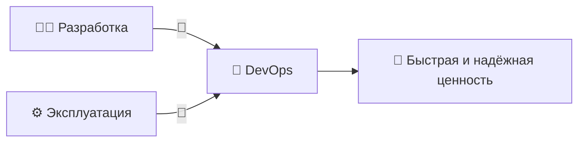

**📖 Рабочее определение (Хамбл и Фарли, *Continuous Delivery*, 2010):**
> DevOps — это набор практик, объединяющих разработку ПО и IT-эксплуатацию, чтобы сократить жизненный цикл разработки, при этом часто доставляя функции, исправления и обновления в тесном согласии с бизнес-целями.

---

## 📍 Слайд 11 – 🚫 Чем DevOps НЕ является

| ❌ Миф | ✅ Реальность |
|---------|-----------|
| «Мы наняли DevOps-инженера, мы готовы» | 👥 Участвуют все |
| «DevOps означает использовать Kubernetes» | 🛠️ Инструменты поддерживают культуру, а не наоборот |
| «DevOps заменяет разработчиков или эксплуатацию» | 🤝 Он их объединяет |
| «DevOps = просто автоматизация» | 🧩 Автоматизация + культура + измерение + обмен |
| «DevOps — это команда» | 🌍 Это способ работы |

> 🔥 **Горячее мнение:** DevOps нельзя купить. Его нужно построить.

---

## 📍 Слайд 12 – 🔄 Три пути

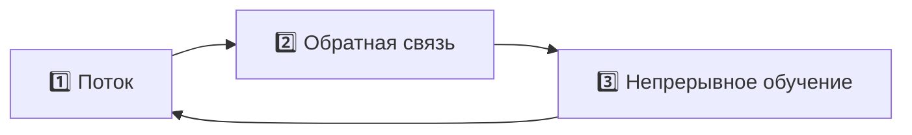

| 🛤️ Путь | 🎯 Фокус | 💡 Практический пример |
|--------|---------|-----------|
| 1️⃣ **Поток** | Быстро из Dev → Prod | 🚀 Конвейеры CI/CD, trunk-based development |
| 2️⃣ **Обратная связь** | Быстро из Prod → Dev | 📊 Мониторинг, алертинг, error budgets |
| 3️⃣ **Непрерывное обучение** | Экспериментировать безопасно | 📝 Безвинные постмортемы, chaos engineering |

> 📚 **Источник:** *The Phoenix Project* и *The DevOps Handbook* (Ким и др.)

---

## 📍 Слайд 13 – 🧩 Модель CAMS

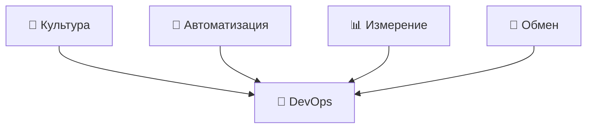

* 🌱 **Культура** — доверие, сотрудничество, общая ответственность
* 🤖 **Автоматизация** — устранение ручной, подверженной ошибкам рутины
* 📊 **Измерение** — отслеживание метрик, решения на основе данных
* 🔗 **Обмен** — знания текут свободно, постмортемы безвинны

> 📖 Введено Дэймоном Эдвардсом и Джоном Уиллисом (2010). Позже Джез Хамбл добавил **L** от *Lean* → **CALMS**.

---

## 📍 Слайд 14 – ⚡ До и после DevOps

| 😰 До | 🚀 После |
|----------|---------|
| 📅 Релизы раз в несколько месяцев | 📆 Релизы ежедневно или ежечасно |
| 📋 Ручные развёртывания | 🤖 Автоматизированные конвейеры под контролем версий |
| 👉 Вина, когда что-то ломается | 📝 Безвинные постмортемы |
| 🙅 «Не моя проблема» | 🤝 Общая ответственность («you build it, you run it») |
| 😨 Страх изменений | 💪 Небольшие обратимые изменения приветствуются |
| 🐌 Часы ручного развёртывания | ⚡ Минуты на развёртывание, секунды на откат |

> 🤔 Какая колонка описывает команду, в которой вы работали?

---

## 📍 Слайд 15 – 🎮 Раздел 3: DevOps как игра

## 🕹️ Симуляция — вы CTO

* 🏢 **FlowStart Inc.** — растущий стартап
* 👥 5 разработчиков, 2 инженера эксплуатации, 10K пользователей
* 📈 Давление от руководства: выпускайте быстрее, но перестаньте всё ломать
* ❓ **Что может пойти не так?**

> 💀 *Всё.*

Давайте пройдём через четыре реальных режима отказа и практику DevOps, которая исправляет каждый. Каждый сценарий соответствует лабораторной, которую вы сделаете в этом семестре.

---

## 📍 Слайд 16 – 💥 Сценарий 1: Провал релиза → CI/CD

**Провал:**
* 📤 Пуш в пятницу в 17:00, без тестов, без ревью, сразу в продакшен
* 💥 Логин сломан, 10K пользователей заблокированы, 4 часа простоя
* 🤷 Никто не знает, что изменилось, потому что никто не может воспроизвести развёртывание

**Исправление — Continuous Integration & Continuous Delivery:**

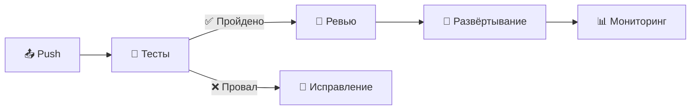

* ✅ Каждое изменение прогоняет автоматические тесты перед слиянием
* ✅ Ревью кода не опционально
* ✅ Развёртывание — одна команда (или один git push)
* ✅ Откат — один клик

> 🔗 **Связь с курсом:** лабораторная 3 строит именно этот конвейер в GitHub Actions.

---

## 📍 Слайд 17 – 🐾 Сценарий 2: Снежинки-серверы → Infrastructure as Code

**Провал:**
* 🖥️ Продакшен-сервер настраивался вручную 2 года инженером эксплуатации, который только что уволился
* 📈 Нужно масштабироваться до 3 серверов — но никто не может воспроизвести конфигурацию
* 😱 «Документация» — в чьей-то голове и в личных сообщениях Slack

> 🐶 **«Питомцы против скота»** — Билл Бейкер, Microsoft (2012). Питомцев выхаживают; скот заменяют.

**Исправление — Infrastructure as Code:**

```hcl
# 🌍 Terraform (1.10+) — декларативная инфраструктура
resource "aws_instance" "web" {
  ami           = "ami-0c55b159cbfafe1f0"
  instance_type = "t3.micro"
  count         = 3  # три одинаковых заменяемых сервера
}
```

* 📝 Инфраструктура живёт в файлах под контролем версий
* 🔄 Серверы воспроизводимы, а не уникальны
* ⚡ Идентичные окружения поднимаются за минуты

> 🔗 **Связь с курсом:** лабораторные 4 (Terraform + Pulumi) и 5–6 (Ansible) строят этот навык.

---

## 📍 Слайд 18 – 🔓 Сценарий 3: Утечка секрета → управление секретами

**Провал:**
* 👨‍💻 Разработчик коммитит `database.password = "hunter2"` в публичный репозиторий
* 🤖 Сканирующие боты находят это **менее чем за 5 минут** (подтверждено отчётами GitGuardian)
* 💥 Злоумышленники похищают базу данных

**Исправление — управление секретами:**

```yaml
# ❌ Плохо — секрет в исходниках
DATABASE_PASSWORD: "super_secret_123"

# ✅ Хорошо — ссылка, а не значение
DATABASE_PASSWORD: ${vault:secret/db/password}
```

* 🚫 Никогда не храните секреты в коде или незашифрованной конфигурации
* 🔐 Используйте менеджер секретов: HashiCorp Vault, OpenBao, AWS Secrets Manager, GCP Secret Manager
* 🔍 Pre-commit хуки ищут секреты (gitleaks, trufflehog)
* 🔄 Автоматически ротируйте учётные данные

> 🔗 **Связь с курсом:** лабораторная 11 интегрирует Kubernetes Secrets с **OpenBao** (open-source форк Vault под лицензией BSL).

---

## 📍 Слайд 19 – 🙈 Сценарий 4: Слепая эксплуатация → наблюдаемость

**Провал:**
* 👥 Пользователи в Twitter: *«Приложение тормозит»*
* 🤷 У команды нет метрик, логов, трассировок
* ⏱️ Часы потрачены на догадки; в конце концов сервер перезапускают от отчаяния

**Исправление — наблюдаемость (три столпа):**

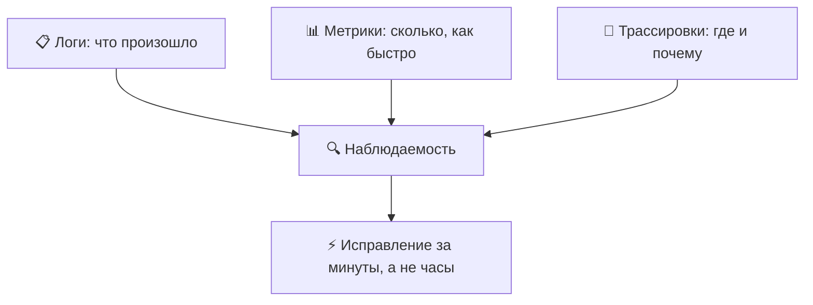

| 📊 Столп | 🛠️ Инструменты, которые вы будете использовать в этом курсе |
|-----------|---------------------------------|
| 📋 Логи | Loki + Promtail (лабораторная 7) |
| 📊 Метрики | Prometheus + Grafana (лабораторная 8, лабораторная 16) |
| 🔗 Трассировки | Вне рамок Core — рассматриваются в SRE-Intro |

> 🔗 **Связь с курсом:** лабораторные 7, 8 и 16 строят полный стек наблюдаемости с нуля.

---

## 📍 Слайд 20 – ♾️ Раздел 4: Жизненный цикл DevOps

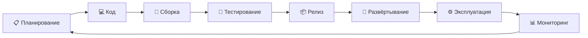

* ♾️ DevOps **непрерывен** — «готово» не существует
* 🔄 Каждый этап питает следующий; мониторинг информирует следующее планирование
* 🔁 Бесконечное улучшение — в цикле весь смысл

---

## 📍 Слайд 21 – 🔁 Этапы жизненного цикла → инструменты (базовая линия май 2026)

| 📍 Этап | 🎯 Деятельность | 🛠️ Представительные инструменты |
|----------|------------|-------------------------|
| 📋 Планирование | Требования, проектирование | Jira, Linear, GitHub Issues |
| 💻 Код | Написание и ревью | Git, GitHub, VS Code, JetBrains |
| 🔨 Сборка | Компиляция, упаковка | Docker **29.x**, Buildah, Maven, npm |
| 🧪 Тестирование | Автоматизированное тестирование | pytest 8.3, Jest 30, Playwright, k6 |
| 📦 Релиз | Версионирование, утверждение | GitHub Releases, Conventional Commits |
| 🚀 Развёртывание | Пуш в окружение | **ArgoCD 3.4**, **Argo Rollouts 1.8**, **Helm 4.1** |
| ⚙️ Эксплуатация | Запуск, масштабирование | **Kubernetes 1.36** «Haru», **Terraform 1.15**, **ansible-core 2.21** |
| 📊 Мониторинг | Наблюдение, алертинг | **Prometheus 3.11+**, Grafana 11, Loki 3.7, **Alloy 1.16** (Promtail EOL март 2026) |

> 🔧 **Примечание о версиях:** каждый инструмент выше закреплён на текущей стабильной версии мая 2026. Лабораторные им соответствуют. *Helm 4 — мажорный релиз — большинство онлайн-руководств всё ещё показывают синтаксис Helm 3; мы намеренно используем 4.*

---

## 📍 Слайд 22 – 🗺️ Карта курса

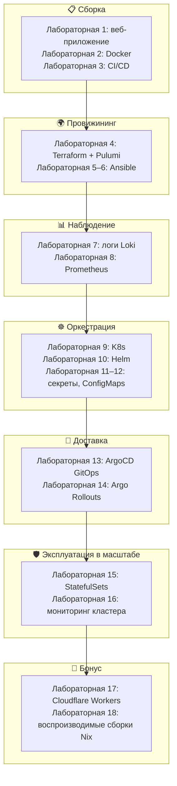

✅ **16 основных лабораторных + 2 бонусные. Каждая соответствует реальному навыку DevOps.**

---

## 📍 Слайд 23 – 📊 Метрики DORA — как мы измеряем DevOps

Команда DORA (Николь Форсгрен и др.) выявила четыре метрики, предсказывающие эффективность доставки ПО. Отчёт DORA *State of DevOps* отслеживает их ежегодно с 2014 года.

| 📊 Метрика | 📏 Что измеряет | 🏆 Elite (2024) | 🐢 Low (2024) |
|-----------|--------------------|--------------|--------------|
| ⏱️ **Lead Time for Changes** | Коммит → продакшен | < 1 часа | > 1 месяца |
| 📦 **Deployment Frequency** | Как часто вы развёртываете | По требованию (несколько раз в день) | < 1/месяц |
| ❌ **Change Failure Rate** | % развёртываний, вызывающих инциденты | 0–5% | 46–60% |
| 🔧 **Failed Deployment Recovery Time** | MTTR после плохого развёртывания | < 1 часа | > 1 месяца |

> 📚 **Источник:** DORA *State of DevOps Report 2024* — последний отчёт, использующий эту четырёхуровневую лестницу. Пятая метрика (reliability) была добавлена в 2021 году. Отчёт 2025 года упразднил лестницу в пользу семи архетипов команд, сочетающих доставку + человеческие факторы — но сами четыре метрики остаются отраслевым стандартом измерения.

**🤔 Вопрос:** какую метрику сложнее всего улучшить и почему?

---

## 📍 Слайд 24 – 🌊 От хаоса к потоку

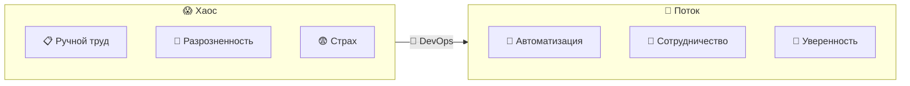

**🎯 Состояние потока (определение Джина Кима):**
* ⚡ Изменения плавно текут от идеи к продакшену
* 🔄 Петли обратной связи быстрые и надёжные
* 📈 Команды непрерывно экспериментируют и улучшаются

---

## 📍 Слайд 25 – 🏢 Раздел 5: DevOps в реальной жизни

**🎬 Netflix** — канонический кейс DevOps
* 🚀 1000+ продакшен-развёртываний в день по всем сервисам
* 🐒 *Chaos Monkey* (open-source с 2012) — намеренно убивает продакшен-инстансы, чтобы проверить устойчивость
* 🔄 Самовосстанавливающаяся инфраструктура; дежурных инженеров редко вызывают

**📦 Amazon**
* ⚡ В среднем каждые 11,7 секунды (Вернер Фогельс, 2011) — до сих пор цитируется как эталон
* 🔧 *«You build it, you run it»* — правило двух пицц Вернера
* 🛠️ Сам AWS был построен, чтобы использовать внутреннюю платформу Amazon

**🔍 Google**
* 🛡️ Изобрёл **Site Reliability Engineering (SRE)** в 2003 году — Бен Трейнор Слосс
* 📊 *Error budgets* балансируют скорость и надёжность
* 📝 Безвинные постмортемы — критерий найма

> 🔗 **Хотите больше?** SRE-Intro (электив) глубоко разбирает плейбук Google.

---

## 📍 Слайд 26 – 👥 Роли DevOps (2025/26)

| 👤 Роль | 🎯 Фокус |
|---------|---------|
| 🔧 **DevOps Engineer** | Конвейеры, автоматизация, infra-as-code |
| 🛡️ **SRE** | Надёжность, SLO, реагирование на инциденты |
| 🏗️ **Platform Engineer** | Внутренняя платформа разработчиков, golden paths |
| ☁️ **Cloud Engineer** | Облачная инфраструктура, оптимизация затрат, FinOps |

**🔗 Общая нить:** сотрудничество, автоматизация, ответственность за продакшен.

> 💼 Platform Engineering — самая быстрорастущая из четырёх (Gartner 2024). Многие компании теперь относятся к *внутренней платформе разработчиков* как к продукту.

---

## 📍 Слайд 27 – 🤝 Командное сотрудничество на практике

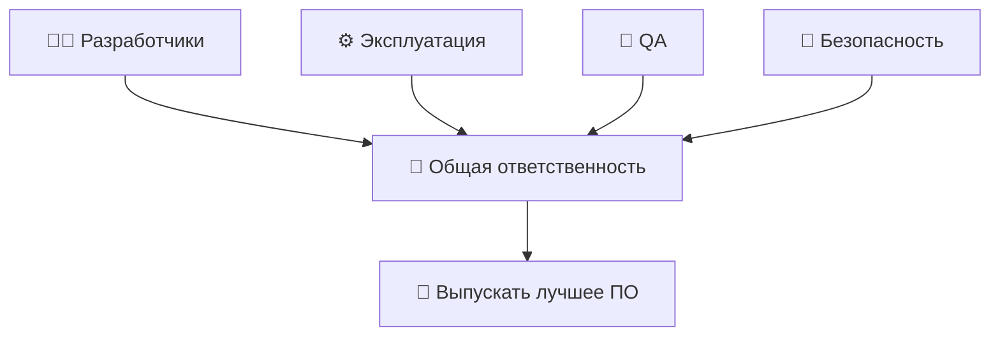

**🤝 Практики, которые вы увидите в здоровых командах:**
* 📟 Общие ротации on-call между разработкой и эксплуатацией
* 📝 Безвинные разборы инцидентов с задачами по действиям
* 👥 Кросс-функциональные команды — feature-команды отвечают от идеи до эксплуатации
* 🔓 Самообслуживаемое развёртывание — каждый инженер может выпускать, с ограничителями

---

## 📍 Слайд 28 – 🎯 Ключевые выводы

1. 🧩 **DevOps = культура + практики + инструменты** — именно в этом порядке
2. 🧱 **Разрушайте разрозненность** между разработкой и эксплуатацией
3. 🤖 **Автоматизируйте всё** повторяемое
4. 📊 **Измеряйте с DORA** — lead time, частота развёртываний, доля неудачных изменений, MTTR
5. 📝 **Учитесь на ошибках**, не назначайте виноватых
6. 🔄 **Малые изменения, быстрая обратная связь** — самый безопасный путь в продакшен

> 💡 DevOps — не пункт назначения. Это направление.

---

## 📍 Слайд 29 – 🧠 Смена мышления

| 😰 Старое мышление | 🚀 Мышление DevOps |
|---------------|------------------|
| 🙅 «Не моя работа» | 🤝 «Наша ответственность» |
| 🚫 «Не трогай прод» | 💪 «Развёртывай уверенно, откатывайся быстро» |
| 👉 «Кто это сломал?» | 🔍 «Как предотвратить этот класс отказов?» |
| 😨 «Изменения рискованны» | ✅ «Малые частые изменения безопаснее редких крупных» |
| 💻 «Работает на моей машине» | 🌍 «Работает в любом окружении — доказано конвейером» |

> ❓ Какое мышление описывает команду, в которой вы хотели бы работать?

---

## 📍 Слайд 30 – 🚀 Что дальше

**📚 Следующая лекция: *Контейнеризация с Docker*** — упакуйте приложение так, чтобы «работает на моей машине» наконец означало «работает везде».

* 🐳 Почему контейнеры победили (и где они не подходят)
* 🔧 Написание production-ready Dockerfile
* 🛡️ Rootless, distroless, многоэтапные сборки
* 🌐 Рабочий процесс Docker Hub

**🔬 Ваша работа в лабораторной 1:** соберите Python-веб-сервис, предоставляющий `/` и `/health`. Этот сервис будет вашим проектом до конца семестра — к лабораторной 16 он будет работать на Kubernetes с GitOps, мониторингом, секретами и хранилищем на основе StatefulSet.

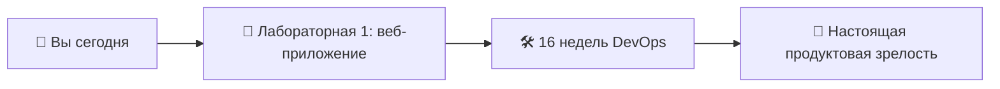

**👋 До встречи на лекции 2.**

> 🌊 От хаоса к потоку — по одному коммиту за раз.

---

## 📚 Ресурсы и дополнительное чтение

**📕 Книги — прочитайте хотя бы одну в этом семестре:**
* *The Phoenix Project* — Джин Ким, Кевин Бер, Джордж Спаффорд (2013). Роман, который привёл DevOps в мейнстрим IT.
* *The DevOps Handbook* (2-е изд.) — Ким, Хамбл, Дебуа, Уиллис (2021). Справочное руководство.
* *Accelerate* — Форсгрен, Хамбл, Ким (2018). Наука, стоящая за метриками DORA.
* *Site Reliability Engineering* — Бейер, Джонс, Петофф, Мёрфи (2016). Бесплатно на sre.google/books.

**🔗 Ссылки:**
* 🌐 [Отчёты DORA State of DevOps](https://dora.dev/research/) — ежегодные исследования, бесплатно
* 🌐 [12 Factor App](https://12factor.net) — основополагающие принципы Heroku
* 🌐 [CNCF Cloud Native Landscape](https://landscape.cncf.io) — вселенная инструментов

**🎓 Квиз:** квиз после лекции идёт в зачёт таблицы лидеров недель 1–3 (см. `README.md` → Grading).
