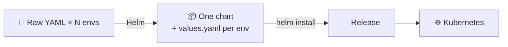
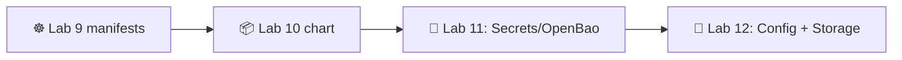

# 📌 Лекция 10 — Управление пакетами Helm: шаблонизация Kubernetes

## 📍 Слайд 1 – 📦 Добро пожаловать в Helm

* 🌍 **Лекция 9 оставила вас с сырым YAML** — Deployment + Service на каждую среду, скопированные и отредактированные вручную. Это масштабируется примерно до двух сред, прежде чем начнёт кусаться.
* 📦 **Helm** = менеджер пакетов для Kubernetes. Он упаковывает ваши манифесты в **chart**, параметризует их **values** и отслеживает установки как **релизы**.
* 🎯 Эта лекция: написать chart, чисто его шаблонизировать и прокатить один и тот же chart через dev/stage/prod, меняя один файл values на каждую среду.
* 🔗 **Связь с лабораторной 10:** преобразуйте ваши манифесты из лабораторной 9 в Helm chart, поддержите 3 среды через values, добавьте хуки pre/post-install, отправьте chart в GHCR как OCI-артефакт.



---

## 📍 Слайд 2 – 🎯 Результаты обучения

| # | Результат |
|---|---------|
| 1 | 🧱 Читать и писать структуру chart'а Helm 4: `Chart.yaml`, `values.yaml`, `templates/`, `_helpers.tpl`, `charts/` |
| 2 | 🎨 Использовать шаблоны Go + функции Sprig, именованные шаблоны, `tpl`, `include` |
| 3 | 🚦 Управлять релизами с помощью `install / upgrade / rollback / uninstall / template / lint / test` |
| 4 | 🌳 Компоновать chart'ы с зависимостями и library chart'ами |
| 5 | 🪝 Использовать хуки для логики pre-install / post-upgrade / pre-delete |
| 6 | 🌐 Отправлять и забирать chart'ы через OCI-реестр (GHCR) |

**Технологический стек, зафиксированный на май 2026:** **Helm 4.1.4** (выпущен 8 апреля 2026). Helm 3 находится в режиме поддержки до 8 июля 2026 (исправления ошибок) / 11 ноября 2026 (только безопасность). Новая работа использует Helm 4.

---

## 📍 Слайд 3 – ❓ Зачем существует Helm

Вы написали три манифеста в лабораторной 9 (Deployment, Service, ConfigMap). Теперь представьте:
* 🌳 Три среды — dev, staging, prod — каждой нужны разные количества реплик, теги образов, лимиты ресурсов
* 🔁 Двенадцать сервисов — одинаковая форма, разные имена

**Без Helm:** копируйте-и-правьте YAML, глазами сравнивайте diffs, надейтесь, что ни одна среда не разъедется. Терпит крах уже на 4-м сервисе.

**С Helm:** *один* набор шаблонов, *один* `values.yaml` на среду, одна команда на установку. Шаблоны рендерятся в YAML; Helm проталкивает их через `kubectl apply`.

> 🔥 **Смелое утверждение:** Helm — не единственный инструмент шаблонизации K8s (Kustomize, Jsonnet, cdk8s, Carvel ytt). Он самый популярный примерно в 5 раз, потому что chart'ы — это *разделяемые артефакты* — `helm pull oci://…` и у вас есть чужой рабочий стек.

---

## 📍 Слайд 4 – 📜 Эволюция Helm: 1 → 2 → 3 → 4

* 📅 **2015** — Helm 1 создан Deis (приобретён Microsoft в 2017). Только клиентская шаблонизация.
* 📅 **2016** — Helm 2 вводит **Tiller** — внутрикластерный серверный компонент. Любим за мощь, ненавидим за RBAC на весь кластер.
* 📅 **2019** — Helm 3 **отбрасывает Tiller**, хранит состояние релиза в K8s Secrets/ConfigMaps. То, что все используют сегодня по умолчанию.
* 📅 **2022** — OCI-реестры становятся первоклассными для распространения chart'ов (chart'ы отправляются/забираются как Docker-образы).
* 📅 **2026 (8 апреля)** — выпущен Helm **4.1.4**. Обратно совместимый формат chart'а для `apiVersion: v2`; переписанный движок + лучшее разрешение зависимостей + поддержка плагинов WASM.

> 📝 **История миграции:** большинство chart'ов Helm 3 работают без изменений на Helm 4. CLI Helm 3 всё ещё доступен; ожидайте оба в компаниях до середины 2026. Лабораторные в этом курсе используют Helm 4.

---

## 📍 Слайд 5 – 🧱 Анатомия chart'а

Chart — это каталог такой формы:

```
mychart/
├── Chart.yaml          # 📇 Metadata: name, version, appVersion, dependencies
├── values.yaml         # 🎚️ Default values (overridable per install)
├── values.schema.json  # 📐 (Optional) JSON schema for values validation
├── templates/
│   ├── deployment.yaml
│   ├── service.yaml
│   ├── ingress.yaml
│   ├── configmap.yaml
│   ├── _helpers.tpl    # 🛠️ Named template definitions (no underscore = file is rendered)
│   ├── NOTES.txt       # 📋 Printed after install/upgrade
│   └── tests/
│       └── test-connection.yaml
├── charts/             # 📦 Subcharts (dependencies)
└── README.md
```

Ключевые правила:
* 📁 Файлы, начинающиеся с `_`, — это **partials** — включаются через `{{ include ... }}`, никогда не рендерятся как самостоятельный YAML
* 🧪 Файлы в `templates/tests/` выполняются только при `helm test <release>`
* 🔒 Всё под `charts/` — это вендоренный subchart (управляется через `helm dependency update`)

---

## 📍 Слайд 6 – 📇 Chart.yaml

```yaml
apiVersion: v2                # ⚠️ Helm 3+; Helm 4 reads v2; v1 is Helm 2 (deprecated)
name: lab10-app
description: DevOps Core lab 10 — Python service + Go echo
type: application             # 'application' (default) or 'library'
version: 1.3.0                # 📌 Chart version (SemVer) — bumped on chart changes
appVersion: "1.0.0"           # 📌 App version (string) — bumped on image changes
kubeVersion: ">=1.33.0"       # 🚦 Refuse install on older clusters

dependencies:
  - name: postgresql
    version: 16.x
    repository: oci://registry-1.docker.io/bitnamicharts
    condition: postgresql.enabled
```

* 🎯 **Две версии** имеют значение: `version` (chart, который ВЫ публикуете) и `appVersion` (образ, который он развёртывает). Они развиваются независимо.
* 🔧 Chart'ы с `type: library` предоставляют только шаблоны `_helpers.tpl` — они сами ничего не устанавливают.

---

## 📍 Слайд 7 – 🎨 Шаблоны Go + Sprig

Helm использует пакет Go `text/template` + библиотеку функций **Sprig** (~200 дополнительных помощников).

```yaml
apiVersion: apps/v1
kind: Deployment
metadata:
  name: {{ include "lab10-app.fullname" . }}
  labels:
    {{- include "lab10-app.labels" . | nindent 4 }}
spec:
  replicas: {{ .Values.replicaCount | default 2 }}
  template:
    spec:
      containers:
        - name: web
          image: "{{ .Values.image.repository }}:{{ .Values.image.tag | default .Chart.AppVersion }}"
          env:
            - name: ECHO_URL
              value: "http://{{ include "lab10-app.fullname" . }}-echo:80"
          {{- with .Values.resources }}
          resources:
            {{- toYaml . | nindent 12 }}
          {{- end }}
```

Распространённые идиомы:
* `{{ include "name" . }}` — вызвать именованный шаблон (лучше, чем `template`, потому что возвращает строку, которую можно передать по конвейеру)
* `| nindent N` — сделать отступ блока на N пробелов *после* новой строки (самое частое исправление ошибок форматирования)
* `| default X` — запасное значение, когда значение отсутствует
* `{{- ... -}}` — удалить пробелы слева/справа от действия
* `{{ toYaml . | nindent N }}` — отрендерить структуру как YAML

> 🔥 **Баг Helm №1:** отступы. `nindent` (новая строка + отступ) — это то, что вам нужно в 90% случаев. `indent` даёт невалидный YAML, если действие находится на отдельной строке.

---

## 📍 Слайд 8 – 🛠️ `_helpers.tpl` — именованные шаблоны, сделанные правильно

Избегайте копипаста блоков меток. Определите один раз, включайте везде.

```handlebars
{{/*
Standard labels — matches the K8s recommended labels namespace.
*/}}
{{- define "lab10-app.labels" -}}
helm.sh/chart: {{ printf "%s-%s" .Chart.Name .Chart.Version | replace "+" "_" | trunc 63 | trimSuffix "-" }}
app.kubernetes.io/name: {{ .Chart.Name }}
app.kubernetes.io/instance: {{ .Release.Name }}
app.kubernetes.io/version: {{ .Chart.AppVersion | quote }}
app.kubernetes.io/managed-by: {{ .Release.Service }}
{{- end }}

{{/*
Selector labels — subset that should never change after install.
*/}}
{{- define "lab10-app.selectorLabels" -}}
app.kubernetes.io/name: {{ .Chart.Name }}
app.kubernetes.io/instance: {{ .Release.Name }}
{{- end }}
```

Селекторные метки — строгое подмножество `.labels`, потому что **селекторы Service/Deployment неизменяемы после создания**. Не помещайте `version` в селекторные метки, иначе сломаете раскатку обновлений.

---

## 📍 Слайд 9 – 🚦 Жизненный цикл релиза

```bash
helm install web ./mychart -n dev \
  -f values-dev.yaml \
  --create-namespace

helm upgrade web ./mychart -n dev \
  -f values-dev.yaml \
  --set image.tag=v1.0.5

helm rollback web 3 -n dev          # ⏪ to revision 3
helm history web -n dev             # 📜 every revision is in K8s Secrets
helm uninstall web -n dev           # 🗑️ removes everything Helm tracked

helm template ./mychart -f values-prod.yaml  # 🔍 render to stdout (CI / GitOps friendly)
helm lint ./mychart                          # 🔍 syntax + schema check
helm test web -n dev                         # 🧪 run templates/tests/ pods
```

* 📜 Каждый `install` и `upgrade` создаёт **ревизию**, хранящуюся как Secret `helm.sh/release.v1` в пространстве имён релиза. `helm rollback` — это просто "применить манифесты из ревизии N".
* 🔍 `helm template` — это шлюз к GitOps: отрендерить один раз, закоммитить YAML, позволить ArgoCD применить.

---

## 📍 Слайд 10 – 🌳 Мультисредовость через иерархию values

Гибкий паттерн — базовый `values.yaml` + переопределение на каждую среду.

```yaml
# values.yaml (defaults)
replicaCount: 2
image:
  repository: ghcr.io/innodevops/lab2-app
  tag: ""                            # falls back to .Chart.AppVersion
resources:
  requests: {cpu: 100m, memory: 64Mi}
  limits:   {cpu: 500m, memory: 256Mi}
ingress:
  enabled: false
```

```yaml
# values-prod.yaml (overrides)
replicaCount: 5
image:
  tag: v1.2.0
resources:
  requests: {cpu: 500m, memory: 256Mi}
  limits:   {cpu: 2000m, memory: 1Gi}
ingress:
  enabled: true
  host: app.prod.example.com
```

```bash
helm upgrade --install web ./mychart -n prod -f values.yaml -f values-prod.yaml
```

Порядок приоритета (от низшего → к высшему):
1. `values.yaml` (по умолчанию в chart'е)
2. `-f file.yaml` (последующие файлы переопределяют предыдущие)
3. `--set key=value` (явно в CLI)

---

## 📍 Слайд 11 – 🪝 Хуки: pre-install, post-upgrade, …

Хуки позволяют запускать Job, Pod или любой ресурс в определённой точке жизненного цикла релиза.

```yaml
apiVersion: batch/v1
kind: Job
metadata:
  name: {{ include "lab10-app.fullname" . }}-db-migrate
  annotations:
    "helm.sh/hook": pre-upgrade,pre-install
    "helm.sh/hook-weight": "-5"
    "helm.sh/hook-delete-policy": before-hook-creation,hook-succeeded
spec:
  template:
    spec:
      restartPolicy: Never
      containers:
        - name: migrate
          image: "{{ .Values.image.repository }}:{{ .Values.image.tag }}"
          command: ["python", "manage.py", "migrate"]
```

Распространённые точки хуков: `pre-install`, `post-install`, `pre-upgrade`, `post-upgrade`, `pre-delete`, `post-delete`, `test`.

`hook-weight` упорядочивает несколько хуков (меньшее значение выполняется первым; при равенстве — по алфавиту).
`hook-delete-policy` управляет очисткой: `before-hook-creation` (по умолчанию), `hook-succeeded`, `hook-failed`.

> ⚠️ **Ловушка хуков:** ресурсы хуков *не* отслеживаются в релизе — `helm uninstall` не удалит Job-хук. Используйте `hook-delete-policy: hook-succeeded` для очистки.

---

## 📍 Слайд 12 – 📦 Зависимости и subchart'ы

Chart'ы могут зависеть от других chart'ов. Запустите `helm dependency update`, чтобы загрузить их в `charts/`.

```yaml
# Chart.yaml
dependencies:
  - name: postgresql
    version: 16.x
    repository: oci://registry-1.docker.io/bitnamicharts
    condition: postgresql.enabled
    alias: db                        # 🏷️ rename in values
```

```yaml
# values.yaml
postgresql:                          # 🎚️ subchart values nest under its alias
  enabled: true
  auth:
    username: app
    database: lab10
```

Helm 4 добавил улучшенное разрешение зависимостей — несколько chart'ов могут тянуть одну и ту же транзитивную зависимость без конфликтов.

---

## 📍 Слайд 13 – 📚 Library chart'ы

Chart с `type: library` предоставляет только шаблоны `_helpers.tpl`. Используйте его, когда 10 прикладных chart'ов делят boilerplate (метки, security context, секреты для pull образов).

```yaml
# common-lib/Chart.yaml
apiVersion: v2
name: common-lib
type: library                        # 🚫 no templates rendered, only helpers contributed
version: 1.0.0
```

```yaml
# mychart/Chart.yaml
dependencies:
  - name: common-lib
    version: 1.x
    repository: oci://ghcr.io/innodevops/charts
```

```handlebars
# mychart/templates/deployment.yaml
{{ include "common-lib.labels" . | nindent 4 }}    # 🔁 reused from the library
```

> 🔗 **Бонус лабораторной 10** просит вас вынести `_helpers.tpl` в library chart и использовать его из прикладного chart'а.

---

## 📍 Слайд 14 – 🌐 OCI-реестры — chart'ы как OCI-артефакты

С 2022 года Helm отправляет chart'ы в OCI-реестры (тот же протокол, что и Docker-образы). GHCR / Docker Hub / Harbor / ECR — все поддерживают OCI-артефакты.

```bash
# 📦 Package
helm package ./mychart                       # produces mychart-1.3.0.tgz

# 🔑 Auth (GHCR uses GitHub PAT or GITHUB_TOKEN in CI)
echo $GITHUB_TOKEN | helm registry login ghcr.io -u $GITHUB_ACTOR --password-stdin

# 📤 Push
helm push mychart-1.3.0.tgz oci://ghcr.io/innodevops/charts

# 📥 Pull (in another repo / cluster)
helm install web oci://ghcr.io/innodevops/charts/mychart --version 1.3.0
```

> 🔥 **Почему OCI:** одна модель аутентификации, один реестр, один набор средств контроля доступа для образов *и* chart'ов. Отбрасывает устаревшую модель HTTP-индексации `helm repo add`.

---

## 📍 Слайд 15 – 🧪 Тестирование chart'ов

* 🔍 `helm lint ./mychart` — проверка схемы + разбора YAML
* 📐 `values.schema.json` — JSON Schema валидирует `values.yaml`. Helm выдаёт ошибку до установки, если values неверны.
* 🧪 `helm template ./mychart | kubectl apply --dry-run=server -f -` — серверная валидация
* ✅ `helm test <release>` — запускает Pod'ы в `templates/tests/` против живого релиза

Типичный `templates/tests/test-connection.yaml`:
```yaml
apiVersion: v1
kind: Pod
metadata:
  name: "{{ include "lab10-app.fullname" . }}-test"
  annotations:
    "helm.sh/hook": test
spec:
  restartPolicy: Never
  containers:
    - name: curl
      image: curlimages/curl:8.10.1
      args: ["-fsS", "http://{{ include "lab10-app.fullname" . }}:80/healthz"]
```

---

## 📍 Слайд 16 – 🚫 Антипаттерны и частые баги

1. ❌ **Хардкодинг тегов образов в шаблонах** — помещайте их в `values.yaml`, чтобы обновления шли через `--set image.tag=...`
2. ❌ **`indent` вместо `nindent`** — даёт невалидный YAML, когда действие находится на отдельной строке
3. ❌ **Изменяемые селекторные метки** — как только Deployment существует, K8s отклоняет изменения селектора; используйте стабильное подмножество
4. ❌ **Пропуск `helm lint` в CI** — каждое изменение chart'а должно валить CI при ошибке lint
5. ❌ **Хуки, которые не убирают за собой** — задавайте `hook-delete-policy: hook-succeeded`, иначе накопите неудачные Job'ы
6. ❌ **Помещение секретов в `values.yaml`** — файл отслеживается git. Используйте **OpenBao + injector секретов** (лабораторная 11) или плагин `helm secrets`
7. ❌ **Один огромный umbrella chart на 12 сервисов** — у каждого сервиса должен быть свой chart; делитесь через library chart
8. ❌ **Использование `latest` в `appVersion`** — убивает воспроизводимость. Закрепите SemVer или git SHA.

---

## 📍 Слайд 17 – 🌍 Helm в реальном мире

* 📦 **Artifact Hub** индексирует **15 000+ Helm chart'ов** от сотен издателей
* 🏢 **Bitnami** поставляет chart'ы продакшн-уровня для ~150 популярных open-source приложений (Postgres, MongoDB, Redis, RabbitMQ, Kafka …) — хотя IPO/изменения лицензий в 2024 заставили многих перейти на общественные форки
* 🎬 **Netflix, Shopify, Spotify** публикуют внутренние Helm chart'ы как стандартную единицу упаковки
* 🪐 **Crossplane, ArgoCD, kube-prometheus-stack** все распространяются как Helm chart'ы — экосистема K8s предполагает, что у вас есть Helm

> 📊 **Опрос CNCF 2024:** Helm — менеджер пакетов K8s №1 с большим отрывом. "История развёртывания в K8s" в 2026 всё ещё в основном Helm + ArgoCD + Kustomize.

---

## 📍 Слайд 18 – 🎯 Ключевые выводы

1. 📦 **Helm = шаблонизация + упаковка + жизненный цикл релиза** — три задачи в одном инструменте
2. 🧱 **Структура chart'а жёсткая** — `Chart.yaml`, `values.yaml`, `templates/`, `_helpers.tpl`. Запомните.
3. 🎨 **Шаблоны Go + Sprig + именованные шаблоны** — `nindent`, `include`, `default` покрывают 80% случаев использования
4. 🌳 **Один chart, N файлов values** — история мультисредовости; никогда не копируйте-правьте YAML
5. 🪝 **Хуки** запускают Job'ы/Pod'ы в моменты жизненного цикла — задавайте `hook-delete-policy` для очистки
6. 📚 **Library chart'ы** делят помощники между прикладными chart'ами
7. 🌐 **OCI-артефакты** — современный путь распространения — тот же реестр, что и ваши образы
8. ✅ **`helm lint` + `values.schema.json` + `helm template` в CI** — ловите ошибки раньше, чем кластер

> 💡 **Реальность Helm 4:** синтаксис, который вы пишете сегодня, также отлично установится на кластерах Helm 3.x. Примите Helm 4 сейчас; вы уже защищены на будущее.

---

## 📍 Слайд 19 – 🚀 Что дальше

**📚 Следующая лекция: *Управление секретами с Kubernetes + OpenBao*** — потому что `values.yaml` отслеживается git, а ваш пароль к БД — нет.

* 🔐 K8s `Secret` — что он на самом деле делает (и не делает)
* 🪦 Миграция HashiCorp Vault → OpenBao (последствия BSL, август 2023)
* 🤖 External Secrets Operator (ESO)
* 🎯 Vault Agent Injector для шаблонизированного конфига

**🔬 Результаты лабораторной 10:**
* Упаковать ваши манифесты из лабораторной 9 в chart `lab10-app`
* Поддержать `values-dev.yaml` / `values-staging.yaml` / `values-prod.yaml`
* Добавить pre-install хук для миграции БД (даже если фиктивный)
* Отправить chart в GHCR через `helm push oci://`
* Бонус 2 балла: вынести `_helpers.tpl` в library chart, используемый вашим прикладным chart'ом



> 🌊 От YAML к пакетам — по одному шаблону за раз.

---

## 📚 Ресурсы

* 📕 *Learning Helm* (2e, 2024) — Butcher, Farina, Dolitsky (O'Reilly). Канонический справочник.
* 📕 *Mastering Helm* — Sumesh Kumar (2023) — паттерны chart'ов
* 🌐 [helm.sh/docs](https://helm.sh/docs/) — официальные документы (Helm 4)
* 🌐 [helm.sh/docs/chart_best_practices](https://helm.sh/docs/chart_best_practices/) — соглашения по написанию chart'ов
* 🌐 [Artifact Hub](https://artifacthub.io/) — поиск публичных chart'ов
* 🌐 [Sprig functions](https://masterminds.github.io/sprig/) — справочник функций, к которому вы будете обращаться еженедельно
* 🌐 [Helm 4 release notes](https://helm.sh/blog/) — что изменилось по сравнению с 3

**🎓 Квиз:** квиз после лекции идёт в зачёт окна лидерборда недель 10-12.
