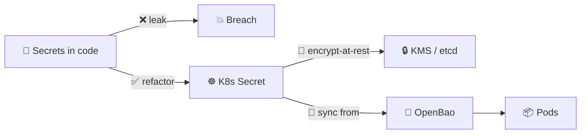
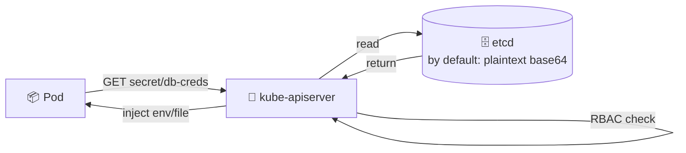
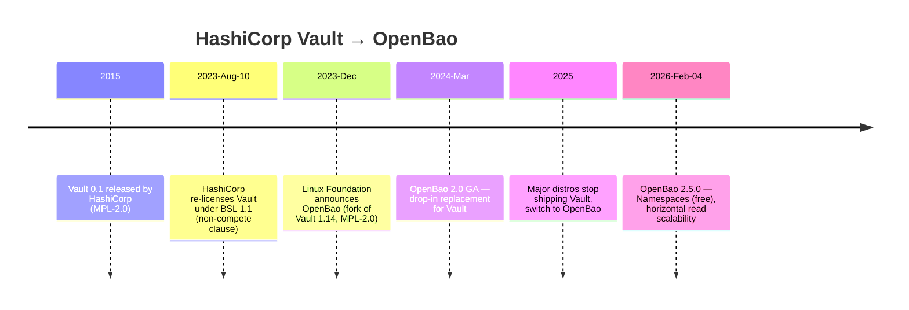
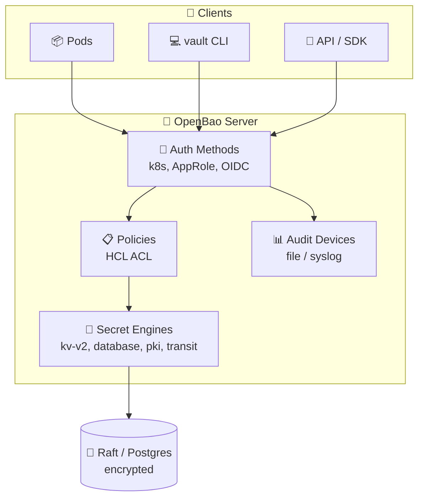
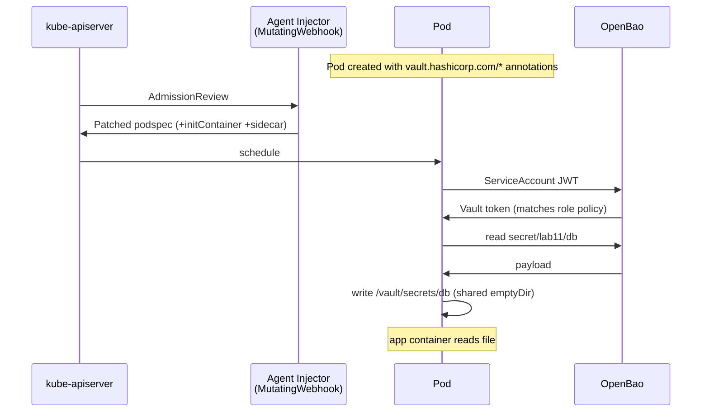
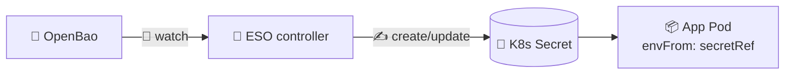
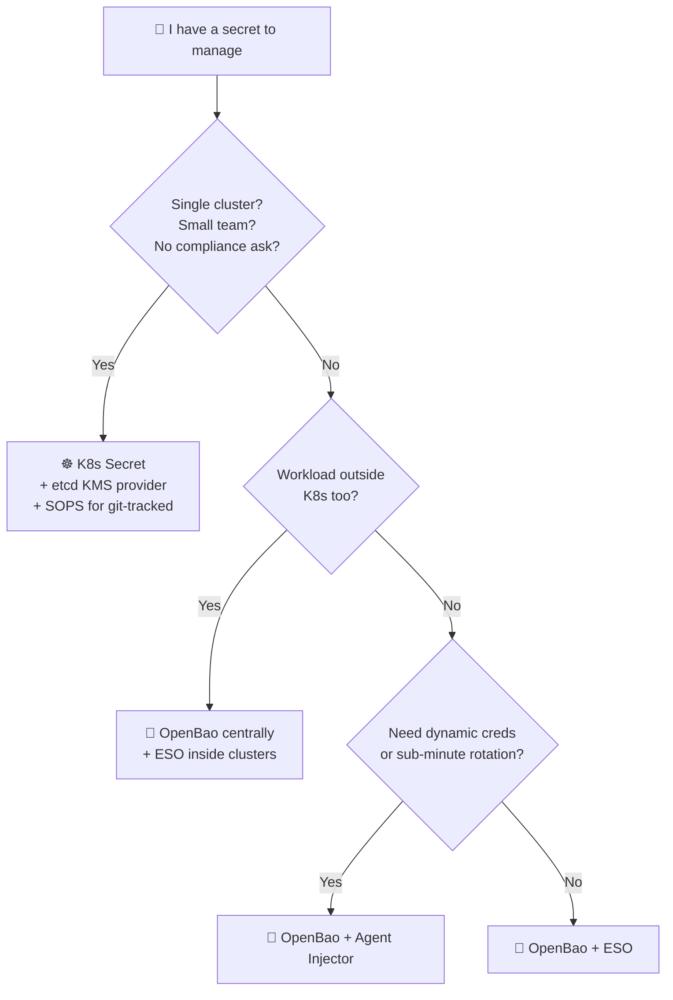
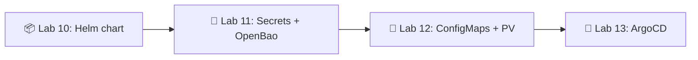

# 📌 Лекция 11 — Секреты и OpenBao: перестаньте класть пароли в Git

## 📍 Слайд 1 – 🔐 Добро пожаловать в управление секретами

* 🌍 **Лабораторная 10 оставила вас с чистым Helm chart'ом** — Deployment, Service, Ingress, values на каждую среду. Одна проблема: реальному приложению нужен пароль к БД, API-ключ, TLS-сертификат. Вы не можете положить их в `values.yaml` и запушить в GitHub.
* 😱 **Секреты в коде — причина облачных утечек №1** — и самая дешёвая для предотвращения.
* 🎯 Эта лекция: K8s `Secret` (что это на самом деле), шифрование в состоянии покоя, проект **OpenBao** (open-source преемник Vault) и два паттерна внедрения секретов в pod'ы — **Vault Agent Injector** и **External Secrets Operator**.
* 🔗 **Связь с лабораторной 11:** добавьте `templates/secrets.yaml` в ваш chart из лабораторной 10, установите **OpenBao** через Helm, настройте Kubernetes auth и внедрите секрет через аннотации Vault Agent.



---

## 📍 Слайд 2 – 🎯 Результаты обучения

| # | Результат |
|---|---------|
| 1 | 🧠 Объяснить, почему K8s `Secret` **не зашифрован** по умолчанию (это base64) |
| 2 | 🔐 Включить **шифрование в состоянии покоя** в etcd с помощью `EncryptionConfiguration` + провайдера KMS |
| 3 | 🏰 Запустить **OpenBao 2.5.0** в Kubernetes; настроить KV-v2 + Kubernetes auth + политику чтения |
| 4 | 💉 Использовать паттерн sidecar **Vault Agent Injector** для рендеринга секретов в файл внутри pod'а |
| 5 | 🤖 Использовать **External Secrets Operator** (ESO) для синхронизации из OpenBao → нативный K8s `Secret` |
| 6 | 🗺️ Выбрать правильный паттерн (Agent Injector vs ESO vs CSI vs Sealed Secrets vs SOPS) |

**Технологический стек, зафиксированный на май 2026:** Kubernetes **1.36**, **OpenBao 2.5.0** (Linux Foundation, MPL-2.0), External Secrets Operator **v2.5.0**, CLI `vault` (по-прежнему работает с OpenBao — совместим по протоколу).

---

## 📍 Слайд 3 – 💀 Цена ошибки

> 💬 *"Единственная по-настоящему безопасная система — это та, которая выключена, залита бетоном и запечатана в комнате со свинцовой обшивкой и вооружённой охраной."* — Gene Spafford

* 💸 **IBM Cost of a Data Breach 2025:** среднемировой ущерб **$4.44M** за утечку; рекорд США — **$10.22M**
* 🔍 **Злоупотребление учётными данными** — вектор первоначального доступа №1 в Verizon DBIR каждый год с 2019
* ⏱️ **Среднее время обнаружения** утечки учётных данных: ~204 дня (IBM 2025)
* 🤖 **GitGuardian 2024:** ~12.8M новых секретов утекло в публичный GitHub за один год — большинство так и не ротировано

> 🤔 **Подумайте:** сколько файлов `.env` на вашем ноутбуке прямо сейчас содержат настоящий продакшн-пароль?

---

## 📍 Слайд 4 – 📜 Реальные инциденты — учитесь на их боли

| Год | Кто | Что |
|------|-----|------|
| 2014 | **Code Spaces** | AWS root-ключи в коде → атакующий уничтожил все резервные копии + все данные клиентов → **компания закрылась в течение 12 часов** |
| 2016 | **Uber** | AWS-креды захардкожены в приватном репозитории GitHub (взломан аккаунт разработчика) → дамп S3 на **57M пользователей** → **мировое соглашение на $148M** |
| 2022 | **Dropbox** | 130 приватных GH-репозиториев украдено через фишинг — утекли внутренние API-ключи + сторонние креды |
| 2022 | **Toyota** | каталог `.git` раздавался из публичного ресурса → учётные данные БД клиентских данных утекли **на 10 лет** |
| 2025 | **tj-actions/changed-files** | CVE-2025-30066, скомпрометирован популярный GitHub Action **слил каждый секрет** в логи CI 23 000+ репозиториев |

> 🔥 **Паттерн:** каждый из них — это **секрет, хранящийся не в том месте** (код, git, логи CI, публичный ресурс). Не zero-day. Не 0-click. Просто учётные данные не в том файле.

---

## 📍 Слайд 5 – ☸️ Объект `Secret` в Kubernetes

`Secret` — это первоклассный объект API K8s, отдельный от `ConfigMap`, потому что он *предназначен* для чувствительных данных.

```yaml
apiVersion: v1
kind: Secret
metadata:
  name: db-creds
  namespace: lab11
type: Opaque
data:                                  # ⚠️ values must be base64-encoded
  username: YWRtaW4=
  password: U3VwZXJTZWNyZXQxMjM=
# stringData:                          # ✅ alternative: K8s base64-encodes for you
#   username: admin
#   password: SuperSecret123
```

* 📦 Три паттерна создания: `kubectl create secret` (императивный), YAML `kind: Secret` (декларативный), Helm `templates/secrets.yaml`
* 🔑 **Встроенные типы:** `Opaque` (общий), `kubernetes.io/dockerconfigjson` (pull образов), `kubernetes.io/tls` (сертификат + ключ), `kubernetes.io/service-account-token`
* 🚦 Потребляется pod'ами как **переменные окружения** (`envFrom`/`secretKeyRef`) или как **монтирование файла** (`projected` / `secret` volume)

---

## 📍 Слайд 6 – ⚠️ Base64 — это не шифрование

> ⚠️ **Самый проверяемый на экзаменах K8s факт** — и непонимание, стоящее за каждой утечкой у джунов.

```bash
$ echo "SuperSecret123" | base64
U3VwZXJTZWNyZXQxMjMK
$ echo "U3VwZXJTZWNyZXQxMjMK" | base64 -d
SuperSecret123                         # 🔓 No key. No password. Just decode.
```

| 🔄 Кодирование (base64) | 🔐 Шифрование (AES-GCM, KMS, …) |
|----------------------|----------------------------------|
| ✅ Обратимо любым, у кого есть строка | 🔑 Требует ключ для расшифровки |
| 🎯 Создано для бинарно-безопасной транспортировки текста | 🛡️ Создано для конфиденциальности |
| 📦 Те же данные, другой формат | 🔒 Другие данные, математически защищённые |

> 🔥 **Почему тогда base64?** Потому что значения `Secret.data` должны быть валидными строками JSON/YAML — иначе бинарные данные, такие как TLS-ключ, не поместились бы. Конфиденциальность — задача API-сервера + etcd, а не base64.

---

## 📍 Слайд 7 – 🗄️ Где на самом деле живут секреты: etcd



Две жёсткие истины об etcd:

* 🔓 **По умолчанию etcd хранит Secret'ы как base64 (эквивалент открытого текста).** Любой с доступом к диску члена etcd, резервной копии etcd или снапшоту может сдампить все ваши секреты.
* 🛡️ **RBAC защищает путь через API, а не данные в состоянии покоя.** Узел с `etcdctl get /registry/secrets/...` полностью обходит API-сервер.

> 🤔 **Вопрос:** шифрует ли etcd ваш управляемый control plane (EKS, GKE, AKS)? **Часто да** — но на *дисковом* уровне (шифрование облачного провайдера), а не на уровне K8s `EncryptionConfiguration`. Это разные модели угроз.

---

## 📍 Слайд 8 – 🔐 Шифрование в состоянии покоя в etcd

K8s поставляет API `EncryptionConfiguration`: kube-apiserver шифрует полезную нагрузку Secret **до** записи в etcd.

```yaml
# /etc/kubernetes/enc/enc-config.yaml
apiVersion: apiserver.config.k8s.io/v1
kind: EncryptionConfiguration
resources:
  - resources: ["secrets"]
    providers:
      - kms:                           # 🥇 prefer KMS provider (AWS KMS, GCP KMS, Vault)
          name: aws-kms
          endpoint: unix:///var/run/kmsplugin/socket.sock
          cachesize: 1000
      - aescbc:                        # 🥈 fallback: local AES-256-CBC
          keys:
            - name: key1
              secret: <base64-32-byte-key>
      - identity: {}                   # ⚠️ identity = no encryption; must be LAST
```

Активация:
* 🛠️ Флаг kube-apiserver: `--encryption-provider-config=/etc/kubernetes/enc/enc-config.yaml`
* 🔄 **Перешифруйте существующие секреты** после включения: `kubectl get secrets -A -o json | kubectl replace -f -`
* 🔑 **Ротация** = добавить новый ключ в начало списка, заменить все секреты, затем переместить старый ключ вниз или удалить

> ⚠️ **Ловушка:** если `identity` не последний, секреты остаются незашифрованными. Порядок важен.

---

## 📍 Слайд 9 – 🪦 История Vault → OpenBao



* ⚖️ **BSL 1.1** = исходный код доступен, но вы не можете предлагать Vault как коммерческий управляемый сервис, конкурирующий с HashiCorp.
* 🍴 Форк OpenBao управляется **Linux Foundation**, MPL-2.0 (настоящий open source), совместим по протоколу с CLI `vault`.
* 💡 **Платные функции HashiCorp** (Namespaces, горизонтальное масштабирование чтения, MFA) **бесплатны в OpenBao 2.5.0**.

> 🔥 **Почему мы учим OpenBao, а не Vault:** лабораторная будет работать на ноутбуках студентов. BSL говорит, что так можно. Но каждый переиспользуемый манифест, который вы создаёте сегодня, завтра отправится в продакшн-кластер — начинайте с лицензии, которую не придётся оспаривать заново.

---

## 📍 Слайд 10 – 🏰 Архитектура OpenBao



**Три концепции, которые вы обязаны знать:**
* 🔐 **Secret Engines** = где живут или генерируются секреты. `kv-v2` (версионированные статические), `database` (динамические креды), `pki` (выдача сертификатов), `transit` (шифрование-как-сервис).
* 🔑 **Auth Methods** = как клиенты доказывают, кто они. Для pod'ов K8s: `kubernetes` (проверяет JWT ServiceAccount pod'а через API TokenReview K8s).
* 📋 **Policies** = HCL-файлы, описывающие возможности на уровне путей (`read`, `list`, `create`, `update`, `delete`, `sudo`, `deny`).

---

## 📍 Слайд 11 – 🛠️ Установка OpenBao через Helm

```bash
helm repo add openbao https://openbao.github.io/openbao-helm
helm repo update

helm install openbao openbao/openbao \
  --namespace openbao --create-namespace \
  --set "server.dev.enabled=true" \         # 🚨 dev mode = unsealed + in-memory, NEVER prod
  --set "injector.enabled=true" \           # 💉 deploy the Agent Sidecar Injector
  --set "server.image.tag=2.5.0"

kubectl get pods -n openbao
# NAME                                    READY   STATUS
# openbao-0                               1/1     Running
# openbao-agent-injector-7f...            1/1     Running
```

* 🚨 **Dev-режим** автоматически инициализируется, автоматически распечатывается (unseal), хранит в RAM. Перезапуск = потеря секретов. **Только для лабораторной.**
* 🏢 **Продакшн:** интегрированное хранилище (Raft) на 3-5 узлах, авто-unseal через KMS, устройство аудита → агрегатор логов, TLS везде.

> 🔥 **CLI `vault` работает.** OpenBao сохранил совместимость API + CLI. `vault status`, `vault kv put`, `vault login` — те же команды.

---

## 📍 Слайд 12 – 🔑 Настройка: KV-v2 + Kubernetes Auth + Policy

```bash
kubectl exec -n openbao -it openbao-0 -- /bin/sh

# 🔐 Enable KV v2 (versioned secrets)
vault secrets enable -path=secret kv-v2

# 📝 Write a secret
vault kv put secret/lab11/db \
  username=app password='S3cure!2026'

# 🔑 Enable Kubernetes auth (validates pod ServiceAccount JWT)
vault auth enable kubernetes
vault write auth/kubernetes/config \
  kubernetes_host="https://$KUBERNETES_PORT_443_TCP_ADDR:443"

# 📋 Policy: read-only on this exact path
vault policy write lab11-read - <<EOF
path "secret/data/lab11/db" {
  capabilities = ["read"]
}
EOF

# 🎯 Bind the policy to a ServiceAccount + namespace
vault write auth/kubernetes/role/lab11 \
  bound_service_account_names=lab11-sa \
  bound_service_account_namespaces=lab11 \
  policies=lab11-read \
  ttl=1h
```

* 🎯 **Role** связывает три вещи: какой SA может аутентифицироваться, какая политика прикрепляется и как долго живёт полученный токен.

---

## 📍 Слайд 13 – 💉 Vault Agent Injector: паттерн sidecar



* 🪝 Инжектор — это **MutatingAdmissionWebhook** — он редактирует podspec во время admission, прозрачно для автора chart'а за пределами аннотаций.
* 🔄 **Init-контейнер** забирает секрет до запуска приложения (так что файл существует при старте приложения). **Sidecar** продлевает токен + обновляет файл.
* 📁 Секреты попадают в `/vault/secrets/<name>` на общем томе `emptyDir`.

---

## 📍 Слайд 14 – 🏷️ Аннотации Vault Agent

```yaml
spec:
  template:
    metadata:
      annotations:
        vault.hashicorp.com/agent-inject: "true"
        vault.hashicorp.com/role: "lab11"
        # 🎯 Plain key=value file at /vault/secrets/db
        vault.hashicorp.com/agent-inject-secret-db: "secret/data/lab11/db"
        # 🎨 Custom template — render as .env
        vault.hashicorp.com/agent-inject-template-db: |
          {{- with secret "secret/data/lab11/db" -}}
          DB_USER={{ .Data.data.username }}
          DB_PASS={{ .Data.data.password }}
          {{- end -}}
        # 🔄 Re-render every 30s; signal SIGHUP to PID 1
        vault.hashicorp.com/agent-inject-default-template: "json"
        vault.hashicorp.com/agent-inject-command-db: "kill -HUP 1"
    spec:
      serviceAccountName: lab11-sa
      containers: [...]
```

* 🎨 `agent-inject-template-*` позволяет рендерить секрет в **любом формате** — `.env`, JSON, YAML, HCL, полный конфигурационный файл приложения.
* 🔁 `agent-inject-command-*` выполняет команду внутри pod'а после повторного рендеринга (сигнал приложению перезагрузить конфиг).

---

## 📍 Слайд 15 – 🤖 External Secrets Operator (ESO): другой паттерн

ESO **синхронизирует** секреты из внешнего хранилища → в нативный K8s `Secret`. Без sidecar. Приложения читают обычный `Secret` и не знают, что ESO существует.



```yaml
apiVersion: external-secrets.io/v1
kind: SecretStore
metadata: {name: openbao, namespace: lab11}
spec:
  provider:
    vault:                                   # ✅ ESO's vault provider works with OpenBao
      server: "http://openbao.openbao:8200"
      path: "secret"
      version: "v2"
      auth:
        kubernetes:
          mountPath: "kubernetes"
          role: "lab11"
          serviceAccountRef: {name: lab11-sa}
---
apiVersion: external-secrets.io/v1
kind: ExternalSecret
metadata: {name: db, namespace: lab11}
spec:
  refreshInterval: 1h                        # ⏱️ controller polls every hour
  secretStoreRef: {name: openbao, kind: SecretStore}
  target: {name: db-creds}                   # ⬅️ produces a K8s Secret with this name
  data:
    - secretKey: password
      remoteRef: {key: lab11/db, property: password}
```

---

## 📍 Слайд 16 – 💉 Agent Injector vs ESO vs CSI: выберите одно

| Аспект | Agent Injector | ESO | Secrets Store CSI |
|---------|----------------|-----|-------------------|
| 📦 Секрет живёт в K8s `Secret`? | ❌ только файл | ✅ да | ⚠️ опциональная синхронизация |
| 🔁 Автообновление при ротации | ✅ в реальном времени (шаблон + сигнал) | ⚠️ интервал опроса | ⚠️ при перезапуске pod'а |
| 🧊 Стоимость ресурсов pod'а | ❌ sidecar на каждый pod | ✅ один контроллер | ✅ daemonset на каждый узел |
| 🔑 Поддерживаемые методы auth | ✅ все методы Vault | ✅ все | ⚠️ только k8s |
| 🎯 Лучше всего, когда | динамические креды, короткий TTL, сигнальные перезагрузки | большинству pod'ов нужен `envFrom`, опрос подходит | строгие правила без K8s-Secret, монтирование файлов |
| 🚦 Сложность | 🟡 средняя | 🟢 низкая | 🟡 средняя |

> 🔥 **Большинство команд в 2026 выбирают ESO** по умолчанию и добавляют Agent Injector только для pod'ов, которым нужны динамические креды БД или ротация с интервалом меньше минуты.

---

## 📍 Слайд 17 – 🌳 Альтернативы: SOPS и Sealed Secrets

Не каждая команда может запустить кластер Vault/OpenBao. Две дружественные к GitOps альтернативы:

* 🔏 **Mozilla SOPS** — шифрует YAML/JSON **на уровне файла** с помощью AWS KMS / GCP KMS / age / PGP. Зашифрованный файл безопасно коммитить. Конвейер CI/CD (или плагин `helm-secrets`) расшифровывает во время apply.
  ```bash
  sops --encrypt --age $AGE_RECIPIENT secrets.yaml > secrets.enc.yaml
  # commit secrets.enc.yaml, *.gitignore secrets.yaml
  ```
* 🔒 **Sealed Secrets** (Bitnami) — CRD + контроллер в кластере. Шифруйте публичным ключом контроллера локально; расшифровать может только этот один кластер. Зашифрованный ресурс безопасно коммитить и применять.
  ```bash
  kubeseal --controller-namespace=kube-system < secret.yaml > sealed.yaml
  ```

| | SOPS | Sealed Secrets | OpenBao + ESO |
|---|------|----------------|---------------|
| 🔄 Ротация | ❌ ручное перешифрование | ❌ ручное перешифрование | ✅ централизованно |
| 🔍 Журнал аудита | ❌ история git | ❌ история git | ✅ аудит Vault |
| 🌍 Совместное использование между кластерами | ✅ | ❌ ключ на кластер | ✅ |
| 🎚️ Сложность | 🟢 низкая | 🟢 низкая | 🟡 средняя |

---

## 📍 Слайд 18 – 🪞 OpenBao 2.5.0: что нового (4 февраля 2026)

* 🏷️ **Namespaces** теперь бесплатны — мультитенантная изоляция секретов, которая раньше была платной функцией HashiCorp Enterprise. Каждое пространство имён получает свои политики/auth/mounts.
* 🚀 **Горизонтальная масштабируемость чтения** — standby-узлы Raft теперь могут отвечать на **read**-запросы локально, без перенаправления лидеру. Нагрузки с интенсивным чтением (представьте 10K pod'ов, опрашивающих конфиг-секрет) внезапно становятся дешёвыми.
* 🔒 **`disable_unauthed_rekey_endpoints: true` по умолчанию** — закрывает поверхность неаутентифицированной атаки (проблема класса CVE в старом Vault).
* 🛠️ Усиление авто-unseal для управляемых ключей (AWS KMS / GCP KMS / Azure Key Vault).
* 🧹 Очистка групп идентификации при unseal — исправляет давний баг Vault, когда повреждённые записи блокировали запуск.

> 🔥 **Практическое влияние:** команды CLI `vault`, которые вы пишете сегодня против OpenBao, будут работать без изменений на продакшн-установках любого масштаба. Старые туториалы по Vault остаются точными примерно на 95%.

---

## 📍 Слайд 19 – 🚫 Антипаттерны

1. ❌ **`echo $PASSWORD | base64` и коммит результата** — base64 это кодирование, а не шифрование. История git вечна.
2. ❌ **Обычный `Secret` без шифрования etcd** — любой со снапшотом etcd владеет вашим продакшном.
3. ❌ **Один токен Vault на приложение, никогда не ротируется** — убивает весь смысл менеджера секретов.
4. ❌ **Dev-режим Vault в продакшне** — хранение в RAM, один ключ, авто-unseal. Перезапуск процесса = полная потеря секретов.
5. ❌ **Долгоживущие токены ServiceAccount, смонтированные по умолчанию** — задайте `automountServiceAccountToken: false` для SA, которым не нужна аутентификация в Vault.
6. ❌ **`vault.hashicorp.com/role: admin` на каждом pod'е** — наименьшие привилегии; одна role на приложение на среду.
7. ❌ **Отсутствие графика ротации секретов** — выберите число (30/60/90 дней), автоматизируйте его, аудируйте отклонения.
8. ❌ **Настоящие значения в `values.yaml`** — этот файл попадает в git через ваш Helm chart. Используйте ESO или Agent Injector, никогда `--set` из шага CI, который логирует.

---

## 📍 Слайд 20 – 🧪 Обнаружение: как находят утечки

Хорошая новость: сканирование секретов дешёвое, быстрое и дружественное к CI.

* 🔍 **gitleaks**, **trufflehog**, **detect-secrets** — хуки pre-commit + гейты CI. Находят AWS-ключи, сервисные аккаунты GCP, PEM-ключи, GH-токены.
* 🐙 **GitHub Secret Scanning** — встроен в github.com; партнёрские интеграции автоматически отзывают утёкшие токены для AWS, GCP, Slack, Stripe, …
* 📊 **OWASP Top 10 (A07: Identification and Authentication Failures)** — явно называет управление учётными данными риском верхнего уровня.

```yaml
# .pre-commit-config.yaml
repos:
  - repo: https://github.com/gitleaks/gitleaks
    rev: v8.21.2
    hooks: [{id: gitleaks}]
```

> 🔥 **Запускайте gitleaks на каждом PR.** Он ловит человеческие моменты. Инструменты бьют политику.

---

## 📍 Слайд 21 – 🗺️ Дерево решений



* 🟢 **Начинайте с малого:** K8s Secret + шифрование etcd покрывает 80% пути.
* 🟡 **Добавляйте OpenBao + ESO**, когда у вас ≥2 кластеров или есть потребители вне K8s.
* 🔴 **Добавляйте Agent Injector + динамические креды**, когда этого требуют аудит/комплаенс.

---

## 📍 Слайд 22 – 🎯 Ключевые выводы

1. 🔓 **K8s `Secret` — это base64, а не шифрование.** Конфиденциальность идёт от RBAC + etcd-at-rest, а не от самого ресурса.
2. 🔐 **Включите `EncryptionConfiguration`** с провайдером KMS; `identity` всегда последний.
3. 🪦 **HashiCorp Vault перешёл на BSL в августе 2023.** Сообщество перешло на **OpenBao** (LF / MPL-2.0). CLI `vault` по-прежнему работает.
4. 🏰 **OpenBao 2.5.0** даёт вам бесплатные Namespaces + горизонтальное масштабирование чтения.
5. 💉 **Два паттерна внедрения:** Agent Injector (sidecar, динамический, сигнальный) и ESO (синхронизируемый контроллером K8s Secret). Выбирайте по нагрузке, а не по хайпу.
6. 🌳 **SOPS / Sealed Secrets** — валидные GitOps-дружественные запасные варианты, когда вы не можете запустить кластер Vault.
7. 🔍 **Сканируйте каждый коммит** с помощью gitleaks/trufflehog. Обнаружение дешевле ротации.

> 💬 *"Безопасность — это не продукт, а процесс."* — Bruce Schneier

---

## 📍 Слайд 23 – 🚀 Что дальше

**📚 Следующая лекция: *ConfigMap'ы и постоянные тома*** — нечувствительная конфигурация, стратегии монтирования и то, как stateful-приложения выживают при перезапусках pod'ов.

* 📁 `ConfigMap` vs `Secret` — когда что является правильным ответом
* 💾 PersistentVolume / PersistentVolumeClaim / StorageClass — динамический провижининг
* 🔧 Стратегии монтирования: subPath, projected volumes, неизменяемые конфиги
* 🗂️ StatefulSets vs Deployments — когда важен порядок

**🔬 Результаты лабораторной 11:**
* Создать Secret `app-credentials` через `kubectl create secret`, просмотреть + декодировать его
* Добавить `templates/secrets.yaml` в ваш chart из лабораторной 10, внедрить через `envFrom`
* Установить **OpenBao** в dev-режиме через OpenBao Helm chart
* Включить KV-v2 + Kubernetes auth + политику чтения + role, привязанную к вашему SA
* Добавить аннотации Vault Agent в ваш Deployment; проверить, что `/vault/secrets/...` появляется в pod'е
* Задокументировать всё в `k8s/SECRETS.md`
* **Бонус (+2.5 балла):** кастомный `agent-inject-template-*`, рендерящий `.env`, именованный шаблон в `_helpers.tpl`, документирование механизма обновления



> 🌊 Вы перестали класть пароли в git. Теперь давайте настроим всё остальное.

---

## 📚 Ресурсы

* 📕 *Container Security* — Liz Rice (O'Reilly, 2020) — глава о Secrets и модели угроз
* 📕 *Kubernetes Security and Observability* — Brendan Creane & Amit Gupta (O'Reilly, 2021)
* 🌐 [openbao.org/docs](https://openbao.org/docs/) — официальные документы OpenBao
* 🌐 [OpenBao 2.5.0 release notes](https://openbao.org/community/release-notes/2-5-0/) — 4 февраля 2026
* 🌐 [external-secrets.io](https://external-secrets.io/) — документы ESO + список провайдеров
* 🌐 [kubernetes.io/docs/concepts/configuration/secret](https://kubernetes.io/docs/concepts/configuration/secret/) — справочник по K8s Secrets
* 🌐 [kubernetes.io/docs/tasks/administer-cluster/encrypt-data](https://kubernetes.io/docs/tasks/administer-cluster/encrypt-data/) — настройка шифрования в состоянии покоя
* 🌐 [getsops.io](https://getsops.io/) — документы SOPS
* 🌐 [github.com/bitnami-labs/sealed-secrets](https://github.com/bitnami-labs/sealed-secrets) — Sealed Secrets
* 🎥 *Kubernetes Secrets Are Not Secret* — доклад Liz Rice на KubeCon (охватывает поверхность атаки etcd)

**🎓 Квиз:** квиз после лекции идёт в зачёт окна лидерборда недель 10-12.
