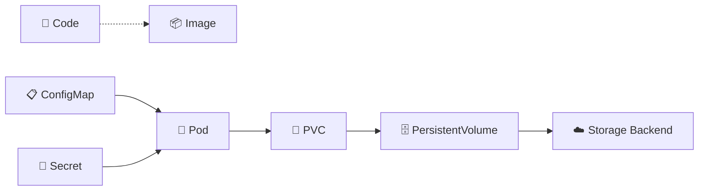
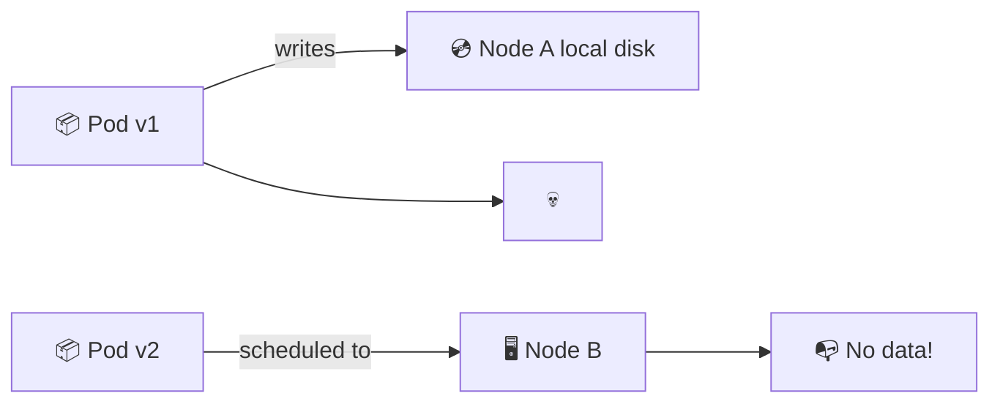
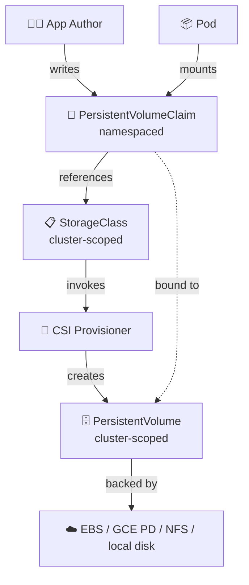
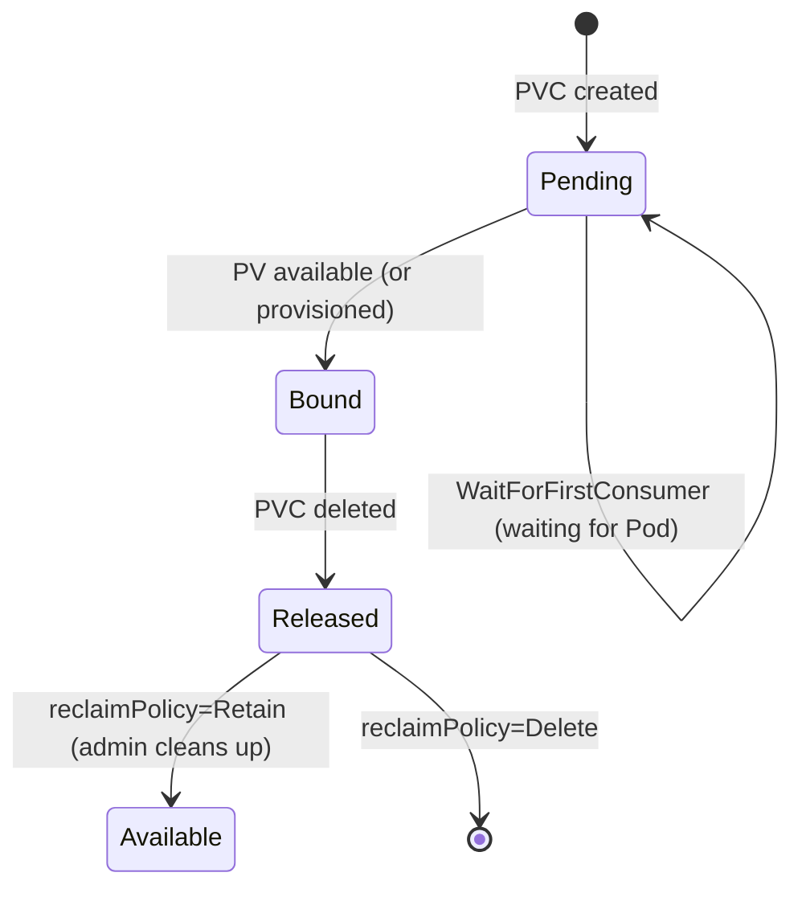
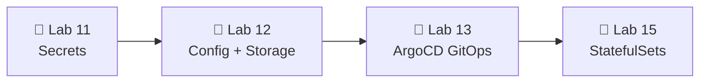

# 📌 Лекция 12 — Конфигурация и хранилище: ConfigMap'ы и постоянные тома

## 📍 Слайд 1 – 💾 Добро пожаловать в конфиг + хранилище

* 🌍 **Лекция 11 спрятала ваши секреты** в Kubernetes Secrets + OpenBao. Но не каждое значение — секрет: уровни логирования, feature-флаги, имена хостов БД, конфиги NGINX — всё это относится к **ConfigMap'ам**.
* 📦 **Правило 12-Factor (фактор III):** "Храните конфигурацию в окружении, а не в коде." Один образ, три среды, ноль пересборок.
* 💾 И ещё есть **состояние**. Контейнеры эфемерны; пользовательские загрузки, файлы баз данных и счётчики посещений нуждаются в хранилище, которое **переживает перезапуск pod'а**. Встречайте `PersistentVolumeClaim`.
* 🎯 Эта лекция: ConfigMap'ы (паттерны внедрения + неизменяемость), PV/PVC (модель заявок + динамический провижининг) и ловушка горячей перезагрузки.
* 🔗 **Связь с лабораторной 12:** добавьте ConfigMap `config.json`, смонтированный как файл, ConfigMap с переменными окружения, внедряемый через `envFrom`, и счётчик `/data/visits` на PVC, переживающий `kubectl delete pod`.



---

## 📍 Слайд 2 – 🎯 Результаты обучения

| # | Результат |
|---|---------|
| 1 | 📋 Создавать ConfigMap'ы из литералов, файлов и YAML; выбирать правильный паттерн внедрения |
| 2 | 🚪 Внедрять конфиг тремя способами: одна переменная окружения, `envFrom`, монтирование тома |
| 3 | 🔒 Использовать ConfigMap'ы с `immutable: true` там, где уместно; понимать выигрыш в производительности + стоимость горячей перезагрузки |
| 4 | 💾 Отличать `PersistentVolume` (уровень кластера) от `PersistentVolumeClaim` (уровень пространства имён) |
| 5 | 🤖 Использовать `StorageClass` для динамического провижининга; выбирать правильный `AccessMode` и `reclaimPolicy` |
| 6 | 🔄 Реализовать горячую перезагрузку через аннотацию с контрольной суммой, Reloader или fsnotify на уровне приложения |

**Технологический стек, зафиксированный на май 2026:** Kubernetes **1.36 "Haru"** (выпущен 22 апреля 2026). CSI-драйверы: **AWS EBS CSI**, **GCE PD CSI**, **local-path-provisioner** (для `kind`). Неизменяемость ConfigMap стабильна с **1.21**. `ReadWriteOncePod` GA с **1.29**. VolumeSnapshot GA с **1.20**.

---

## 📍 Слайд 3 – ❓ Почему конфиг, запечённый в образ, — это плохо

Представьте, что вы запекаете `DATABASE_URL=postgres://prod-db:5432/app` в образ. Теперь:

* 🔄 **Три среды → три сборки образа.** CI запускается 3× на каждый merge. Покрытие тестами на dev-образе ≠ на prod-образе.
* 🐛 **Одна опечатка — одна пересборка.** Хотите понизить `LOG_LEVEL` с `DEBUG` до `INFO`? Сборка, сканирование, подпись, отправка, развёртывание. 10 минут ради изменения строки.
* 💀 **Секреты в слоях образа.** `docker history` раскрывает каждый `ENV DB_PASSWORD=...`. Слои остаются в реестре навсегда.
* 🚦 **Промоушен ≠ промоушен.** "Dev-контейнер идёт в прод" — только у dev-образа конфиг dev'а, так что вы на самом деле пересобираете для прода. Артефакт, который вы тестировали, — не артефакт, который вы выпускаете.

> 🔥 **The 12-Factor App** (Heroku, 2011) сделал это универсальным: **артефакт одинаков во всех средах; конфигурация внедряется во время выполнения**. Контейнеры + Kubernetes реализуют это правило с помощью ConfigMap'ов и Secret'ов.

---

## 📍 Слайд 4 – 📋 Что такое ConfigMap на самом деле

`ConfigMap` — это **привязанный к пространству имён** объект Kubernetes, хранящий неконфиденциальные данные ключ-значение. API находится в ядре `v1` (стабилен с 1.2 — старше большинства ваших студентов).

```yaml
apiVersion: v1
kind: ConfigMap
metadata:
  name: app-config
  namespace: dev
data:
  LOG_LEVEL: "info"
  CACHE_TTL: "3600"
  config.yaml: |              # ← multi-line file content
    server:
      port: 8080
      timeout: 30s
binaryData:                   # ← base64 for non-UTF-8 (rare)
  tls.crt: <base64-blob>
```

* 📏 **Ограничение размера: 1 MiB** на объект (лимит значения etcd). Достигли? Разделите на несколько ConfigMap'ов или используйте настоящую систему распространения конфигурации.
* 🚫 **Не зашифрован в состоянии покоя по умолчанию.** Любой с RBAC `get configmap` читает всё. Открытый текст в etcd.
* ❌ **Не для секретов.** Пароли БД, API-ключи, TLS-ключи → `Secret` (лекция 11). Хотя `Secret` тоже base64 в etcd, глаголы RBAC и история аудита отдельные.

---

## 📍 Слайд 5 – 🛠️ Три способа создать ConfigMap

```bash
# 1️⃣ From literals — fastest for one-off values
kubectl create configmap app-config \
  --from-literal=LOG_LEVEL=info \
  --from-literal=CACHE_TTL=3600

# 2️⃣ From a file — preserves structure (nginx.conf, prometheus.yml)
kubectl create configmap nginx-config \
  --from-file=nginx.conf=./nginx.conf

# 3️⃣ From an env-file — bulk import .env-style config
kubectl create configmap app-env --from-env-file=./prod.env

# 4️⃣ From YAML — the only one that belongs in git
kubectl apply -f configmap.yaml
```

> ✅ **В реальной жизни используется только `4️⃣`.** `create` — для разовой отладки. Всё в продакшне — это декларативный YAML в Helm chart или overlay Kustomize, применяемый через GitOps (лекция 13).

---

## 📍 Слайд 6 – 🚪 Паттерн внедрения 1: одна переменная окружения

```yaml
spec:
  containers:
    - name: web
      env:
        - name: LOG_LEVEL                  # ← env var name in the container
          valueFrom:
            configMapKeyRef:
              name: app-config
              key: LOG_LEVEL               # ← key inside the ConfigMap
              optional: false              # ← pod won't start if key missing
```

Когда использовать:
* 🎯 Вы хотите **переименовать** переменную окружения (`LOG_LEVEL` в CM → `APP_LOG_LEVEL` в контейнере)
* 🎯 Вам нужно только **пара ключей** из большого ConfigMap'а
* 🎯 Вы хотите явный контроль `optional` для каждого ключа

> ⚠️ **Переменные окружения запекаются при старте pod'а.** Обновите ConfigMap, работающий pod всё равно видит старое значение до перезапуска. Всегда.

---

## 📍 Слайд 7 – 🚪 Паттерн внедрения 2: `envFrom` (массово)

```yaml
spec:
  containers:
    - name: web
      envFrom:
        - configMapRef:
            name: app-env           # ← every key becomes an env var
            optional: false
        - secretRef:
            name: app-secrets       # ← Secrets work the same way
        - prefix: APP_              # ← optionally prefix all keys
          configMapRef:
            name: feature-flags
```

* 🚀 **Одна строка на источник.** Все ключи в `app-env` становятся переменными окружения дословно.
* 🚫 **Невалидные имена переменных окружения молча пропускаются** (например, ключи с точками или начинающиеся с цифр). Придерживайтесь `[A-Z_][A-Z0-9_]*`.
* 🏷️ **`prefix`** задаёт пространство имён для ConfigMap'а, когда у двух источников совпадают ключи.

> 🔥 **Ловушка:** `envFrom` *не* позволяет переименовывать или фильтровать ключи. Если в вашем ConfigMap'е 30 ключей, контейнер получает все 30 переменных окружения. Курируйте ConfigMap, а не внедрение.

---

## 📍 Слайд 8 – 🚪 Паттерн внедрения 3: монтирование тома

```yaml
spec:
  volumes:
    - name: config-vol
      configMap:
        name: nginx-config
        items:                      # ← optional: project specific keys
          - key: nginx.conf
            path: nginx.conf
            mode: 0644
  containers:
    - name: nginx
      volumeMounts:
        - name: config-vol
          mountPath: /etc/nginx     # ← whole dir, files auto-update
        # ✅ OR with subPath: single file, but NO auto-update:
        # - name: config-vol
        #   mountPath: /etc/nginx/nginx.conf
        #   subPath: nginx.conf
```

* 📁 **Монтирование всего каталога** → kubelet отражает обновления ConfigMap в течение ~`kubelet --sync-frequency` (по умолчанию 60s) + TTL кеша. Файлы появляются через атомарную подмену симлинка `..data`.
* 🚫 **`subPath` — это одноразовая копия** — файл материализуется один раз при старте pod'а и **никогда не обновляется**. Компромисс: чистый путь монтирования, но вы теряете живую перезагрузку.
* 🎚️ **`defaultMode` / `mode`** управляют правами доступа к файлам (по умолчанию `0644`).

---

## 📍 Слайд 9 – 🔒 Неизменяемые ConfigMap'ы (стабильно в 1.21)

```yaml
apiVersion: v1
kind: ConfigMap
metadata:
  name: app-config-v3
immutable: true                     # ← cannot be edited; can only be deleted+recreated
data:
  LOG_LEVEL: "info"
  CACHE_TTL: "3600"
```

Зачем это существует:
* ⚡ **Производительность:** kubelet перестаёт `watch`ить ConfigMap. При 10k Pod'ов × 20 ConfigMap'ов = на 200k меньше watch-подписок.
* 🛡️ **Безопасность:** предотвращает случайные правки. `kubectl edit configmap app-config-v3` падает с "field is immutable".

Паттерн:
* 🏷️ **Версия в имени** — `app-config-v1`, `app-config-v2`, …
* 🔁 **Deployment ссылается на версионированное имя** — переход `app-config-v2 → v3` — это изменение шаблона Deployment → раскатка обновления бесплатно.
* 🗑️ **Очищайте старые версии** с помощью GC-задачи, когда на них ничего не ссылается.

> 🔥 **Компромисс:** неизменяемость убивает горячую перезагрузку. Если ваше приложение читает файл по таймеру, неизменяемость подходит. Если вы хотите переключать конфиг без перезапуска, придерживайтесь изменяемых + паттернов со слайда 16.

---

## 📍 Слайд 10 – 📊 ConfigMap vs Secret — быстрый diff

| Аспект | `ConfigMap` | `Secret` |
|---|---|---|
| Тип API | `v1.ConfigMap` | `v1.Secret` (типизированный: `Opaque`, `kubernetes.io/tls`, …) |
| Хранение в etcd | Открытый текст | Base64-кодированный (НЕ шифрование — шифрование в состоянии покоя требует `EncryptionConfiguration`) |
| Аудитория | Нечувствительная конфигурация | Пароли, токены, сертификаты |
| Глагол RBAC | `get configmaps` | `get secrets` (обычно строже ограничен) |
| Том tmpfs? | Нет (обычная ФС) | Да (монтируется как `tmpfs`, никогда не касается диска) |
| Ограничение размера | 1 MiB | 1 MiB |
| Поле immutable | ✅ с 1.21 | ✅ с 1.21 |

> 🔥 **Правило большого пальца:** если потеря этого завтра заставит вас открыть инцидент безопасности, это Secret.

---

## 📍 Слайд 11 – 💾 Раздел-пауза — почему хранилище сложное

Модель контейнеров **неизменяемая + эфемерная**:
* 📦 Pod умирает → его записываемый слой умирает вместе с ним
* 🔄 Раскатка обновления → новый pod, свежая пустая файловая система
* 🧭 Pod переназначен на другой узел → локальный диск предыдущего узла недоступен

Для **stateless**-нагрузок (web, API) это идеально. Для **stateful**-нагрузок (БД, загрузки файлов, очереди) это катастрофа:



Ответ Kubernetes: **отвязать объект хранилища от pod'а**. Pod заявляет хранилище по имени; на каком бы узле ни запускался pod, том следует за ним.

---

## 📍 Слайд 12 – 🏗️ Трио PV / PVC / StorageClass



* 💾 **PVC (PersistentVolumeClaim)** — *заявка*. "Мне нужно 10Gi, RWO, быстрый SSD." Живёт в пространстве имён. Пишется авторами приложений.
* 🗄️ **PV (PersistentVolume)** — *ресурс*. Уровень кластера (без пространства имён). Создаётся администратором (статически) или провижионером (динамически).
* 📋 **StorageClass** — *шаблон*. "Вот как провижионить новые PV типа `fast-ssd`." Уровень кластера.

> 🎯 **Ментальная модель:** PVC относится к PV так же, как Pod относится к Node. Pod не выбирает узел; это делает scheduler. PVC не выбирает PV; это делает binder.

---

## 📍 Слайд 13 – 🤖 Статический vs динамический провижининг

**Статический (стиль до 1.6, всё ещё валиден):** администратор заранее создаёт PV; PVC привязывается к подходящему.

```yaml
# Admin creates this once
apiVersion: v1
kind: PersistentVolume
metadata: {name: pv-data-01}
spec:
  capacity: {storage: 10Gi}
  accessModes: [ReadWriteOnce]
  hostPath: {path: /mnt/data}        # ← demo only; never in prod
```

**Динамический (по умолчанию с 1.6):** PVC указывает `StorageClass`; кластер автоматически провижионит PV.

```yaml
apiVersion: storage.k8s.io/v1
kind: StorageClass
metadata: {name: fast-ssd}
provisioner: ebs.csi.aws.com         # ← AWS EBS CSI driver
parameters:
  type: gp3
  iops: "3000"
  throughput: "125"
reclaimPolicy: Delete
volumeBindingMode: WaitForFirstConsumer    # ← bind only when a Pod uses the PVC
allowVolumeExpansion: true
```

> 🔥 **`WaitForFirstConsumer`** — это то, что вам нужно в мульти-AZ кластерах. Без него PV провижионится в зоне X, а Pod оказывается запланированным в зону Y — и `kubectl describe pod` читает `volume node affinity conflict`. Добро пожаловать в отладку EBS в полночь.

---

## 📍 Слайд 14 – 🔓 Режимы доступа

| Режим | Сокр. | Значение | Типичный бэкенд |
|---|---|---|---|
| `ReadWriteOnce` | RWO | Монтируется RW одним **узлом** (несколько Pod'ов на этом узле — OK) | EBS, GCE PD, Azure Disk |
| `ReadOnlyMany` | ROX | Монтируется RO многими узлами | NFS, S3-CSI, распространение контента |
| `ReadWriteMany` | RWX | Монтируется RW многими узлами одновременно | NFS, EFS, Azure Files, CephFS |
| `ReadWriteOncePod` | RWOP | Монтируется RW ровно **одним Pod'ом** во всём кластере | Любой CSI-драйвер с K8s 1.29 GA |

* 🔒 **`ReadWriteOncePod`** (GA в K8s 1.29) строже RWO — RWO допускает N pod'ов на одном узле; RWOP — ровно один pod во всём кластере. Используйте для выбора лидера, БД с одним писателем.
* 🧨 **Облачное блочное хранилище — только RWO.** EBS, GCE PD, Azure Disk — это блочные устройства; облачное ядро не может делить их RW между хостами.
* 📡 **Нужен RWX?** Это NFS, EFS, Azure Files или CephFS. Медленнее, дороже, местами с согласованностью в конечном счёте.

---

## 📍 Слайд 15 – ♻️ Политики возврата

Когда PVC удаляется, что происходит с нижележащим диском?

| Политика | Поведение | Когда использовать |
|---|---|---|
| `Delete` | PV и нижележащий диск удаляются (облачный том исчезает) | По умолчанию для облачного SC; OK для кешей и временных данных |
| `Retain` | PV остаётся; диск не тронут. Оператор должен очистить вручную | Базы данных, всё с ценными данными |
| `Recycle` | `rm -rf /thevolume/*`, затем PV снова доступен | ⚠️ **Устарел**, только NFS/hostPath, не поддерживается в CSI — не используйте |

```yaml
spec:
  persistentVolumeReclaimPolicy: Retain    # ← override the StorageClass default per-PV
```

> 🔥 **Продакшн-правило:** для любого PVC, содержащего бизнес-данные, задавайте `Retain` и пишите задокументированный runbook по очистке. `Delete` удобен до того дня, когда вы удалите пространство имён и потеряете 200 GB пользовательских загрузок.

---

## 📍 Слайд 16 – 🔄 Горячая перезагрузка — три стратегии

Обновления ConfigMap **не перезапускают pod'ы**. Pod'ы сохраняют стартовый снимок переменных окружения; смонтированные файлы обновляются (в конечном счёте), но большинство приложений не следят за конфигом через `inotify`. Три рабочих паттерна:

**1. Перезапуск pod'а при изменении конфига (путь GitOps) — аннотация с контрольной суммой:**
```yaml
spec:
  template:
    metadata:
      annotations:
        checksum/config: {{ include "myapp.configmapHash" . }}
```
Helm вычисляет хеш; любое изменение CM меняет аннотацию → раскатка Deployment → свежие pod'ы. Чисто, декларативно, нативно для GitOps.

**2. Контроллер Reloader** — `stakater/Reloader` следит за ConfigMap'ами и Secret'ами, затем патчит владеющие Deployment/StatefulSet, чтобы вызвать раскатку. Ноль изменений кода приложения. Задайте аннотацию: `reloader.stakater.com/auto: "true"`.

**3. Перезагрузка на месте на уровне приложения:**
* Смонтируйте ConfigMap как том (не переменную окружения, не subPath).
* Приложение следит за файлом через `fsnotify` (Go), `inotify` (Linux) или цикл опроса каждые 30s.
* При изменении → перечитать, атомарно подменить конфиг, залогировать. NGINX, Envoy, Prometheus, Loki — все делают это нативно.

> ⚠️ **Монтирования `subPath` никогда не обновляются автоматически.** Это причина №1 "моя горячая перезагрузка не работает".

---

## 📍 Слайд 17 – 📸 VolumeSnapshot'ы (GA в 1.20)

Резервные копии внутри Kubernetes — на основе CSI-драйверов.

```yaml
# 1. Take a snapshot of a PVC
apiVersion: snapshot.storage.k8s.io/v1
kind: VolumeSnapshot
metadata: {name: data-snap-2026-05-26}
spec:
  volumeSnapshotClassName: csi-aws-ebs
  source:
    persistentVolumeClaimName: app-data
---
# 2. Restore by creating a new PVC from the snapshot
apiVersion: v1
kind: PersistentVolumeClaim
metadata: {name: app-data-restored}
spec:
  accessModes: [ReadWriteOnce]
  resources: {requests: {storage: 10Gi}}
  dataSource:
    name: data-snap-2026-05-26
    kind: VolumeSnapshot
    apiGroup: snapshot.storage.k8s.io
```

* 📸 **`VolumeSnapshot`** (уровень пространства имён) + **`VolumeSnapshotContent`** (уровень кластера) повторяют двойственность PVC/PV.
* 🧰 Нужен CSI-драйвер с поддержкой снимков: AWS EBS CSI ✅, GCE PD CSI ✅, local-path-provisioner ❌.
* 🆕 **K8s 1.36** (апрель 2026) повысил **VolumeGroupSnapshot до GA** — атомарные снимки нескольких PVC для приложений, охватывающих несколько томов (например, БД + WAL).

---

## 📍 Слайд 18 – ☁️ CSI-драйверы в 2026

| Драйвер | Бэкенд | Доступ | Снимок | Расширение | Примечания |
|---|---|---|---|---|---|
| `ebs.csi.aws.com` | AWS EBS | RWO, RWOP | ✅ | ✅ | gp3 по умолчанию в новых кластерах |
| `efs.csi.aws.com` | AWS EFS | RWX | ❌ | n/a | NFSv4, оплата за GB+IOPS |
| `pd.csi.storage.gke.io` | GCE PD | RWO, RWOP | ✅ | ✅ | региональный PD = варианты ROX/RWX |
| `disk.csi.azure.com` | Azure Disk | RWO, RWOP | ✅ | ✅ | аналог EBS |
| `file.csi.azure.com` | Azure Files | RWX | ✅ | ✅ | протокол SMB или NFS |
| `rancher.io/local-path` | локальный диск | RWO | ❌ | ❌ | по умолчанию в `kind`/k3d/Rancher |

* 🔌 **CSI (Container Storage Interface)** достиг GA в K8s 1.13. Каждый современный драйвер хранилища — CSI. Встроенные драйверы (`kubernetes.io/aws-ebs` и т. д.) все мигрированы или устарели.
* 🧪 **Для лабораторной 12** вы будете использовать `local-path-provisioner` (StorageClass k3d по умолчанию). Он только RWO, без снимков — подходит для счётчика посещений; не то, что вы бы запускали в продакшне.

---

## 📍 Слайд 19 – 📜 Конечный автомат PVC



Состояния, которые нужно распознавать в `kubectl get pvc`:
* ⏳ **Pending** — подходящего PV пока нет. С `WaitForFirstConsumer` это нормально, пока Pod не потребит его.
* ✅ **Bound** — счастливый путь.
* 🔓 **Released** — PVC исчез, PV (и данные) всё ещё здесь — для политик `Retain`.
* ❌ **Failed** — провижионер вернул ошибку. `kubectl describe pvc <name>` → проверьте Events.

> 🐛 **Классический застрявший PVC:** `Pending` навсегда, потому что ни один `StorageClass` не является дефолтным для кластера, а PVC не указал `storageClassName`. Исправление: `kubectl patch storageclass <name> -p '{"metadata":{"annotations":{"storageclass.kubernetes.io/is-default-class":"true"}}}'`.

---

## 📍 Слайд 20 – 🧱 Stateful vs Stateless (предзнаменование лекции 15)

| Свойство | Stateless | Stateful |
|---|---|---|
| Нагрузка K8s | `Deployment` | `StatefulSet` (лекция 15) |
| Идентичность pod'а | Взаимозаменяемая, `app-7d-xyz` | Липкая: `db-0`, `db-1`, `db-2` |
| Хранилище | `emptyDir` или ничего | Один PVC на pod, автоматически провижионится через `volumeClaimTemplates` |
| Масштабирование | `kubectl scale --replicas=10` мгновенно | Упорядоченно: 0 → 1 → 2 → … с гейтингом по проверке состояния |
| Примеры | Веб-фронтенд, API, worker | Postgres, Kafka, Elasticsearch, кластер Redis |

* 🍱 **Сегодняшняя лабораторная использует Deployment + PVC** — подходит для одной реплики, пишущей в один том.
* 🪜 **Лекция 15 вводит StatefulSet** — когда вам нужны три реплики Postgres, каждая со своим PVC, переживающие переназначение со стабильными сетевыми ID.

> 💡 **Питомцы vs скот** (Bill Baker, 2012): Deployment'ы — это скот, StatefulSet'ы — питомцы. Оба валидны; выбирайте по модели данных.

---

## 📍 Слайд 21 – 🚫 Антипаттерны

1. ❌ **Секреты в ConfigMap'ах** — отслеживаются git + открытый etcd + широкий RBAC. Используйте `Secret` или External Secrets Operator.
2. ❌ **Тома `hostPath` в продакшне** — привязывают pod к узлу, ломают переназначение, риск эксфильтрации. Только для демо.
3. ❌ **`emptyDir` для данных, которые вам важны** — стирается при смерти pod'а. Используйте PVC.
4. ❌ **`Delete`-возврат на продакшн-данных** — один `kubectl delete pvc` и AWS-том исчез. Задавайте `Retain` для всего ценного.
5. ❌ **Монтирование `subPath` + ожидание горячей перезагрузки** — никогда не происходит. Используйте монтирование каталога.
6. ❌ **RWX облачные блочные тома** — их не существует. EBS/PD/Azure Disk — это RWO. Вам нужны EFS/Files/NFS.
7. ❌ **ConfigMap > 1 MiB** — etcd отказывает. Разделите его или перенесите массовые данные в настоящий конфиг-сервер.
8. ❌ **Изменяемые ConfigMap'ы на горячих путях** — каждый Pod следит; при 10k Pod'ов это тормоз для control plane. Используйте `immutable: true` + версионированные имена.
9. ❌ **Отсутствие `volumeBindingMode: WaitForFirstConsumer`** в мульти-AZ кластерах — гарантированное несовпадение зон.
10. ❌ **Доверие "Bound"** — это значит, что PV существует, а не что данные — это то, что вы записали. Резервные копии (VolumeSnapshot) живут на другой оси.

---

## 📍 Слайд 22 – 🎯 Ключевые выводы

1. 📋 **ConfigMap = нечувствительная конфигурация времени выполнения**, уровень пространства имён, лимит 1 MiB, открытый текст в etcd. Три паттерна внедрения: одна переменная окружения, `envFrom`, монтирование тома.
2. 🔒 **`immutable: true`** (стабильно с 1.21) — это ход для производительности + безопасности в кластерах с большим числом Pod'ов; сочетается с версионированными именами.
3. 💾 **PVC (уровень пространства имён, заявка) ↔ PV (уровень кластера, ресурс) ↔ StorageClass (шаблон).** Динамический провижининг — по умолчанию с 1.6.
4. 🔓 **AccessModes:** RWO (один узел), ROX (много RO), RWX (много RW, только файловые), RWOP (один Pod, с K8s 1.29 GA). Облачное блочное хранилище — только RWO/RWOP.
5. ♻️ **Политика возврата:** `Retain` для данных, о которых вы бы плакали; `Delete` для кешей; никогда `Recycle`.
6. 🔄 **Горячая перезагрузка:** аннотация с контрольной суммой ИЛИ Reloader ИЛИ fsnotify на уровне приложения при монтировании каталога. `subPath` блокирует обновления.
7. 📸 **VolumeSnapshot GA с 1.20**; групповой снимок GA в 1.36 для приложений с несколькими томами.
8. 🧱 **Deployment + PVC** подходит для одной реплики. Три реплики Postgres нуждаются в **StatefulSet** (лекция 15).

> 💬 *"Артефакт одинаков во всех средах; конфигурация внедряется во время выполнения."* — The 12-Factor App, по-прежнему верно спустя 15 лет.

---

## 📍 Слайд 23 – 🚀 Что дальше

**📚 Следующая лекция: *Лекция 13 — GitOps с ArgoCD*** — потому что каждый ConfigMap, каждый PVC, каждый файл values, который мы написали сегодня, принадлежит git, а **ArgoCD** — это то, что следит за git и согласовывает кластер.

* 🔄 **Pull-модель**: кластер вытягивает желаемое состояние из git, а не CI проталкивает в кластер
* 🤖 **ArgoCD 3.4** — App-of-Apps, sync waves, ApplicationSets
* 🎯 Обнаружение дрейфа: "кластер отклонился от git → исправь это (или предупреди меня)"
* ↩️ Откат = `git revert`

**🔬 Результаты лабораторной 12 (10 + 2.5 бонусных):**
* Счётчик посещений, сохраняемый в `/data/visits` (на основе файла, переживает перезапуск)
* ConfigMap, смонтированный как файл `config.json` + второй ConfigMap, внедряемый через `envFrom`
* PVC для `/data`, проверенный через `kubectl delete pod` → счётчик переживает
* `k8s/CONFIGMAPS.md` с выводами команд + скриншотами
* Бонус: горячая перезагрузка через аннотацию с контрольной суммой, Reloader или fsnotify; задокументировать ограничение `subPath`



> 🌊 От захардкоженных значений к динамическому, постоянному, управляемому через GitOps конфигу — по одному тому за раз.

---

## 📚 Ресурсы

* 📕 *Kubernetes Up & Running* (3e, 2022) — Burns, Beda, Hightower — главы о ConfigMap + Volume
* 📕 *Kubernetes Patterns* (2e, 2023) — Bilgin Ibryam & Roland Huß — каталог паттернов
* 🌐 [kubernetes.io/docs/concepts/configuration/configmap](https://kubernetes.io/docs/concepts/configuration/configmap/)
* 🌐 [kubernetes.io/docs/concepts/storage/persistent-volumes](https://kubernetes.io/docs/concepts/storage/persistent-volumes/)
* 🌐 [kubernetes.io/docs/concepts/storage/volume-snapshots](https://kubernetes.io/docs/concepts/storage/volume-snapshots/)
* 🌐 [12factor.net/config](https://12factor.net/config) — фактор III
* 🌐 [github.com/stakater/Reloader](https://github.com/stakater/Reloader) — авто-перезапуск при изменении CM/Secret
* 🌐 [github.com/kubernetes-sigs/aws-ebs-csi-driver](https://github.com/kubernetes-sigs/aws-ebs-csi-driver)
* 🌐 [github.com/rancher/local-path-provisioner](https://github.com/rancher/local-path-provisioner) — по умолчанию в `kind`/k3d

**🎓 Квиз:** квиз после лекции идёт в зачёт окна лидерборда недель 10-12.
