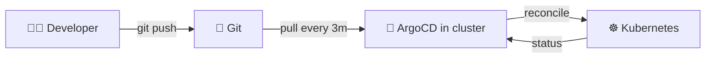
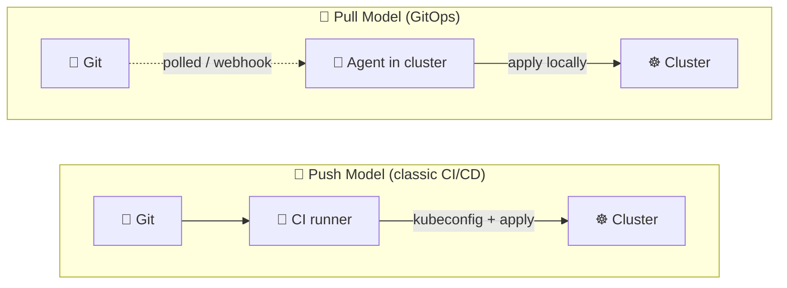
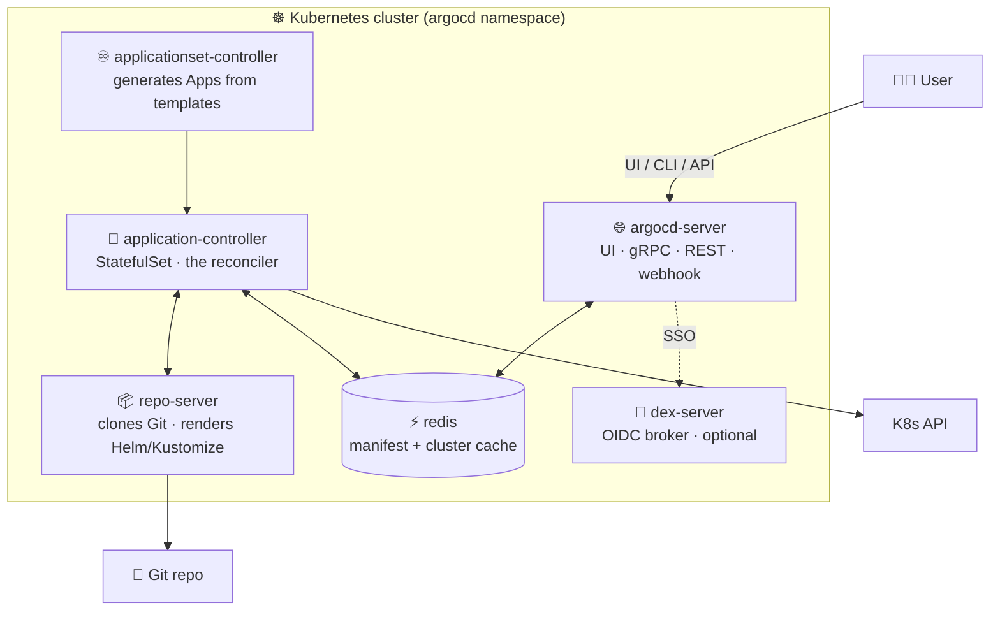
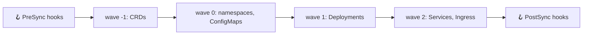
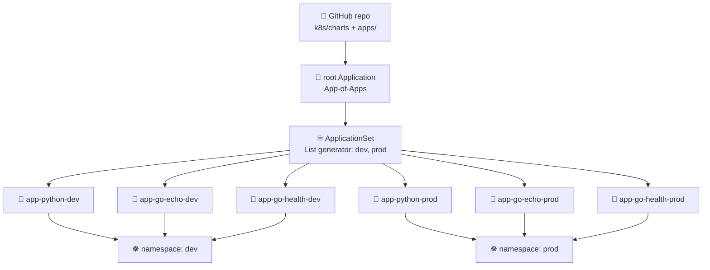
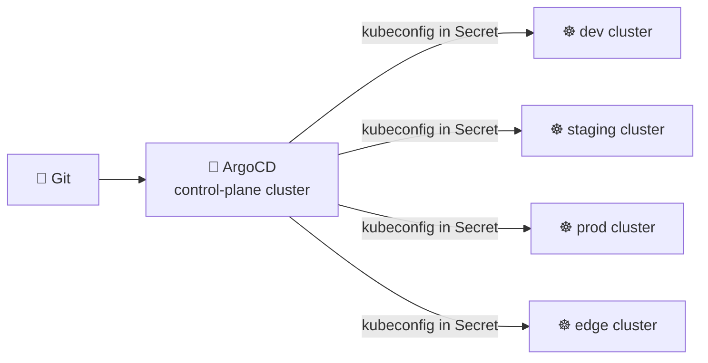
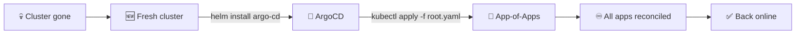
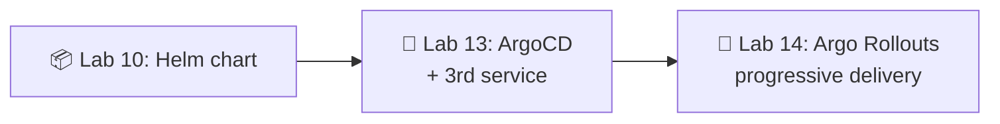

# 📌 Лекция 13 — GitOps с ArgoCD: Git как источник истины

## 📍 Слайд 1 – 🚀 Добро пожаловать в GitOps

* 🌍 **Лекции 9–12 оставили вам настоящий кластер**, в котором работает Python-сервис, упакованный через Helm, плюс sidecar Go echo, с секретами в OpenBao и постоянным состоянием на PVC. Развёртывание по-прежнему — это вы, набирающий `helm upgrade` с ноутбука.
* 🤖 **GitOps** переносит этот «ноутбук» *внутрь* кластера: агент следит за Git, забирает желаемое состояние и непрерывно выполняет сверку. Больше никаких `kubectl` вне процесса из рук человека.
* 🎯 Эта лекция: ментальная модель GitOps + архитектура **ArgoCD 3.4** (май 2026), CRD Application и ApplicationSet, политики синхронизации, паттерн App-of-Apps и почему всё это становится интересным только когда у вас есть **три** сервиса.
* 🔗 **Связь с Lab 13:** установить ArgoCD через Helm, объявить манифесты Application для `app-python`, `app-go-echo` **и третьего вспомогательного сервиса `app-go-health`**, а затем позволить `ApplicationSet` генерировать копии dev + prod из одного шаблона.



---

## 📍 Слайд 2 – 🎯 Результаты обучения

| # | Результат |
|---|---------|
| 1 | 📜 Назвать **четыре принципа OpenGitOps** и объяснить, почему каждый из них важен |
| 2 | 🔁 Сопоставить модели развёртывания **push и pull** по поверхности доступа к учётным данным, дрейфу, аудиту |
| 3 | 🏗️ Набросать **архитектуру ArgoCD 3.4**: argocd-server, application-controller, repo-server, redis, Dex |
| 4 | 📝 Читать и писать CRD **Application** с `source`, `destination`, `syncPolicy` |
| 5 | 🌳 Собирать развёртывания с помощью **паттерна App-of-Apps** и генераторов **ApplicationSet** |
| 6 | 🛡️ Рассуждать про **sync waves, хуки, self-heal, prune** и когда выигрывает ручная синхронизация |

**Технологический стек на май 2026:** **ArgoCD 3.4.x** (GA в начале мая 2026; **2.x больше не поддерживается с ноября 2025 с релизом 3.2**), Kubernetes **1.36** «Haru», единый GitOps-репозиторий на GitHub, развёртывания из вашего Helm-чарта Lab 10.

---

## 📍 Слайд 3 – ❓ Почему pull лучше push

Вы сдали Lab 12 с CI-workflow, который выполняет `helm upgrade` в отношении кластера. Это работает. Так зачем переходить?

* 🔑 **Учётные данные.** CI нужен kubeconfig с cluster-admin, чтобы применять. Этот kubeconfig лежит в секретах GitHub, на ноутбуках разработчиков, в скриптах. Любая утечка — это компрометация кластера.
* 🌊 **Дрейф.** Кто-то в 3 часа ночи делает `kubectl edit` Deployment, чтобы «починить» инцидент в prod. Helm-чарт в Git больше не соответствует реальности. Следующий `helm upgrade` молча перезаписывает исправление.
* 🕵️ **Аудит.** «Кто отмасштабировал prod ingress до 12 реплик?» — ответ живёт в истории shell, а не в Git.
* 🚑 **Восстановление.** Кластер пропал? С push CI/CD вы перезапускаете конвейеры; с GitOps вы выполняете `helm install argo-cd && kubectl apply -f root.yaml`, и кластер пересобирает сам себя.

> 🔥 **Горячее мнение:** GitOps — это не инструмент, это *инверсия управления*. Кластер тянется к Git; ничто не тянется внутрь кластера.

---

## 📍 Слайд 4 – 📜 Четыре принципа OpenGitOps

Рабочая группа CNCF **OpenGitOps** ратифицировала четыре принципа (v1.0.0). Заучите их — каждый GitOps-инструмент реализует эти принципы, иначе это не GitOps.

1. 📝 **Декларативность** — желаемое состояние описывается в декларативной форме (YAML, HCL, …), никогда императивными командами.
2. 🔒 **Версионированность и неизменяемость** — это желаемое состояние хранится с полной историей; вы всегда можете переключиться на коммит `abc123` и узнать, что было развёрнуто.
3. 🤖 **Автоматическое вытягивание** — программные агенты *внутри* целевой системы вытягивают желаемое состояние. Никто не пушит снаружи.
4. ♾️ **Непрерывная сверка** — агенты сравнивают фактическое состояние с желаемым и автоматически действуют, чтобы привести их в соответствие. Всегда.

> 💡 **Лакмусовая проверка:** если убрать агента, задрейфует ли кластер относительно Git? Если да — у вас GitOps. Если нет (потому что ничего не сверяло), у вас просто был «YAML в Git».

---

## 📍 Слайд 5 – 🔄 Push против pull, бок о бок



| Аспект | 🔄 Push CI/CD | 🚀 Pull GitOps |
|--------|--------------|----------------|
| Учётные данные кластера | Живут в секретах CI | Остаются внутри кластера |
| Обнаружение дрейфа | Нет — CI запускается и забывает | Непрерывно, каждые 3 минуты |
| Аудит-след | Логи CI (ротируются) | `git log` (неизменяемый) |
| Восстановление после сбоя | Перезапустить конвейер на новом кластере | Установить агент, указать на Git |
| Что блокирует развёртывание | Доступность CI runner | Доступность Git |

---

## 📍 Слайд 6 – 🛠️ Ландшафт GitOps-инструментов

| Инструмент | Происхождение | Сильная сторона |
|------|---------|-----------|
| **ArgoCD** | CNCF graduated (Intuit, 2018) | UI в первую очередь, декларативный CRD `Application`, sync waves |
| **Flux CD v2** | CNCF graduated (Weaveworks, 2020) | CLI в первую очередь, контроллер на ресурс (Kustomization, HelmRelease, GitRepository) |
| **Rancher Fleet** | SUSE/Rancher | Огромные мультикластерные флоты (edge, retail) |
| **Codefresh GitOps** | Octopus (коммерческий) | ArgoCD под капотом + дашборды, дрейф, мультикомандный RBAC |
| **Jenkins X** | CD Foundation | Если вам обязательно нужно сохранить Jenkins |

Курс использует **ArgoCD**, потому что (a) это самый распространённый GitOps-инструмент, (b) UI делает дрейф видимым для людей вне Kubernetes, и (c) CRD `Application` + `ApplicationSet` чисто ложатся на обучение по мультиокружениям + мультисервисам.

> 🔥 **Честное мнение:** Flux действительно хорош — легче, более в духе Unix, без UI, который нужно поддерживать. Выбирайте его для домашней лаборатории. ArgoCD побеждает в компаниях, потому что дашборды — это способ, которым неинженеры узнают, что развёртывания прошли успешно.

---

## 📍 Слайд 7 – 🏗️ Архитектура ArgoCD



* 🌐 **argocd-server** — UI + gRPC/REST API; с ним общаются люди и CI. Stateless, горизонтально масштабируется.
* 🔄 **application-controller** — сердце. Сверяет каждый CR `Application` с кластером. StatefulSet для шардирования по множеству кластеров.
* 📦 **repo-server** — клонирует Git, запускает `helm template` / `kustomize build`, возвращает отрендеренные манифесты контроллеру. Stateless, с интенсивным кешированием.
* ⚡ **redis** — кеширует манифесты, состояние кластера, ревизии Git. Потеряйте его — и сверка станет медленной, но не ошибочной.
* 🔐 **dex-server** — OIDC-брокер для SSO через GitHub/Google/Okta. Опционален; для лабораторных можно использовать локальных пользователей.
* ♾️ **applicationset-controller** — превращает один шаблон + генератор во множество CR `Application`.

---

## 📍 Слайд 8 – 📝 CRD Application

Атомарная единица ArgoCD — это один `Application` — указатель на «эта папка в этом репозитории на этой ревизии идёт в это пространство имён на этом кластере».

```yaml
apiVersion: argoproj.io/v1alpha1
kind: Application
metadata:
  name: app-python-dev
  namespace: argocd
  finalizers:
    - resources-finalizer.argocd.argoproj.io   # 🗑️ cascade-delete K8s resources on app delete
spec:
  project: default
  source:
    repoURL: https://github.com/innodevops/student-repo.git
    targetRevision: main                         # 📌 branch, tag, or commit SHA
    path: k8s/charts/app-python
    helm:
      valueFiles:
        - values-dev.yaml
  destination:
    server: https://kubernetes.default.svc        # in-cluster
    namespace: dev
  syncPolicy:
    automated:
      prune: true                                 # 🗑️ delete resources removed from Git
      selfHeal: true                              # 💚 revert manual cluster edits
    syncOptions:
      - CreateNamespace=true
```

Ключевые понятия:
* 📌 **`targetRevision: main`** против **SHA**: ветка отслеживает движущийся HEAD (годится для dev), SHA фиксирует точно (используйте для prod-релизов).
* 🗑️ **`finalizers:`** без этого удаление `Application` оставляет ресурсы K8s осиротевшими.
* 🔄 **`automated`** включает авто-синхронизацию; *если его опустить*, приложение становится **manual-sync** (нажмите кнопку или выполните `argocd app sync`).

---

## 📍 Слайд 9 – 🔄 Состояния синхронизации, здоровья и операции

Каждый `Application` отслеживает два ортогональных состояния плюс переходную операцию.

| Состояние синхронизации | Значение |
|------------|---------|
| 🟢 **Synced** | Живой кластер совпадает с отрендеренными манифестами |
| 🟡 **OutOfSync** | Дрейф между Git и кластером (это хорошо — вы его видите!) |
| ❓ **Unknown** | Репозиторий недоступен или контроллер ещё не проверил |

| Состояние здоровья | Значение |
|--------------|---------|
| 💚 **Healthy** | Все ресурсы сообщают о готовности (Deployment доступен, Pod работает и т. д.) |
| 🔵 **Progressing** | Раскатка в процессе, дайте минуту |
| 🔴 **Degraded** | Что-то сломалось (CrashLoopBackOff, ошибка схемы) |
| ⚪ **Suspended** | Хуки приостановлены или приложение на паузе |
| 🚫 **Missing** | Ресурса нет в кластере |

> 💡 Приложение может быть **Synced + Degraded** (Git верно говорит «разверни этот сломанный Pod») или **OutOfSync + Healthy** (кластер работает нормально, но не совпадает с Git). Оба состояния диагностичны.

ArgoCD 3.4 добавил фильтр **Operation Status** рядом с Sync и Health, так что UI теперь показывает «что прямо сейчас активно синхронизируется» — полезно при реагировании на инциденты.

---

## 📍 Слайд 10 – 🎚️ Политики синхронизации: manual, auto, self-heal, prune

```yaml
syncPolicy:
  automated:
    prune: true
    selfHeal: true
    allowEmpty: false       # 🛡️ refuse to apply if rendering produced 0 manifests
  syncOptions:
    - CreateNamespace=true
    - ServerSideApply=true
    - PruneLast=true
    - ApplyOutOfSyncOnly=true
  retry:
    limit: 5
    backoff:
      duration: 5s
      factor: 2
      maxDuration: 3m
```

* 🔄 **Нет блока `automated:` → ручная синхронизация.** UI показывает большую кнопку «SYNC». Стандарт для prod.
* 🤖 **`automated:` → авто-синхронизация** при каждом изменении в Git *и* при каждой периодической сверке (по умолчанию 3 мин).
* 💚 **`selfHeal: true`** — возвращает ручные правки кластера к состоянию в Git. Отключите, если ресурсом владеет контроллер (например, HPA, записывающий `replicas`).
* 🗑️ **`prune: true`** — удаляет ресурсы, которые были *удалены* из Git. Без этого удаление файла в Git оставляет работающий сироту.
* ⚙️ **`ServerSideApply=true`** использует серверное применение K8s (избегает проблемы аннотации «last-applied-configuration» и хорошо ладит с HPA/VPA).

> ⚠️ **Разумное значение по умолчанию для prod:** ручная синхронизация, `prune: false`, `selfHeal: false`. Люди проверяют каждое изменение. В dev-окружениях включается всё.

---

## 📍 Слайд 11 – 🌊 Sync waves и хуки

Некоторые ресурсы должны подниматься *раньше* других — CRD раньше пользовательских ресурсов, namespaces раньше всего, миграции БД раньше приложения.

```yaml
metadata:
  annotations:
    argocd.argoproj.io/sync-wave: "-1"           # 🌊 negative = earlier, positive = later (default 0)
    argocd.argoproj.io/hook: PreSync             # 🪝 PreSync | Sync | PostSync | SyncFail | PostDelete
    argocd.argoproj.io/hook-delete-policy: HookSucceeded
```



* 🪝 **Хуки** — произвольные ресурсы K8s (обычно Jobs), которые запускаются в точках жизненного цикла. Классическое применение: Job `pre-sync`, который выполняет `flyway migrate` до запуска новых pod'ов приложения.
* 🌊 **Waves** упорядочивают ресурсы фазы Sync. Контроллер применяет всё на волне `N`, ждёт здоровья, затем переходит к `N+1`.
* 🧹 **`hook-delete-policy`** поддерживает кластер в порядке — `HookSucceeded` удаляет Job, как только он завершается успешно.

---

## 📍 Слайд 12 – 🌳 Паттерн App-of-Apps

Проблема начальной загрузки: ArgoCD управляет вашими приложениями через CR `Application` в пространстве имён `argocd`. Но кто управляет *этими* CR `Application`? Ответ: другой `Application`.

```
gitops-repo/
└── apps/
    ├── root.yaml              # 👈 the "App-of-Apps" — points at ./apps
    ├── app-python.yaml        # Application CR for the Python service
    ├── app-go-echo.yaml       # Application CR for the Go echo service
    └── app-go-health.yaml     # Application CR for the Go health service
```

```yaml
# root.yaml — the seed
apiVersion: argoproj.io/v1alpha1
kind: Application
metadata:
  name: root
  namespace: argocd
spec:
  project: default
  source:
    repoURL: https://github.com/innodevops/student-repo.git
    targetRevision: main
    path: apps                                # 📂 directory full of Application YAMLs
  destination:
    server: https://kubernetes.default.svc
    namespace: argocd
  syncPolicy:
    automated: { prune: true, selfHeal: true }
```

Один `kubectl apply -f root.yaml`, и ArgoCD обнаруживает и синхронизирует каждое дочернее `Application`. Теперь кластер сам себя обслуживает — восстановление = переустановить ArgoCD + заново применить `root.yaml`.

---

## 📍 Слайд 13 – 🧬 Топология ArgoCD из 3 сервисов



* 🐍 **app-python** — ваш сервис из Lab 2 → Lab 10 (FastAPI).
* 🦫 **app-go-echo** — вспомогательный компаньон из Lab 9 (Go HTTP echo).
* 💚 **app-go-health** — **новый в Lab 13** — крошечный Go-сервис health/static, поставляемый как вспомогательный. Он существует *специально* для того, чтобы ApplicationSet и App-of-Apps перестали быть игрушечными паттернами.

> 💡 **Педагогический момент:** ApplicationSet с одним сервисом — это просто `kubectl apply` с лишними шагами. С **двумя** сервисами в **двух** окружениях он начинает оправдывать себя. А с **тремя сервисами × двумя окружениями = шестью Applications**, сгенерированными из одного шаблона в 30 строк, ценность очевидна. Поэтому Lab 13 вводит `app-go-health`.

---

## 📍 Слайд 14 – ♾️ ApplicationSet: один шаблон, много приложений

```yaml
apiVersion: argoproj.io/v1alpha1
kind: ApplicationSet
metadata:
  name: all-apps
  namespace: argocd
spec:
  generators:
    - matrix:
        generators:
          - list:                       # 1️⃣ which apps
              elements:
                - { svc: app-python,     path: k8s/charts/app-python }
                - { svc: app-go-echo,    path: k8s/charts/app-go-echo }
                - { svc: app-go-health,  path: k8s/charts/app-go-health }
          - list:                       # 2️⃣ which environments
              elements:
                - { env: dev,  autoSync: "true" }
                - { env: prod, autoSync: "false" }
  template:
    metadata:
      name: '{{svc}}-{{env}}'
    spec:
      project: default
      source:
        repoURL: https://github.com/innodevops/student-repo.git
        targetRevision: main
        path: '{{path}}'
        helm:
          valueFiles:
            - 'values-{{env}}.yaml'
      destination:
        server: https://kubernetes.default.svc
        namespace: '{{env}}'
      syncPolicy:
        syncOptions: [CreateNamespace=true]
```

Генератор **matrix** выполняет перекрёстное соединение двух генераторов **list** → 3 сервиса × 2 окружения = **6 CR `Application`**, материализованных автоматически. Добавить четвёртый сервис? Одна строка в первом списке.

---

## 📍 Слайд 15 – 🧰 Прочие генераторы ApplicationSet

| Генератор | По чему итерируется | Когда использовать |
|-----------|----------------------|----------|
| **List** | Встроенные литералы | Небольшой, стабильный набор (dev/staging/prod) |
| **Cluster** | Все кластеры, зарегистрированные в ArgoCD | Раскатки по мультикластерному флоту |
| **Git (Directory)** | Папки внутри пути в репозитории | Одна папка на приложение — автообнаружение новых приложений |
| **Git (File)** | Файлы YAML/JSON по пути | Один конфигурационный файл на тенанта |
| **Matrix** | Перекрёстное соединение двух генераторов | Приложения × окружения, сервисы × кластеры |
| **Merge** | Внутреннее соединение + переопределение | Наложение кластерных переопределений на базовый список |
| **SCM Provider** | Репозитории в организации GitHub/GitLab | GitOps на всю организацию для многих репозиториев сервисов |
| **Pull Request** | Открытые PR в репозитории | Эфемерные preview-окружения на каждый PR |
| **Cluster Decision** | CRD, выбирающий кластеры | Внешняя логика решает, куда попадают приложения |
| **Plugin** | HTTP-сервис, который вы пишете | Всё, что вышеперечисленное не выражает |

> 💡 **Lab 13 использует List + Matrix.** Бонус: попробуйте генератор Git Directory, направленный на `k8s/charts/` — добавление новой папки чарта автоматически создаёт Application.

---

## 📍 Слайд 16 – 🔐 RBAC и AppProjects

Из коробки каждый `Application` попадает в проект `default`, который может развертывать куда угодно. В продакшене вы разделяете доступ с помощью CR **AppProject**.

```yaml
apiVersion: argoproj.io/v1alpha1
kind: AppProject
metadata:
  name: team-payments
  namespace: argocd
spec:
  sourceRepos:
    - https://github.com/innodevops/payments-*    # 🔒 only these repos
  destinations:
    - namespace: payments-*                       # 🔒 only these namespaces
      server: https://kubernetes.default.svc
  clusterResourceWhitelist:                       # 🔒 only these cluster-scoped kinds
    - group: ''
      kind: Namespace
  namespaceResourceBlacklist:
    - group: ''
      kind: ResourceQuota
  roles:
    - name: deployer
      policies:
        - p, proj:team-payments:deployer, applications, sync, team-payments/*, allow
      groups: [innodevops:payments]
```

Пользовательский ConfigMap **argocd-rbac-cm** сопоставляет группы OIDC → роли → разрешения. Паттерн: один проект на команду, никакого использования `default` в prod, группы OIDC для привязок ролей людей.

---

## 📍 Слайд 17 – 🔒 Секреты в мире GitOps

GitOps требует «всё в Git» — но секреты открытым текстом в Git — это немедленная утечка. Три готовых к продакшену ответа:

| Паттерн | Как работает | Компромисс |
|---------|--------------|----------|
| **Sealed Secrets** (Bitnami) | Контроллер в кластере имеет пару ключей; вы через `kubeseal` превращаете `Secret` в `SealedSecret` (шифр в YAML); контроллер расшифровывает при применении | Ключ на кластер — перезапечатывать при ротации |
| **External Secrets Operator + OpenBao** | Git хранит только *ссылку* `ExternalSecret`; ESO вытягивает фактическое значение из OpenBao/Vault/SSM во время синхронизации | Операционная зависимость от хранилища секретов |
| **SOPS + KMS / age** | Файлы шифруются в Git с помощью `sops`; плагин ArgoCD (`argocd-vault-plugin`, `helm-secrets`) расшифровывает при рендеринге | Установка плагина + управление ключами |

Ваш **Lab 11** уже подключил OpenBao + ESO — именно этот паттерн Lab 13 продолжает использовать. Ресурсы `Secret` никогда не появляются в Git; только ссылки `ExternalSecret`.

> 🔥 **Никогда** не кладите секреты открытым текстом в GitOps-репозиторий, даже приватный. История Git вечна.

---

## 📍 Слайд 18 – 🌐 Мультикластерный GitOps

ArgoCD, работающий в **одном** кластере «control plane», может управлять **множеством** рабочих кластеров.



* 🔑 Каждый целевой кластер регистрируется через `argocd cluster add <context>`, что создаёт `Secret` с его kubeconfig в пространстве имён `argocd`.
* ♾️ **Генератор Cluster** в ApplicationSet сочетает это с одним шаблоном → «развернуть это приложение в каждом кластере с меткой `tier=edge`».
* ⏸️ **ArgoCD 3.4 добавил Pause Reconciliation на кластер** — переключите тумблер, чтобы заморозить проблемный кластер посреди инцидента, не трогая остальные.

> 💡 **Hub-and-spoke против федеративного:** модель хаба проще; для >50 кластеров или строгой сетевой изоляции рассмотрите **Argo CD Argocd в каждом кластере** + контроллер флота более высокого уровня (Fleet, Cluster API).

---

## 📍 Слайд 19 – 🩺 Наблюдение за самим ArgoCD

ArgoCD из коробки отдаёт метрики Prometheus (стек вашего Lab 8 их скрейпит).

| Метрика | За чем следить |
|--------|-----------|
| `argocd_app_info{sync_status="OutOfSync"}` | Устойчивый дрейф |
| `argocd_app_info{health_status="Degraded"}` | Сломанные приложения |
| `argocd_app_sync_total{phase="Failed"}` | Неудачные синхронизации |
| `argocd_app_reconcile_bucket` | Гистограмма задержки сверки |
| `argocd_cluster_api_resource_objects` | Рост количества объектов (сигнал масштабирования) |
| `argocd_redis_request_total` | Нагрузка на кеш |

Подключите их к стеку Grafana из Lab 8 и настройте алерты на **Degraded > 5 минут** и **OutOfSync > 30 минут** (кластеры с авто-синхронизацией никогда не должны оставаться OutOfSync так долго; если остаются — что-то заклинило).

---

## 📍 Слайд 20 – 🚨 Восстановление после сбоя: Git — это ваш бэкап

Чистая история восстановления GitOps:



1. 🆕 Подготовьте новый кластер (Terraform / kubeadm / kOps).
2. 📦 `helm install argo-cd argo/argo-cd -n argocd --create-namespace`.
3. 🌱 `kubectl apply -f apps/root.yaml`.
4. ☕ Ждите. Всё остальное — в Git.

> ⚠️ **Что *не* восстанавливается:** stateful-данные (PVC, базы данных). GitOps восстанавливает **конфигурацию**, а не **состояние**. Сочетайте со снапшотами PV / Velero / бэкапами баз данных. Это тот же урок, который вбивали Labs 11 (секреты) и 12 (PVC).

---

## 📍 Слайд 21 – 🧰 Антипаттерны и частые ошибки

1. ❌ **`kubectl apply` в пространство имён, управляемое GitOps** — self-heal откатит это через 3 минуты, и вы потратили всем день на отладку. Делайте изменение в Git.
2. ❌ **`prune: true` при первой установке** — если ваш `path:` неверен, ArgoCD с радостью удалит всё, чего он не видит. Начните с `prune: false`, проверьте, затем включите.
3. ❌ **Указание `targetRevision` на `HEAD`** для prod — молчаливые раскатки на каждый коммит в `main`. Используйте тег или ветку `release/*`.
4. ❌ **Хранение YAML `Secret` открытым текстом в Git** — даже в приватном репозитории. Используйте Sealed Secrets / ESO / SOPS.
5. ❌ **Один гигантский `Application` для «всего»** — вы теряете синхронизацию на приложение, статус на приложение, RBAC на приложение. Один Application на (сервис × окружение).
6. ❌ **Смешивание задач репозитория** — держите **код приложения** и **манифесты GitOps** в *разных* репозиториях (или как минимум по разным путям). CI собирает образ; GitOps-репозиторий ссылается на новый тег.
7. ❌ **Забыть finalizer** — осиротевшие ресурсы при `kubectl delete app` — это то, как бунтарские Pod'ы выживают в продакшене год.
8. ❌ **selfHeal на ресурсах с HPA** — HPA пишет `spec.replicas`, ArgoCD откатывает его, начинается борьба. Используйте `ignoreDifferences:` на `/spec/replicas`.

---

## 📍 Слайд 22 – 🌍 GitOps в реальном мире

* 🏢 **Intuit** открыл исходный код ArgoCD в 2018 году, чтобы управлять ~2 000 микросервисов; они делают сотни развёртываний в день из Git.
* 🛒 **BlackRock, Adobe, Tesla, Red Hat OpenShift GitOps** — все используют ArgoCD в продакшене в большом масштабе.
* 📊 **Годовой опрос CNCF 2024:** внедрение GitOps — практика K8s с самым быстрым ростом; **ArgoCD** — доминирующий инструмент в ответах опроса.
* 🏷️ **Проект Argo стал CNCF graduated** в декабре 2022 — тот же уровень зрелости, что у Kubernetes, Prometheus, Envoy.
* 🚀 **ArgoCD 3.4** (начало мая 2026) удвоил усилия по Day-2 операциям: пауза на кластер, более богатые фильтры UI, версия K8s, хранимая как Major.Minor.Patch, трассировка OpenTelemetry через OIDC-поток.

> 📊 **Одна цифра:** опрос Codefresh «State of GitOps» 2024 года оценил **ArgoCD в ~70 % GitOps-развёртываний**, Flux — ~25 %, остальное — длинный хвост.

---

## 📍 Слайд 23 – 🎯 Ключевые выводы

1. 📜 **GitOps = четыре принципа OpenGitOps** — декларативность, версионированность, вытягивание, непрерывная сверка. Всё остальное — детали реализации.
2. 🚀 **Pull лучше push** по поверхности доступа к учётным данным, обнаружению дрейфа и восстановлению после сбоя.
3. 🏗️ **ArgoCD = 5 компонентов** — argocd-server, application-controller, repo-server, redis, dex (+ applicationset-controller). Запомните их задачи.
4. 📝 **CRD Application** — атомарная единица; **App-of-Apps** загружает весь кластер из одного семени.
5. ♾️ **ApplicationSet** с Matrix(List × List) генерирует N сервисов × M окружений из одного шаблона — лабораторный паттерн.
6. 🎚️ **Политика синхронизации = manual для prod, automated+selfHeal+prune для dev** — разумное значение по умолчанию.
7. 🌊 **Sync waves + хуки** упорядочивают миграции БД до pod'ов приложения и cleanup-jobs после.
8. 🔒 **Секреты держатся вне Git** — Sealed Secrets / ESO + OpenBao / SOPS. Навсегда.

> 💬 *«Operations by Pull Request.»* — Kelsey Hightower

---

## 📍 Слайд 24 – 🚀 Что дальше

**📚 Следующая лекция: *Прогрессивная доставка с Argo Rollouts*** — потому что когда GitOps развёртывает мгновенно при мерже, следующий вопрос: *«как развёртывать **осторожно**?»* Canary, blue-green, автоматический анализ.

* 🐤 **Canary-развёртывания** — 10% → 50% → 100%, с гейтами по запросам Prometheus
* 🔵 **Blue-green** — два полных стека, мгновенное переключение, мгновенный откат
* 📊 **AnalysisTemplate** — продвижение / откат на основе метрик
* 🔄 **Argo Rollouts** против Flagger — два конкурента

**🔬 Результаты Lab 13:**
* Установите ArgoCD 3.4 через Helm в вашем кластере
* Добавьте **третий сервис** — `app-go-health` (вспомогательные файлы поставляются в `app_go_health/`)
* Объявите `Application` для каждого из **трёх** сервисов в **двух** окружениях (dev + prod) — всего шесть Applications
* Замените шесть одним **ApplicationSet** с генератором Matrix(List, List)
* Оберните всё в корневой Application **App-of-Apps**
* Авто-синхронизируйте dev с selfHeal + prune; держите prod **вручную**
* Бонус 2.5 балла: переключитесь на генератор Git Directory, который автообнаруживает новые чарты под `k8s/charts/*`



> 🌊 От «я развернул это» к «Git развернул это» — по одному мержу за раз.

---

## 📚 Ресурсы

* 📕 *GitOps and Kubernetes* — Yuen, Matyushentsev, Ekenstam, Suen (Manning, 2021) — каноническая книга о паттерне
* 📕 *The Path to GitOps* — Christian Hernandez (Red Hat e-book, 2024) — коротко, с фокусом на практику
* 🌐 [argo-cd.readthedocs.io](https://argo-cd.readthedocs.io/en/stable/) — официальная документация ArgoCD
* 🌐 [opengitops.dev](https://opengitops.dev/) — четыре ратифицированных принципа
* 🌐 [github.com/argoproj/argo-cd](https://github.com/argoproj/argo-cd) — исходники + релизы
* 🌐 [fluxcd.io](https://fluxcd.io/) — другой GitOps-инструмент CNCF, который стоит знать
* 🌐 [Опрос Codefresh «State of GitOps»](https://codefresh.io/) — ежегодные цифры внедрения
* 🎙️ Keynote KubeCon 2023 — *«GitOps at Intuit»* (Hong Wang) — история зарождения ArgoCD в масштабе

**🎓 Квиз:** квиз после лекции идёт в окно таблицы лидеров недель 13–16.
