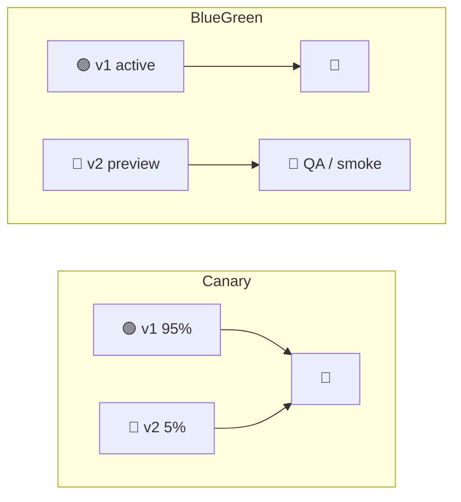
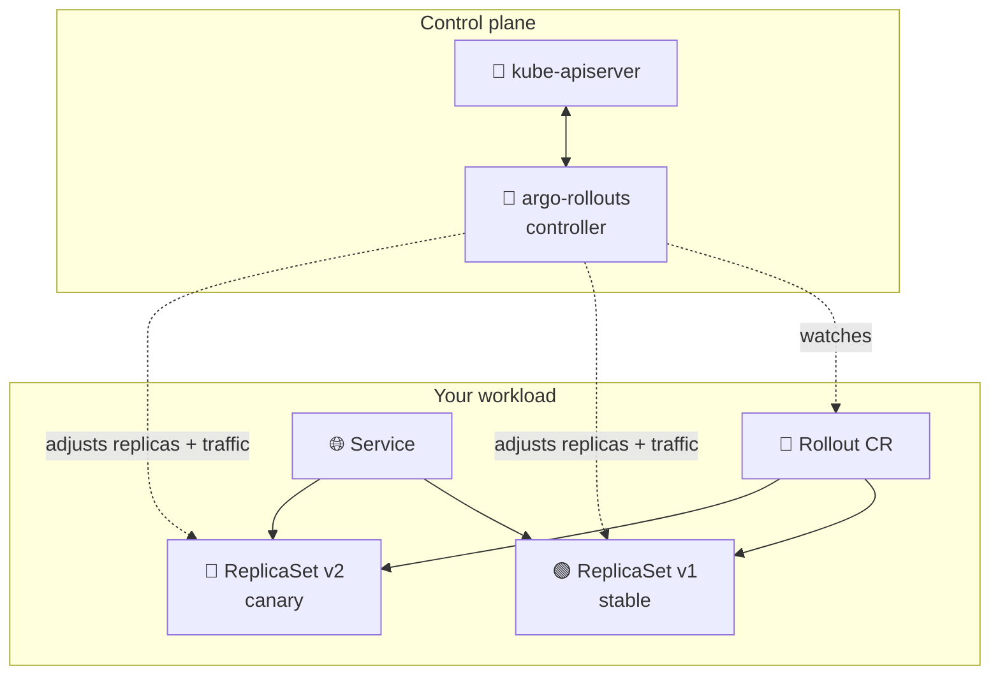
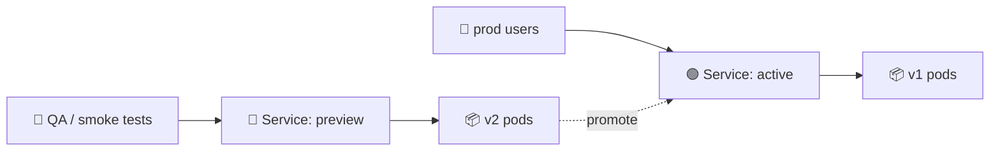
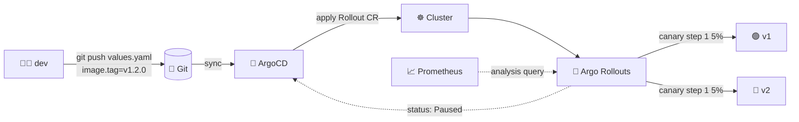
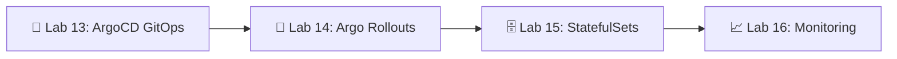

# 📌 Лекция 14 — Прогрессивная доставка с Argo Rollouts

## 📍 Слайд 1 – 🚦 Добро пожаловать в прогрессивную доставку

* 🌍 **Лекция 13 дала вам GitOps.** ArgoCD теперь сверяет ваш Helm-чарт из Git → кластер за секунды. Источник истины: решено.
* 🐤 **Но «развёрнуто» ≠ «выпущено».** Раскатка Deployment подменяет pod'ы по 25% за раз и перестаёт измерять, как только они проходят проверку живости (liveness probe). Баг в вашем новом образе — тот, что срабатывает только на 5% запросов — доставляется 100% пользователей.
* 🎯 Эта лекция: заменить `kind: Deployment` на `kind: Rollout`, управлять трафиком по шагам (5% → 25% → 50% → 100%), позволить метрикам решать, продвигать или откатывать — **без человека, смотрящего в Grafana в пятницу вечером**.
* 🔗 **Связь с Lab 14:** преобразовать ваш чарт из Lab 13 из `Deployment` → `Rollout`, поставить canary-стратегию с 5-шаговым сдвигом трафика, затем добавить параллельную blue-green-стратегию с `previewService`, плюс `AnalysisTemplate` для Prometheus в качестве бонуса.

```mermaid
flowchart LR
  Deploy[📦 kind: Deployment] -->|25% pods at a time, no metrics| Done[✅ "Deployed"]
  Rollout[🐤 kind: Rollout] -->|5% → 25% → 50% → 100%<br/>+ metric gates| Released[🎯 "Released"]
```

---

## 📍 Слайд 2 – 🎯 Результаты обучения

| # | Результат |
|---|---------|
| 1 | 🧠 Различать **развёртывание** (pod'ы запускают новый код) и **релиз** (пользователи видят новый код) |
| 2 | 🐤 Настроить стратегию **canary** с весовыми шагами и паузами |
| 3 | 🔵 Настроить стратегию **blue-green** с `activeService` + `previewService` |
| 4 | 📊 Написать **`AnalysisTemplate`**, который запрашивает Prometheus и автоматически продвигает / прерывает |
| 5 | 🚦 Подключить **управление трафиком** через NGINX, ALB, Istio или плагин Gateway API |
| 6 | 🛠️ Управлять раскаткой через `kubectl argo rollouts`: `get`, `promote`, `abort`, `retry`, `undo` |

**Технологический стек на май 2026:** **Argo Rollouts 1.8.4** (выпущен 13 февраля 2026), Kubernetes **1.36 «Haru»**, ArgoCD **3.4.x** для синхронизации, **Prometheus 3.11.3** (или линейка 3.5 LTS) для метрик анализа — тот же Prometheus, что вы подняли в Lab 8.

---

## 📍 Слайд 3 – ❓ Развёртывание ≠ релиз

Вы делали rolling-обновления с обычным `kind: Deployment` ещё с Lab 9. Так почему этого недостаточно?

* 🩺 **Единственный сигнал здоровья Deployment — проба на уровне pod'а.** Как только готовность становится зелёной, K8s переключает трафик. Утечки памяти, медленная хвостовая задержка и всплески 5xx невидимы для раскатки.
* ⏱️ **`maxSurge` и `maxUnavailable` — грубые регуляторы.** `maxSurge` 25% означает, что ко 2-й минуте 25% трафика идут на сломанную сборку без автоматического прерывания.
* 🌐 **Нет примитива процента трафика.** Deployment не может сказать «отправь 5% HTTP-запросов на v2 и 95% на v1». Он может только сказать «замени N pod'ов».
* 🚫 **Нет интеграции с метриками.** Вы не можете сказать Deployment «откатись, если 5xx > 1%». Вы можете сказать это *Argo Rollouts* — именно так.

> 🔥 **Горячее мнение:** «двигайся быстро и ломай вещи» умерло; «двигайся быстро с обратными связями» — вот что на самом деле делают элитные команды. Прогрессивная доставка — это то, что замыкает цикл между *развёртыванием кода* и *знанием, что он работает*.

---

## 📍 Слайд 4 – 📜 Краткая история прогрессивной доставки

* 📅 **2010** — Humble и Farley публикуют *Continuous Delivery*. Книга вводит метафору canary как «разверни на один сервер, наблюдай, затем продвигай».
* 📅 **2014** — Netflix открывает исходники **Spinnaker** со встроенными canary-стадиями, опирающимися на их внутренний «ACA» (Automated Canary Analysis).
* 📅 **2018** — Netflix + Google открывают исходники **Kayenta**, статистического судьи canary (U-критерий Манна — Уитни). Пользователи Spinnaker получают бесплатное продвижение на основе метрик.
* 📅 **2019** — Weaveworks вводят термин **«progressive delivery»** в блог-посте; они выпускают **Flagger** вместе с Flux. Команда Argo в том же году выпускает **Argo Rollouts** вместе с ArgoCD.
* 📅 **2021** — Argo Rollouts **v1.0 GA**. Присоединяется к ArgoCD/Workflows/Events как проект CNCF incubation, переходит в Graduated в **декабре 2022**.
* 📅 **2024** — CNCF архивирует спецификацию **SMI** (Service Mesh Interface). **Gateway API** + плагин Argo Rollouts Gateway API становятся рекомендованным путём для управления трафиком между мешами.
* 📅 **2026 (13 февраля)** — **Argo Rollouts 1.8.4** — релиз с исправлением для blue-green-анализа (проблема «преждевременного успеха, когда ReplicaSet становится ненасыщенным»), плюс обновления зависимостей.

> 📚 *The Phoenix Project* и *Accelerate* обе называют прогрессивную доставку самым сильным предиктором низкой доли неудачных изменений (change failure rate). DORA 2024: у элитных команд **< 5% доли неудачных изменений**; у отстающих — 15–30%.

---

## 📍 Слайд 5 – 🐤 Canary, blue-green и друзья

Четыре стратегии, которые вы увидите в реальности. Argo Rollouts реализует первые две нативно; остальные — паттерны уровня приложения.

| Стратегия | Как переключает трафик | Стоимость ресурсов | Лучше всего для |
|----------|----------------------|----------------|----------|
| 🟰 **Rolling** (встроена в Deployment) | Количество pod'ов, а не % запросов | 1x + maxSurge | Stateless, изменения с низким риском |
| 🐤 **Canary** | % запросов через маршрутизатор трафика (5 → 25 → 50 → 100) | 1x + реплики canary | Большинства prod-развёртываний |
| 🔵 **Blue-Green** | Переключение сервиса «всё или ничего» | 2x во время переключения | Миграции БД, ломающие изменения API |
| 🚩 **Feature flag** | На каждый запрос, внутри приложения | 1x (это просто код) | Внутренние или A/B-эксперименты |



> 🤔 **Подумайте:** какую стратегию вы выберете для изменения схемы БД, которое v1 не может прочитать? *(Подсказка: не canary — 5% пользователей, попадающих на сломанную схему, это всё равно 5% пользователей.)*

---

## 📍 Слайд 6 – 🤖 Argo Rollouts: замена «один к одному»

Argo Rollouts — это контроллер Kubernetes, которому принадлежит CRD под названием `Rollout`. Форма на 95% идентична `Deployment` — те же `replicas`, `selector`, `template` — плюс блок `strategy`, где вы объявляете, *как* раскатывать.



* 📜 **Один CRD заменяет Deployment.** Контроллер управляет двумя ReplicaSet'ами — stable и canary — и переключает pod'ы и/или HTTP-веса между ними.
* 🔧 **Плагин kubectl** (`kubectl argo rollouts`) даёт вам `get`, `promote`, `abort`, `retry`, `undo`, плюс подкоманду `dashboard` для локального UI.
* 🤝 **ArgoCD уже понимает Rollouts.** Как только вы замените `Deployment` в чарте на `Rollout`, UI ArgoCD отрисовывает прогресс раскатки как полноценный объект — без дополнительной конфигурации.

> 🔥 **Миграция механическая:** `sed -i 's/kind: Deployment/kind: Rollout/' templates/*.yaml`, затем добавьте блок `strategy:`. Шаблон pod'а не изменяется.

---

## 📍 Слайд 7 – 📜 Минимальная раскатка

```yaml
apiVersion: argoproj.io/v1alpha1
kind: Rollout
metadata:
  name: lab14-app
spec:
  replicas: 10
  selector:
    matchLabels:
      app: lab14-app
  template:
    metadata:
      labels:
        app: lab14-app
    spec:
      containers:
        - name: web
          image: ghcr.io/innodevops/lab2-app:v1.2.0
          ports: [{containerPort: 8080}]
          readinessProbe:
            httpGet: {path: /ready, port: 8080}
  strategy:
    canary:
      steps:
        - setWeight: 5
        - pause: {duration: 2m}
        - setWeight: 25
        - pause: {duration: 5m}
        - setWeight: 50
        - pause: {duration: 5m}
        - setWeight: 100
```

* 🐤 **Список шагов выполняется сверху вниз.** Каждый `setWeight` — это процент от *реплик* (без маршрутизатора трафика) или процент от *запросов* (с маршрутизатором трафика — см. слайд 12).
* ⏸️ **`pause: {duration: ...}`** — пауза на время; **`pause: {}`** — жёсткий ручной гейт — раскатка стоит на месте, пока вы не выполните `kubectl argo rollouts promote`.
* 🎯 **`setWeight: 100` в конце не нужен** — контроллер считает 100% финальным состоянием после завершения всех шагов.

---

## 📍 Слайд 8 – ⏱️ Что происходит на каждом шаге

| Время | Реплики stable | Реплики canary | Трафик на v2 | Состояние |
|------|----------------|----------------|----------------|-------|
| T+0   | 10 | 0 | 0%   | `Progressing` (развёртывается canary) |
| T+0.5 | 10 | 1 | 5%   | `Paused` (таймер 2 мин) |
| T+2.5 | 8  | 3 | 25%  | `Paused` (таймер 5 мин) |
| T+7.5 | 5  | 5 | 50%  | `Paused` (таймер 5 мин) |
| T+12.5 | 0 | 10 | 100% | `Healthy` ✅ |

* 🔄 **Без маршрутизатора трафика** Argo Rollouts аппроксимирует вес, корректируя *соотношение числа реплик* и полагаясь на round-robin `Service` для остального. При 10 репликах всего 5% округляется до 1 canary-pod'а.
* 🚦 **С маршрутизатором трафика** (NGINX, ALB, Istio, Gateway API) вес точен на уровне HTTP независимо от числа реплик. Вы можете пустить 5% трафика на 10% pod'ов.
* 💥 **`Degraded`** появляется, если canary ReplicaSet не укладывается в дедлайны прогресса или шаг `analysis` завершается неудачей.

---

## 📍 Слайд 9 – 🔵 Стратегия Blue-Green

Когда вы не можете позволить себе смешивать версии — скажем, при обратно-несовместимой миграции схемы — переключите весь трафик разом.

```yaml
strategy:
  blueGreen:
    activeService: lab14-app
    previewService: lab14-app-preview
    autoPromotionEnabled: false      # require manual `promote`
    scaleDownDelaySeconds: 300       # keep old pods 5 min for fast rollback
    prePromotionAnalysis:
      templates: [{templateName: smoke-tests}]
```



* 🟢 **`activeService`** — это то, что использует продакшен-трафик. Селектор переписывается контроллером, чтобы указывать на текущий «живой» ReplicaSet.
* 🔵 **`previewService`** указывает на новый ReplicaSet — ваша команда QA / smoke-тесты / синтетические мониторы бьют по этому URL.
* ⏪ **`scaleDownDelaySeconds`** сохраняет старые pod'ы живыми N секунд после продвижения. Откатитесь мгновенно, выполнив `kubectl argo rollouts undo` до истечения таймера.

> ⚠️ **Реальность стоимости:** во время переключения вы запускаете 2x pod'ов (active + preview), 2x стоимость кластера на это окно. Заложите это в бюджет.

---

## 📍 Слайд 10 – 📊 AnalysisTemplate — решения на основе метрик

Самая мощная функция Argo Rollouts: определите запрос, условие успеха и порог неудачи. Ссылайтесь на него из шага раскатки, и контроллер *автоматически* прервёт её при регрессии.

```yaml
apiVersion: argoproj.io/v1alpha1
kind: AnalysisTemplate
metadata:
  name: success-rate
spec:
  args:
    - name: service-name
  metrics:
    - name: success-rate
      interval: 1m              # query every minute
      count: 5                  # take 5 samples
      successCondition: result[0] >= 0.99
      failureLimit: 2           # 2 failures → abort
      provider:
        prometheus:
          address: http://prometheus.monitoring:9090
          query: |
            sum(rate(http_requests_total{
              service="{{args.service-name}}",
              status!~"5.."
            }[2m]))
            /
            sum(rate(http_requests_total{
              service="{{args.service-name}}"
            }[2m]))
```

* 🎯 **`successCondition`** — это выражение Go над `result` — Prometheus возвращает `[]float64`, возьмите индекс 0 для мгновенных запросов.
* ❌ **`failureLimit: 2`** означает, что допускается до 2 неудачных измерений; третье прерывает раскатку.
* ⚠️ **`inconclusiveLimit`** (не показан) ставит на паузу (а не прерывает), когда данные отсутствуют — полезно, если Prometheus медленно скрейпит новые pod'ы.

---

## 📍 Слайд 11 – 🔗 Подключение анализа к canary

Вставьте шаг `analysis` между сменой весов. Раскатка не продолжится, пока анализ не вернёт `Successful`.

```yaml
strategy:
  canary:
    steps:
      - setWeight: 5
      - pause: {duration: 2m}
      - analysis:
          templates: [{templateName: success-rate}]
          args:
            - name: service-name
              value: lab14-app-canary
      - setWeight: 25
      - analysis:
          templates: [{templateName: success-rate}]
          args:
            - name: service-name
              value: lab14-app-canary
      - setWeight: 100
```

Результаты анализа:

| Результат | Действие раскатки |
|--------|----------------|
| ✅ `Successful` | Перейти к следующему шагу |
| ❌ `Failed` | Авто-прерывание, уменьшить canary, вернуть трафик на stable |
| ⚠️ `Inconclusive` | Пауза; возобновить вручную через `promote` |
| 🐢 `Running` | Продолжать выборку до достижения count или failureLimit |

> 🔥 **Совет профи:** также настройте `analysis` как `backgroundAnalysis` на уровне spec — он идёт параллельно с каждым шагом с момента старта, так что регрессия посреди шага прерывает сразу, а не ждёт следующего гейта.

---

## 📍 Слайд 12 – 🚦 Маршрутизация трафика: соотношение реплик против реальных HTTP-весов

Без маршрутизатора трафика «5% трафика» аппроксимируется соотношением числа реплик. Это грубо и неточно при малом N. Интеграция **маршрутизатора трафика** позволяет контроллеру программировать реальные HTTP-веса в ваш ingress или mesh.

| Маршрутизатор | Ресурс, который правит Argo Rollouts | Когда |
|--------|------------------------------|------|
| 🌐 **NGINX Ingress** | Второй `Ingress` с `nginx.ingress.kubernetes.io/canary: true` + `canary-weight` | Самый распространённый ingress K8s |
| 🚢 **AWS ALB** | Вес `TargetGroupBinding` в `ListenerRule` | Магазины на EKS с управляемым ALB |
| 🕸️ **Istio** | Веса HTTP-маршрута `VirtualService` | Существующий mesh Istio |
| 🔗 **Linkerd** | Через **SMI** TrafficSplit (legacy) или **Gateway API** (рекомендуется) | Пользователи Linkerd |
| 🌉 **Плагин Gateway API** | Нативные взвешенные бэкенды `HTTPRoute` — работает на любой реализации GW API | Новые развёртывания (агностично к mesh) |

Пример с NGINX:

```yaml
strategy:
  canary:
    canaryService: lab14-app-canary
    stableService: lab14-app-stable
    trafficRouting:
      nginx:
        stableIngress: lab14-app-ingress
    steps:
      - setWeight: 5
      - pause: {duration: 2m}
      - setWeight: 100
```

> 📚 **CNCF архивировал спецификацию SMI в 2024.** Новая работа должна ориентироваться на **Kubernetes Gateway API** через плагин `argoproj-labs/rollouts-plugin-trafficrouter-gatewayapi` — один плагин, любой соответствующий mesh.

---

## 📍 Слайд 13 – 🛠️ kubectl argo rollouts — набор для выживания

```bash
# 📊 Live status — refreshes in place, shows weight, pods, analysis
kubectl argo rollouts get rollout lab14-app --watch

# ⏯️ Move past a manual `pause: {}`
kubectl argo rollouts promote lab14-app

# ⏩ Skip ALL remaining steps and go to 100% (use sparingly)
kubectl argo rollouts promote lab14-app --full

# 💥 Abort the in-progress rollout — traffic flips back to stable
kubectl argo rollouts abort lab14-app

# 🔁 Restart a Degraded rollout from step 0 (after you've fixed the image)
kubectl argo rollouts retry rollout lab14-app

# ⏪ Roll back to the previous stable ReplicaSet (after promotion)
kubectl argo rollouts undo lab14-app

# 🖥️ Local dashboard at http://localhost:3100
kubectl argo rollouts dashboard
```

> 🔧 **Совет:** сделайте алиас для длинной команды — `alias kr='kubectl argo rollouts'`. Поблагодарите себя к середине Lab 14.

---

## 📍 Слайд 14 – 🔁 ArgoCD + Argo Rollouts — полный цикл GitOps

Lab 13 подключил ArgoCD; Lab 14 меняет тип рабочей нагрузки. ArgoCD рассматривает `Rollout` как полноценный ресурс, следя за его `.status.phase` ради `Healthy` / `Paused` / `Degraded`.



* ✅ ArgoCD сообщает приложение `Healthy` *только* когда Rollout `Healthy` — приостановленная canary показывается как `Progressing`, прерванная — как `Degraded`. Больше никаких «синхронизировано, но на самом деле сломано».
* 🚫 **Не включайте авто-синхронизацию ArgoCD `selfHeal: true` на полях `status` CR Rollout.** ArgoCD по умолчанию сравнивает только spec — но если вы это расширили, вы можете конфликтовать с контроллером раскатки.

---

## 📍 Слайд 15 – 🐦 Flagger — другая опция

Argo Rollouts не одинок. **Flagger** (Weaveworks, теперь подпроект Flux) — другой крупный контроллер прогрессивной доставки.

| | 🐤 **Argo Rollouts** | 🐦 **Flagger** |
|---|------------------------|----------------|
| Модель ресурсов | Заменяет Deployment на CRD `Rollout` | Сохраняет ваш существующий Deployment, добавляет CR `Canary` |
| Форма раскатки | Явный список `steps:` (вы пишете каждый вес) | Декларативные `stepWeight`/`maxWeight` — контроллер увеличивает автоматически |
| Сочетание с GitOps | ArgoCD (семейство того же проекта) | Flux CD (семейство того же проекта) |
| Поддержка mesh | Нативно: NGINX, ALB, Istio, Traefik, AppMesh, плагины (Gateway API, Contour, Consul…) | Нативно: Istio, Linkerd, AppMesh, Contour, NGINX, Gloo, Gateway API |
| Провайдеры метрик | Prometheus, Datadog, NewRelic, Wavefront, CloudWatch, Graphite, InfluxDB, Kayenta, Web | Prometheus, Datadog, CloudWatch, NewRelic, Graphite, кастомные вебхуки |
| Ручные гейты | Полноценные (`pause: {}`) | Возможны через вебхук, менее эргономичны |

> 🔥 **Правило большого пальца:** если вы на ArgoCD — используйте Argo Rollouts. Если на Flux — используйте Flagger. Эти двое — духовные братья: те же цели, чуть разная эргономика. Этот курс использует Argo Rollouts, потому что Lab 13 уже поднял ArgoCD.

---

## 📍 Слайд 16 – 🔥 Частые антипаттерны

1. ❌ **Canary без анализа.** Пауза по времени «5 минут на 5%» — это просто медленная русская рулетка. Всегда подключайте `AnalysisTemplate`.
2. ❌ **`successCondition: result[0] >= 0.95`.** Слишком мягко — это допускает 5% частоту ошибок. Реальные SLO — 99,9%+.
3. ❌ **Нет `failureLimit`.** Без него один сбой Prometheus прерывает каждую раскатку. По умолчанию ставьте `failureLimit: 2` или `3`.
4. ❌ **Селектор по меткам `version: v1`.** Конфликт селектора Service и метки раскатки — Argo Rollouts внедряет свою метку `rollouts-pod-template-hash`, и вы сломаете сервис.
5. ❌ **`scaleDownDelaySeconds: 0` на blue-green.** Старые pod'ы исчезают в момент продвижения; если вы найдёте баг через 10 секунд, откатываться будет *некуда*.
6. ❌ **Смешивание canary + миграции БД.** 5% пользователей попадают на v2 → v2 пишет колонку, которую v1 не может прочитать → 95% пользователей получают 500. Используйте blue-green для изменений схемы, с миграцией как pre-promotion-анализом.
7. ❌ **Пропуск плагина kubectl в CI.** Ваша CI-задача запускает `kubectl rollout status` (команда Deployment), путается и сообщает «success», пока canary ещё на 5%. Используйте `kubectl argo rollouts status`.

---

## 📍 Слайд 17 – 🏭 Прогрессивная доставка в реальном мире

* 🎬 **Netflix** — пионер автоматизированного canary-анализа с Kayenta (2018, совместно с Google). Каждый конвейер Spinnaker в Netflix ставит продакшен за статистическое сравнение метрик canary-против-baseline. Их canary-«судья» использует U-критерий Манна — Уитни для значимости временных рядов.
* 🏢 **Google** — использует canary + blue-green внутри; одна задача Borg на регион, с переключением трафика между регионами за часы, а не минуты. SRE book, глава 8.
* 🐙 **GitHub** — поставляет окружение «preview» для каждого внутреннего изменения до мержа; prod-раскатка идёт регион за регионом с гейтами по метрикам.
* 🐦 **Twitter (теперь X)** — публичный инженерный блог (2023) о раскатке изменений алгоритма ленты через canary 0,1% → 1% → 10% с 24-часовыми окнами наблюдения.
* 💸 **Capital One** — кейс (2022): переход от только blue-green к canary + анализ после инцидента на $20M, вызванного мгновенным продвижением на 100% сломанного auth-сервиса.

> 📊 **DORA 2024:** организации, использующие прогрессивную доставку, сообщают о **на 41% меньшей доле неудачных изменений**, чем те, кто всё ещё на rolling Deployment.

---

## 📍 Слайд 18 – 🎚️ Выбор размеров шагов

Универсального «правильного» списка шагов canary нет. Калибруйте по **ожидаемому бюджету ошибок** и **объёму трафика**.

| Тип сервиса | Трафик | Рекомендуемые шаги |
|--------------|---------|--------------------|
| 🌐 Внутренний админ-инструмент | < 100 rpm | `25 → 50 → 100`, паузы 2 мин |
| 🏬 API со средним трафиком | 1k–10k rpm | `5 → 25 → 50 → 100`, паузы 5 мин + анализ |
| 🌍 Высоконагруженный публичный сервис | > 100k rpm | `1 → 5 → 10 → 25 → 50 → 100`, паузы 30 мин + фоновый анализ |
| 💳 Платежи / auth (высокий радиус поражения) | любой | `1 → 5 → 25 → 50 → 100`, ручные гейты между КАЖДЫМ шагом + многооконный анализ |

* 📏 **Правило:** меньше первый шаг + длиннее пауза, когда цена плохого развёртывания высока. Canary 5% на сервисе, обрабатывающем 1M запросов/мин, всё равно подвергает 50 000 запросов/мин багам.
* ⏱️ **Длина паузы** должна быть ≥ окна выборки анализа (например, запрос с частотой 5 мин → минимум пауза 5 мин), чтобы первый анализ видел только трафик canary.

---

## 📍 Слайд 19 – 🧪 Lab 14 подробно

Вы будете строить на Helm-чарте из Lab 13 (управляемом ArgoCD).

**Задача 1 — Основы (2 балла):** установить контроллер Argo Rollouts + плагин `kubectl argo rollouts` + dashboard. Проверить через `kubectl argo rollouts version`.

**Задача 2 — Canary (3 балла):** преобразовать `templates/deployment.yaml` → `templates/rollout.yaml`. Настроить 5-шаговую canary `20 → 40 → 60 → 80 → 100` с ручным гейтом после шага 1. Запустить раскатку через изменение тега образа, продвинуть через dashboard, затем прервать посреди раскатки и убедиться, что трафик вернулся на stable.

**Задача 3 — Blue-Green (3 балла):** добавить второй файл значений `values-bluegreen.yaml`. Настроить `activeService` / `previewService`. Развернуть v1, затем v2, обратиться к preview-сервису, продвинуть, а затем сразу выполнить `undo` и наблюдать, как active-сервис переключается обратно.

**Задача 4 — Документация (2 балла):** написать `k8s/ROLLOUTS.md`, документирующий обе стратегии, скриншоты из dashboard Argo Rollouts, справочник CLI-команд и вашу рекомендацию о том, какую стратегию для чего использовать.

**Бонус (+2.5 балла):** подключить `AnalysisTemplate` к Prometheus, который вы подняли в Lab 8. Используйте провайдер `web` против `/health` как низкопороговый вариант, или настоящий провайдер `prometheus` с `rate(http_requests_total{status=~"5.."}[2m])` для полного опыта. Продемонстрируйте **авто-откат**, намеренно развернув образ, возвращающий 500.

> 🔗 **Переход к Lab 16:** AnalysisTemplate, который вы напишете здесь, — это ровно то, что подхватывает «мониторинг + алертинг» в Lab 16 — правила Prometheus + гейты раскатки замыкают цикл между *наблюдением* и *реакцией*.

---

## 📍 Слайд 20 – 📊 Dashboard + уведомления

```bash
kubectl argo rollouts dashboard           # http://localhost:3100
```

Dashboard показывает каждую раскатку в кластере, её текущий шаг, число реплик canary/stable, вес трафика и живой статус любого идущего анализа. Важны три кнопки: `Promote`, `Abort`, `Restart`.

Для **уведомлений** (Slack, MS Teams, email) установите `argo-rollouts-notifications` и определите триггеры `NotificationConfiguration`:

```yaml
apiVersion: notifications.argoproj.io/v1alpha1
kind: NotificationConfiguration
spec:
  triggers:
    - name: on-rollout-aborted
      condition: rollout.status.phase == 'Degraded'
      template: rollout-aborted
  templates:
    - name: rollout-aborted
      slack:
        attachments: |
          [{"title": "Rollout {{.rollout.metadata.name}} aborted",
            "color": "#E96D76"}]
```

> 🚨 **Продакшен-правило:** каждая команда должна получать пинг в Slack по раскаткам в `Degraded`. Молчаливые сбои — это то, как вы узнаёте неделю спустя, что продакшен сидел на v1.1, потому что каждое продвижение с тех пор авто-прерывалось.

---

## 📍 Слайд 21 – ✨ Что нового в Argo Rollouts 1.8.x

Argo Rollouts — стабильный проект; 1.8 — это инкрементальное улучшение, а не революция.

* 🩹 **1.8.4 (13 февраля 2026)** — исправление для «bluegreen-анализ преждевременно успешен, если новый ReplicaSet становится ненасыщенным» (PR #4604). Обновляет `hashicorp/go-plugin` до 1.6.3. **Это версия для фиксации в Lab 14.**
* 🔌 **Созревание плагинов** — системы плагинов маршрутизации трафика и провайдеров метрик теперь рекомендуемый путь для интеграций, не входящих в ядро. Плагины Gateway API, Contour, kgateway, Consul живут под `argoproj-labs/`.
* 📜 **`apisix` маршрутизатор трафика** GA ранее в линейке 1.8.
* 🏃 **Производительность** — контроллер теперь более агрессивно использует кеши informer для больших кластеров (10k+ раскаток).
* 🚫 **Напоминание об устаревании:** встроенный маршрутизатор трафика `smi` всё ещё работает, но его дни сочтены после того, как CNCF архивировал спецификацию SMI. Переходите на плагин Gateway API для новой работы.

> 📚 **Источник:** [Argo Rollouts releases](https://github.com/argoproj/argo-rollouts/releases). Фиксируйте `v1.8.4` для стабильности; `v1.9` выходит в середине 2026.

---

## 📍 Слайд 22 – 🎯 Ключевые выводы

1. 🐤 **Rollout = Deployment + стратегия.** Тот же шаблон pod'а, другой контроллер, гораздо более безопасный релиз.
2. 🎚️ **Canary переключает трафик по шагам;** blue-green переключает всё разом. Оба — полноценные в Argo Rollouts.
3. 📊 **`AnalysisTemplate` — это ключ.** Без гейтов по метрикам вы лишь замедлили плохое развёртывание; с ними вы автоматизировали откат.
4. 🚦 **Маршрутизатор трафика > соотношение реплик** для точных малых процентов. NGINX для большинства, плагин Gateway API для агностичности к mesh.
5. 🧰 **`kubectl argo rollouts` — ваш ежедневный инструмент** — `get --watch`, `promote`, `abort`, `undo`. Сделайте алиас.
6. 🔁 **ArgoCD + Argo Rollouts — каноничная комбинация GitOps + прогрессивной доставки.** Lab 13 + Lab 14 стоят рядом по замыслу.
7. 🚫 **Избегайте смешивания canary с ломающими изменениями.** 5% пользователей на несовместимой схеме — всё равно плохой день. Беритесь за blue-green.

> 💡 **Паттерн:** Git push → синхронизация ArgoCD → старт Rollout → анализ запрашивает Prometheus → шаг или откат. Весь цикл идёт без человека.

---

## 📍 Слайд 23 – 🧠 Смена образа мыслей

| 😰 Обычный Deployment | 🐤 Прогрессивная доставка |
|---|---|
| «Раскатилось — выкатываем» | «Раскатилось *и метрики выдержали* — выкатываем» |
| `kubectl rollout undo` (вручную) | `kubectl argo rollouts abort` (авто при регрессии) |
| Радиус поражения 100% с минуты 1 | Радиус поражения 5% за гейтом анализа |
| Развёртывания в пятницу = страшно | Развёртывания в пятницу = как во вторник |
| Откат — это постмортем | Откат — это решение контроллера |
| «Оно развернулось?» | «Оно развернулось *и выпустилось*?» |

---

## 📍 Слайд 24 – 🚀 Что дальше

**📚 Следующая лекция: *StatefulSets и постоянное хранилище*** — потому что stateless-раскатки легки. Базы данных, Kafka, Elastic, Redis: это другое.

* 🗄️ **StatefulSets:** упорядоченность, стабильная сетевая идентичность, PVC на pod
* 💾 **PersistentVolumes и PersistentVolumeClaims:** абстракция хранилища
* 🪣 **StorageClasses:** динамический провижининг (gp3, ssd, nfs)
* 📦 **Снапшоты томов и восстановление:** для бэкапов внутри K8s
* 🔄 **Стратегии OnDelete против RollingUpdate:** почему обновления StatefulSet не прогрессивны в смысле Rollout

**🔬 Результаты Lab 14 (кратко):**
* Контроллер Argo Rollouts 1.8.4 + dashboard
* Helm-чарт с ресурсом `Rollout`, обе стратегии canary и blue-green
* Прохождение по `kubectl argo rollouts`: promote, abort, retry, undo
* Бонус: `AnalysisTemplate` + демонстрация отката при намеренном сбое



> 🌊 От «развёрнуто» к «выпущено» — по одному взвешенному шагу за раз.

---

## 📚 Ресурсы

* 📕 *Continuous Delivery* (2010) — Humble & Farley. Откуда метафора canary вошла в мейнстрим.
* 📕 *Accelerate* (2018) — Forsgren, Humble, Kim. Данные DORA о доле неудачных изменений.
* 🌐 [Документация Argo Rollouts](https://argoproj.github.io/argo-rollouts/) — официальная; раздел *Features* превосходен
* 🌐 [Релизы Argo Rollouts](https://github.com/argoproj/argo-rollouts/releases) — фиксируйте v1.8.4
* 🌐 [Плагин Gateway API](https://github.com/argoproj-labs/rollouts-plugin-trafficrouter-gatewayapi) — агностичная к mesh маршрутизация трафика
* 🌐 [Документация Flagger](https://flagger.app/) — альтернатива со стороны Flux
* 🌐 [Kayenta в Netflix Tech Blog](https://netflixtechblog.com/automated-canary-analysis-at-netflix-with-kayenta-3260bc7acc69) — статистический canary-анализ от команды, которая его создала
* 🌐 [CNCF: введение в прогрессивную доставку](https://www.cncf.io/blog/2024/02/27/flagger-vs-argo-rollouts-vs-service-meshes-a-guide-to-progressive-delivery-in-kubernetes/)
* 🎥 [Argo против Flagger (панель KubeCon)](https://www.cncf.io/online-programs/) — прямое сравнение контроллер против контроллера

**🎓 Квиз:** квиз после лекции идёт в окно таблицы лидеров недель 13–16.
