# 📌 Лекция 15 — StatefulSets и постоянное хранилище: запуск того, что помнит

> 🎯 **От stateless-скота к stateful-идентичности — когда «подойдёт любой pod» перестаёт быть правдой**

---

## 📍 Слайд 1 – 🗄️ Рабочие нагрузки, которые не забывают

До Lab 14 каждый pod, который мы запускали, был одноразовым. Убей его — получишь новый со случайным именем и чистым пустым диском; пользователь ничего не заметит. Это работало, потому что ничего на этих pod'ах не *запоминало* ничего между запросами — состояние жило в самом запросе или в чьей-то ещё базе данных.

* 📦 Большинство рабочих нагрузок stateless: веб-приложения, API, воркеры, edge-прокси
* 🗄️ Некоторые — нет: базы данных, очереди сообщений, поисковые кластеры, кеши с тёплым рабочим набором
* 💥 Отношение ко второй группе как к первой — это то, как исчезают продакшен-данные

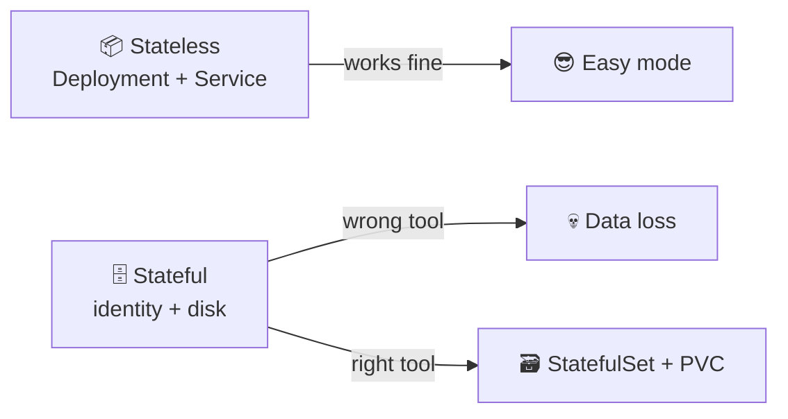

> 🔗 **Связь с Lab 15:** вы преобразуете ваш Helm-чарт из Lab 12 из `Deployment` в `StatefulSet` с `volumeClaimTemplates` и headless `Service`, а затем докажете, что каждый pod владеет своим собственным счётчиком посещений, который переживает уничтожение pod'а.

---

## 📍 Слайд 2 – 🎯 Результаты обучения

| # | Результат |
|---|---------|
| 1 | 🧠 Отличать stateless от stateful рабочих нагрузок и выбирать правильный контроллер |
| 2 | 🏗️ Читать и писать манифесты `StatefulSet` с `volumeClaimTemplates` |
| 3 | 🌐 Настроить headless `Service` (`clusterIP: None`) и разрешать DNS на уровне pod'а |
| 4 | 🔢 Рассуждать об упорядоченном и `Parallel` управлении pod'ами для stateful-кластеров |
| 5 | 🔄 Выбирать между `RollingUpdate` (с партициями) и `OnDelete` стратегиями обновления |
| 6 | 🤖 Знать, когда полностью отказаться от StatefulSet и взять оператор (CloudNativePG, Strimzi, Rook) |

**Технологический стек на май 2026:** Kubernetes **1.36** «Haru», **CloudNativePG 1.29** (оператор PostgreSQL), **Rook v1.18+ (Ceph 19 Squid)**, **Longhorn 1.9** как лёгкий вариант хранилища от CNCF. `StatefulSet` в Apps-API `apps/v1` — GA с **Kubernetes 1.9 (дек 2017)** — поверхность API железобетонная; а вот режимы сбоя — нет.

---

## 📍 Слайд 3 – ⚠️ Почему Deployment неправилен для Postgres

Всё, что делает `Deployment` прекрасным для stateless-веб-приложения, — это *ровно* то, что вредит stateful-приложению.

| Поведение Deployment | Почему это здорово для веба | Почему это ужасно для Postgres |
|---|---|---|
| 🎲 Случайные имена pod'ов (`web-7b9c4-x4f2k`) | Pod'ы взаимозаменяемы | Реплике нужно знать, *какой* pod — primary |
| 📦 Общий `PersistentVolumeClaim` (или его отсутствие) | Stateless = нет диска | Два процесса Postgres, пишущих один WAL = повреждение |
| ⚡ Параллельный запуск pod'ов | Быстрее масштабирование | Гонки при выборах при bootstrap; split-brain |
| 🔁 IP pod'ов меняются при перезапуске | `Service` это сглаживает | Строки подключения реплик ломаются на полуслове |
| 📉 Масштабирование до нуля безопасно | Просто перезапуск | «Scale to zero» = данные всё ещё на PVC, *но так ли это?* |

> 🔥 **Горячее мнение:** день, когда кто-то заводит инцидент под названием *«pod базы данных перезапустился, и данные пропали»*, — это день, когда они узнают, что `Deployment` + `emptyDir` — не база данных. Поэтому у нас есть `StatefulSet`.

---

## 📍 Слайд 4 – 🐾 Pets против cattle, пересмотрено

Лекция 1 ввела **pets против cattle** (Bill Baker, 2012). Stateless-нагрузки — это cattle: заменяемые, пронумерованные случайно. Stateful-нагрузки — это pets, но **управляемые pets**, а не снежинки.

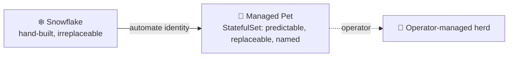

* 🐶 **Pet** = стабильная идентичность, стабильное хранилище, вы точно знаете, кто такой pod-0
* 🐮 **Cattle** = бери любой, это неважно — Deployments
* 🏥 **Managed herd** = оператор (CloudNativePG, Strimzi) лечит каждого pet за вас, чтобы человеку не приходилось

> 💡 StatefulSet — это примитив K8s для *управляемых pets*. Операторы — примитив для *управляемых стад*.

---

## 📍 Слайд 5 – 🏗️ Гарантии StatefulSet

Три гарантии, которых вы не получаете от Deployment. Заучите их.

* 🔢 **Стабильная, уникальная сетевая идентичность** — имена pod'ов `<sts-name>-<ordinal>`: `postgres-0`, `postgres-1`, `postgres-2`. Имя *переживает переселение, перезапуск, отказ узла*.
* 💾 **Стабильное, постоянное хранилище** — каждый порядковый номер владеет своим `PersistentVolumeClaim`, созданным из блока `volumeClaimTemplates`. Переселите pod-1 — тот же PVC следует за ним.
* 📊 **Упорядоченное, плавное развёртывание, масштабирование и завершение** — pod-0 должен быть Ready до старта pod-1. При уменьшении первым уходит старший порядковый номер.

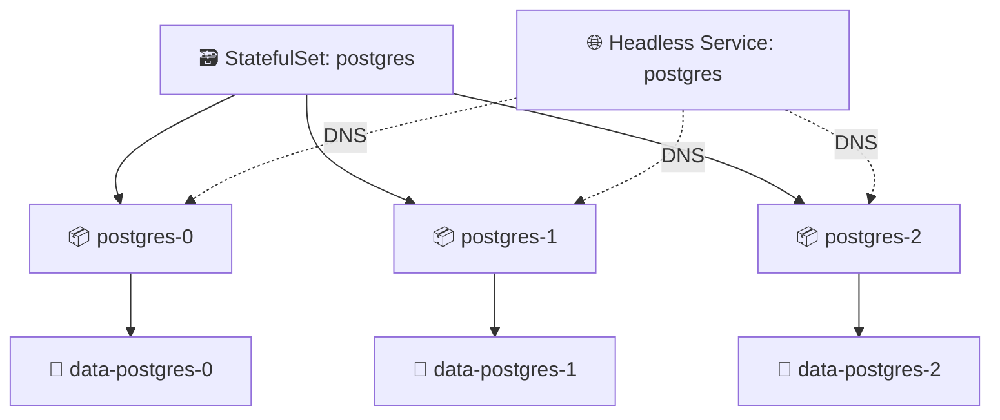

> 📚 **Источник:** [Документация Kubernetes — StatefulSet](https://kubernetes.io/docs/concepts/workloads/controllers/statefulset/) (apps/v1, GA с 1.9).

---

## 📍 Слайд 6 – 🌐 Headless-сервисы — DNS без балансировщика

Обычный `Service` получает виртуальный `clusterIP`; `kube-proxy` балансирует нагрузку между эндпоинтами. **Headless**-сервис имеет `clusterIP: None` и ведёт себя иначе: кластерный DNS возвращает **A-записи каждого pod'а**, а не один виртуальный IP.

```yaml
# 🌐 Regular Service — one virtual IP, round-robin to pods
apiVersion: v1
kind: Service
metadata:
  name: postgres
spec:
  selector: { app: postgres }
  ports: [{ port: 5432 }]
---
# 🌐 Headless Service — no IP, returns every pod's IP
apiVersion: v1
kind: Service
metadata:
  name: postgres-headless
spec:
  clusterIP: None              # 🔑 the magic
  selector: { app: postgres }
  ports: [{ port: 5432 }]
```

| DNS-запрос | Обычный Service | Headless-сервис |
|-----------|-----------------|------------------|
| `postgres.default.svc` | `10.96.0.42` (один виртуальный IP) | `10.244.1.7, 10.244.2.3, 10.244.3.9` (каждый pod) |
| `postgres-0.postgres-headless.default.svc` | ❌ не существует | `10.244.1.7` (только pod-0) |

> 🔑 **Зачем он нужен:** связка StatefulSet ↔ DNS *требует* управляющего headless-сервиса. Без него вы не можете адресовать `pod-0` напрямую, а значит, не можете написать строку подключения Postgres для primary.

---

## 📍 Слайд 7 – 🔗 DNS-имена на pod

Каждый pod в `StatefulSet` получает стабильную DNS-запись под управляющим headless-сервисом:

```
<pod-name>.<headless-service>.<namespace>.svc.cluster.local
```

Для StatefulSet `postgres` с `serviceName: postgres-headless` в пространстве имён `prod`:

```
postgres-0.postgres-headless.prod.svc.cluster.local
postgres-1.postgres-headless.prod.svc.cluster.local
postgres-2.postgres-headless.prod.svc.cluster.local
```

* ✅ Имена **никогда не меняются** для данного порядкового номера — `postgres-0` это `postgres-0` навсегда
* ✅ Разрешение работает **из любого pod'а в кластере** — так реплики находят primary
* ✅ Если `postgres-0` переселяется на другой узел, имя всё равно разрешается в IP нового pod'а

> 🔧 **Проверьте в Lab 15:** `kubectl exec postgres-0 -- nslookup postgres-1.postgres-headless` — вы должны увидеть одну A-запись, совпадающую с текущим IP pod-1.

---

## 📍 Слайд 8 – 💾 volumeClaimTemplates: один PVC на pod, бесплатно

Ключевая функция. Блок `volumeClaimTemplates` говорит контроллеру StatefulSet: *для каждого порядкового номера pod'а создай PVC из этого шаблона*. Ни один человек не пишет PVC вручную.

```yaml
apiVersion: apps/v1
kind: StatefulSet
metadata: { name: postgres }
spec:
  serviceName: postgres-headless
  replicas: 3
  selector: { matchLabels: { app: postgres } }
  template:
    metadata: { labels: { app: postgres } }
    spec:
      containers:
        - name: postgres
          image: postgres:17.5
          volumeMounts:
            - { name: data, mountPath: /var/lib/postgresql/data }
  volumeClaimTemplates:                  # 🔑 per-pod PVC provisioning
    - metadata: { name: data }
      spec:
        accessModes: [ReadWriteOnce]
        storageClassName: standard
        resources: { requests: { storage: 20Gi } }
```

**Результат после `kubectl apply`:**

```
PVC data-postgres-0   →   PV   →   bound to postgres-0
PVC data-postgres-1   →   PV   →   bound to postgres-1
PVC data-postgres-2   →   PV   →   bound to postgres-2
```

> ⚠️ **Критично:** PVC, созданные через `volumeClaimTemplates`, **НЕ удаляются**, когда вы уменьшаете StatefulSet или удаляете сам StatefulSet. Это функция — ваши данные переживают ошибки. Компромисс — их нужно чистить вручную через `kubectl delete pvc`.

---

## 📍 Слайд 9 – 🔄 Упорядоченное развёртывание и масштабирование

Поведение по умолчанию: pod-N ждёт, пока pod-(N-1) станет Ready, прежде чем стартовать. Уменьшение — в обратном порядке.

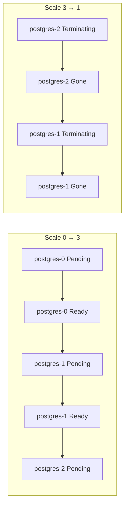

* 🔢 Последовательный старт: pod-0 становится primary → pod-1 присоединяется как реплика → pod-2 присоединяется
* 📉 Обратное завершение: pod-2 выводится → pod-1 выводится → pod-0 (primary) остаётся до последнего
* ⏱️ Заклинивший pod-1 **блокирует** старт pod-2 — медленно, но безопасно

**Переопределите через `podManagementPolicy: Parallel`**, когда упорядоченность не нужна — например, stateless-кластер шардов, которые все лениво обнаруживают друг друга. По умолчанию — `OrderedReady`.

```yaml
spec:
  podManagementPolicy: Parallel   # start all pods at once; PVCs still per-ordinal
```

> 🔥 **Когда `Parallel` имеет смысл:** кластер в стиле Cassandra, где каждый узел равен и обнаружение идёт через gossip, а не через «найди pod-0». Большинство баз данных хотят `OrderedReady`.

---

## 📍 Слайд 10 – 🔄 Стратегии обновления: RollingUpdate против OnDelete

Обновление StatefulSet значит больше, чем обновление Deployment — вы обновляете *основную базу данных*, а не веб-фронтенд.

**RollingUpdate (по умолчанию)** — заменяет pod'ы по одному, *начиная с высшего порядкового номера*:

```yaml
spec:
  updateStrategy:
    type: RollingUpdate
    rollingUpdate:
      partition: 0           # update everything from ordinal 0 upward (i.e., all pods)
```

**OnDelete** — контроллер *ничего не делает* при изменении spec; вы удаляете pod'ы сами, когда готовы:

```yaml
spec:
  updateStrategy:
    type: OnDelete
```

| Стратегия | Чем запускается | Когда использовать |
|---|---|---|
| `RollingUpdate` | `kubectl apply` нового шаблона pod'а | Большинство случаев — дайте K8s рулить |
| `RollingUpdate` + `partition` | apply + ручное уменьшение партиции | Canary одной реплики перед остальными |
| `OnDelete` | ручной `kubectl delete pod` | Строгие окна изменений; согласованные обновления БД |

> 🔧 **Бонус Lab 15:** попробуйте оба варианта. Workflow `OnDelete` — это то, как на самом деле выглядят большинство продакшен-обновлений баз данных — человек в цикле, потому что цена автоматической ошибки — «восстановление из бэкапа».

---

## 📍 Слайд 11 – 🎯 Партиционированная раскатка (canary для stateful-приложений)

Поле `partition` — это эквивалент canary для StatefulSet. Pod'ы с порядковым номером `>= partition` получают новый шаблон; остальные остаются на старом.

```yaml
spec:
  replicas: 5
  updateStrategy:
    type: RollingUpdate
    rollingUpdate:
      partition: 4           # 🐤 only postgres-4 updates
```

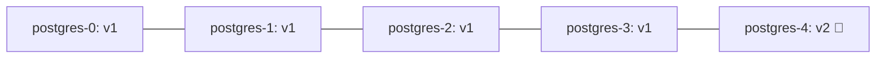

* 🐤 Обновление попадает только на pod-4 — вашу canary
* ✅ Проверяйте метрики, отставание репликации, ошибки приложения
* 🔽 Опускайте `partition: 4 → 3 → 2 → 1 → 0`, чтобы катить обновление дальше
* ⏪ Верните `partition` на большое число и заново примените старый образ, чтобы откатиться

> 📊 **Сравните с Lab 14 (Rollouts):** Argo Rollouts даёт взвешенное переключение трафика для *stateless*-приложений. Партиции StatefulSet дают «этот порядковый номер запускает новую версию» для *stateful*-приложений. Разные задачи, разные инструменты.

---

## 📍 Слайд 12 – ⏱️ Частые режимы сбоя

| Симптом | Вероятная причина | Исправление |
|---|---|---|
| 🟡 `postgres-1` навсегда застрял в `Pending` | PVC не может привязаться: нет storage class, превышена квота, RWO PVC на узле, где он уже смонтирован | `kubectl describe pvc data-postgres-1`; проверьте `StorageClass`; проверьте узел, где сидит pod-0 |
| 🔁 Pod перезапускается каждую минуту | Проваливается liveness probe; readiness на неверном порту | `kubectl logs --previous`; уточните пути проб |
| ❌ Pod-2 так и не стартует | Pod-1 не Ready (контроллер ждёт) | Сначала почините pod-1; или переключитесь на `podManagementPolicy: Parallel`, если приложение это поддерживает |
| 💾 Масштабирование «удалило» мои данные | Нет — PVC сохраняются намеренно; вы уменьшили StatefulSet, но PVC всё ещё на месте | `kubectl get pvc` — ваши данные на месте; увеличьте `replicas` обратно |
| 🌐 `postgres-0.postgres-headless` не разрешается | Headless-сервис отсутствует или с неверным селектором | Убедитесь, что `serviceName` в STS совпадает с сервисом `clusterIP: None`, чей селектор совпадает с метками pod'ов |
| 🐢 Масштабирование 0→10 занимает 20 минут | `OrderedReady` по умолчанию ждёт каждый pod | Используйте `podManagementPolicy: Parallel`, если упорядоченность не нужна |

> 🔍 **Порядок отладки:** `kubectl get sts,pod,pvc,svc` — эти четыре вместе рассказывают всю историю.

---

## 📍 Слайд 13 – 💽 Постоянные тома: двухуровневая модель

`PersistentVolumeClaim` — это *запрос*; `PersistentVolume` — это фактический диск. `StorageClass` кластера создаёт PV динамически — без него ваши PVC висят вечно.

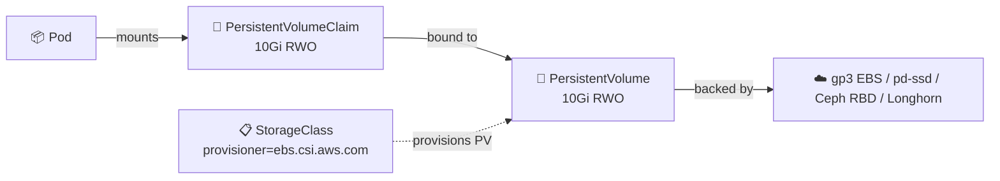

| Режим доступа | Значение | Типичный бэкенд |
|---|---|---|
| `ReadWriteOnce` (RWO) | Один узел R/W за раз | Блочное хранилище (EBS, GCE PD, Ceph RBD) — по умолчанию для StatefulSet |
| `ReadOnlyMany` (ROX) | Много узлов, только чтение | Объектное хранилище поверх |
| `ReadWriteMany` (RWX) | Много узлов R/W одновременно | NFS, CephFS, EFS — нужны для приложений с общей файловой системой, редки для баз данных |
| `ReadWriteOncePod` (RWOP, GA 1.29) | Ровно один pod R/W во всём кластере | Строже RWO; предотвращает multi-attach на одном узле |

> ⚠️ **Политика возврата:** у PV есть `persistentVolumeReclaimPolicy`. `Retain` сохраняет данные после удаления PVC (безопаснее); `Delete` стирает их. В большинстве облачных `StorageClass` по умолчанию — `Delete`. **Ставьте `Retain` для всего, что важно.**

---

## 📍 Слайд 14 – 🌩️ Облачно-нативные варианты хранилища (май 2026)

Не каждый кластер работает на EBS или GCE PD. Для on-prem или мультиоблака вы приносите хранилище с собой.

| Проект | Стиль | Сильные стороны | Компромиссы |
|---|---|---|---|
| **Rook v1.18 + Ceph 19 Squid** | Распределённое (block + file + object) | Проверено в бою в масштабе; единое block/file/object; CNCF graduated | Тяжёлое — нужно ≥3 узлов, тщательное планирование ёмкости |
| **Longhorn 1.9** (SUSE → CNCF) | Распределённый block, нативный для K8s | Простой UI, лёгкие снапшоты, бэкапы в S3, небольшие кластеры | Только block; накладные расходы на реплику тома |
| **OpenEBS Mayastor** | NVMe-over-TCP, гиперконвергентное | Наивысшая производительность для NVMe; движок по умолчанию в новых установках | Новее; требует возможностей ядра |
| **CSI cloud-драйверы** (EBS, GCE PD, Azure Disk) | Блочное в одном облаке | Управляемое, быстрое, дешёвое | Вендорская привязка; только RWO |

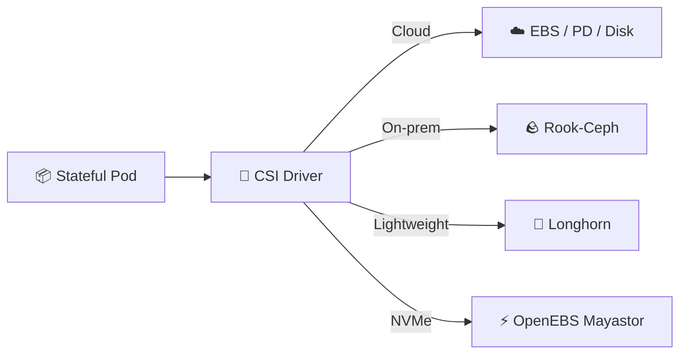

> 🔧 **Связь с курсом:** Lab 15 использует `StorageClass` по умолчанию в k3d (local-path-provisioner). Принципы переносятся; продакшен подставляет EBS или Rook.

---

## 📍 Слайд 15 – 🏥 За пределами StatefulSet: когда нужен оператор

StatefulSet даёт вам *идентичность + хранилище*. Он не даёт вам:

* 🩺 Оркестрацию отказа (продвинуть реплику, когда primary умирает)
* 💾 Согласованные бэкапы (`pg_basebackup`, архивирование WAL)
* 🔄 Восстановление на момент времени из S3
* 📊 Мониторинг отставания репликации
* 🔐 Ротацию учётных данных на тенанта

Это **оператор** — контроллер, который понимает вашу конкретную базу данных. Операторы поставляются как CRD (Custom Resource Definitions) плюс pod контроллера, который за ними следит.

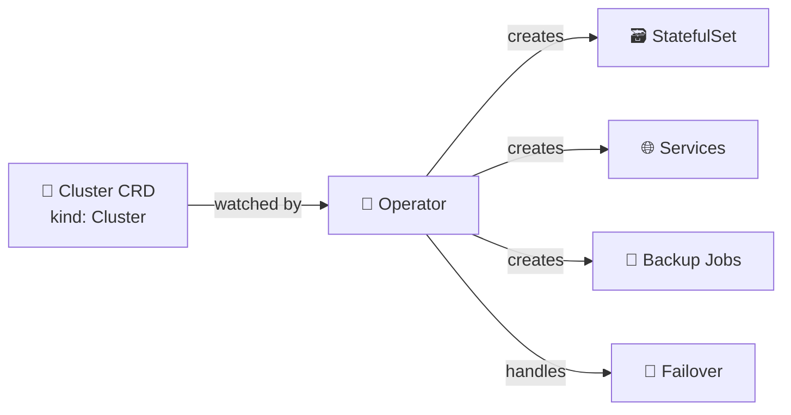

**Готовые к продакшену операторы в 2026:**

| Рабочая нагрузка | Оператор | Заметки |
|---|---|---|
| 🐘 PostgreSQL | **CloudNativePG 1.29** (CNCF Sandbox) | По умолчанию для многих платформенных команд; поддерживает PG 18.3; кворумный failover стабилен |
| 🐬 MySQL | **MySQL Operator for K8s** (Oracle) или **Percona XtraDB Operator** | Два жизнеспособных выбора; Percona для высокой доступности |
| 🟢 MongoDB | **MongoDB Community Operator** | Остаётся в границах лицензии SSPL |
| 🍂 Redis | **Redis Operator** (OT/Spotahome) или **Dragonfly Operator** | Dragonfly — совместимая с Redis замена «один к одному» |
| 📨 Kafka | **Strimzi** (CNCF) | Де-факто оператор Kafka для K8s |
| 🐘 ClickHouse | **Altinity ClickHouse Operator** | |

> 💡 **Правило большого пальца:** если вы бы подняли себя в 3 часа ночи из-за отказа этой базы данных, запускайте её через оператор, а не через голый StatefulSet.

---

## 📍 Слайд 16 – 🐘 CloudNativePG за 90 секунд

Вкус того, что покупает вам оператор. Сравните с ручным написанием StatefulSet для Postgres из 3 pod'ов.

```yaml
apiVersion: postgresql.cnpg.io/v1
kind: Cluster
metadata:
  name: app-db
spec:
  instances: 3                        # 🔢 1 primary + 2 replicas
  imageName: ghcr.io/cloudnative-pg/postgresql:18.3
  storage:
    size: 50Gi
    storageClass: standard
  backup:
    barmanObjectStore:
      destinationPath: s3://my-backups/app-db
      s3Credentials:
        accessKeyId:     { name: backup-creds, key: ACCESS_KEY_ID }
        secretAccessKey: { name: backup-creds, key: SECRET_ACCESS_KEY }
    retentionPolicy: "30d"
  monitoring:
    enablePodMonitor: true            # 📊 Prometheus scraping out of the box
```

* 🔄 Автоматические выборы primary (кворумный failover, стабилен с 1.28)
* 💾 Непрерывное архивирование WAL в S3
* ♻️ Согласованные по кластеру rolling-обновления минорных версий
* 📊 `PodMonitor` + дашборды в комплекте

> 📚 **Источник:** [cloudnative-pg.io](https://cloudnative-pg.io/) — 1.29 GA выпущен в 2026; PostgreSQL 18.3 — образ по умолчанию.

---

## 📍 Слайд 17 – 💾 Резервное копирование и восстановление (кратко)

> 📘 **Более глубоко:** SRE-Intro (электив) имеет полную лекцию о стратегиях бэкапа, RPO/RTO и chaos-тестировании вашего восстановления. Здесь мы только ставим флаг.

**Три правила для stateful K8s в 2026:**

1. 💾 **Снапшот — не бэкап.** Снапшоты EBS не знают о приложении; восстановление наполовину записанного WAL — это повреждение. Используйте родной инструмент базы данных (`pg_basebackup`, `mongodump`, `xtrabackup`).
2. 🔁 **Непроверенный бэкап — это желание.** Учебные восстановления, по расписанию, в свежий кластер. Инцидент GitLab.com 2017 года потерял данные, потому что 5 из 5 механизмов бэкапа были сломаны — никто не проверял.
3. 📦 **Храните бэкапы вне кластера.** S3, GCS или внешнее объектное хранилище Ceph. Если кластер пропадёт, ваши бэкапы не должны пропасть с ним.

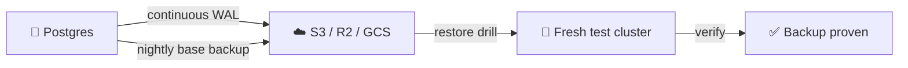

> 🔥 **Снова преимущество оператора:** CloudNativePG, Strimzi и друзья поставляют бэкап *и* восстановление как CRD. Вы объявляете `kind: Backup` и `kind: ScheduledBackup`; вы объявляете `kind: Cluster.spec.bootstrap.recovery` для восстановления. Никаких bash-скриптов.

---

## 📍 Слайд 18 – 📋 Полный пример StatefulSet (шаблон Lab 15)

Минимально жизнеспособный StatefulSet — то, к чему сходится ваш чарт из Lab 15:

```yaml
apiVersion: v1
kind: Service
metadata: { name: visits-headless }
spec:
  clusterIP: None
  selector: { app: visits }
  ports: [{ port: 8000, name: http }]
---
apiVersion: apps/v1
kind: StatefulSet
metadata: { name: visits }
spec:
  serviceName: visits-headless        # 🔑 must match the headless Service
  replicas: 3
  selector: { matchLabels: { app: visits } }
  template:
    metadata: { labels: { app: visits } }
    spec:
      containers:
        - name: app
          image: ghcr.io/innodevops/lab12-app:v1.2.0
          ports: [{ containerPort: 8000, name: http }]
          volumeMounts:
            - { name: data, mountPath: /data }
          readinessProbe:
            httpGet: { path: /health, port: http }
            initialDelaySeconds: 3
            periodSeconds: 5
  volumeClaimTemplates:
    - metadata: { name: data }
      spec:
        accessModes: [ReadWriteOnce]
        resources: { requests: { storage: 1Gi } }
```

**Проверьте в Lab 15:**

```bash
kubectl get sts,pod,pvc,svc                                  # all four resources present
kubectl exec visits-0 -- nslookup visits-1.visits-headless   # 🔗 per-pod DNS works
for i in 0 1 2; do                                           # 💾 per-pod state
  kubectl exec visits-$i -- cat /data/visits
done
kubectl delete pod visits-0                                  # pod-0 restarts, same PVC, same data
```

---

## 📍 Слайд 19 – ⚠️ Подводные камни в продакшене

| Подводный камень | Симптом | Смягчение |
|---|---|---|
| 🗑️ Забытые PVC | Кластер заполняется осиротевшими PVC | `kubectl delete pvc data-postgres-{0..N}` при выводе StatefulSet |
| 🔄 Политика возврата `Delete` | Данные стёрты при удалении PVC | Пропатчите `StorageClass` до `Retain` для prod; проверьте на PV |
| 🌐 Отсутствует headless-сервис | Разрешение DNS молча сломано | Применяйте Service *до* StatefulSet; линтуйте это в CI |
| 📊 Слишком агрессивная liveness probe | Pod'ы перезапускаются посреди сброса WAL | Используйте readiness для трафика; liveness только на глубоких дедлоках |
| 🐢 Кластеры из двух реплик | Худшее из обоих миров | Stateful-кластеры хотят **нечётное** число ≥3 для кворума; или один экземпляр с бэкапами |
| 🔁 Изменение `volumeClaimTemplates` | Поле **неизменяемо** после создания | Для изменения размера: правьте PVC напрямую (если в StorageClass `allowVolumeExpansion: true`) |
| 📦 Pod-0 падает первым; остальные не стартуют | `OrderedReady` по умолчанию блокирует | Устраните корневую причину pod-0; переходите на `Parallel` только если приложение это поддерживает |

> 🔥 **Ловушка изменения размера:** вы не можете отредактировать `volumeClaimTemplates.spec.resources` и ждать, что это разойдётся. Контроллер StatefulSet молча это игнорирует. Изменяйте размер PVC *вручную*; пересоздайте StatefulSet с `--cascade=orphan`, если разница шаблона важна.

---

## 📍 Слайд 20 – 🆚 Deployment против StatefulSet против DaemonSet против Job

Пока этот курс затронул все четыре. Краткое обобщение:

| Контроллер | Имена pod'ов | Хранилище | Упорядоченность | Вариант использования |
|---|---|---|---|---|
| **Deployment** | случайный суффикс | общее / нет | параллельная | Stateless-приложения (веб, API, воркеры) |
| **StatefulSet** | порядковый (`-0`, `-1`) | на pod через шаблоны | последовательная по умолчанию | Базы данных, очереди, всё с идентичностью |
| **DaemonSet** | один на узел | hostPath / на узел | один-на-узел | Агенты узла (log shipper, CSI driver, сетевой плагин) |
| **Job / CronJob** | случайные; работают до завершения | в рамках задачи | параллельная или последовательная | Пакетная работа, миграции, задачи по расписанию |

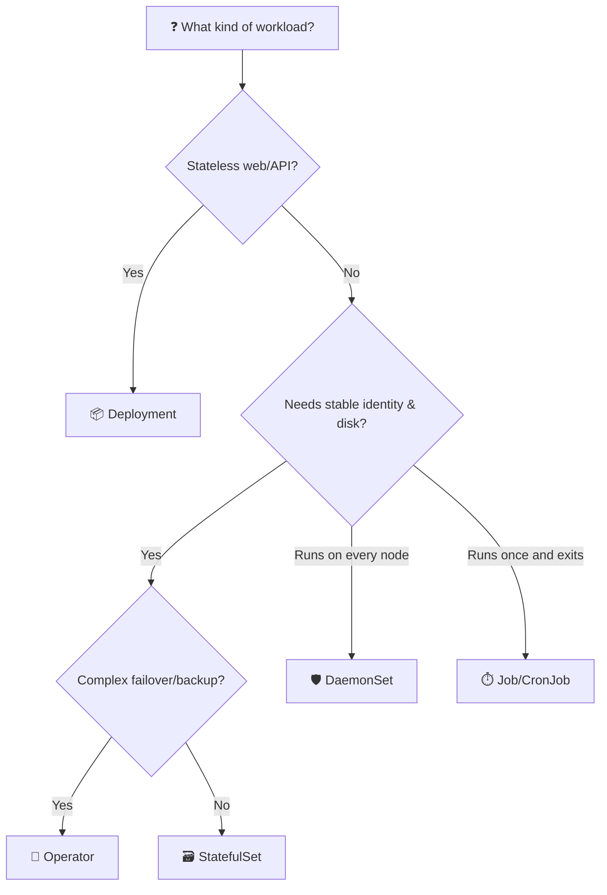

> 💡 **Большинство pod'ов, которые вы когда-либо напишете, — это Deployments.** Тянитесь к StatefulSet только когда нужна идентичность *или* хранилище на pod. Тянитесь к оператору в тот момент, когда на сцене появляются failover, бэкапы или хореография обновлений.

---

## 📍 Слайд 21 – 🎯 Ключевые выводы

1. 🗃️ **StatefulSet = идентичность + хранилище на pod + упорядоченный жизненный цикл.** Три гарантии, которых не предлагают Deployments.
2. 🌐 **Headless-сервисы (`clusterIP: None`) обязательны** — они дают DNS на pod, который делает идентичность полезной.
3. 💾 **`volumeClaimTemplates` создаёт один PVC на порядковый номер**, и PVC намеренно сохраняются при уменьшении.
4. 🔢 **Упорядоченность по умолчанию — `OrderedReady`**; `Parallel` — опционально, для кластеров, которым не нужен bootstrap pod-0 первым.
5. 🔄 **`RollingUpdate` + `partition`** — ваш механизм canary для stateful-обновлений; **`OnDelete`** — для ручных обновлений, привязанных к окнам изменений.
6. 🤖 **Для настоящих баз данных используйте оператор** (CloudNativePG, Strimzi, Percona). StatefulSet сам по себе — *примитив*, а не *ответ*.
7. 💾 **Снапшот — не бэкап.** Инструменты, знающие о приложении, + проверенные восстановления, иначе у вас нет бэкапов.
8. 🐾 **StatefulSets — управляемые pets.** Операторы — управляемые стада. Оба лучше снежинок.

> 💡 **Мантра:** *Если вы бы подняли себя из-за его отказа, не запускайте это как Deployment.*

---

## 📍 Слайд 22 – 🧠 Смена образа мыслей

| 😰 Старое | 🚀 Осознающее StatefulSet |
|---|---|
| «Просто подними ещё один pod, они все одинаковые» | «pod-0 — это primary, имя имеет значение» |
| «Смонтируем общий PVC на все реплики» | «Каждая реплика владеет своим PVC через шаблон» |
| «Это база данных, разверни её как приложение» | «Оператор рулит failover, мы просто объявляем `kind: Cluster`» |
| «Бэкап — это то, что делает облачный снапшот» | «Бэкапы знают о приложении, вне кластера и проверены восстановлением» |
| «Почему развёртывание застряло на pod-1?» | «Потому что pod-0 не Ready — ищите корневую причину, не обходите через Parallel» |
| «Масштабируй до нуля, потом обратно» | «PVC остаются; данные остаются; можно масштабировать свободно» |

> 🤔 Какая строка описывает команду, в которой вы работали?

---

## 📍 Слайд 23 – 🚀 Что дальше

**📚 Следующая лекция: *Лекция 16 — За пределами Kubernetes*** — когда кластер избыточен *и* когда кластер не той формы.

* 🌐 **Cloudflare Workers** — изоляты V8 на edge; 0 мс холодного старта; крошечные бандлы
* ❄️ **Nix** — воспроизводимые сборки и dev-окружения без контейнера в поле зрения
* 🤔 **Компромиссы** — когда полностью пропустить K8s; когда сочетать его с чем-то ещё
* 🎁 **Бонусные лабораторные 17 и 18** — разверните ваш сервис из Lab 1 в Cloudflare Workers; упакуйте его через Nix flakes

**🔬 Результаты Lab 15:**

* Преобразуйте ваш Helm-чарт из Lab 12 из `Deployment` → `StatefulSet`
* Добавьте headless `Service` (`clusterIP: None`), управляемый `serviceName`
* Настройте `volumeClaimTemplates`, чтобы каждый pod получал свой PVC
* Докажите состояние на pod: обращайтесь к pod'ам через `kubectl port-forward`, наблюдайте независимые счётчики посещений
* Убейте `app-0`, наблюдайте, как те же данные возвращаются при переселении
* **Бонус (2.5 балла):** продемонстрируйте `RollingUpdate` с `partition` *и* раскатку через `OnDelete`

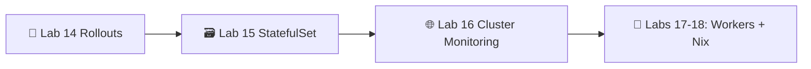

> 🌊 От скота к управляемым pets — по одному порядковому номеру за раз.

Квиз после лекции идёт в окно таблицы лидеров недель 13–16.

---

## 📚 Ресурсы

**📕 Книги:**

* *Kubernetes Up & Running* (3e, 2022) — Burns, Beda, Hightower. Глава о StatefulSets — канонический текст.
* *Kubernetes Patterns* (2e, 2024) — Ibryam & Huß. Паттерны «Stateful Service» и «Service Discovery».
* *Database Reliability Engineering* (2017) — Campbell & Majors. Почему существуют операторы, в книжной форме.

**🔗 Ссылки:**

* 🌐 [Концепции StatefulSet](https://kubernetes.io/docs/concepts/workloads/controllers/statefulset/) — официальные
* 🌐 [Headless-сервисы](https://kubernetes.io/docs/concepts/services-networking/service/#headless-services)
* 🌐 [Шаблоны claim'ов томов](https://kubernetes.io/docs/concepts/workloads/controllers/statefulset/#volume-claim-templates)
* 🌐 [Стратегии обновления и партиционированная раскатка](https://kubernetes.io/docs/concepts/workloads/controllers/statefulset/#update-strategies)
* 🌐 [Паттерн оператор](https://kubernetes.io/docs/concepts/extend-kubernetes/operator/)
* 🌐 [OperatorHub.io](https://operatorhub.io/) — курируемый каталог операторов
* 🌐 [CloudNativePG](https://cloudnative-pg.io/) — оператор PostgreSQL, на который мы ссылаемся повсюду
* 🌐 [Rook](https://rook.io/) — продакшен-хранилище на Ceph
* 🌐 [Longhorn](https://longhorn.io/) — лёгкое блочное хранилище от CNCF
