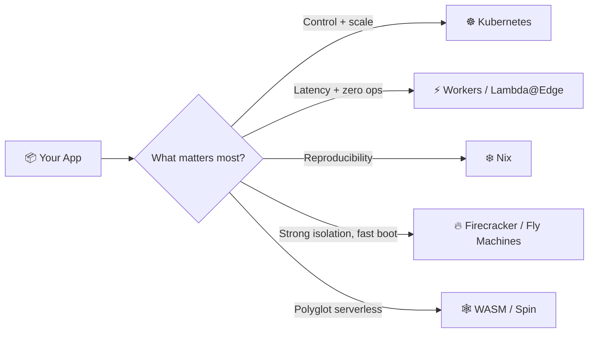
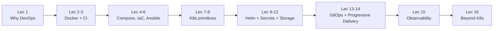
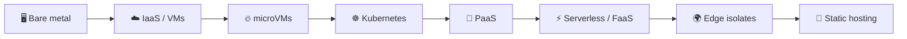
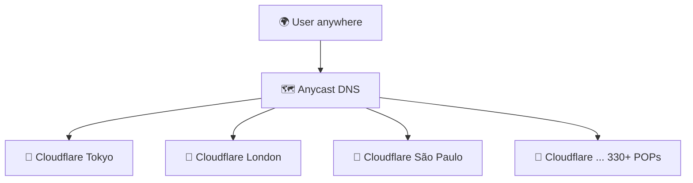
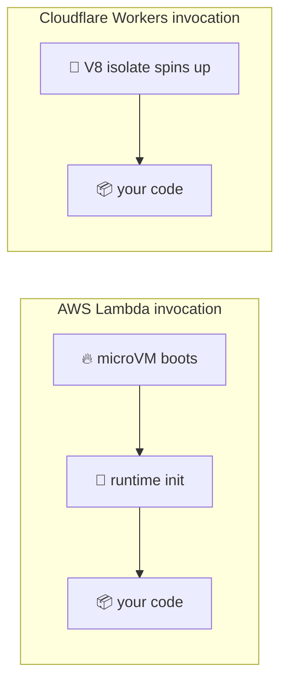
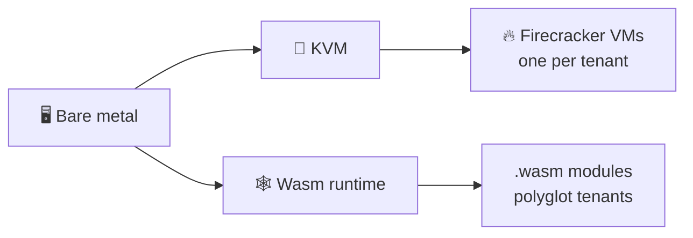
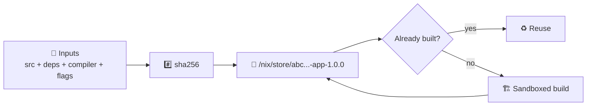
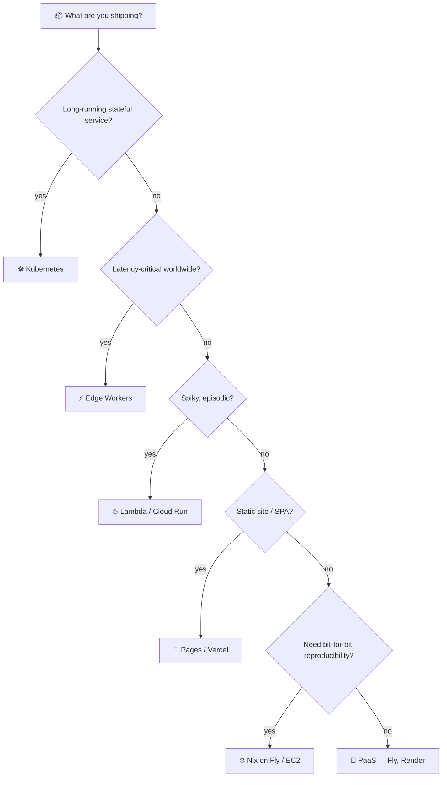
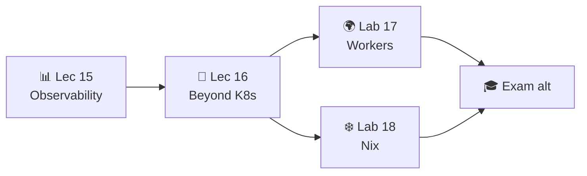

# 📌 Лекция 16 — За пределами Kubernetes: альтернативные модели развёртывания

> 🎯 **Финал курса.** Вы потратили 15 лекций на то, чтобы научиться запускать контейнеры в кластере. Теперь мы задаём вопрос, который рано или поздно задаёт каждый senior-инженер: *а нужен ли нам был вообще кластер?*

---

## 📍 Слайд 1 – 🚀 Вопрос, который рано или поздно задаёт каждый архитектор

* ☸️ Вы умеете развёртывать в Kubernetes. **Вы доказали это на Labs 8–16.**
* 🤔 Но для многих рабочих нагрузок K8s — **неверная абстракция**: слишком много поверхности ради слишком малой отдачи
* 🌍 В 2026 году меню развёртывания — это уже не просто «VM против контейнера», а **спектр** сред выполнения, оптимизированных для очень разных задач
* 🎯 Сегодня: edge serverless (lab 17) и воспроизводимые сборки (lab 18), плюс когда каждый из них превосходит K8s



> 📚 **Рамка на сегодня:** каждая модель на этом слайде *тоже* готова к продакшену. Навык — знать, какую задачу решает каждая из них, — и какие задачи она не решает.

---

## 📍 Слайд 2 – 🎯 Результаты обучения

К концу этой лекции вы сможете:

| # | Результат |
|---|---------|
| 1 | 🧠 Объяснить, что такое **изолят V8** и почему его холодный старт <5 мс |
| 2 | ⚖️ Сравнить **edge serverless** (Workers) с **региональным FaaS** (Lambda) |
| 3 | ❄️ Описать, что гарантирует **деривация Nix**, чего не гарантирует Dockerfile |
| 4 | 📊 Выбирать между K8s, edge, microVM, PaaS и статическим хостингом по матрице вариантов использования |
| 5 | 🚀 Отобразить Lab 17 (Cloudflare Workers) и Lab 18 (Nix) на спектр развёртывания |
| 6 | 🔮 Назвать среды выполнения следующей волны (WASM, unikernels, Firecracker) и для чего они |

---

## 📍 Слайд 3 – 🧰 Технологический стек на сегодня (май 2026)

| Инструмент | Версия / Статус | Заметки |
|------|------------------|-------|
| **Cloudflare Workers** | workerd + изоляты V8, 330+ POP на edge | Холодный старт <5 мс; бесплатный уровень 100k запросов/день, 10 мс CPU; $5/мес Paid = 10M запросов + 50 мс CPU |
| **Wrangler CLI** | **4.94+** | Локально-в-первую-очередь по умолчанию; `--remote` теперь опционален |
| **Workers KV / D1 / R2 / Durable Objects** | GA | Примитивы состояния, привязанные к edge |
| **Nix** | **2.25** (ноя 2024), 2.26+ в разработке | Установщик Determinate включает flakes по умолчанию |
| **Lix** | Комьюнити-форк (форкнут мар 2024) | Замена `nix` «один к одному»; FlakeHub — реестр SemVer |
| **AWS Lambda runtime** | microVM Firecracker, ~125 мс загрузка | Изоляция на вызов |
| **Fly.io** | Fly Machines на Firecracker | Та же технология microVM, что у Lambda; VM остаётся у вас |
| **Fermyon Spin** | v3.5 (WASI 0.3 preview) | Приобретён Akamai в дек 2025 → Akamai Functions |

> 🧷 Два из этих инструментов — **Cloudflare Workers** и **Nix** — это всё содержание Labs 17 и 18. Остальные — контекст мира, в который вы вот-вот войдёте.

---

## 📍 Слайд 4 – 🗺️ Дуга курса, в последний раз



Вы взобрались по лестнице абстракций от `chroot` → контейнеры → оркестрация → GitOps. Сегодня мы смотрим **вбок** на среды выполнения, которые поднялись на гору другим путём.

---

## 📍 Слайд 5 – ⚠️ Налог на Kubernetes

K8s даёт вам контроль. Контроль имеет ценник:

* 🔧 **Эксплуатация кластера** — обновления control plane, миграции CRD, бэкапы etcd
* 🧠 **Экспертиза команды** — kubectl, RBAC, сети, storage classes, ingress-контроллеры
* 💰 **Стоимость простоя** — control plane ($72/мес на EKS) + минимум 3 рабочих узла даже при нулевом трафике
* ⏱️ **Время до первого развёртывания** — для новой команды — дни. С управляемым K8s + платформенной командой — всё равно часы
* 🕵️ **Поверхность атаки** — каждый CRD, каждый вебхук, каждый оператор — это код, работающий в вашем кластере

> 💬 **Kelsey Hightower, 2017 (всё ещё правда):** *«Kubernetes — это платформа для построения платформ. Это лучшее место для старта, а не финальная цель.»*

Для однорегионального статического сайта или вебхука, который срабатывает 200 раз в день, накладные расходы платформы съедают ценность.

---

## 📍 Слайд 6 – 🚩 Сигналы, что K8s избыточен

| 🚩 Сигнал | 💡 Что лучше подходит |
|----------|---------------|
| 1–2 сервиса, без потребности в горизонтальном масштабировании | PaaS (Fly.io, Render, Railway) |
| Пиковый трафик с длинными окнами простоя | Serverless (Lambda, Cloud Run) |
| Глобальная чувствительность к задержке | Edge runtime (Workers, Lambda@Edge) |
| Чисто статический сайт или SPA | Pages / Netlify / Vercel |
| Воспроизводимость > оркестрации | Nix + bare metal или microVM |
| Команда из 1 разработчика, «надо сдать к пятнице» | **Что угодно, кроме K8s** |

> 💬 **Мудрость DORA:** самые эффективные команды оптимизируют **поток**, а не технологическое величие. Самое простое развёртывание, дающее бизнес-результат, обычно и правильное.

---

## 📍 Слайд 7 – 📊 Спектр абстракций



| Уровень | Вы управляете | Платформа управляет | Время загрузки |
|-------|-----------|------------------|-----------|
| Bare metal | ОС, драйверы, runtime, приложение | ничем | минуты |
| VM (EC2) | ОС, runtime, приложение | железом | 30–60 с |
| microVM (Firecracker, Fly) | runtime, приложение | гипервизором + ядром | ~125 мс |
| Kubernetes | манифестами + приложением | планированием, сетью | секунды (pod), дни (кластер) |
| PaaS | кодом приложения + конфигом | всем остальным | минуты |
| Serverless / FaaS | функцией | runtime, масштабированием | 100 мс – 1 с |
| Edge isolates | функцией | глобальной маршрутизацией | **<5 мс** |
| Static hosting | файлами | CDN | 0 (без вычислений) |

Каждая строка меняет **контроль** на **простоту**. Выбирайте самую высокую строку, которую можете вытерпеть.

---

## 📍 Слайд 8 – 🌍 Секция 1: Edge-вычисления — код там, где пользователи

**Традиционное облако:**
```
Tokyo user → 200 ms → us-east-1 → response
```

**Edge-вычисления:**
```
Tokyo user → 20 ms → Cloudflare Tokyo POP → response
```



* ⚡ **Обрыв задержки** исчезает — ваш код уже там, где пользователь
* 🌍 **Нет выбора региона** — в стране edge нет «us-east-1»
* 💸 **Платите за запрос, а не за час простоя** — настоящий scale-to-zero
* 📏 **Ограничено** — короткие бюджеты CPU, меньше деревья зависимостей, нет нативных бинарников

---

## 📍 Слайд 9 – 🧪 Изоляты V8 — как Cloudflare Workers обходится без контейнера



* 🧬 **Изолят ≠ контейнер.** Это изолированная JS-куча внутри уже работающего процесса V8
* ⏱️ **Холодный старт: <5 мс.** Контейнеры Lambda: 100 мс – 1 с+
* 🧠 **Память: ~3 МБ на изолят.** microVM Lambda: ≥128 МБ
* 🏭 **Плотность:** одна нода Worker обслуживает тысячи арендаторов в одном процессе V8
* 🚫 **Компромисс:** нет файловой системы, нет нативных модулей, 10 мс CPU на бесплатном уровне (50 мс платно, с burst до 5 мин)

> 🔬 **Архитектурная ставка:** песочница на уровне **среды выполнения языка**, а не **ядра ОС**. Меньше радиус поражения, меньше стоимость загрузки.

---

## 📍 Слайд 10 – 🛠️ Анатомия Worker'а

`src/index.ts`:
```ts
export interface Env {
  APP_NAME: string;          // wrangler.jsonc var
  API_TOKEN: string;         // wrangler secret put
  SETTINGS: KVNamespace;     // bound KV namespace
}

export default {
  async fetch(req: Request, env: Env): Promise<Response> {
    const url = new URL(req.url);
    if (url.pathname === "/health") return Response.json({ status: "ok" });
    if (url.pathname === "/edge")   return Response.json({
      colo: req.cf?.colo, country: req.cf?.country, tls: req.cf?.tlsVersion,
    });
    if (url.pathname === "/counter") {
      const n = Number(await env.SETTINGS.get("visits") ?? "0") + 1;
      await env.SETTINGS.put("visits", String(n));
      return Response.json({ visits: n });
    }
    return new Response("Not Found", { status: 404 });
  },
};
```

Целый HTTP API в одном экспорте по умолчанию. Ни Dockerfile, ни ingress, ни HPA.

---

## 📍 Слайд 11 – 🛫 Развёртывание Worker'а

```bash
npm create cloudflare@latest -- edge-api    # scaffold
cd edge-api
npx wrangler login                           # OAuth in browser
npx wrangler dev                             # local; uses workerd locally
npx wrangler deploy                          # global rollout in seconds
```

**Примитивы состояния, привязанные на edge:**

| Привязка | Что это | Вариант использования |
|---------|-----------|----------|
| **KV** | согласованное в конечном счёте key/value | флаги, конфиг, счётчики |
| **D1** | SQLite на регион с репликацией | небольшая реляционная БД |
| **R2** | S3-совместимые блобы, без платы за исходящий трафик | ассеты, бэкапы |
| **Durable Objects** | строго согласованный stateful-актор | чаты, таблицы лидеров |

> 🔗 **Связь с Lab 17:** вы поставляете Worker с `/health`, `/edge`, секретами, счётчиком на KV, двумя развёртываниями, откатом — и таблицей сравнения Kubernetes-против-Workers в `WORKERS.md`.

---

## 📍 Слайд 12 – ⚖️ Workers против Lambda против K8s, в цифрах

| Метрика | ☸️ Pod K8s | 🔥 AWS Lambda | ⚡ Cloudflare Workers |
|--------|-----------|---------------|----------------------|
| Холодный старт | секунды (планирование + pull образа) | 100–1000 мс | **<5 мс** |
| Минимум памяти | запрос контейнера (например, 128 Mi) | 128 МБ | ~3 МБ |
| Глобально по умолчанию? | нет — выберите регион(ы) | нет — выберите регион | **да — все POP** |
| Модель оплаты | узлы 24/7 | за запрос + ГБ-с | за запрос, без платы за регион |
| Бесплатный уровень | только локально (k3d) | 1M запросов/мес | **100k запросов/день** |
| Стоимость простоя при 0 трафика | полный счёт за узлы | ~$0 | ~$0 |
| Долгие задачи | да (любые) | до 15 мин | 30 с реального времени (платно; CPU 50 мс–5 мин) |
| Нативные бинарники / Python wheels | да | да | ограниченно (Python через Pyodide, без C-расширений) |

**Читайте так:** Workers побеждают по задержке + нижней границе цены; Lambda — по гибкости runtime на запрос; K8s — по долгоиграющим, нативным, stateful-нагрузкам.

---

## 📍 Слайд 13 – 🧭 Секция 2: Другие edge-игроки

Edge — не монополия Cloudflare:

| Платформа | Среда выполнения | Сильная сторона |
|----------|---------|-----------|
| **Cloudflare Workers** | изоляты V8 (workerd) | JS/TS на каждом POP |
| **Vercel Edge Functions** | изоляты V8 на инфраструктуре Cloudflare | Middleware Next.js |
| **AWS Lambda@Edge** | Lambda в POP CloudFront | переписывание запросов |
| **AWS CloudFront Functions** | JS, sub-мс | только переписывание заголовков |
| **Deno Deploy** | изоляты V8, API Deno | TS в первую очередь |
| **Fastly Compute** | Wasmtime (WASM) | задержка + переносимость |
| **Akamai Functions** (экс-Fermyon) | Spin / WASM | после приобретения Akamai в дек 2025 |

> 💡 **Паттерн:** каждый игрок сходится к **isolate-или-Wasm + глобальный anycast**. Контейнер отсутствует на картинке по замыслу.

---

## 📍 Слайд 14 – 🔥🕸️ microVM и WASM — другие лёгкие среды выполнения

Если изоляты V8 слишком ограничены, а контейнер слишком тяжёл:

| Среда | Загрузка | Изоляция | Кто выбирает |
|---------|------|-----------|--------------|
| 🔥 **Firecracker microVM** | ~125 мс, накладные <5 MiB | Настоящий KVM, аппаратно принудительный | AWS Lambda, Fargate, **Fly.io**, e2b.dev, modal.com |
| 🕸️ **WASM** (Wasmtime, workerd) | sub-мс | Языковая песочница + capability-based WASI | Fermyon Spin, Fastly Compute, Shopify functions, Cloudflare |



* 🔥 **Firecracker** — AWS открыл его исходники в 2018, 150 microVM/сек/хост. **Lambda и Fly.io взяли один и тот же кирпич, но выставили разные API.**
* 🕸️ **WASM** — полиглот (Rust/Go/Python/TS → один бинарник). WASI 0.2 (фев 2024, компонентная модель). WASI 0.3 (асинхронный I/O, конец 2025).
* 🏭 **Продакшен-масштаб:** Fermyon Spin достигал 75M запросов/сек до того, как **Akamai приобрёл Fermyon в дек 2025**, перезапустив его как Akamai Functions.
* ⚠️ **Оговорка WASM на 2026:** всё ещё с пробелами. Не везде полный сетевой стек. Отлично на edge сегодня; пока не готов для общих бэкендов.

---

## 📍 Слайд 15 – ❄️ Секция 3: Воспроизводимые сборки — другой рубеж

Контейнеры решили «работает на моей машине». **А действительно ли?**

* 🐳 `FROM python:3.13-slim` — что на самом деле в этом теге *сегодня* против шести месяцев назад? Разное.
* 📦 `pip install -r requirements.txt` — транзитивные зависимости дрейфуют даже с пинами `==`
* 🕒 Слои Docker содержат временные метки → тот же `Dockerfile`, другой SHA образа при каждой сборке
* 🐛 Инцидент Toyota (2022) и бэкдор xz-utils (мар 2024) оба опирались на разрыв между *«что вы думали, что собрали»* и *«что поставили»*

**Обещание Nix:** *побитово идентичный результат, на любой машине, сегодня и в 2036* — потому что каждый вход (компиляторы, исходники, флаги) хешируется в путь результата.

> 💬 **Докторская диссертация Eelco Dolstra (2006) определила модель.** Двадцать лет спустя это единственная система, которая действительно её обеспечивает.

---

## 📍 Слайд 16 – 🧬 Nix за один слайд

* 📦 **Менеджер пакетов + система сборки + система конфигурации** — один инструмент, три задачи
* 🗄️ **Хранилище Nix** — `/nix/store/<sha256>-<name>-<version>` — адресуемое по содержимому, неизменяемое
* 🔒 **Чистые сборки** — в песочнице, без сети (кроме fixed-output дериваций), без `/home`, без часов
* ❄️ **Один и тот же хеш везде** — попадание в кеш на `cache.nixos.org` = без пересборки
* 🌊 **Ленивая вычисляемость** — 100k+ пакетов в nixpkgs, вы собираете только то, на что ссылаетесь



**Одно предложение:** Nix превращает сборку в чистую функцию от её входов.

---

## 📍 Слайд 17 – 🧪 Деривация, конкретно

`default.nix` — ваш Flask-сервис из Lab 1, собранный через Nix:

```nix
{ pkgs ? import <nixpkgs> {} }:
pkgs.python3Packages.buildPythonApplication {
  pname   = "devops-info-service";
  version = "1.0.0";
  src     = ./.;
  format  = "other";
  propagatedBuildInputs = with pkgs.python3Packages; [ flask ];
  nativeBuildInputs     = [ pkgs.makeWrapper ];
  installPhase = ''
    mkdir -p $out/bin
    cp app.py $out/bin/devops-info-service
    wrapProgram $out/bin/devops-info-service --prefix PYTHONPATH : "$PYTHONPATH"
  '';
}
```

```bash
nix-build           # → ./result symlink into /nix/store/<hash>-...
./result/bin/devops-info-service
nix-hash --type sha256 result   # this hash is the same on every machine, forever
```

---

## 📍 Слайд 18 – 📦 dockerTools — воспроизводимые контейнеры без Dockerfile

```nix
# docker.nix
{ pkgs ? import <nixpkgs> {} }:
let app = import ./default.nix { inherit pkgs; }; in
pkgs.dockerTools.buildLayeredImage {
  name    = "devops-info-service-nix";
  tag     = "1.0.0";
  contents = [ app ];
  config = {
    Cmd          = [ "${app}/bin/devops-info-service" ];
    ExposedPorts = { "5000/tcp" = {}; };
  };
  created = "1970-01-01T00:00:01Z";   # ← THE reproducibility trick
}
```

```bash
nix-build docker.nix
docker load < result          # tarball → docker image
sha256sum result              # build twice → same hash. Try that with `docker build`.
```

**Почему это работает там, где `docker build` — нет:**

| Проблема | `docker build` | Nix `dockerTools` |
|---------|---------------|-------------------|
| Временные метки сборки | пишутся в каждый слой | прибиты к эпохе |
| Дрейф базового образа | `python:3.13-slim` меняется под вами | ревизия nixpkgs хешируется в результат |
| `apt-get install` | каждый запуск разрешается в последнюю версию | каждая зависимость — путь в хранилище |
| Хеш итогового образа | меняется при каждой сборке | **идентичен при каждой сборке** |

> 🔗 **Связь с Lab 18:** вы сделаете ровно это — пересоберёте Python-приложение из Lab 1 и Docker-образ из Lab 2 через Nix, а затем докажете равенство хешей через `sha256sum`.

---

## 📍 Слайд 19 – 🌊 Flakes — Nix с lock-файлом

Nix до flakes был воспроизводим *если вы были дисциплинированы*. Flakes делают это поведением по умолчанию.

`flake.nix`:
```nix
{
  description = "DevOps Info Service — reproducible build";

  inputs.nixpkgs.url = "github:NixOS/nixpkgs/nixos-24.11";

  outputs = { self, nixpkgs }:
    let
      system = "x86_64-linux";
      pkgs   = nixpkgs.legacyPackages.${system};
    in {
      packages.${system}.default    = import ./default.nix  { inherit pkgs; };
      packages.${system}.dockerImg  = import ./docker.nix   { inherit pkgs; };
      devShells.${system}.default   = pkgs.mkShell {
        buildInputs = [ pkgs.python313 pkgs.python313Packages.flask ];
      };
    };
}
```

```bash
nix flake update         # → flake.lock pins nixpkgs to an exact git SHA
nix build                # builds packages.default
nix develop              # drops you into a shell with pinned Python + Flask
```

**`flake.lock` — недостающий элемент** — как `package-lock.json` или `Cargo.lock`, но для **всего замыкания зависимостей** вплоть до libc.

---

## 📍 Слайд 20 – 🪐 Экосистема Nix в 2026

| Игрок | Одной строкой |
|--------|-----------|
| **Классический CLI** (`nix-build`, `nix-shell`) | Всё ещё поддерживается — что вы запустите в Lab 18 первым |
| **Команда `nix`** (Nix 2.4+, зрелая в 2.25) | Нативный для flakes UX: `nix build`, `nix develop`, `nix flake` |
| **Determinate Nix** | Курируемый установщик + корпоративная сборка; flakes по умолчанию |
| **Lix** (комьюнити-форк, мар 2024) | Замена «один к одному»; быстрее вычисления, дружелюбнее управление |
| **NixOS** | Полный дистрибутив Linux, построенный на деривациях Nix |
| **FlakeHub** (Determinate Systems) | Реестр SemVer + подписанных flakes |
| **`devenv`, `flox`** | Фронтенды dev-shell более высокого уровня над Nix |

**Внедрение в продакшене:** Mercury, Replit, Shopify, Anthropic, CI в стиле Cachix. **Честная оговорка:** кривая обучения реальна — дайте две недели, прежде чем судить.

---

## 📍 Слайд 21 – 🧮 Секция 4: Матрица решений



**Шпаргалка по вариантам использования:**

| Рабочая нагрузка | Лучший выбор |
|---------|---------|
| Мультисервисный бэкенд, внутренняя платформа | ☸️ Kubernetes |
| Приёмник вебхуков, низколатентный API | ⚡ Cloudflare Workers |
| ML-инференс, cron-задача, пакетная обработка | 🔥 Lambda / Cloud Run |
| Сайт документации, маркетинговая страница | 📄 Pages / Vercel / Netlify |
| Игровой бэкенд, региональная база данных | 🚂 Fly.io |
| Артефакт сборки, прошедший аудит безопасности | ❄️ Nix |

---

## 📍 Слайд 22 – 🚫 Антипаттерны, которые вы увидите в реальности

1. ❌ **K8s для маркетингового сайта на одного арендатора** — $200/мес на то, что `index.html` на Cloudflare Pages делает бесплатно
2. ❌ **Lambda для API 24/7** — повторная инициализация соединений съедает бюджет задержки; HPA на K8s дешевле в устойчивом состоянии
3. ❌ **Cloudflare Workers для долгой задачи обработки данных на Python** — 30 с реального времени и Python только через Pyodide не предназначены для этого
4. ❌ **Nix в команде, которая никогда его не видела** — без чемпиона кривая обучения топит внедрение (двухнедельный разгон реален)
5. ❌ **«Всё на edge»** — ваша база данных в us-east-1; обратный путь с edge к origin сводит выигрыш в задержке на нет
6. ❌ **microVM для статического контента** — Firecracker избыточен для HTML

> 💡 **Исправление всегда одно:** сначала назовите задачу, в последнюю очередь выбирайте абстракцию.

---

## 📍 Слайд 23 – 🏢 Выбор в реальном мире

* 🟧 **Сам Cloudflare** — дашборд `workers.cloudflare.com` работает на Workers + D1
* 🟦 **Shopify Functions** — WASM, кастомная логика checkout на edge
* ✈️ **Fly.io** — запускает каждый контейнер клиента как microVM Firecracker, без K8s в стеке
* 🟣 **Anthropic, Mercury, Replit** — Nix в продакшене для воспроизводимых сборок и devshell
* 🟢 **GitHub Actions runners** — microVM Firecracker с 2023 для укреплённых раннеров
* 🟡 **Discord** — изоляты V8 для выполнения слэш-команд
* 🟠 **Akamai (экс-Fermyon, дек 2025)** — Spin/WASM serverless, конкурирующий с Workers

**Паттерн:** несексуальное значение по умолчанию для stateful-бэкендов — всё ещё K8s. Захватывающие инновации происходят на краях спектра — и буквально, и фигурально.

---

## 📍 Слайд 24 – 🔮 Что дальше (после 2026)

| Тренд | Куда движется |
|-------|------------------|
| **WASI 0.3 + Component Model** | Полиглот-serverless, который реально работает |
| **Unikernels** (`unikraft`, `nanos`) | VM под одно приложение, загружающиеся за <50 мс |
| **Плотность microVM** | 1000+ VM Firecracker/хост с общими снапшотами ядра |
| **Конфиденциальные вычисления** | AMD SEV / Intel TDX для изоляции арендаторов в недоверенных облаках |
| **Платформы, оркеструемые ИИ** | Автомасштабирование кластера и реагирование на инциденты LLM-агентами |
| **Local-first приложения** | CRDT + синхронизация на edge; сервер становится опциональным |

> 💬 *«Облако — это просто чужой компьютер. Edge — это всеобщий компьютер. Будущее — это ничей компьютер.»*

Выбирайте абстракцию, которая позволяет вашей команде двигаться быстрее **сегодня** — но читайте отраслевую прессу, потому что нижняя граница постоянно сдвигается.

---

## 📍 Слайд 25 – 🎯 Ключевые выводы + смена образа мыслей

1. ☸️ **K8s** = долгоиграющие, stateful, мультисервисные. **Не** вебхук.
2. ⚡ **Изоляты V8 ≠ контейнеры** — песочница на уровне языка, холодный старт <5 мс, минимум памяти ~3 МБ
3. 🔥 **Firecracker** приводит в движение Lambda и Fly.io — один кирпич, очень разные продукты
4. 🕸️ **WASM** — полиглот-ставка на edge — отлично сегодня на edge, пока не для общих бэкендов
5. ❄️ **Nix** решает *воспроизводимость* — ортогонально оркестрации, не замена ей
6. 🧮 **Матрица решений > техностековый трайбализм** — сначала назовите рабочую нагрузку, в последнюю очередь выбирайте среду выполнения

| 😰 Вы из лекции 1 | 🚀 Вы из лекции 16 |
|------------------|-------------------|
| «Просто докеризуй это» | «А нужен ли ему вообще контейнер?» |
| «Куда мне это развернуть?» | «Какая модель развёртывания подходит рабочей нагрузке?» |
| «Kubernetes — это ответ» | «K8s — **один из** ответов; какой вопрос мы задаём?» |
| «Работает на моей машине» | «Работает в деривации — работает на любой машине» |
| «DevOps — это YAML» | «DevOps — это сокращение цикла обратной связи, как бы мы его ни достигали» |

> 💬 *«Лучшая архитектура — та, которую ваша команда может успешно эксплуатировать в пятницу днём.»*

---

## 📍 Слайд 26 – 🚀 Что дальше

**Это последняя лекция.** Что осталось:

* 🧪 **Lab 16** — Kube-Prometheus + init-контейнеры (обязательно, завершает базовый трек)
* 🌍 **Lab 17 (бонусный / альтернатива экзамену)** — edge API на Cloudflare Workers. 10 основных + 2 бонусных балла.
* ❄️ **Lab 18 (бонусный / альтернатива экзамену)** — воспроизводимые Python + Docker на Nix. 10 основных + 2 бонусных балла.
* 🏆 **Lab 17 + Lab 18 вместе** = бонусный трек лабораторных = **20% оценки** = вариант полной **замены экзамена**



> 🎓 **Квиз после лекции идёт в окно таблицы лидеров недель 13–16. Вы закончили серию лекций — идите завершать Lab 16 и выбирайте бонусные лабораторные.**

---

## 📚 Ресурсы

**Cloudflare Workers:**
* 🌐 [Документация Cloudflare Workers](https://developers.cloudflare.com/workers/) — runtime, KV, D1, R2, Durable Objects
* 🌐 [Руководство по миграции Wrangler v3 → v4](https://developers.cloudflare.com/workers/wrangler/migration/update-v3-to-v4/) — local-by-default это большое изменение
* 🌐 [Цены Workers](https://developers.cloudflare.com/workers/platform/pricing/) — бесплатный уровень всё ещё 100k запросов/день
* 📕 *Cloudflare Workers Up and Running* — Cordova & White, 2024

**Nix:**
* 🌐 [nix.dev](https://nix.dev/) — официальные руководства
* 🌐 [Zero to Nix](https://zero-to-nix.com/) — начальный трек от Determinate Systems
* 🌐 [Nix Pills](https://nixos.org/guides/nix-pills/) — глубокое погружение для любопытных
* 🌐 [FlakeHub](https://flakehub.com/) — реестр semver flakes
* 📕 *Nix from the Ground Up* — Burkitt, 2024

**Edge / microVM / WASM:**
* 🌐 [Firecracker](https://firecracker-microvm.github.io/) — microVM, приводящий в движение Lambda и Fly.io
* 🌐 [Архитектура Fly.io](https://fly.io/docs/reference/architecture/) — microVM на практике
* 🌐 [Fermyon Spin](https://www.fermyon.com/spin) — WASI serverless, теперь под Akamai
* 🎥 *Containers from Scratch* — Liz Rice, GopherCon 2017 (всё ещё лучшие 40 минут о слое среды выполнения)

**Заключительное чтение курса:**
* 📕 *Accelerate* — Forsgren, Humble, Kim (2018) — доказательная база DORA за «поставляй мало, поставляй часто»
* 📕 *The DevOps Handbook* — Kim, Humble, Debois, Willis (2016, 2e 2021)
* 🌐 [Ландшафт CNCF](https://landscape.cncf.io/) — карта постоянно меняется; возвращайтесь ежегодно

**🎓 Квиз:** квиз после лекции идёт в **окно таблицы лидеров недель 13–16**. Вы закончили серию лекций — идите завершать Lab 16 и выбирайте бонусные лабораторные.
