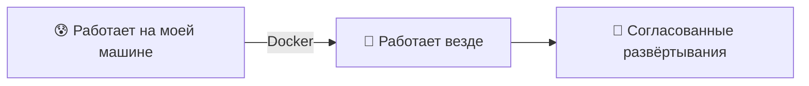
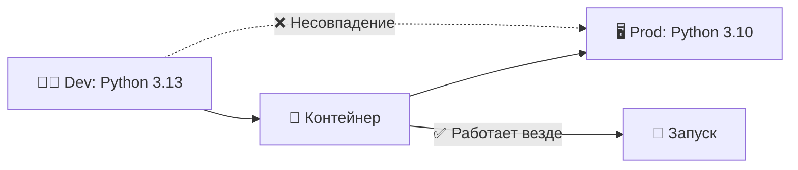
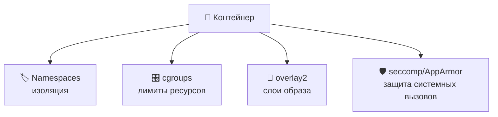
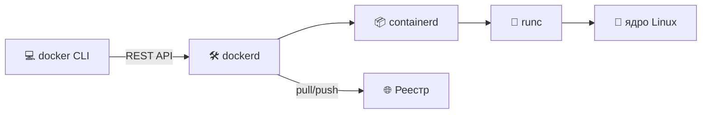
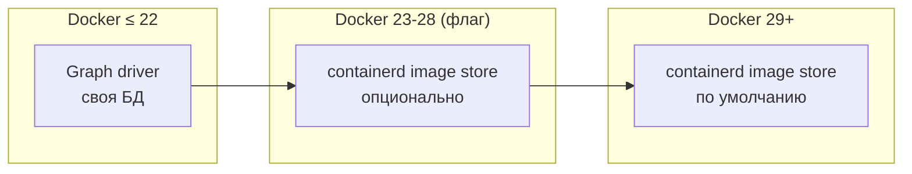
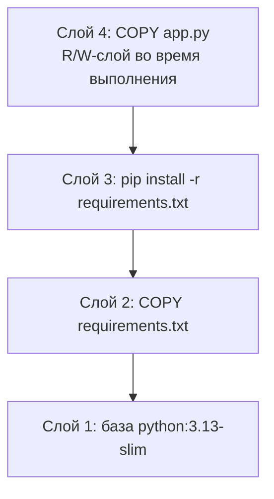
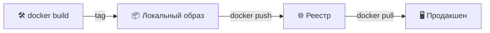
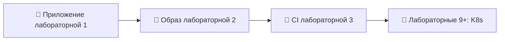

# 📌 Лекция 2 — Контейнеризация с Docker: от «работает на моей машине» к «работает везде»

## 📍 Слайд 1 – 🐳 Добро пожаловать в контейнеризацию

* 🌍 **«Работает на моей машине»** — самая дорогая фраза в разработке ПО (постоянная шутка лекции 1, теперь мы её исправляем)
* 📦 **Контейнеры** = упакуйте приложение + зависимости + среду выполнения в одну поставляемую единицу
* 🚀 **Docker** = инструмент, который сделал контейнеры мейнстримом в 2013 году
* 🎯 Эта лекция: сборка production-grade контейнеров — маленьких, безопасных, воспроизводимых



> 🔗 **Связь с лабораторной 2:** вы контейнеризуете Python-сервис из лабораторной 1. К концу у вас будет многоэтапный Dockerfile с итоговым образом менее 100 МБ.

---

## 📍 Слайд 2 – 🎯 Результаты обучения

| # | Результат |
|---|---------|
| 1 | 🧠 Объяснить, как Linux namespaces и cgroups делают контейнеры возможными |
| 2 | 📝 Писать production-ready Dockerfile |
| 3 | 🔐 Применять паттерны rootless и distroless |
| 4 | 📦 Уменьшать размер образа с помощью многоэтапных сборок |
| 5 | 🚀 Пушить и пулить из Docker Hub или GHCR |

**Технологический стек, закреплённый на май 2026:** Docker Engine **29.5+** (выпущен в мае 2026; хранилище образов containerd теперь по умолчанию), BuildKit включён по умолчанию, Compose v2 на Go (Python compose v1 достиг EOL в июле 2023).

---

## 📍 Слайд 3 – ❓ Большой вопрос

* 📊 **~65%** организаций запускают контейнеры в продакшене (CNCF Annual Survey 2024)
* 🐳 В Docker Hub **15M+** публичных образов, **~17 млрд** скачиваний в месяц
* 💥 Однако сканирование Snyk 2024 года обнаружило, что **~80%** публичных образов содержат хотя бы одну уязвимость HIGH-уровня

> 💬 *«Контейнеры — новая единица развёртывания»* — Келси Хайтауэр

**🤔 Обсуждение:** если каждый образ потенциально уязвим, что делает Dockerfile «хорошим»?

---

## 📍 Слайд 4 – 🔥 Проблема зависимостей

* 👨‍💻 **Dev-машина:** Python 3.13, glibc 2.40, OpenSSL 3.3
* 🖥️ **Prod-машина:** Python 3.10, glibc 2.31, OpenSSL 1.1
* 💥 Приложение падает в проде с `GLIBC_2.34 not found` — и никто не может воспроизвести это локально



Контейнер замораживает *всё пользовательское пространство* — интерпретатор, библиотеки, системные инструменты — в один неизменяемый артефакт. Общим остаётся только ядро.

---

## 📍 Слайд 5 – 😱 Решение на VM (и почему контейнеры победили)

VM решили задачу изоляции в 2000-х, виртуализируя **аппаратное обеспечение**: полная ОС на каждое приложение.

| 📊 | 🖥️ VM | 🐳 Контейнер |
|----|------|-------------|
| Время загрузки | минуты | секунды |
| Накладные расходы | полная ОС на приложение (~ГБ) | общее ядро (~МБ) |
| Плотность на хост | десятки | сотни — тысячи |
| Размер образа | 1–10 ГБ | 5 МБ – 1 ГБ |
| Изоляция | на уровне оборудования | на уровне процессов + namespaces |

> 🔥 **Компромисс:** у контейнеров изоляция слабее. CVE в ядре позволяет вырваться из контейнера, но не из VM. Поэтому production-кластеры K8s часто работают на VM.

---

## 📍 Слайд 6 – 📜 Краткая история контейнеров

* 📅 **1979** — `chroot()` добавлен в Unix V7. Предок всех контейнеров.
* 📅 **2000** — FreeBSD Jails: chroot + изоляция процессов.
* 📅 **2008** — **LXC** (Linux Containers): namespaces + cgroups вместе.
* 📅 **2013** — **Docker** становится open-source (dotCloud, переименована). Демо Соломона Хайкса на PyCon становится вирусным.
* 📅 **2015** — Docker передаёт спецификацию среды выполнения контейнеров (OCI). Containerd отделяется от Docker.
* 📅 **2016** — Kubernetes достигает 1.0; оркестрация контейнеров становится продакшен-историей.
* 📅 **2020** — Kubernetes объявляет Docker устаревшей средой выполнения (использует containerd напрямую). Образы Docker по-прежнему работают — они же OCI.
* 📅 **2023** — Docker Compose v1 (Python) достигает EOL в июле 2023. **Compose v2 (Go)** — стандарт.
* 📅 **2026** — Выпущен Docker Engine **29** (май 2026). Хранилище образов containerd становится по умолчанию для новых установок — завершается траектория «Docker превращается в containerd + инструменты», начавшаяся в 2015.

---

## 📍 Слайд 7 – 🐧 Примитивы ядра, которые делают это возможным

Контейнеры — не функция, а *композиция* возможностей Linux:

| Примитив | Что изолирует |
|-----------|------------------|
| 🏷️ **Namespaces** (PID, NET, MNT, UTS, IPC, USER, CGROUP) | Деревья процессов, сети, монтирования, имя хоста, IPC, UID, представление cgroup |
| 🎛️ **cgroups (v2)** | CPU, память, блочный ввод-вывод, PID — *квоты*, а не изоляция |
| 📂 **Union-файловые системы** (overlay2) | Стекированные слои только для чтения + один R/W-слой = модель образа |
| 🛡️ **Capabilities + seccomp + AppArmor** | Какие системные вызовы контейнеру разрешено делать |



> 📖 *Containers from Scratch* (доклад Лиз Райс, 2017) — строит контейнер на 100 строках Go с помощью этих примитивов.

---

## 📍 Слайд 8 – 🏗️ Архитектура Docker



* **`docker` CLI** — то, что вы вводите
* **`dockerd`** — демон; общается с containerd по gRPC
* **`containerd`** — менеджер среды выполнения OCI (также используется напрямую K8s)
* **`runc`** — собственно порождатель процессов, вызывающий ядро
* **Реестр** — Docker Hub, GHCR, ECR, GAR, Harbor — хранит образы

> 📝 **Rootless Docker** (по умолчанию с Docker 23): `dockerd` работает от вашего пользователя, а не от root. Применяйте его.

---

## 📍 Слайд 9 – 🔁 Docker 29 и хранилище образов containerd

Десятилетие у Docker было собственное хранилище образов (*graph driver* — `overlay2`, `aufs` и т. д.). У containerd было *другое* хранилище образов. Одни и те же OCI-образы на диске, но две базы данных, описывающие их. Docker 23 ввёл хранилище образов containerd как feature-флаг в 2023 году; **Docker 29 (май 2026) делает его по умолчанию для новых установок**.

Почему студентам это важно:
* 🪞 **Ленивые пулы** — качайте только те слои, которые действительно нужны (eStargz / SOCI)
* 🖥️ **Мультиплатформенные образы локально** — `docker buildx build --platform linux/amd64,linux/arm64` наконец работает без обращений к реестру
* 📦 **Лучшее освобождение диска** — GC образов соответствует тому, что уже делают `nerdctl` и Kubernetes
* 🧹 **Одна база образов** на хосте вместо двух



> 🔥 **Горячее мнение:** движок Docker теперь в основном отполированный UX поверх containerd + BuildKit. Для экосистемы это *хорошо*; это значит, что Kubernetes, nerdctl, podman и Docker согласны насчёт среды выполнения.

---

## 📍 Слайд 10 – 📚 Слои образа — ментальная модель

Каждая инструкция Dockerfile создаёт **слой только для чтения**. Слои складываются через overlayfs; работающий контейнер добавляет сверху один R/W-слой.



**Почему это важно:**
* 🚀 Слои **кэшируются** — неизменённые шаги не пересобираются
* 📦 Слои **разделяются** — три образа на одной базе хранят базу один раз
* 💀 Слои **аддитивны** — удаление файла в позднем слое скрывает его, но в слое выше он остаётся

> 🔥 **Антипаттерн:** `COPY secrets.env / && rm secrets.env` НЕ удаляет секрет. Он всё ещё в более раннем слое. Считайте каждый слой вечным.

---

## 📍 Слайд 11 – 📝 Основы Dockerfile — прочитайте дважды

```dockerfile
# 🏗️ Базовый образ — alpine, debian-slim, distroless, scratch
FROM python:3.13-slim

# 👤 Не запускайте от root (позже мы это усилим)
RUN useradd --create-home --shell /bin/bash app
USER app
WORKDIR /home/app

# 📦 Зависимости СНАЧАЛА (меняются редко → кэшируются)
COPY --chown=app:app requirements.txt .
RUN pip install --user --no-cache-dir -r requirements.txt

# 💻 Код приложения ПОСЛЕДНИМ (меняется часто → пересобирается только этот слой)
COPY --chown=app:app . .

# 🚪 Документируйте порт
EXPOSE 8080

# 🚀 Используйте exec-форму (PID 1 = ваше приложение → сигналы работают)
CMD ["python", "app.py"]
```

> ⚠️ **Ловушка PID 1:** shell-форма (`CMD python app.py`) делает `/bin/sh` процессом PID 1, а ваше приложение — PID 2 — сигналы (SIGTERM) до него не доходят. Всегда используйте exec-форму `CMD ["python", "app.py"]`.

---

## 📍 Слайд 12 – ⚡ До и после Docker

| 😰 Без Docker | 🚀 С Docker |
|---|---|
| В README 14 шагов `apt-get install` | `docker run myapp` |
| «Работает на Linux, но не на Windows» | Работает одинаково на Linux/macOS/Windows (с Linux-контейнерами) |
| Дрейф продакшена накапливается | Образ неизменяем; пересборки воспроизводимы |
| Онбординг нового разработчика занимает часы | `docker compose up` и пишите код |
| Одна плохая зависимость = переустановка всего сервера | `docker stop && docker rm && docker run` — готово |

---

## 📍 Слайд 13 – 🎮 Сценарий 1: Запуск от root

**Провал:**
```dockerfile
FROM python:3.13-slim
COPY . /app
CMD ["python", "/app/server.py"]
```
Он запускается как **root внутри контейнера**. CVE в ядре (например, CVE-2022-0185, побег через FILESYSTEM\_MOUNT) позволяет процессу стать root на хосте. Это побег из контейнера.

**Исправление — отказ от привилегий:**
```dockerfile
FROM python:3.13-slim
RUN useradd --uid 10001 --create-home --shell /bin/bash app
WORKDIR /home/app
COPY --chown=app:app . .
USER 10001     # 👤 числовой UID переживает переименования
CMD ["python", "server.py"]
```

> 🔒 **Бонус:** добавьте `--read-only` и `--cap-drop=ALL` при `docker run`. Лабораторная 2 проходит через это.

---

## 📍 Слайд 14 – 🐌 Сценарий 2: Медленные сборки (плохой порядок слоёв)

**Неправильный порядок — каждое изменение кода переустанавливает все зависимости (сборка 5 минут):**
```dockerfile
COPY . /app                 # 🚫 Каждое изменение инвалидирует всё ниже
RUN pip install -r /app/requirements.txt
```

**Правильный порядок — слой зависимостей кэшируется до изменения `requirements.txt`:**
```dockerfile
COPY requirements.txt .     # ✅ Меняется редко
RUN pip install -r requirements.txt
COPY . .                    # ✅ Изменения кода не сбрасывают слой зависимостей
```

**Правило большого пальца:** упорядочивайте слои от **наименее часто меняющихся** к **наиболее часто меняющимся**. База → системные пакеты → языковые зависимости → код приложения.

---

## 📍 Слайд 15 – 📦 Сценарий 3: Раздутые образы

Наивный Python-образ — **~1,2 ГБ**. Это проблема:
* 🐢 Медленный `docker pull` → медленные развёртывания, медленный autoscale
* 💸 Затраты на хранение и трафик растут с размером образа
* 🛡️ Больше образ = больше пакетов = больше CVE

**Уменьшайте:**
| Базовый образ | Размер | Компромисс |
|------------|-----:|-----------|
| `python:3.13` (debian) | ~1,2 ГБ | исчерпывающий |
| `python:3.13-slim` | ~150 МБ | нет man-страниц, меньше системных библиотек |
| `python:3.13-alpine` | ~60 МБ | musl libc — некоторые wheels ломаются |
| `gcr.io/distroless/python3` | ~50 МБ | нет shell, нет менеджера пакетов |
| `scratch` (для Go/Rust) | ~10 МБ | ничего, кроме вашего бинарника |

---

## 📍 Слайд 16 – 📁 Сценарий 4: Нет `.dockerignore`

Без `.dockerignore` `COPY . .` отправляет в образ ваши локальные `node_modules/`, `.git`, `.venv`, конфиги IDE и **секреты**. Контекст сборки может быть в сотни МБ.

```gitignore
# .dockerignore — тот же синтаксис, что и .gitignore
.git
.venv
venv/
__pycache__/
node_modules/
.env
*.pyc
docs/
tests/
README.md
.idea/
.vscode/
```

> 🔍 **Реальная история:** в 2022 году Toyota допустила утечку данных клиентов, потому что папка `.git` была включена в развёрнутый контейнер. Всегда имейте `.dockerignore`.

---

## 📍 Слайд 17 – 🚀 Многоэтапные сборки: главный трюк

Компилируйте в тяжёлом образе, **копируйте только артефакт** в крошечный итоговый образ.

```dockerfile
# 🏗️ Этап сборки: полный инструментарий
FROM golang:1.23 AS build
WORKDIR /src
COPY . .
RUN CGO_ENABLED=0 go build -o /app ./cmd/server

# 🚀 Итоговый этап: только бинарник
FROM gcr.io/distroless/static-debian12
COPY --from=build /app /app
USER nonroot:nonroot
ENTRYPOINT ["/app"]
```

Результат для типичного Go-сервиса:
* Одноэтапный образ `golang:1.23`: **~900 МБ**
* Многоэтапный distroless-образ: **~15 МБ**
* Тот же бинарник, **в 60 раз меньше**, **ноль shell**, **ноль менеджера пакетов**

> 🔗 **Бонус лабораторной 2:** перепишите Go-приложение из лабораторной 1 как многоэтапную distroless-сборку.

---

## 📍 Слайд 18 – 🔐 Distroless и `scratch`

**Distroless** (Google, 2018): образы со средой выполнения + вашим приложением, но **без shell, без apt, без busybox**. Резко сокращает поверхность атаки.

```dockerfile
# ❌ Стандартный slim — удобен для отладки, крупнее, больше CVE
FROM python:3.13-slim
COPY . /app
CMD ["python", "/app/server.py"]

# ✅ Distroless — продакшен
FROM gcr.io/distroless/python3-debian12
COPY --from=build /app /app
CMD ["/app/server.py"]
```

**`scratch`** — пустой образ. Используйте только для статически слинкованных бинарников (Go с `CGO_ENABLED=0`, Rust с musl). 0 CVE, потому что там буквально больше ничего нет.

> 📖 **Liz Rice, *Container Security* (O'Reilly, 2020)** — справочник по усилению образов.

---

## 📍 Слайд 19 – 🌐 Docker Hub и реестры



| Реестр | Примечания |
|----------|-------|
| 🐳 **Docker Hub** | По умолчанию; 1 бесплатный приватный репозиторий; rate limits бьют по CI |
| 🐙 **GHCR** (ghcr.io) | Бесплатно для публичных, интегрирован с GitHub Actions |
| ☁️ **ECR / GAR / ACR** | Cloud-native; доступ через IAM; рекомендуется для продов AWS/GCP/Azure |
| 🏠 **Harbor** | Self-hosted; graduated CNCF; подпись образов + сканирование уязвимостей встроены |

**Ссылки на образы:** `[registry/]namespace/repo[:tag][@digest]`
- `nginx` → `docker.io/library/nginx:latest`
- `ghcr.io/innodevops/lab2-app:v1.2.3@sha256:abc…` — для продакшена закрепляйте по digest

---

## 📍 Слайд 20 – 🏷️ Стратегии тегирования

> 🚫 **Никогда не развёртывайте `:latest` в продакшен.** Он изменяем; вы не сможете воспроизвести вчерашнее развёртывание.

| Стратегия | Пример | Когда |
|----------|---------|------|
| 📌 **SemVer** | `v1.4.2` | Релиз библиотеки или продукта |
| 🔢 **Git SHA** | `git-3a7f29c` | Сборки CI; всегда уникальны |
| 📅 **CalVer** | `2026.04.0` | Каденция релизов по времени |
| 🌿 **Ветка** | `main`, `develop` | Только во время разработки |
| 🔒 **Закрепление по digest** | `@sha256:…` | Продакшен — неизменяемо |

**Рекомендуется:** пушить два тега на каждую сборку — тег SemVer-или-SHA для воспроизводимости плюс движущийся тег `main` для удобства. Продакшен ссылается на неизменяемый.

---

## 📍 Слайд 21 – 🛡️ Лучшие практики безопасности контейнеров

Чек-лист, применимый к любому Dockerfile:

1. ✅ **Закрепляйте версии базового образа** — `python:3.13-slim`, а не `python:slim` или `python:latest`
2. ✅ **Переходите на non-root UID** — `USER 10001`
3. ✅ **Добавляйте `HEALTHCHECK`**, чтобы оркестратор знал, когда приложение живо
4. ✅ **Не вшивайте секреты** — `--build-arg` виден в `docker history`; используйте секреты BuildKit или runtime-переменные окружения
5. ✅ **Задавайте `WORKDIR`** явно — `/app`, а не `/` или `~`
6. ✅ **Используйте `COPY`, а не `ADD`**, если вам специально не нужно скачивание по URL или авто-распаковка tar
7. ✅ **Сканируйте образы** — Trivy, Grype или Snyk в CI; блокируйте сборку на CVE HIGH/CRITICAL
8. ✅ **Подписывайте образы** — cosign + Sigstore; проверка в admission controller (рассматривается в элективе DevSecOps)

```bash
# 🔍 Лабораторная 2 будет использовать это
trivy image --severity HIGH,CRITICAL --exit-code 1 myapp:v1.0.0
```

---

## 📍 Слайд 22 – 🐙 Compose: несколько контейнеров локально

`docker-compose.yml` декларативно описывает многоконтейнерный стек — идеально для локальной разработки и дымовых тестов CI.

```yaml
services:
  app:
    build: ./app_python
    ports: ["8080:8080"]
    environment:
      DATABASE_URL: postgres://db:5432/app
    depends_on:
      db:
        condition: service_healthy
  db:
    image: postgres:17
    healthcheck:
      test: ["CMD-SHELL", "pg_isready -U postgres"]
      interval: 5s
    environment:
      POSTGRES_PASSWORD: dev
```

> 🔗 **Вы будете использовать Compose в лабораторных 6, 7, 8.** Для production-нагрузок с несколькими контейнерами на смену приходит Kubernetes (лабораторная 9+).

---

## 📍 Слайд 23 – 🌍 Контейнерные паттерны в реальных компаниях

* 🎬 **Netflix** — каждый микросервис поставляется как образ контейнера; тысячи сборок в день пушатся во внутренний реестр на базе S3.
* 📦 **Amazon (Bottlerocket)** — ОС, оптимизированная для контейнеров, на хосте почти ничего больше не работает.
* 🔍 **Google** — изобрёл контейнеры в продакшене (Borg, 2003); внутри компании пушит ~2 миллиарда контейнеров в неделю.
* 💬 **GitHub** — *каждый* PR выполняется в контейнере через Actions; ~100 миллионов контейнеров в месяц.
* 🏦 **Capital One** — перенёс основной банкинг с VM на контейнеры в EKS; сократил расходы на вычисления ~на 40%.

> 🔥 **Общая нить:** контейнеры — это то, как современные инженерные организации выпускают ПО в масштабе.

---

## 📍 Слайд 24 – 🎯 Ключевые выводы

1. 📦 **Контейнеры — не магия** — namespaces + cgroups + overlayfs + реестр
2. 🏗️ **Упорядочивайте слои от стабильного к изменчивому** — держите кэши горячими
3. 👤 **Никогда не запускайте от root** — переходите на ненулевой UID, желательно числовой
4. 🛡️ **Многоэтапность + distroless** — меньше образ, меньше CVE, быстрее пулы
5. 🏷️ **Тегируйте по SemVer или SHA; никогда не развёртывайте `:latest`**
6. 🔍 **Сканируйте каждый образ в CI** — Trivy или Grype, блокируйте на HIGH/CRITICAL
7. 📄 **`.dockerignore` не опционален** — держит секреты и `.git` снаружи

> 💡 **Хороший Dockerfile — маленький, безопасный и воспроизводимый. Два из трёх — это баг.**

---

## 📍 Слайд 25 – 🧠 Смена мышления

| 😰 Старое | 🚀 Контейнерно-нативное |
|-------|---------------------|
| «Настрой сервер» | Определи окружение в `Dockerfile` |
| «Обнови прод-машину» | Собери новый образ, разверни заново |
| «Работает на моей машине» | Работает в образе, образ работает везде |
| «Большой монолит на VM» | Много маленьких сервисов, каждый — контейнер |
| Образ — чёрный ящик | Образ — версионированный артефакт, просканированный и подписанный |

---

## 📍 Слайд 26 – 🚀 Что дальше

**📚 Следующая лекция: *Continuous Integration*** — каждый пуш прогоняет тесты, собирает образ и сканирует его перед слиянием.

* 🔄 Почему CI предотвращает отказы, которые вы видели в лекции 1
* 🛠️ Синтаксис workflow GitHub Actions
* 🧪 Пирамида тестирования: unit → integration → end-to-end
* 🐳 Автоматическая сборка и пуш образа из лабораторной 2

**🔬 Лабораторная 2:** контейнеризуйте сервис из лабораторной 1 с многоэтапным Dockerfile, просканируйте его через Trivy, запушьте в GHCR. Образ, который вы соберёте на этой неделе, будет следовать за вашим сервисом через все оставшиеся лабораторные — K8s развернёт его (лабораторная 9), Helm упакует (лабораторная 10), ArgoCD доставит (лабораторная 13).



**👋 До встречи на лекции 3.**

---

## 📚 Ресурсы

* 📕 *Docker Deep Dive* — Найджел Поултон (последнее изд. охватывает BuildKit + Compose v2)
* 📕 *Container Security* — Лиз Райс, O'Reilly 2020 (бесплатный PDF на aquasec.com)
* 🎥 *Containers from Scratch* — доклад Лиз Райс на GopherCon (YouTube, 2017)
* 🌐 [docs.docker.com](https://docs.docker.com) — официальная документация Docker (Engine 27.x)
* 🌐 [distroless](https://github.com/GoogleContainerTools/distroless) — distroless-образы Google
* 🌐 [opencontainers.org](https://opencontainers.org) — спецификация OCI (образ + среда выполнения + дистрибуция)
* 🌐 [CIS Docker Benchmark](https://www.cisecurity.org/benchmark/docker) — чек-лист усиления

**🎓 Квиз:** квиз после лекции идёт в зачёт таблицы лидеров недель 1–3.
