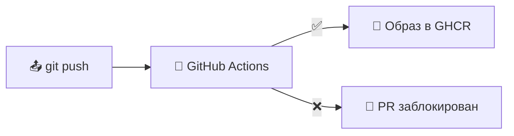
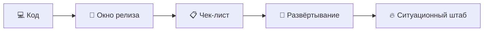
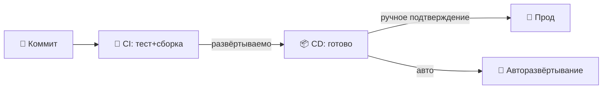
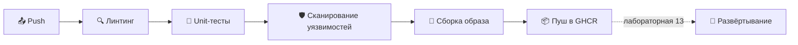
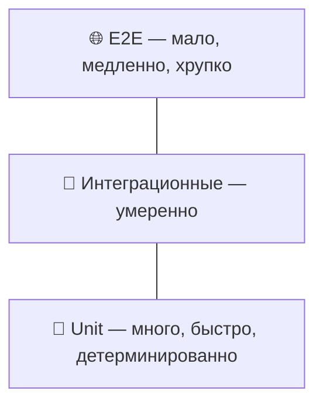
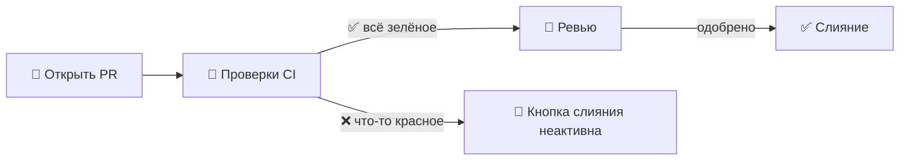
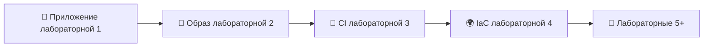

# 📌 Лекция 3 — Continuous Integration: от «недели слияний» к зелёному статусу на каждый пуш

## 📍 Слайд 1 – 🤖 Добро пожаловать в CI/CD

* 🐳 Лекция 2 закончилась образом, который «работает везде» — но только если вы не забудете пересобрать, просканировать и запушить его
* 🤖 **Continuous Integration** превращает это «если» в «когда»: каждый коммит прогоняет один и тот же конвейер, на одном и том же раннере, с одним и тем же сканером
* 🎯 Эта лекция: соберите workflow GitHub Actions, который требует лабораторная 3 — тест → линтинг → сканирование → сборка → публикация, с блокировкой на каждом PR
* 🔗 **Лабораторная 3 строит именно этот workflow** для Python-сервиса из лабораторной 1 и образа из лабораторной 2



> 📚 **Рамка:** CI — мост между «я изменил код на ноутбуке» (лекция 1) и «этот самый образ работает в K8s» (лекция 9). Пропустите CI — и мост превращается в прыжок веры.

---

## 📍 Слайд 2 – 🎯 Результаты обучения

| # | Результат |
|---|---------|
| 1 | 🧠 Определять CI, CD и CDeploy в терминах Хамбла и Фарли |
| 2 | 🔺 Применять пирамиду тестирования — много unit, мало интеграционных, редкие E2E |
| 3 | 📝 Читать и писать workflow GitHub Actions с нуля |
| 4 | 🛡️ Блокировать слияния на сканированиях уязвимостей Trivy и обязательных проверках |
| 5 | 🏷️ Выбирать SemVer или CalVer и тегировать образы соответственно |
| 6 | ⚡ Диагностировать медленный CI — кэширование, матрицы, фильтры путей, concurrency |

---

## 📍 Слайд 3 – 🛠️ Технологический стек (закреплён на май 2026)

| Компонент | Версия | Почему закреплено |
|-----------|--------:|------------|
| Раннер | `ubuntu-24.04` | LTS; `ubuntu-latest` меняется и ломает воспроизводимость |
| `actions/checkout` | `@v4` | Среда выполнения Node 20; v3 устарел в феврале 2024 |
| `actions/setup-python` | `@v5` | Встроенный `cache: pip` с ключом по `requirements.txt` |
| `docker/build-push-action` | `@v6` | BuildKit + мультиплатформенность; v5 EOL в апреле 2025 |
| `docker/metadata-action` | `@v5` | Теги SemVer/CalVer/SHA за один шаг |
| Trivy | `v0.69.3+` | ⚠️ атака на цепочку поставок в марте 2026 (v0.69.4 вредоносна — см. слайд 15); база CVE обновляется ежедневно; альтернативы: Grype, Snyk (платно) |
| Cosign | `2.4` | Клиент Sigstore; подпись образов рассматривается в элективе DevSecOps |
| pytest | `8.3+` | Совместим с Python 3.13 |

> 📌 **Закрепляйте actions на мажорном теге** (`@v4`), инструменты — на минорной версии, базовые образы в продакшене — по digest. Лабораторная 3 требует первые два.

---

## 📍 Слайд 4 – ❓ Большой вопрос

* 📊 **DORA 2024:** элитные команды развёртывают по требованию, несколько раз в день; отстающие — реже раза в месяц
* 🐛 **Capers Jones (2012):** исправление бага в проде стоит **в 30–100 раз** дороже, чем обнаружение в dev
* 🔍 **Sonatype 2024:** каждое 8-е скачивание open-source несёт известную уязвимость — зависимости и есть поверхность атаки

> 💬 *«Если это больно, делайте это чаще»* — Мартин Фаулер, *Continuous Integration* (2006)

---

## 📍 Слайд 5 – 🔥 Проблема: ад ручного тестирования

Команда без CI выглядит так:

* 📋 50-шаговый ручной чек-лист перед каждым релизом
* 🗓️ Релизы раз в месяц, потому что каждый занимает целый день
* 😴 QA-инженер снова забыл протестировать `/health`
* 💥 Продакшен ломается; никто не может воспроизвести, что было развёрнуто



> 📖 Лекция 1 назвала это *адом ручных релизов*. CI — практика, которая его упраздняет.

---

## 📍 Слайд 6 – 💥 Проблема интеграции («неделя слияний»)

До CI интеграция долгоживущих веток была плановым событием:

* 🌿 Пять разработчиков в feature-ветках **3 недели**
* 📅 «Пятница интеграции» — все сливаются в `main` одновременно
* 🔀 Часы разрешения конфликтов; никто не понимает диффы
* 💀 `main` сломан неделю; никто не может выпускать

> 📖 Кент Бек (*Extreme Programming*, 1999) прописал лекарство: **интегрируйтесь как минимум ежедневно**. Хамбл и Фарли закрепили это в *Continuous Delivery* (2010).

**Исправление:** маленькие коммиты, trunk-based development, каждый пуш валидируется CI.

---

## 📍 Слайд 7 – 🔓 Пробел в безопасности

Лекция 2 закончилась на `trivy image`. Запустите его один раз вручную — и забудете, а CVE, опубликованная в следующий вторник, ни о чём не напомнит.

* 🔍 **Sonatype 2024:** среднее корпоративное приложение тянет **180+ open-source зависимостей**
* ⏱️ Медианное время обнаружения уязвимой зависимости без сканирования: **218 дней** (Snyk *State of Open Source 2024*)
* 🤖 **GitGuardian 2024:** утёкшие учётные данные в публичных репозиториях находят сканирующие боты **менее чем за 5 минут**

> 🔥 **CI — это место, где безопасность сдвигается влево** — сканирование идёт на каждом PR, а не «когда будет время».

---

## 📍 Слайд 8 – 💡 Что такое CI/CD на самом деле

Три термина, которые часто путают. *Continuous Delivery* Хамбла и Фарли (2010) проводит границы:

| Термин | Определение | Триггер |
|------|------------|---------|
| 🤖 **Continuous Integration** | Каждый коммит собирается и тестируется в общем стволе | Пуш / PR |
| 📦 **Continuous Delivery** | Каждый прошедший коммит **готов к развёртыванию** в любой момент | Слияние в `main` |
| 🚀 **Continuous Deployment** | Каждый прошедший коммит **автоматически развёртывается** в прод | Слияние в `main` |



> 📖 Джез Хамбл: *«Continuous Delivery — это не Continuous Deployment. Разница в том, кто нажимает кнопку»*.

---

## 📍 Слайд 9 – 🔄 Анатомия конвейера

У каждого современного CI-конвейера один и тот же скелет — лабораторная 3 строит шаги в рамках:



* 🔍 **Линтинг** — `ruff` / `flake8` / `pylint`. Секунды.
* 🧪 **Тесты** — `pytest` против эндпоинтов лабораторной 1. Десятки секунд.
* 🛡️ **Сканирование** — Trivy или Grype по зависимостям и образу. ~1 мин.
* 🐳 **Сборка** — многоэтапный Dockerfile из лабораторной 2, с кэшем BuildKit.
* 📦 **Публикация** — GHCR (бесплатно для публичных, нативно в GitHub, `GITHUB_TOKEN`).

> 🔗 Развёртывание (пунктир) — это лекция 13 / лабораторная 13 — ArgoCD следит за реестром.

---

## 📍 Слайд 10 – 🔺 Пирамида тестирования

Пирамида Майка Кона (*Succeeding with Agile*, 2009) до сих пор остаётся моделью:



| Слой | Доля | Скорость | Что ловит |
|-------|------:|------:|---------|
| 🧪 Unit | ~70% | мс | Логические баги в чистых функциях |
| 🔗 Интеграционные | ~20% | секунды | Неверный HTTP-статус, форма запроса к БД |
| 🌐 E2E | ~10% | минуты | Сквозные потоки между сервисами, UI |

> ⚠️ **Перевёрнутая пирамида (упор на E2E) = медленный, нестабильный CI.** *Testing Blog* Google называет это антипаттерном *рожок мороженого*. Лабораторная 3 остаётся на уровне unit; интеграционные тесты появляются в лабораторной 7+.

---

## 📍 Слайд 11 – 📝 Анатомия workflow GitHub Actions

Workflow — это YAML-файл в `.github/workflows/`. Читайте эти ключи сверху вниз:

```yaml
name: Python CI                    # 👁️ показывается на вкладке Actions
on:                                # ⚡ триггеры
  push: { branches: [main] }
  pull_request:
permissions:                       # 🔒 минимально необходимое
  contents: read
  packages: write                  # для пуша в GHCR
concurrency:                       # ♻️ отменять устаревшие запуски по тому же PR
  group: ci-${{ github.ref }}
  cancel-in-progress: true

jobs:
  test:
    runs-on: ubuntu-24.04          # 📌 закреплено, не :latest
    steps:
      - uses: actions/checkout@v4
      - uses: actions/setup-python@v5
        with: { python-version: "3.13", cache: pip }
      - run: pip install -r requirements.txt -r requirements-dev.txt
      - run: ruff check .
      - run: pytest -q
```

> 📌 **Закрепляйте actions на мажорном теге** (`@v4`). Закрепление на `@main` позволяет компрометации выше по цепочке тихо попасть в ваш CI (ср. атака на цепочку поставок **tj-actions/changed-files**, **14–15 марта 2025**, **CVE-2025-30066** — 23 000+ репозиториев утекли секреты в логи CI; исправлено в v46.0.1).

---

## 📍 Слайд 12 – 🧩 Jobs, steps, needs, матрицы

* 🧱 **Workflow** → много **jobs** → много **steps**
* 🧱 **Jobs по умолчанию идут параллельно**; упорядочивайте их через `needs:`
* 🧱 **Каждый job — свежая VM** — файлы не переходят между jobs, если не использовать `upload-artifact`/`download-artifact`
* 🧱 **Матрицы** размножают один job по многим параметрам

```yaml
jobs:
  test:
    strategy:
      fail-fast: false             # не убивать 3.12, когда 3.13 падает
      matrix:
        python-version: ["3.11", "3.12", "3.13"]
    runs-on: ubuntu-24.04
    steps:
      - uses: actions/setup-python@v5
        with: { python-version: "${{ matrix.python-version }}" }
      - run: pytest

  docker:
    needs: test                    # 🔗 запускается, только если прошла каждая ячейка матрицы
    runs-on: ubuntu-24.04
    steps: ...
```

> 💡 **Concurrency × матрица:** 3 job × N PR могут быстро сжечь минуты бесплатного тарифа. Всегда задавайте `cancel-in-progress` (слайд 11).

---

## 📍 Слайд 13 – 🎮 Сценарий 1: Нет тестов → pytest в CI

**Провал:**

```python
# app.py из лабораторной 1
@app.route("/")
def home():
    return {"message": "Hello", "hostname": os.environ["HOSTNAME"]}
```

Опечатка в `os.environ` вызывает `KeyError`. На ноутбуке разработчика это работает, потому что у него задан `HOSTNAME`; в контейнере, где его нет, всё падает.

**Исправление — pytest под CI:**

```python
# tests/test_app.py
def test_home_returns_hostname_field(client, monkeypatch):
    monkeypatch.delenv("HOSTNAME", raising=False)
    r = client.get("/")
    assert r.status_code == 200
    assert "hostname" in r.get_json()

def test_health_endpoint(client):
    r = client.get("/health")
    assert r.status_code == 200
    assert r.get_json()["status"] == "healthy"
```

> 🔗 **Задача 1 лабораторной 3** просит написать ровно эти тесты для `/` и `/health` — и обосновать выбор pytest против unittest. Fixtures и простой `assert` в pytest выигрывают для большинства проектов.

---

## 📍 Слайд 14 – 🎮 Сценарий 2: Ручные сборки Docker → build-push-action

**Провал (ручной поток лабораторной 2):**

```bash
docker build -t myapp:latest .
docker tag myapp:latest ghcr.io/me/myapp:v1.2.3
docker login ghcr.io                       # ← введено вручную
docker push ghcr.io/me/myapp:v1.2.3
docker push ghcr.io/me/myapp:latest
# 😱 забыли запушить :v1.2.3 → прод работает со вчерашним багом
```

**Исправление:**

```yaml
docker:
  needs: test
  runs-on: ubuntu-24.04
  permissions: { contents: read, packages: write }
  steps:
    - uses: actions/checkout@v4
    - uses: docker/login-action@v3
      with:
        registry: ghcr.io
        username: ${{ github.actor }}
        password: ${{ secrets.GITHUB_TOKEN }}    # 🔒 эфемерный, нечего ротировать
    - uses: docker/metadata-action@v5
      id: meta
      with:
        images: ghcr.io/${{ github.repository }}
        tags: |
          type=semver,pattern={{version}}
          type=sha,prefix=git-
          type=raw,value=latest,enable={{is_default_branch}}
    - uses: docker/build-push-action@v6
      with:
        context: ./app_python
        push: true
        tags: ${{ steps.meta.outputs.tags }}
        cache-from: type=gha
        cache-to: type=gha,mode=max
```

> 🔗 **Задача 2 лабораторной 3** собирает именно этот job. `GITHUB_TOKEN` автоматически выдаётся на каждый запуск — никаких учётных данных Docker Hub, которыми нужно управлять.

---

## 📍 Слайд 15 – 🎮 Сценарий 3: Уязвимые зависимости → Trivy + Dependabot

**Провал:**

```
# requirements.txt
flask==2.0.1            # CVE-2023-30861 (высокая) — раскрытие cookie сессии
requests==2.25.0        # CVE-2023-32681 (средняя) — утечка proxy auth
```

Лекция 2 представила `trivy image`. CI запускает его на каждом PR.

```yaml
- uses: aquasecurity/trivy-action@0.35.0   # 📌 v0.35.0+ безопасно после инцидента (см. врезку)
  with:
    scan-type: fs                      # сканировать requirements.txt + lock-файлы
    severity: HIGH,CRITICAL
    exit-code: "1"                     # 🚫 провалить job
    ignore-unfixed: true               # пропускать CVE без патча
```

> ⚠️ **Атака на цепочку поставок Trivy (19 марта 2026 — CVE-2026-33634).** Вредоносный бинарник **Trivy v0.69.4** был опубликован на официальной странице релизов GitHub после компрометации ключей подписи мейнтейнера. Любой CI job, который закрепил `trivy-action` на плавающем `master`/`latest` или вызывал `curl -sfL .../install.sh | sh` 19–20 марта, исполнял код атакующих на раннере — с полным доступом к хранилищу секретов CI. Исправление выпущено в течение 24 часов (Trivy **v0.69.3** откатили до последней заведомо хорошей сборки; `trivy-action **v0.35.0+`**, `setup-trivy **v0.2.6+`** безопасны после инцидента). **Урок этой лекции:** *сам сканер* — часть вашей цепочки поставок. Закрепляйте его. Проверяйте его подпись. Точно такой же паттерн (скомпрометированный мейнтейнер → вредоносный релиз) потопил tj-actions/changed-files годом ранее — дважды за 12 месяцев для двух самых используемых инструментов безопасности в CI/CD.


**В паре с Dependabot** (`.github/dependabot.yml` — нативно, без токена, без третьих сторон):

```yaml
version: 2
updates:
  - package-ecosystem: pip
    directory: /app_python
    schedule: { interval: weekly }
  - package-ecosystem: github-actions  # 🔒 держать actions/checkout@v4 свежим
    directory: /
    schedule: { interval: weekly }
```

> 🛡️ **Выбор инструмента:** Trivy (Aqua, Apache-2.0) и Grype (Anchore, Apache-2.0) — полноценные FOSS. Snyk богат функциями, но платен сверх бесплатного тарифа. Лабораторная 3 принимает любой из трёх.

---

## 📍 Слайд 16 – 🎮 Сценарий 4: Медленный CI → кэширование

```
[Run 1] pip install ........................ 2m 18s
[Run 2] pip install ........................ 2m 14s     # те же зависимости
[Run 3] pip install ........................ 2m 21s     # 😴 всё ещё скачивается
```

**Исправление — встроено в `setup-python`:**

```yaml
- uses: actions/setup-python@v5
  with:
    python-version: "3.13"
    cache: pip
    cache-dependency-path: app_python/requirements.txt
```

Ключ кэша — `runner.os + python-version + hash(requirements.txt)`. Измените `requirements.txt` — и кэш инвалидируется автоматически.

**Добавьте кэш Docker BuildKit** (слайд 14 уже показывает это):

```yaml
cache-from: type=gha
cache-to: type=gha,mode=max
```

**Фильтры путей пропускают workflow для несвязанных изменений:**

```yaml
on:
  push:
    paths: ["app_python/**", ".github/workflows/python-ci.yml"]
```

**Измеренный эффект на типичной настройке лабораторной 3:** 5 мин 30 с → 45 с на горячем кэше. ~7× быстрее.

> ⚠️ **Не кэшируйте `~/.cache/pip` вручную, если `setup-python` вам подходит** — встроенный кэш корректно обрабатывает инвалидацию.

---

## 📍 Слайд 17 – 📊 Покрытие — полезно, но не священно

```yaml
- run: pytest --cov=app_python --cov-report=xml --cov-fail-under=70
- uses: codecov/codecov-action@v4
  with: { files: ./coverage.xml }
```

| Покрытие | Прочтение |
|---------:|---------|
| < 50% | Вероятно, нет настоящей культуры тестирования |
| 70–85% | Здорово для большинства прикладного кода |
| 95%+ | Территория библиотек / критичных для безопасности систем |
| 100% | Почти всегда расточительно — убывающая отдача |

> 🔥 **Мартин Фаулер:** *покрытие — полезный инструмент для поиска непротестированного кода; это не полезная цель.* Высокое покрытие со слабыми проверками — театр.

---

## 📍 Слайд 18 – 🔁 Переиспользуемые части

По мере роста CI copy-paste гниёт. GitHub даёт два примитива переиспользования:

| Инструмент | Область | Когда |
|------|-------|------|
| 🧩 **Composite action** (`action.yml`) | Набор **steps** | «Setup Python + кэш + установка зависимостей» |
| 🔁 **Reusable workflow** (`uses: org/repo/.github/workflows/x.yml@v1`) | Целый **job** | «Стандартный CI для каждого Python-сервиса» |

> 🔗 **Лабораторная 3 этого не требует**, но production-монорепозитории активно на это опираются. Вернёмся к теме в лекции 13.

---

## 📍 Слайд 19 – 🏷️ Версионирование: SemVer

`MAJOR.MINOR.PATCH` — спецификация Тома Престона-Вернера (semver.org, 2013).

| Повышение | Когда | Пример |
|------|------|---------|
| **MAJOR** | Несовместимое изменение API | `1.4.2 → 2.0.0` |
| **MINOR** | Новая обратно совместимая функция | `1.4.2 → 1.5.0` |
| **PATCH** | Только исправление бага | `1.4.2 → 1.4.3` |

`docker/metadata-action` может выводить теги SemVer из git-тега (`git tag v1.2.3 && git push --tags`):

```yaml
tags: |
  type=semver,pattern={{version}}    # 1.2.3
  type=semver,pattern={{major}}.{{minor}}    # 1.2
  type=semver,pattern={{major}}    # 1
```

**Используйте SemVer для:** библиотек, SDK, API, которые закрепляют потребители ниже по цепочке.

---

## 📍 Слайд 20 – 📅 Версионирование: CalVer

`YYYY.MM.DD` или `YYYY.MM.PATCH` — calver.org, популяризирован Ubuntu (`24.04`) и pip (`24.3`).

```yaml
- id: ver
  run: echo "v=$(date -u +%Y.%m.%d)" >> $GITHUB_OUTPUT
- uses: docker/build-push-action@v6
  with:
    tags: |
      ghcr.io/${{ github.repository }}:${{ steps.ver.outputs.v }}
      ghcr.io/${{ github.repository }}:latest
```

**Используйте CalVer для:** сервисов с непрерывным развёртыванием, где «несовместимое изменение» не применимо, потому что никто, кроме вас, не закрепляет вас (ваш собственный сервис, развёртываемый вашим собственным CI).

> 🚫 **Никогда не развёртывайте `:latest` в продакшен.** Он изменяем; завтрашний образ с тем же тегом — другой артефакт. Закрепляйте по SemVer или по digest. (Тот же урок, что и в лекции 2.)

---

## 📍 Слайд 21 – 🛡️ Защита веток: CI полезен, только если он блокирует

Зелёный значок CI — украшение. **Обязательные проверки статуса** — вот ворота.

В `Settings → Branches → Branch protection rules` для `main`:

* ✅ Требовать pull request перед слиянием (≥1 ревью)
* ✅ Требовать прохождения проверок статуса перед слиянием — выберите `test`, `docker`, `trivy`
* ✅ Требовать актуальности веток перед слиянием
* ✅ Требовать линейную историю (без merge-коммитов) — держит `git bisect` честным
* ✅ Не разрешать обход вышеперечисленного (даже админам)
* ✅ Ограничить пуши, создающие совпадающие ветки



> 🔗 **Задача 3 лабораторной 3** включает добавление этой защиты в ваш форк.

---

## 📍 Слайд 22 – 🚫 Антипаттерны CI

| ❌ Антипаттерн | ✅ Исправление |
|----------------|------|
| `runs-on: ubuntu-latest` | Закрепите: `ubuntu-24.04` |
| `actions/checkout@main` | Закрепите на мажорном теге (или SHA для рискованных actions) |
| Секреты в `env:` на уровне workflow | Передавайте через `secrets:` на уровне job, ограничивайте разрешения по минимуму |
| 30-минутный CI, который все пропускают | Кэш + фильтр путей + сокращение матрицы; цель < 10 мин |
| Тесты, зависящие от прод-URL | Моки/fixtures; у раннера нет учётных данных не просто так |
| `--ignore-unfixed` включён навсегда | Отслеживайте неисправленные CVE в issue; пересматривайте еженедельно |
| Один файл workflow на 800 строк | Разделяйте по назначению; reusable workflows для общих jobs |
| Пропуск CI через `[skip ci]` | Не делайте так. Следующий человек сольёт регрессию. |

---

## 📍 Слайд 23 – 📈 Метрики CI, которые важны

Отслеживайте их вместе с метриками DORA (лекция 1, слайд 23):

| Метрика | Здоровая цель | Почему |
|--------|---------------:|-----|
| ⏱️ **Длительность конвейера (p50)** | < 10 мин | Задержка обратной связи — в *Accelerate* Форсгрен коррелирует с частотой развёртываний |
| ✅ **Доля успешных CI в `main`** | > 95% | Ниже — нестабильность подрывает доверие; люди начинают игнорировать красное |
| 🔄 **Среднее время до зелёного** после красного | < 1 часа | Как быстро вы чините `main` |
| 🛡️ **CVE, пойманные в CI vs в проде** | В основном в CI | Обратная величина «времени жизни утёкшей уязвимости» |
| 📦 **Доля попаданий в кэш** | > 80% | Прямой драйвер затрат на хостинговых раннерах |

> 📊 **Источники:** Forsgren и др., *Accelerate* (2018); CircleCI *State of Software Delivery 2024*.

---

## 📍 Слайд 24 – 🏢 CI в масштабе — реальные цифры

* 🐙 **Сам GitHub** — ~100 млн запусков Actions в месяц по публичным репозиториям; каждый PR в `github/github` прогоняет ~30 тыс. тестов
* 🛒 **Shopify** — продакшен-развёртывания десятки раз в день; обратная связь CI меньше 5 минут на основном монолите (Shopify Engineering, 2024)
* 🎬 **Netflix** — каждый микросервис собирается и тестируется на каждый коммит; ~3000+ сборок в день
* 🔍 **Google** — единый ствол, **два миллиарда** строк кода, ~100 млн тестов в день на Bazel (Winters и др., *Software Engineering at Google*, 2020)
* 🏦 **Capital One** — 50+ команд на общих reusable workflows; команда платформы владеет конвейером, чтобы продуктовые команды не изобретали его заново

> 🔥 **Общая нить:** медленный CI облагает налогом каждого инженера каждый день. Одна сэкономленная минута на запуск окупается по всей организации.

---

## 📍 Слайд 25 – 🎯 Ключевые выводы

1. 🤖 **CI интегрирует часто** — каждый пуш, на чистом раннере, на одном и том же workflow
2. 🔺 **Пирамида: много unit, мало интеграционных, редкие E2E** — обратное — это нестабильность и медлительность
3. 📌 **Закрепляйте всё** — ОС раннера, мажорные версии actions, базовые образы по digest в проде
4. 🛡️ **Сканируйте в CI, чините в PR** — Trivy или Grype по файловой системе + образу; Dependabot держит зависимости свежими
5. ⚡ **Кэшируйте правильные вещи** — `setup-python` для pip, кэш BuildKit GHA для слоёв, фильтры путей для несвязанных пушей
6. 🏷️ **SemVer для библиотек, CalVer для сервисов; никогда не развёртывайте `:latest`**
7. 🚦 **Обязательные проверки > значки** — защита веток — это то, что имеет значение
8. 📊 **Измеряйте длительность конвейера + долю успеха** — медленный, нестабильный CI игнорируют

> 💡 **Хороший конвейер быстрый, детерминированный и скучный. Азарт в CI — это запашок.**

---

## 📍 Слайд 26 – 🚀 Что дальше

**📚 Следующая лекция: *Infrastructure as Code — Terraform & Pulumi*.** Ваш CI собирает образ; лекция 4 рассказывает, как облачные ресурсы, которые *запускают* образ, создаются воспроизводимо, в коде, проверяются и применяются через такой же конвейер, какой вы построили сегодня.

* 🌍 Декларативный и императивный провижининг
* 🏗️ Модули Terraform 1.15; Pulumi 3.x для code-native инфраструктуры
* 🔐 Backend state, блокировки, обнаружение дрейфа
* 🧪 `terraform plan` как ворота CI — та же идея, что вы применили к тестам

**🔬 Результат лабораторной 3:**

* `app_python/tests/` с pytest, покрывающими `/` и `/health`
* `.github/workflows/python-ci.yml` — линтинг → тестирование → Trivy → сборка → пуш в GHCR
* Защита ветки `main`, требующая этих проверок
* Значки статуса + покрытия в README
* Бонус: второй workflow для приложения на компилируемом языке за фильтром `paths:`



**👋 До встречи на лекции 4.**

---

## 📚 Ресурсы

**📕 Книги:**
* *Continuous Delivery* — Джез Хамбл и Дэвид Фарли (Addison-Wesley, 2010). Канонический текст.
* *Continuous Integration* — Duvall, Matyas, Glover (2007). До-облачная эпоха, принципы неизменны.
* *Accelerate* — Форсгрен, Хамбл, Ким (2018). Наука DORA.
* *Software Engineering at Google* — Winters, Manshreck, Wright (2020). CI в масштабе ствола.

**🔗 Ссылки:**
* 🌐 [docs.github.com/actions](https://docs.github.com/actions) — официальная справка
* 🌐 [github.com/aquasecurity/trivy](https://github.com/aquasecurity/trivy) / [anchore/grype](https://github.com/anchore/grype)
* 🌐 [semver.org](https://semver.org) / [calver.org](https://calver.org)
* 🌐 [martinfowler.com/articles/continuousIntegration.html](https://martinfowler.com/articles/continuousIntegration.html) — Фаулер, 2006

**🛠️ Локальные инструменты:** [`act`](https://github.com/nektos/act) (запуск Actions локально), [`actionlint`](https://github.com/rhysd/actionlint) (линтинг workflow), [`gh`](https://cli.github.com/) (`gh run watch`).

**🎓 Квиз:** квиз после лекции идёт в зачёт таблицы лидеров недель 1–3 (см. `README.md` → Grading).
