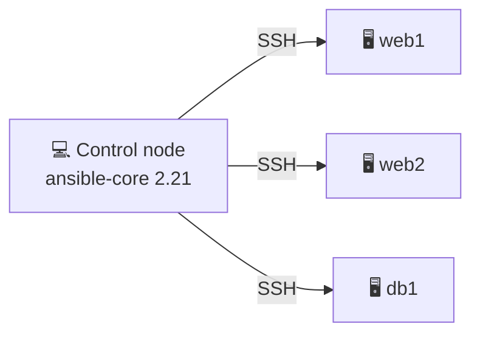
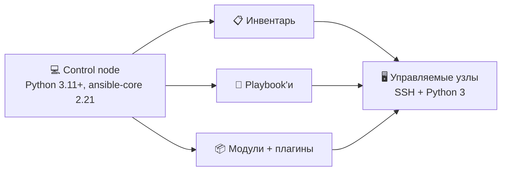
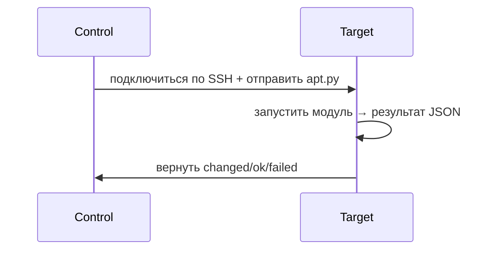
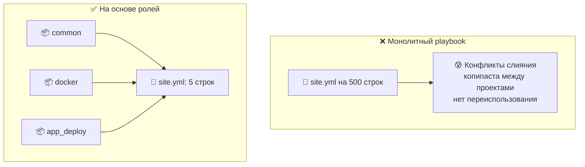
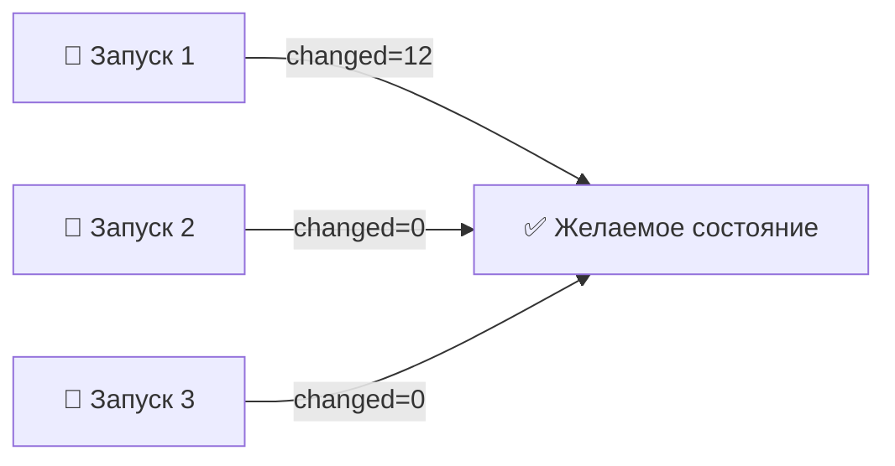
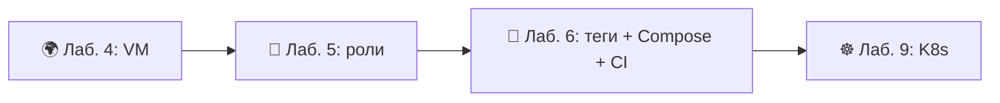

# 📌 Лекция 5 — Основы Ansible: управление конфигурацией, которое не кусается

## 📍 Слайд 1 – 🔧 Добро пожаловать в управление конфигурацией

* 🌍 **Лекция 4 создала машину** — Terraform/Pulumi создали VM, выдали ей IP, открыли порты
* 🤔 Но машина пуста: нет Docker, нет пользователя для приложения, нет конфигурации nginx, нет TLS, нет настроек демона
* 🔧 **Ansible настраивает то, что внутри** — пакеты, файлы, сервисы, секреты — декларативно, с помощью `ansible-core 2.21` (май 2026)


> 🔗 **Связь с лабораторной 5:** вы создадите три роли (`common`, `docker`, `app_deploy`) и с их помощью провижините VM из лабораторной 4 и запустите на ней образ контейнера из лабораторной 2.

---

## 📍 Слайд 2 – 🎯 Результаты обучения

| # | Результат |
|---|---------|
| 1 | 🧠 Объяснить безагентное управление конфигурацией по push-модели и его отличие от инструментов на основе агентов |
| 2 | 📋 Написать и структурировать статический инвентарь; понимать, когда переходить на динамический |
| 3 | 📝 Писать идемпотентные playbook'и с правильными модулями (`apt`, `service`, `template`, `lineinfile`) |
| 4 | 📦 Организовывать переиспользуемую логику в роли (tasks / handlers / defaults / templates) |
| 5 | 🔐 Шифровать секреты с помощью Ansible Vault и безопасно передавать их в playbook'и |

**Технологический стек, зафиксированный на май 2026:** `ansible-core` **2.21** (community-пакет **ansible 13.6.0**, апрель 2026), Python **3.11+** на control node, `ansible-galaxy` для коллекций, OpenSSH на управляемых узлах.

> 📌 **Замечание про «LTS»:** у Ansible-core **нет официальной метки LTS.** Red Hat поставляет *Ansible Automation Platform* с расширенной поддержкой, но open-source `ansible-core` обещает лишь ~6 месяцев исправлений безопасности на каждый минорный релиз. Сейчас поддерживаемые open-source версии — **2.18, 2.19, 2.20, 2.21**. Старые слайды в интернете, где написано «2.17 LTS», появились до прояснения политики — игнорируйте их.

---

## 📍 Слайд 3 – 🆚 Ansible против остального IaC

* 🌍 **Terraform / Pulumi (лекция 4)** = *провижининг* — «создать 3 VM, 1 LB, 1 инстанс RDS»
* 🔧 **Ansible (лекция 5)** = *конфигурация* — «установить Docker, отрендерить `daemon.json`, запустить сервис»
* 🐳 **Docker (лекция 2)** = *упаковка* — «заморозить приложение и его среду выполнения»
* ☸️ **Kubernetes (лекция 9+)** = *оркестрация* — «запустить N реплик, перезапускать при сбое, раскатывать обновления»

> 🔥 **Не путайте их.** Terraform делает так, что машина существует. Ansible делает машину полезной. Оба живут в Git; оба принадлежат CI.


---

## 📍 Слайд 4 – 🔥 Раздел 1: Проблема конфигурации

```bash
# 😱 Bash-скрипт, который «работает» — один раз
#!/bin/bash
apt-get update
apt-get install -y nginx
echo "Welcome" > /var/www/html/index.html
systemctl start nginx
```

Запустите его дважды — `apt-get install` в порядке, но `echo >` перезаписывает файл при каждом запуске. Запустите на Ubuntu 22.04 vs 24.04 — имена пакетов расходятся. Запустите на сервере, где кто-то вручную отредактировал `index.html` — ваша правка молча сотрёт чужую.

**Вот проблема на одном слайде.** Shell-скрипты — это императивные рецепты; они описывают не *конечное состояние*, а только *шаги*. Всё, что не совпадает с мысленной моделью автора, их ломает.

---

## 📍 Слайд 5 – 📝 Дрейф документации

* 📝 Документацию написали один раз, а сервер меняли сотни раз — никто не обновляет вики
* 🚪 Инженер, который знал реальную конфигурацию, ушёл в 2024
* 💀 Реальность ≠ документация; команда доверяет тому, что сегодня подводит меньше
* 🔇 «В runbook написано X, но в продакшене теперь Y» — фраза, которую вы услышите на каждом постмортеме
* 🧪 Тест аварийного восстановления проваливается, потому что *реальную* конфигурацию так и не записали

> ⚠️ **Устаревшая документация хуже отсутствующей** — она активно вводит в заблуждение.

---

## 📍 Слайд 6 – 💸 Цена серверов, настроенных вручную

| 🔥 Режим отказа | 💥 Последствия |
|---|---|
| 🐢 Ручное патчинг, сервер за сервером | Критические CVE остаются без патчей неделями |
| 📋 Ручные правки по SSH | Опечатки вызывают простои в продакшене |
| 👉 Snowflake-серверы | «На сервере 1 работает, на сервере 2 сломано» |
| 🙈 Нет журнала аудита | Аудиты комплаенса проваливаются; никто не знает, кто менял `sshd_config` |
| 🐶 Серверы-питомцы | Один умирает, и никто не может пересобрать его с нуля |

> 📖 **Verizon DBIR 2024:** ~85% утечек связаны с человеческим фактором — ошибки конфигурации возглавляют список облачных инцидентов. Цель Ansible — удалить эту таблицу целиком.

---

## 📍 Слайд 7 – 💡 Раздел 2: Что такое Ansible

* 🔧 **Инструмент управления конфигурацией** — описывает *желаемое состояние* парка машин
* 🌐 **Безагентный** — общается по SSH (Linux) или WinRM (Windows); на целевых узлах не нужно устанавливать или патчить демон
* 📤 **На основе push** — control node отправляет команды при запуске; нет цикла pull, нет heartbeat агента
* 📝 **YAML + Jinja2** — почти декларативный синтаксис, версионируется как любой код
* 🔄 **Идемпотентный по замыслу** — повторный запуск того же playbook'а приводит к тому же состоянию



> 📖 **Определение:** Ansible — это open-source движок автоматизации, который с помощью SSH и YAML приводит парк машин в документированное, версионируемое состояние.

---

## 📍 Слайд 8 – 📜 Краткая история Ansible

* 📅 **2012** — Michael DeHaan выпускает Ansible; явная реакция на сложность агентов Puppet/Chef
* 📅 **2013** — основана AnsibleWorks; первый коммерческий релиз
* 📅 **2015** — **Red Hat покупает AnsibleWorks** примерно за $150M
* 📅 **2019** — IBM покупает Red Hat; Ansible остаётся open-source
* 📅 **2021** — разделение проекта: **`ansible-core`** (движок) vs **`ansible`** (community-пакет с сотнями предустановленных коллекций)
* 📅 **2024+** — коллекции становятся канонической единицей распространения; пакет `community.ansible` объединяет сотни из них
* 📅 **Май 2026** — `ansible-core 2.21` (community-пакет **ansible 13.6.0**) — то, что вы будете использовать в лабораторной 5

> 🤔 **Обратите внимание:** ставка Ansible — *никаких агентов* — появилась за годы до «GitOps» и по-прежнему остаётся верным выбором для конфигурации парка.

---

## 📍 Слайд 9 – 🚫 Чем Ansible НЕ является

| ❌ Миф | ✅ Реальность |
|---|---|
| «Заменяет Terraform» | 🤝 Terraform провижинит, Ansible настраивает. Разные уровни. |
| «Требует агентов на каждом сервере» | 🌐 Только SSH. В этом весь смысл. |
| «Только Linux» | 🪟 Windows работает через WinRM/PowerShell; сетевое оборудование — через API-модули |
| «Просто bash с YAML» | 📦 Идемпотентные модули + модель состояния + handlers + Jinja2 |
| «Медленный для больших парков» | ⚡ По умолчанию forks=5, масштабируйте через `forks=50`, mitogen или AAP |

> 🔥 **Смелое утверждение:** как только у вашей команды больше трёх серверов, вам нужен Ansible (или эквивалент). Ручной SSH не масштабируется.

---

## 📍 Слайд 10 – 🏗️ Архитектура



| 🧱 Компонент | 🎯 Назначение |
|---|---|
| 💻 **Control node** | Ваш ноутбук или CI-раннер. Python 3.11+ и `ansible-core 2.21`. |
| 🖥️ **Управляемые узлы** | Серверы, которые вы настраиваете. SSH + Python 3. |
| 📋 **Инвентарь** | Статический INI/YAML или динамический облачный плагин. Перечисляет хосты, группы, переменные. |
| 📦 **Модули** | Python-единицы работы (`apt`, `service`, `template`, `copy`, `file`). |
| 📚 **Коллекции** | Единица упаковки. Устанавливаются через `ansible-galaxy collection install`. |

---

## 📍 Слайд 11 – 🔁 Как на самом деле выполняется одна задача

1. 📋 Прочитать инвентарь → определить целевые хосты
2. 🔐 Подключиться по SSH к каждому хосту (параллельно, по умолчанию `forks=5`)
3. 📤 Отправить небольшой файл Python-модуля во временный каталог, запустить его через Python целевого узла
4. 📊 Модуль возвращает JSON: `{"changed": true, "msg": "..."}`
5. 🧹 Удалить временные файлы, закрыть SSH



> 📝 **Следствие:** целевому узлу нужен Python — он уже есть на любой машине с Ubuntu 22.04+. Это единственный «агент», который нужен Ansible.

---

## 📍 Слайд 12 – 📋 Инвентарь: статический (INI / YAML)

```ini
# inventory/hosts.ini
[webservers]
web1 ansible_host=10.0.1.10
web2 ansible_host=10.0.1.11

[databases]
db1  ansible_host=10.0.2.10

[production:children]
webservers
databases

[all:vars]
ansible_user=ubuntu
ansible_ssh_private_key_file=~/.ssh/lab4_id_ed25519
```

* 🏷️ **Группы** организуют хосты по роли, окружению или географии
* 🪆 **Группа групп** (`:children`) строит иерархии: `production` ⊃ `webservers`+`databases`
* 🎯 **Таргетинг**: `hosts: webservers`, `hosts: all`, `hosts: production:!web2` (исключить один хост)

---

## 📍 Слайд 13 – 🌐 Инвентарь: динамический (облачные плагины)

Статические списки гниют в тот момент, когда VM пересоздаётся и получает новый IP. Плагины инвентаря обращаются к облачному провайдеру во время выполнения.

```yaml
# inventory/aws.yml
plugin: amazon.aws.aws_ec2
regions:
  - eu-central-1
filters:
  tag:Project: devops-core
  instance-state-name: running
keyed_groups:
  - key: tags.Role
    prefix: role
compose:
  ansible_host: public_ip_address
```

```bash
ansible-galaxy collection install amazon.aws
ansible-inventory -i inventory/aws.yml --graph
```

| Облако | Коллекция | Плагин |
|---|---|---|
| AWS | `amazon.aws` | `aws_ec2` |
| GCP | `google.cloud` | `gcp_compute` |
| Azure | `azure.azcollection` | `azure_rm` |
| Yandex Cloud | `yandex.cloud` | `yandex_compute` |

> 🔗 **Бонусное задание лабораторной 5** использует это против VM, которую вы создали в лабораторной 4 с помощью Terraform/Pulumi.

---

## 📍 Слайд 14 – 📝 Первый playbook — читайте дважды

```yaml
---
- name: Configure web servers
  hosts: webservers
  become: true                # 🔐 sudo до root
  gather_facts: true          # 🧠 собрать ansible_distribution, ansible_memtotal_mb, ...

  tasks:
    - name: Update apt cache (max 1h old)
      ansible.builtin.apt:
        update_cache: yes
        cache_valid_time: 3600

    - name: Install nginx
      ansible.builtin.apt:
        name: nginx
        state: present

    - name: Ensure nginx is running and enabled
      ansible.builtin.service:
        name: nginx
        state: started
        enabled: yes
```

```bash
ansible-playbook -i inventory/hosts.ini playbook.yml
```

> 📌 **Читайте FQCN**: `ansible.builtin.apt` означает коллекцию `ansible.builtin`, модуль `apt`. После разделения 2021 года это *канонический* способ ссылаться на модули.

---

## 📍 Слайд 15 – 🎨 Чтение вывода

```text
TASK [Install nginx] ********************************************************
changed: [web1]
TASK [Ensure nginx is running and enabled] **********************************
ok: [web1]

PLAY RECAP ******************************************************************
web1 : ok=3  changed=1  unreachable=0  failed=0
```

| Цвет | Статус | Значение |
|---|---|---|
| 🟢 | **ok** | Уже в желаемом состоянии — изменений не требуется |
| 🟡 | **changed** | Модулю пришлось действовать, чтобы достичь желаемого состояния |
| 🔴 | **failed** | Модуль вернул ошибку |
| ⚫ | **skipped** | Условие `when:` оказалось ложным |

> 🎯 **Цель зрелого playbook'а:** первый запуск в основном жёлтый. Каждый последующий запуск полностью зелёный.

---

## 📍 Слайд 16 – 📦 Модули, которые вы будете использовать чаще всего

| Модуль | Работа | Идемпотентный? |
|---|---|---|
| 🧰 `ansible.builtin.apt` | Устанавливать/удалять пакеты .deb | ✅ |
| ⚙️ `ansible.builtin.service` / `systemd` | Управлять сервисами | ✅ |
| 📄 `ansible.builtin.template` | Рендерить Jinja2 → удалённый файл | ✅ |
| 🗃️ `ansible.builtin.copy` | Отправлять статический файл | ✅ |
| 🧷 `ansible.builtin.file` | Управлять правами, симлинками, каталогами | ✅ |
| ➕ `ansible.builtin.lineinfile` / `blockinfile` | Редактировать конфиг по строке/блоку | ✅ |
| 👤 `ansible.builtin.user` / `group` | Управлять учётными записями Linux | ✅ |
| 🐳 `community.docker.docker_container` | Запускать контейнер | ✅ |
| 💥 `ansible.builtin.shell` / `command` | Запускать произвольные команды | ❌ — аварийный выход |

> ⚠️ **`shell` и `command` — крайние меры.** У них нет модели состояния — Ansible понятия не имеет, изменил ли что-то ваш `echo >> file`. Сначала тянитесь к идемпотентному модулю; откатывайтесь, только когда модуля не существует.

---

## 📍 Слайд 17 – 🎭 `command` vs `shell`: выбирайте правильный

```yaml
# command — exec(), без shell. Безопаснее. Нет пайпов, перенаправлений, $VARS.
- ansible.builtin.command: /usr/bin/curl https://example.com/health

# shell — полноценный /bin/sh. Используйте ТОЛЬКО когда действительно нужны возможности shell.
- ansible.builtin.shell: |
    set -euo pipefail
    journalctl -u nginx | grep -c "200 OK" > /tmp/ok_count

# Когда приходится их использовать, прикрутите идемпотентность через creates: / removes:
- name: Run init script only if marker file is missing
  ansible.builtin.command: /usr/local/bin/init-once
  args:
    creates: /var/lib/myapp/.initialized
```

`creates:` и `removes:` — так вы прикручиваете идемпотентность к одноразовому скрипту.

---

## 📍 Слайд 18 – 📦 Раздел 3: Роли

*Роль* — это просто дерево каталогов с общепринятыми подпапками. Она упаковывает задачи + переменные + шаблоны + handlers, чтобы вы могли подключить их в любой playbook одной строкой.

```text
roles/
└── docker/
    ├── tasks/main.yml          # работа
    ├── handlers/main.yml       # реакции на события
    ├── defaults/main.yml       # переменные (наименьший приоритет)
    ├── vars/main.yml           # переменные (высокий приоритет)
    ├── templates/daemon.json.j2
    ├── files/install.sh
    └── meta/main.yml           # зависимости, поддерживаемые платформы
```

> 🔥 **Одно правило:** если вы копипастите один и тот же блок задач между двумя playbook'ами, это роль.

---

## 📍 Слайд 19 – 📁 Почему роли лучше одного гигантского playbook'а



* 🔄 **Переиспользуемые** — делитесь ролями между проектами, организациями и даже через Ansible Galaxy
* 📁 **Обнаружимые** — у каждой роли одинаковая структура; новые инженеры разбираются за минуты
* 🧪 **Тестируемые** — Molecule поднимает каждую роль в контейнере и запускает её playbook независимо
* 🔬 **Композируемые** — роль `webserver` может зависеть от `common` через `meta/main.yml`

---

## 📍 Слайд 20 – 🐳 Пример роли: `docker` (главный результат лабораторной 5)

```yaml
# roles/docker/tasks/main.yml
---
- name: Install prerequisites
  ansible.builtin.apt:
    name: [apt-transport-https, ca-certificates, curl, gnupg, lsb-release]
    state: present
    update_cache: yes

- name: Add Docker APT key
  ansible.builtin.apt_key:
    url: https://download.docker.com/linux/ubuntu/gpg
    state: present

- name: Add Docker repository
  ansible.builtin.apt_repository:
    repo: "deb https://download.docker.com/linux/ubuntu {{ ansible_distribution_release }} stable"
    state: present

- name: Install Docker Engine
  ansible.builtin.apt:
    name: [docker-ce, docker-ce-cli, containerd.io]
    state: present
  notify: restart docker

- name: Add user to docker group
  ansible.builtin.user:
    name: "{{ docker_user }}"
    groups: docker
    append: yes
```

> 🔗 **Обратите внимание на факт Jinja2:** `{{ ansible_distribution_release }}` превращается в `noble` на Ubuntu 24.04 и `jammy` на 22.04. Одна роль — оба дистрибутива.

---

## 📍 Слайд 21 – 🔔 Handlers — перезапуск только когда вы действительно что-то изменили

```yaml
# roles/docker/handlers/main.yml
---
- name: restart docker
  ansible.builtin.service:
    name: docker
    state: restarted
```

```yaml
# roles/docker/tasks/main.yml (продолжение)
- name: Render /etc/docker/daemon.json
  ansible.builtin.template:
    src: daemon.json.j2
    dest: /etc/docker/daemon.json
    mode: "0644"
  notify: restart docker     # 🔔 срабатывает только если шаблон изменился
```

**Ключевая семантика handlers:**
* 🎯 **Запускается через `notify:`** — только когда уведомляющая задача сообщает `changed: true`
* ⏱️ **Выполняется один раз в конце play** — несколько notify одного и того же handler'а схлопываются в один перезапуск
* 🚦 **Пропускается при втором запуске** — файл уже корректен, нет изменений, нет перезапуска, нет простоя

> 💡 **В этом весь смысл.** Наивный `service restart` при каждом запуске пинает Docker — и ваши контейнеры — каждый раз. Handlers перезапускают только когда конфигурация действительно разошлась.

---

## 📍 Слайд 22 – 📊 Переменные: где они живут и кто побеждает

```yaml
# roles/docker/defaults/main.yml    (наименьший приоритет — легко переопределить)
---
docker_user: ubuntu
docker_data_root: /var/lib/docker
docker_log_max_size: "10m"
```

**Приоритет — сокращённо, от низшего к высшему:**
1. 📁 Роль `defaults/main.yml`
2. 📋 Инвентарь group_vars / host_vars
3. 📄 Блок `vars:` в playbook'е
4. 🔧 Роль `vars/main.yml`
5. ⚡ `-e var=value` в CLI (**всегда побеждает**)

> 📖 **Соглашение:** *переопределяемые* значения по умолчанию в `defaults/`, *фиксированные* значения в `vars/`. Если пользователь не должен это менять — это место в `vars/`.

---

## 📍 Слайд 23 – 🔄 Раздел 4: Идемпотентность — убийственная фича Ansible



**Задача идемпотентна, когда** её двойной запуск даёт тот же эффект, что и одинарный.

Модули достигают этого, проверяя состояние *до* действия:
* `apt: state=present` → запросить dpkg, установить только если отсутствует
* `service: state=started` → запросить systemd, запустить только если остановлен
* `file: state=directory` → проверить путь через stat, создать только если отсутствует
* `template:` → сравнить отрендеренный вывод с текущим файлом, записать только если отличается

```bash
# Пробный прогон: сообщить об изменениях, не внося их
ansible-playbook playbook.yml --check --diff
```

> 🧪 **Тест приёмки:** второй подряд запуск сообщает `changed=0`. Если что-то всё ещё меняется, значит какая-то задача неидемпотентна — обычно это случайный `shell:` или шаблонный файл с временными метками. **Лабораторная 5 оценивает вас по этому.**

---

## 📍 Слайд 24 – 🔐 Ansible Vault — секреты в Git без слёз

```bash
# Создать / редактировать / просмотреть зашифрованные файлы (AES-256)
ansible-vault create  group_vars/all/vault.yml
ansible-vault edit    group_vars/all/vault.yml

# Зашифровать строку inline
ansible-vault encrypt_string 'supersecret' --name dockerhub_password
```

```yaml
# group_vars/all/vault.yml (зашифрован в состоянии покоя)
dockerhub_username: lab5student
dockerhub_password: dckr_pat_xxxxxxxxxxxxxxxxxxxxxxxxxx
```

```bash
ansible-playbook deploy.yml --ask-vault-pass                       # запрос
ansible-playbook deploy.yml --vault-password-file ~/.vault_pass    # файл (в gitignore)
ansible-playbook deploy.yml --vault-id dev@~/.vd --vault-id prod@prompt   # мультиокружение
```

> 🔗 **Лабораторная 11 связывает это с OpenBao** — для продакшена вы переходите от Vault-как-шифратора-файлов к Vault-как-хранилищу-секретов. Лабораторная 5 использует Ansible Vault, потому что это правильный масштаб: несколько учётных данных, зашифрованных в Git, без дополнительной инфраструктуры.

---

## 📍 Слайд 25 – 🌍 Ansible в реальном мире

* 🛡️ **NASA JPL** — управляет наземными системами марсианских миссий (публичные доклады с 2016)
* 🏦 **Capital One** — Ansible Tower проводит ночной комплаенс десятков тысяч инстансов EC2
* 🎮 **Riot Games** — провижининг парка серверов League of Legends
* 🔭 **CERN** — управление патчами в вычислительной сети LHC
* 🐧 **Red Hat** — установщик OpenShift по сути является гигантской коллекцией playbook'ов Ansible

> 🔥 **Общая нить:** каждый парк больше ~50 машин использует *какой-то* инструмент управления конфигурацией. Ansible — самый частый ответ, потому что безагентная модель на порядок снижает барьер для согласия.

---

## 📍 Слайд 26 – ⚡ До и после Ansible

| 😰 До | 🚀 После |
|---|---|
| 📞 SSH на 30 серверов по одному | Один вызов `ansible-playbook` |
| 📝 Runbook «Выполните эти 14 команд» | YAML в Git, с diff в PR |
| 🐶 Каждый сервер настроен вручную, хрупок | Роли гарантируют идентичное состояние |
| 😨 День патчей занимает у команды целый день | День патчей — один прогон CI |
| 📚 Документация расходится с реальностью | Playbook *и есть* документация |
| 🔥 Восстановление = пересобрать по памяти | Восстановление = `terraform apply` + `ansible-playbook` |

---

## 📍 Слайд 27 – 🎯 Ключевые выводы

1. 🔧 **Ansible безагентный** — SSH + Python на целевом узле и есть весь «агент»
2. 📋 **Инвентарь — это половина дела** — статический для лабораторных, динамический для продакшен-парков
3. 📦 **Роли — единица переиспользования** — `tasks/`, `handlers/`, `defaults/`, `templates/`
4. 🔄 **Идемпотентность — это фича** — `changed=0` при втором запуске и есть тест приёмки
5. 🔔 **Handlers предотвращают флаппинг** — перезапускайте Docker только когда его конфигурация действительно изменилась
6. 📌 **Используйте FQCN-модули** — `ansible.builtin.apt`, а не голый `apt`; защита от будущих изменений после разделения 2021 года
7. 🛑 **`shell:` — крайняя мера** — оборачивайте через `creates:` / `removes:`, когда это неизбежно
8. 🔐 **Vault шифрует секреты в состоянии покоя** — мостик к OpenBao из лабораторной 11 для продакшена

> 💡 **Сдвиг мышления:** перестаньте говорить серверу, *как* добраться туда. Скажите ему, *где* оказаться. Остальное Ansible разберёт сам.

---

## 📍 Слайд 28 – 🚀 Что дальше

**📚 Лекция 6: *Продвинутый Ansible и непрерывное развёртывание*** — продолжает ваши роли из лабораторной 5 и доводит их до продакшен-уровня:

* 🏷️ **Теги** — `ansible-playbook --tags docker` для запуска подмножества
* 🧱 **Блоки + `rescue:` / `always:`** — try/catch для задач
* 🚀 **Стратегии развёртывания** — rolling, serial, max_fail_percentage
* 🐙 **Шаблоны Docker Compose**, рендеримые Ansible
* 🤖 **CI/CD** — запуск Ansible из GitHub Actions на каждый push в `main`

**🔬 Результаты лабораторной 5 (на этой неделе):**
* `roles/common` — базовые пакеты, часовой пояс
* `roles/docker` — установка Docker (пример со слайда 20)
* `roles/app_deploy` — забрать образ из лабораторной 2, запустить как контейнер, открыть порт 5000, проверить `/health`
* `group_vars/all/vault.yml` — зашифрованные учётные данные Docker Hub
* `docs/LAB05.md` — доказательство идемпотентности (вывод двух подряд запусков)
* Необязательный бонус: **динамический инвентарь** против вашего облака из лабораторной 4



**👋 До встречи на лекции 6.**

---

## 📚 Ресурсы

* 📕 *Ansible for DevOps* — Jeff Geerling (обновляется ежегодно; практический справочник)
* 📕 *Ansible: Up & Running* — Hochstein & Moser, O'Reilly (3-е изд. охватывает `ansible-core`)
* 🎥 [Серия Ansible 101 от Jeff Geerling](https://www.youtube.com/playlist?list=PL2_OBreMn7FqZkvMYt6ATmgC0KAGGJNAN) — бесплатно на YouTube
* 🌐 [docs.ansible.com](https://docs.ansible.com/ansible-core/2.21/) — официальная документация `ansible-core 2.21`
* 🌐 [galaxy.ansible.com](https://galaxy.ansible.com) — community-роли и коллекции
* 🌐 [Molecule](https://ansible.readthedocs.io/projects/molecule/) — фреймворк тестирования ролей

**🎓 Квиз после лекции идёт в зачёт окна лидерборда недель 4–6.**
