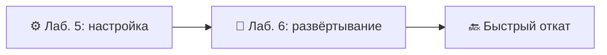
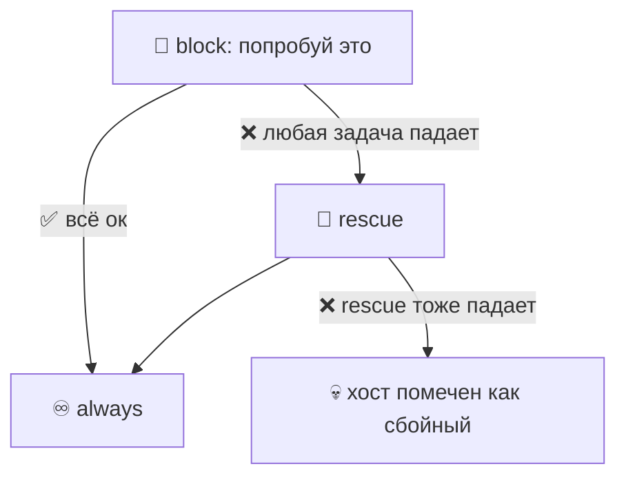
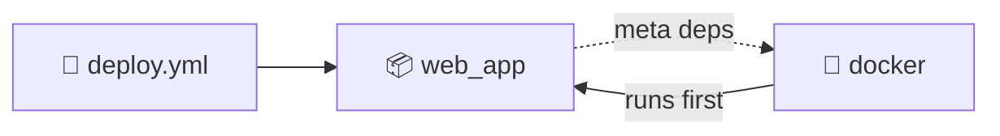
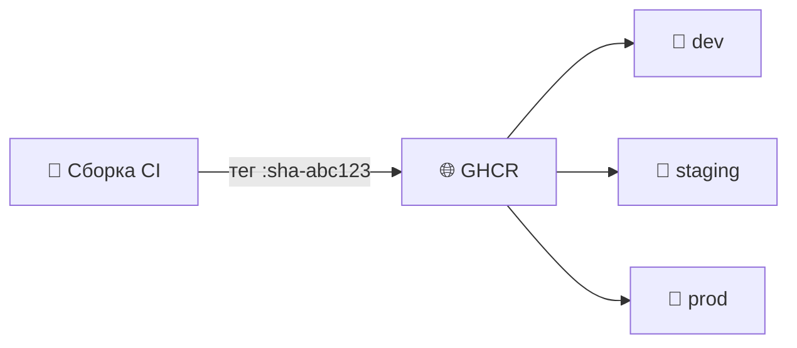
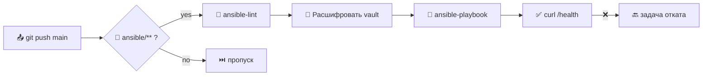
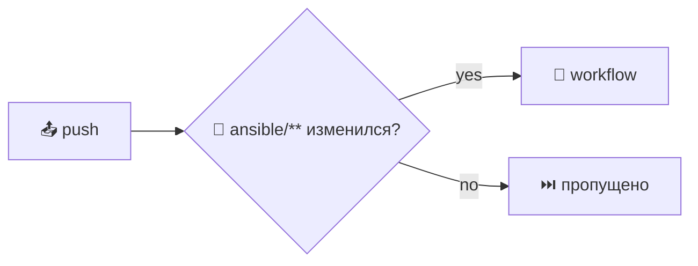
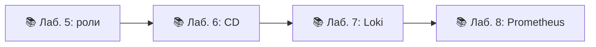

# 📌 Лекция 6 — Продвинутый Ansible и непрерывное развёртывание

## 📍 Слайд 1 – 🚀 Добро пожаловать в непрерывное развёртывание

* 🧩 Лекция 5 дала вам **playbook'и, роли, инвентарь, идемпотентность, базовые модули** — вы умеете настраивать сервер
* 🚀 Сегодня: превращаем это в **конвейер развёртывания** — push в `main`, приложение на машине, откат за минуты
* 🛠️ Продакшен-паттерны: `block`/`rescue`/`always`, теги, Docker Compose с шаблонами Jinja2, раннеры GitHub Actions
* 🎯 Стек, зафиксированный на май 2026: **ansible-core 2.21**, **Docker Compose v2**, `community.docker` 4.x



> 🔗 **Связь с лабораторной 6:** вы отрефакторите playbook'и из лабораторной 5 с помощью блоков и тегов, сделаете шаблон `docker-compose.yml.j2`, добавите логику чистой переустановки `web_app_wipe` и запустите всё это из GitHub Actions на каждый push в `ansible/**`.

---

## 📍 Слайд 2 – 🎯 Результаты обучения

| # | Результат |
|---|---------|
| 1 | 🧱 Использовать `block` / `rescue` / `always` для playbook'ов с быстрым отказом |
| 2 | 🏷️ Спроектировать стратегию тегов, поддерживающую `--tags` и `--skip-tags` |
| 3 | 📝 Шаблонизировать `docker-compose.yml` через Jinja2 + `community.docker.docker_compose_v2` |
| 4 | 🧹 Реализовать логику очистки с двойным шлюзом (переменная + тег) |
| 5 | 🤖 Запускать Ansible из GitHub Actions с секретами и фильтрами путей |
| 6 | 🔙 Рассуждать о раскатках rolling, all-at-once и serial-percentage |

> ⚙️ **Предварительные требования из лекции 5:** синтаксис YAML-playbook'ов, структура ролей (`tasks/`, `handlers/`, `defaults/`, `meta/`), инвентарь + group_vars, Ansible Vault. Мы **не** будем вводить их заново.

---

## 📍 Слайд 3 – 🔥 От конфигурации к доставке

Лекция 5 закончилась вопросом: *«сервер настроен — и что дальше?»*

* 📦 Управление конфигурацией отвечает на вопрос **что должно быть установлено**
* 🚀 Непрерывное развёртывание отвечает на вопрос **какая версия работает прямо сейчас**
* 🔄 Тот же движок playbook'ов, другая частота — провижининг раз в квартал, развёртывание десять раз в день

> 🔥 **Смелое утверждение:** если ваш скрипт развёртывания — это Bash-файл, на который кто-то заходит по SSH, чтобы запустить, у вас есть автоматизация **для настройки**, но не **для доставки**. Тот же разрыв, что между Dev и Ops в лекции 1.

---

## 📍 Слайд 4 – 😱 Ад ручного развёртывания

Реальный скрипт, с которого начинает большинство команд:

```bash
ssh prod-1
cd /opt/app && git pull
docker stop app; docker rm app
docker pull myorg/app:latest && docker run -d --name app -p 80:8080 myorg/app:latest
```

Почему это ломается при масштабировании:

* 🐢 SSH на N хостов последовательно — минуты на развёртывание, часы на 50 хостах
* 🤷 Нет записи о том, *что* выкатили и *когда* — `:latest` изменяем
* 💥 Сбой на хосте 3 оставляет 1+2 на новом коде, 3-N на старом — **расколотый продакшен**
* 🌙 Никто не рискует развёртывать в пятницу, потому что нет кнопки отката

> 📊 DORA 2024: **доля неудачных изменений** у отстающих — **46–60%**. Большинство — плохие ручные развёртывания, а не плохой код.

---

## 📍 Слайд 5 – 🔙 Кошмары отката

Откатить код — простая часть. А как насчёт:

| 🔥 Забота | 💥 Что взрывается |
|------------|------------------|
| 💾 Миграция базы данных | Новые схемы развёрнуты; старый бинарник не может их прочитать |
| ⚙️ Дрейф конфигурации | Перезапущенный контейнер подхватывает только новые переменные окружения |
| 🏷️ Изменяемый тег | `myorg/app:latest` теперь указывает на сломанную сборку |
| 🔐 Ротация секретов | Новое значение Vault уже получено; откат ловит 403 |

> ⚠️ **Практическое правило:** если вы не можете откатиться **меньше чем за 5 минут**, вы на самом деле не развёртываете — вы *фиксируете*. Логика очистки из лабораторной 6 + неизменяемый тег (`docker_tag: 1.2.3`) — это минимум.

---

## 📍 Слайд 6 – 🧱 Блоки: группировка + обработка ошибок

В лабораторной 5 вы писали линейные списки задач. `block` группирует задачи под общими директивами **и** позволяет обрабатывать сбои.

```yaml
- name: Install Docker engine
  block:
    - ansible.builtin.apt_repository:
        repo: "deb https://download.docker.com/linux/ubuntu jammy stable"
    - ansible.builtin.apt: { name: docker-ce, update_cache: true }
  rescue:
    - name: GPG / mirror flake — retry
      ansible.builtin.apt: { name: docker-ce, update_cache: true }
      retries: 3
      delay: 10
  always:
    - ansible.builtin.systemd: { name: docker, enabled: true }
  become: true
  tags: [docker, docker_install]
```

> 📖 `block` принимает `become`, `when`, `tags`, `vars` — они применяются к каждой задаче внутри. Гораздо чище, чем копипастить `become: true` везде.

---

## 📍 Слайд 7 – 🎯 Семантика Block / Rescue / Always



* 🟢 `block` успешен → выполняется `always`
* 🔴 задача в `block` падает → выполняется `rescue` → выполняется `always` → хост **продолжает** работу, если rescue успешен
* ⛔ `rescue` тоже падает → хост помечается как сбойный, `always` всё равно выполняется (очистка священна)

> ⚠️ `rescue` **не** означает «игнорировать ошибки» — он означает «у меня есть план восстановления». Без rescue playbook останавливается на сбойном хосте.

---

## 📍 Слайд 8 – ⚡ Быстрый отказ vs снисходительность

| 🎚️ Стратегия | Когда | Пример |
|--------------|------|---------|
| ❌ **Быстрый отказ** (по умолчанию) | Провижининг, миграции | Неудачная установка Docker должна остановить прогон |
| 🔄 **Rescue + повтор** | Нестабильная сеть, GPG-зеркала | Повторить `apt update` через 10 с |
| 😶 `ignore_errors: yes` | Косметическая очистка | `rm /tmp/stale.lock`, который вам не важен |
| 🔁 `until:` + `retries:` | Проверки состояния | Ждать до 10 × 6 с ответа `/health` 200 |

```yaml
- name: Wait for app to come up
  ansible.builtin.uri:
    url: "http://localhost:{{ app_port }}/health"
    status_code: 200
  register: hc
  retries: 10
  delay: 6
  until: hc.status == 200
```

> 🔥 **Антипаттерн:** посыпать всё `ignore_errors: yes`, чтобы CI стал зелёным. Вы только что превратили развёртывание в бросок монетки.

---

## 📍 Слайд 9 – 🏷️ Теги: запускайте только то, что нужно

Теги помечают задачи, чтобы вы могли выбирать подмножества во время запуска. Каждая задача, блок или роль могут быть помечены тегом.

```bash
ansible-playbook site.yml --tags "docker,app_deploy"
ansible-playbook site.yml --skip-tags "common"
ansible-playbook site.yml --list-tags
ansible-playbook site.yml --tags "docker" --check     # пробный прогон
```

* 🏷️ Теги **наследуются** вниз — тег на блоке применяется к каждой задаче внутри
* 🔒 Два **специальных тега**: `always` (выполняется всегда, если не пропущен) и `never` (не выполняется, пока не запрошен)
* 📦 Роли можно помечать при импорте: `roles: [{ role: docker, tags: [docker] }]`

> 🔥 **В лабораторной 6** вы ставите теги на трёх уровнях — роль, блок, отдельная задача — чтобы `--tags docker_install` попадал в нужный срез, не затягивая постороннюю работу.

---

## 📍 Слайд 10 – 🗂️ Стратегия тегов, которая выживает

Выберите **три оси тегов** и придерживайтесь их:

| 🧭 Ось | Имена тегов | Пример |
|---------|-----------|---------|
| 🧩 **Компонент** | `common`, `docker`, `web_app` | `--tags docker` затрагивает только роль docker |
| 🛠️ **Действие** | `install`, `config`, `deploy`, `wipe` | `--tags deploy` пропускает установки |
| ⚠️ **Шлюз риска** | `web_app_wipe`, `db_migrate` | Опасные, только по запросу |

```yaml
- name: Application deployment
  block: [...]
  tags: [web_app, app_deploy, deploy]

- name: Application wipe
  block: [...]
  when: web_app_wipe | bool
  tags: [web_app, web_app_wipe]   # защищено и when, и тегом
```

> 📖 **Источник:** документация Ansible — *Tags* и *Common Tagging Patterns*. Чистая таксономия тегов — разница между 10-минутным и 90-минутным развёртыванием.

---

## 📍 Слайд 11 – 📝 Jinja2 — слой шаблонизации

Модуль `template` в Ansible рендерит файлы **Jinja2** во время выполнения. Лекция 5 использовала его вскользь; лабораторная 6 опирается на него сильно.

```jinja
{# roles/web_app/templates/docker-compose.yml.j2 #}
services:
  {{ app_name }}:
    image: {{ docker_image }}:{{ docker_tag }}
    ports:
      - "{{ app_port }}:{{ app_internal_port }}"
    environment:

      {{ k }}: "{{ v }}"

    restart: {{ restart_policy | default('unless-stopped') }}
```

* `{{ var }}` — интерполяция
* `` / `` — управляющие конструкции
* `| default('x')`, `| upper`, `| to_json` — **фильтры** объединяются через `|`

> ⚠️ Compose v2 убрал поле верхнего уровня `version:`. Если учебник всё ещё пишет `version: '3.8'`, он старше 2023 года — не указывайте его.

---

## 📍 Слайд 12 – 🎛️ Полезные фильтры Jinja2

```yaml
image_tag: "{{ docker_tag | default('latest') }}"
when:      "{{ web_app_wipe | bool }}"            # '-e wipe=true' — это строка!
api_key:   "{{ lookup('env', 'API_KEY') | b64encode }}"
```

| 🎛️ Фильтр | Что он делает |
|------------|--------------|
| `default(x)` | Запасное значение, когда переменная не определена |
| `bool` | Приводит строки `"true"`/`"false"` к логическому типу |
| `to_nice_yaml`, `to_json` | Рендерит структурированную конфигурацию |
| `combine(dict2)` | Объединяет два словаря (group_vars + host_vars) |
| `regex_replace(p, r)` | Встроенный sed |

> 📚 Полный список фильтров: `ansible-doc -t filter -l` (поставляется вместе с ansible-core).

---

## 📍 Слайд 13 – 🐳 Docker Compose через Ansible

Используйте `community.docker.docker_compose_v2` (Python-SDK `docker` + плагин Compose — **не** устаревший модуль `docker_compose` v1).

```yaml
- name: Render compose file
  ansible.builtin.template:
    src: docker-compose.yml.j2
    dest: "{{ compose_project_dir }}/docker-compose.yml"
    mode: "0644"

- name: docker compose up -d
  community.docker.docker_compose_v2:
    project_src: "{{ compose_project_dir }}"
    state: present
    pull: always              # всегда перезабирать тег
    remove_orphans: true
  register: compose_result
```

* 🔌 Установите коллекцию: `ansible-galaxy collection install community.docker`
* 🐍 Требуется `python3-docker` на **целевом** узле (не на контроллере)
* ♻️ Идемпотентно — повторный запуск показывает `changed=0`, если отрендеренный файл идентичен

> 🔗 **Лабораторная 6 §2.5** проводит через всё это от начала до конца.

---

## 📍 Слайд 14 – 🔗 Зависимости ролей (`meta/main.yml`)

Роль может объявить, что должно выполниться первым. Лекция 5 описывала структуру ролей; теперь мы используем `meta/main.yml`.

```yaml
# roles/web_app/meta/main.yml
---
dependencies:
  - role: docker
    vars:
      docker_users: ["{{ ansible_user }}"]
```



* ✅ `ansible-playbook deploy.yml` с `roles: [web_app]` теперь также запускает `docker`
* ⚠️ Зависимости выполняются **раз на play**, а не на каждый импорт роли — держите их лёгкими
* 🚫 Не выстраивайте цепочку в три уровня глубиной; вы быстро теряете интуицию о порядке выполнения

---

## 📍 Слайд 15 – 🧹 Логика очистки: зачем и как

**Зачем:** чистая переустановка иногда единственный безопасный откат (повреждённый том, сломанный кэш, ротированные секреты). Вам нужна кнопка — и нужна она **с защитой**.

**Паттерн двойного шлюза** (лабораторная 6 §3):

```yaml
# roles/web_app/tasks/wipe.yml
- name: Wipe web application
  block:
    - name: Compose down
      community.docker.docker_compose_v2:
        project_src: "{{ compose_project_dir }}"
        state: absent
    - name: Remove compose dir
      ansible.builtin.file:
        path: "{{ compose_project_dir }}"
        state: absent
  when: web_app_wipe | bool   # шлюз 1: переменная
  tags: [web_app_wipe]        # шлюз 2: тег
```

| Вызов | Очистка? |
|------------|-------|
| `deploy.yml` | ❌ переменная false, тег не запрошен |
| `deploy.yml --tags web_app_wipe` | ❌ `when` блокирует |
| `deploy.yml -e web_app_wipe=true` | ✅ очистка, **затем** развёртывание (чистая переустановка) |
| `deploy.yml -e web_app_wipe=true --tags web_app_wipe` | ✅ только очистка |

> 🔥 **Почему не только тег `never`?** Опечатка в `--tags` всё равно могла бы его запустить. Два независимых шлюза = опечатка сама по себе не уничтожит продакшен.

---

## 📍 Слайд 16 – 🌍 Мультиокружные инвентари

Та же роль, другой **group_vars** для каждого окружения.

```
ansible/inventories/
  dev/hosts.ini       group_vars/all.yml   → docker_tag: main
  staging/hosts.ini   group_vars/all.yml   → docker_tag: 1.2.3-rc1
  prod/hosts.ini      group_vars/all.yml   → docker_tag: 1.2.2   # закреплён
```

```bash
ansible-playbook -i inventories/staging deploy.yml
ansible-playbook -i inventories/prod    deploy.yml --check    # сначала пробный прогон prod
```

* 🎯 **Продвигайте** один и тот же артефакт: dev → staging → prod используют идентичные роли + образ
* 🔐 Файлы Vault **на каждое окружение**, чтобы утечка в dev не раскрыла prod
* 🚫 Не ветвите playbook по `inventory_hostname == 'prod'` — ветвите по переменным

---

## 📍 Слайд 17 – 📦 Продвижение образа через окружения



* 🏷️ **Один неизменяемый тег** (SHA или SemVer) проходит через каждое окружение — никогда не перетегируйте
* 📌 Закрепляйте `docker_tag` для каждого окружения в group_vars; повышайте его в PR, а не по SSH

> 🔥 **Из лекции 2:** «никогда не развёртывайте `:latest` в продакшене». Лабораторная 6 это принуждает — `docker_tag` обязателен в `group_vars` и проверяется `ansible-lint`.

---

## 📍 Слайд 18 – 🤖 Интеграция с CI/CD: общая картина



* 🔄 Триггер: push в `main` **или** `workflow_dispatch` для ручных развёртываний
* 🧹 Сначала lint — сломанный YAML в продакшене это самый глупый простой
* 🚀 Затем развёртывание через `ansible-playbook` против нужного инвентаря
* ✅ Проверка HTTP-пробой перед объявлением успеха

> 🔗 **Лабораторная 6 §4** пишет `.github/workflows/ansible-deploy.yml` с нуля.

---

## 📍 Слайд 19 – 🛠️ Скелет workflow GitHub Actions

```yaml
# .github/workflows/ansible-deploy.yml
name: Ansible Deploy
on:
  push:
    branches: [main]
    paths: ['ansible/**', '.github/workflows/ansible-deploy.yml']
  workflow_dispatch:

jobs:
  lint:
    runs-on: ubuntu-24.04
    steps:
      - uses: actions/checkout@v4
      - uses: actions/setup-python@v5
        with: { python-version: '3.12' }
      - run: pip install 'ansible-core==2.21.*' ansible-lint
      - run: ansible-lint ansible/

  deploy:
    needs: lint
    runs-on: ubuntu-24.04
    environment: production    # GH approval gate + per-env secrets
    steps:
      - uses: actions/checkout@v4
      - env:
          VAULT: ${{ secrets.VAULT_PASS }}
          SSH:   ${{ secrets.SSH_KEY }}
        run: |
          install -m 600 /dev/stdin ~/.ssh/id_ed25519 <<< "$SSH"
          install -m 600 /dev/stdin /tmp/vault       <<< "$VAULT"
          ansible-playbook -i ansible/inventories/prod \
            ansible/playbooks/deploy.yml --vault-password-file /tmp/vault
```

> 🔧 Закрепите `ansible-core==2.21.*` на семестр, чтобы совпадать с lock-файлами лабораторных 5/6. (У Ansible-core **нет метки LTS** — закрепляйте точный минор, который совпадает с lock-файлом коллекций.)

---

## 📍 Слайд 20 – 🔐 Секреты, OIDC и self-hosted раннеры

Три уровня работы с секретами, от слабейшего к сильнейшему:

| 🔐 Уровень | Механизм | Компромисс |
|---------|-----------|-----------|
| 🟡 Секрет репозитория как env | `secrets.SSH_KEY` → `~/.ssh/id_ed25519` | Просто; никогда не выводите в логи |
| 🟠 GitHub Environment | Секреты на окружение + ручное одобрение | Нужен для prod; небольшие операционные издержки |
| 🟢 **OIDC + облачный IAM** | Кратковременные федеративные токены | Никаких долгоживущих ключей — рекомендуется |

```yaml
# Пример OIDC: принять роль AWS без статических учётных данных
- uses: aws-actions/configure-aws-credentials@v4
  with:
    role-to-assume: arn:aws:iam::123:role/ansible-deploy
    aws-region: eu-central-1
```

* 🖥️ **Self-hosted раннер** в целевой сети = никакого SSH-ключа в CI, быстрее прогоны
* ⚠️ Self-hosted раннеры — это **границы доверия** — никогда не запускайте их на PR из форков

> 🔥 **Смелое утверждение:** в 2026 году долгоживущий SSH-ключ в `secrets.SSH_KEY` — это новый «пароль в исходниках». Используйте OIDC там, где целевая среда это поддерживает.

---

## 📍 Слайд 21 – 📁 Фильтры путей: не сжигайте минуты CI

```yaml
on:
  push:
    paths:
      - 'ansible/**'
      - '!ansible/docs/**'                # исключить docs
      - '.github/workflows/ansible-deploy.yml'
  pull_request:
    paths: ['ansible/**']
```

* ⚡ PR только с документацией → нет прогона развёртывания, минуты не сжигаются
* 🎯 Фильтр пути на **сам файл workflow**, чтобы его правка запускала самотест
* ❗ `paths-ignore` и `paths` взаимоисключающи; выберите что-то одно



> 💰 GitHub тарифицирует минуты в приватных репозиториях. Команда из 20 человек без фильтров путей может сжечь в 10 раза больше CI, чем нужно.

---

## 📍 Слайд 22 – 🚀 Стратегии развёртывания

Для N хостов Ansible предоставляет одну волшебную ручку: `serial:`.

```yaml
- name: Deploy web tier
  hosts: webservers
  serial: "25%"          # 25% хостов за раз
  max_fail_percentage: 10  # прервать, если упало >10% партии
  roles: [web_app]
```

| 🚀 Стратегия | `serial:` | Когда |
|-------------|-----------|------|
| 🔄 **Rolling** | `1` или `25%` | Без простоя; балансировщик продолжает выводить хосты из ротации |
| 🐤 **Canary** | `1` (только первая партия, затем пауза) | Тест на одном хосте, наблюдение, продолжение |
| 💥 **Всё сразу** | опустить `serial:` | Только dev/staging — простой в prod |
| 🔵 **Blue/green** | два инвентаря (`blue`, `green`) + переключение LB | Тяжелее в настройке, мгновенный откат |

> 📖 Стратегия Ansible — **на основе push**: контроллер задаёт темп. K8s (лабораторная 9+) переворачивает это на pull, но паттерны переносятся.

---

## 📍 Слайд 23 – ✅ Проверка + 🔙 Откат

Развёртывание не завершено, когда `ansible-playbook` выходит с кодом 0 — оно завершено, когда **приложение отвечает**.

```yaml
- name: Smoke test
  ansible.builtin.uri:
    url: "http://{{ inventory_hostname }}:{{ app_port }}/health"
    status_code: 200
  register: hc
  retries: 10
  delay: 6
  until: hc.status == 200

- name: Roll back on failure
  community.docker.docker_compose_v2:
    project_src: "{{ compose_project_dir }}"
    state: present
  vars:
    docker_tag: "{{ previous_tag }}"
  when: hc is failed
```

**Чек-лист отката:**
* 🏷️ Предыдущий неизменяемый тег захвачен **до** развёртывания (факт `previous_tag`)
* 💾 Миграции БД совместимы вперёд ИЛИ откатываются отдельно
* 🔔 Срабатывает алерт на сбой проверки, чтобы человек знал

> ⏱️ **DORA «время восстановления после неудачного развёртывания»**: у элитных < 1 ч, у отстающих > 1 месяца. Автоматический откат — вот этот разрыв.

---

## 📍 Слайд 24 – 🌍 Паттерны из реального мира

* 🎬 **Netflix Spinnaker** — версионированный артефакт на каждый коммит; автоматический canary-анализ (открыт в 2015)
* 🏦 **Capital One** — Ansible для провижининга ОС, контейнерный CD сверху; единый каталог ролей по AWS и on-prem
* 📦 **Shopify** — 30+ развёртываний в день через «shipit» с шлюзами одобрения на каждом этапе
* 🇺🇸 **Red Hat AAP** — Ansible Automation Platform как стандартный CD-слой для не-K8s нагрузок
* 🚀 **GitLab Pages** — последовательные раскатки на сотни граничных узлов из Ansible

> 🔥 **Общая нить:** маленькие, автоматизированные, наблюдаемые развёртывания. Крупные квартальные релизы «всё сразу» — артефакт другой эпохи.

---

## 📍 Слайд 25 – 🎯 Ключевые выводы

1. 🧱 **Блоки** группируют задачи и дают `rescue` + `always` — используйте их на каждой границе ошибок
2. 🏷️ **Теги** — это стратегия, а не метки — три оси (компонент, действие, риск) держат их поддерживаемыми
3. 📝 **Шаблоны Jinja2** превращают одну роль в N приложений через `group_vars` / `vars_files`
4. 🐳 `community.docker.docker_compose_v2` — единственный модуль Compose, который стоит использовать в 2026
5. 🧹 **Логика очистки с двойным шлюзом** — переменная И тег, никогда одно или другое
6. 🤖 **GitHub Actions + фильтры путей** делают Ansible кнопочным — lint, запуск, проверка, откат
7. 🚀 `serial:` + `max_fail_percentage:` — ваша ручка стратегии развёртывания

> 💡 **Хорошее развёртывание — маленькое, автоматизированное, наблюдаемое и обратимое.** Три из четырёх всё ещё болят.

---

## 📍 Слайд 26 – 🚀 Что дальше

**📚 Следующая лекция: *Логирование с Loki*** — вы выкатили приложение; теперь узнайте, что оно сказало.

* 📋 Почему агрегация логов важна, когда у вас больше 1 хоста
* 🛠️ Архитектура Loki + Promtail + Grafana
* 🔍 LogQL: `{job="web_app"} |= "ERROR"`
* 🧪 Лабораторная 7 развёртывает стек логирования теми самыми паттернами Ansible, которые вы только что изучили



**🔬 Напоминание о результатах лабораторной 6:** отрефакторенные роли `common` + `docker` с блоками/rescue/тегами; роль `web_app` с `docker-compose.yml.j2` + `community.docker.docker_compose_v2`; `web_app_wipe` с двойным шлюзом; `.github/workflows/ansible-deploy.yml`, выполняющий lint → deploy → verify.

**👋 До встречи на лекции 7.**

---

## 📚 Ресурсы

* 📕 *Continuous Delivery* — Jez Humble, David Farley (2010) — канонический текст
* 📕 *Ansible for DevOps* — Jeff Geerling (издание 2024; ansible-core ушёл вперёд до 2.21, но паттерны не изменились)
* 🌐 [Ansible Blocks](https://docs.ansible.com/ansible/latest/user_guide/playbooks_blocks.html)
* 🌐 [Ansible Tags](https://docs.ansible.com/ansible/latest/user_guide/playbooks_tags.html)
* 🌐 [`community.docker.docker_compose_v2`](https://docs.ansible.com/ansible/latest/collections/community/docker/docker_compose_v2_module.html)
* 🌐 [GitHub Actions: фильтры `paths`](https://docs.github.com/en/actions/using-workflows/triggering-a-workflow#using-filters)
* 🌐 [GitHub OIDC для облачных развёртываний](https://docs.github.com/en/actions/deployment/security-hardening-your-deployments/about-security-hardening-with-openid-connect)

> 🎓 Квиз после лекции идёт в зачёт окна лидерборда недель 4–6.
