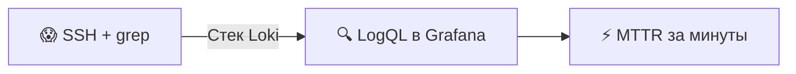
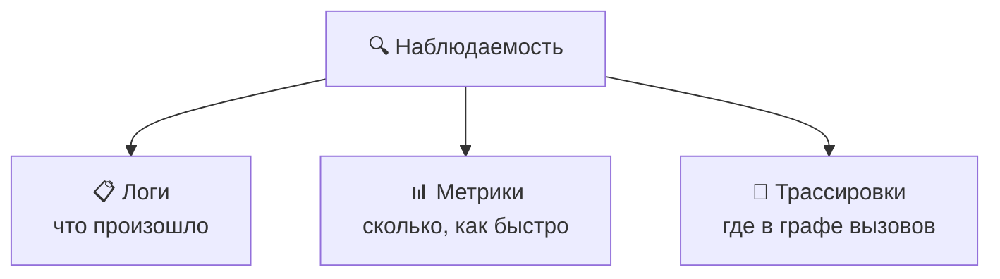
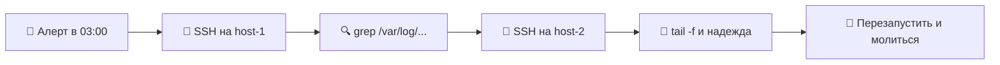
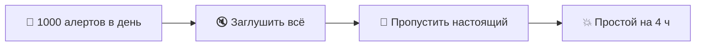
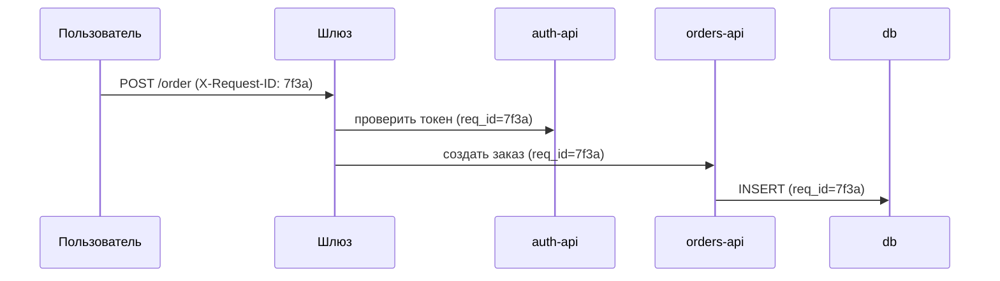
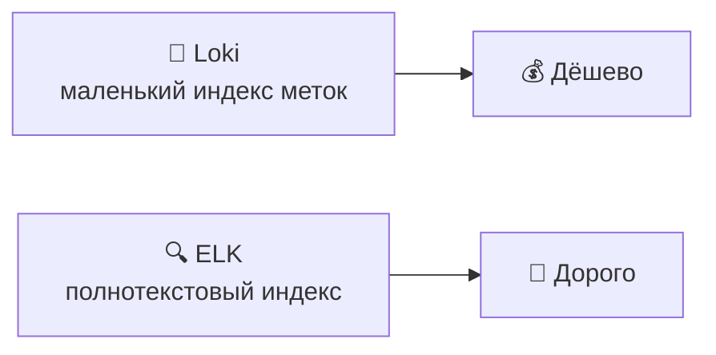
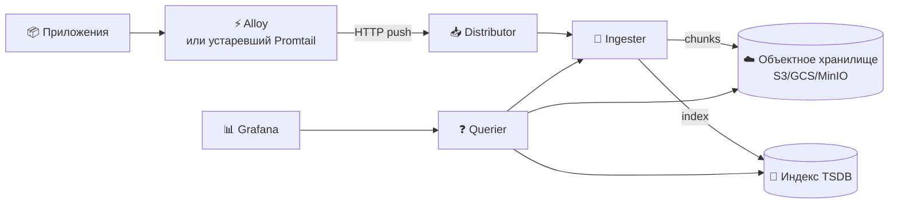
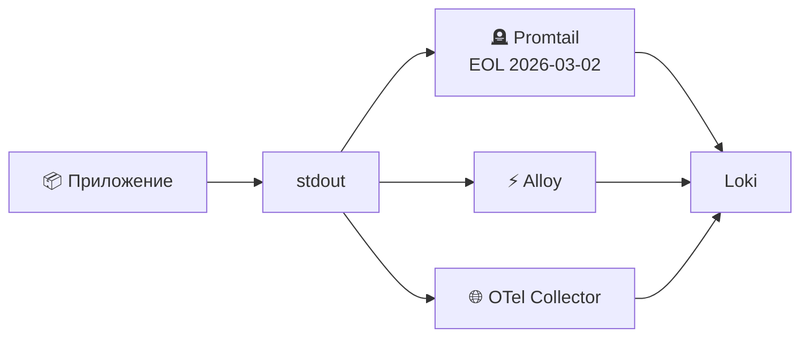
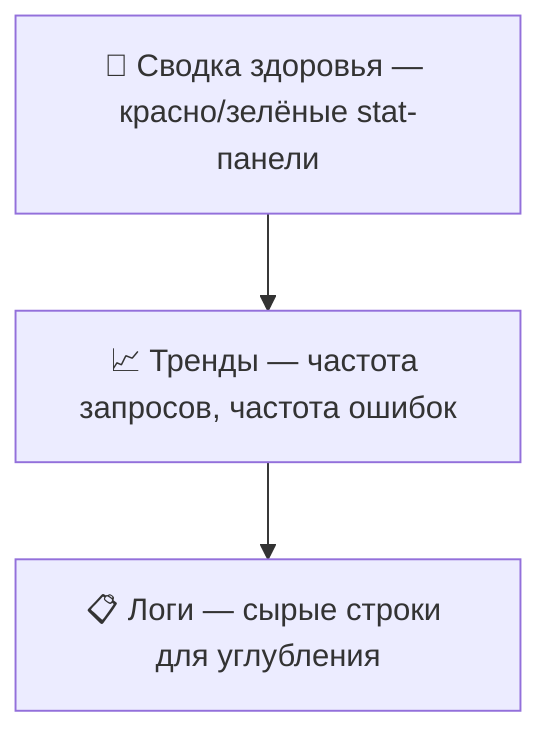
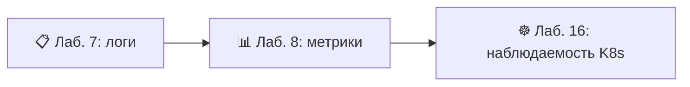

# 📌 Лекция 7 — Наблюдаемость и логирование: от слепой эксплуатации к пониманию

## 📍 Слайд 1 – 🔍 Добро пожаловать в наблюдаемость

* 🌍 **Ваше приложение работает в продакшене** — но знаете ли вы на самом деле, что оно делает?
* 😰 Лекция 1 назвала режим отказа: **Сценарий 4 — слепая эксплуатация** (пользователи пишут в Twitter, нет метрик, нет логов, перезапуск в отчаянии)
* 🔧 Это та лекция, которая **это исправляет**: централизованные логи, которые можно запросить за секунды
* 🎯 Сегодня: развернуть стек Loki и научиться задавать вопросы своим продакшен-логам



> 🔗 **Связь с лабораторной 7:** вы развернёте Loki 3.7 + **Grafana Alloy** + Grafana 13 через docker-compose, отправите JSON-логи из Python-приложения из лабораторной 1 и построите дашборд из 4 панелей. (Promtail сохранён в слайдах 14–15 ниже как исторический контекст — он достиг **End-of-Life 2 марта 2026 года**.)

---

## 📍 Слайд 2 – 🎯 Результаты обучения

| # | Результат |
|---|---------|
| 1 | 🧠 Различать три столпа: **логи, метрики, трассировки** — и для чего каждый нужен |
| 2 | 🔍 Объяснить, как Loki индексирует по **меткам**, а не по полному тексту, и почему это управляет стоимостью |
| 3 | 📝 Выдавать **структурированные JSON-логи** с correlation ID из Python-сервиса |
| 4 | 🛠️ Писать в **LogQL** селекторы потоков, фильтры строк и запросы диапазона логов |
| 5 | 📊 Строить дашборд логов в Grafana, отвечающий на один операционный вопрос на панель |

**Технологический стек, зафиксированный на май 2026:**
* 💾 **Loki 3.7** (3.0 вышел в мае 2024; 3.x стабилизировал схему TSDB v13)
* 📊 **Grafana 13** (13.0.1+security-01, выпущена 12 мая 2026)
* ⚡ **Grafana Alloy 1.16.1** (6 мая 2026) — канонический агент; **используйте его для новых развёртываний**
* 🪦 **Promtail** достиг **End-of-Life 2 марта 2026 года**. Всё ещё работает в существующих установках, исправлений больше нет. Слайды 14–15 охватывают его только для контекста.

---

## 📍 Слайд 3 – 🧱 Три столпа наблюдаемости



| 📊 Столп | 🎯 Вопрос | 🛠️ Этот курс |
|-----------|------------|----------------|
| 📋 **Логи** | *Какое событие произошло?* | **Лекция 7 + лабораторная 7** (Loki) |
| 📊 **Метрики** | *Сколько / как быстро / как часто?* | Лекция 8 + лабораторная 8 (Prometheus) |
| 🔗 **Трассировки** | *Где в запросе ушло время?* | Вне рамок Core — рассматривается в факультативе SRE-Intro |
| ☸️ **Взгляд K8s** | *Все три в кластере* | Лекции 15–16, лабораторная 16 |

> 📖 **Charity Majors** (сооснователь Honeycomb, *Observability Engineering*, 2022): *«Наблюдаемость — это способность задавать системе новые вопросы, не выпуская новый код».*

---

## 📍 Слайд 4 – 🙈 Проблема видимости

Без централизованных логов отладка выглядит так:



* 📁 У каждого хоста свои лог-файлы, в своём формате, со своей ротацией
* 🔍 Чтобы сопоставить один запрос по трём сервисам, нужно три SSH-сессии
* 📅 Логи старше окна ротации просто **исчезают**, когда они вам нужны
* 💀 К моменту, когда вы найдёте нужную строку, инцидент длится уже лишний час

> 🔥 **Проверка реальности (DORA 2024):** элитные команды восстанавливаются после инцидентов менее чем за 1 час. С SSH + grep вы так не сможете.

---

## 📍 Слайд 5 – 🚨 Усталость от алертов и «у меня работает»

Две патологии, сигнализирующие, что вам нужна наблюдаемость, а не больше дашбордов:

**1. Усталость от алертов** — 200 предупреждений в день, каждое ложное. Настоящие сбои заглушаются.

**2. «У меня работает»** — пользователи говорят, что приложение медленное, команда не может воспроизвести, нет данных, чтобы разрешить спор. Следующие часы — карго-культ отладки.



> 📖 **Cindy Sridharan**, *Distributed Systems Observability* (O'Reilly, 2018): лекарство — **высококардинальные структурированные данные**, которые можно нарезать по требованию — а не больше заранее заготовленных алертов.

---

## 📍 Слайд 6 – 💸 Цена слепого полёта

| 🔥 Симптом | 💥 Цена |
|-----------|---------|
| 🐢 Медленная отладка | MTTR 4+ часа, эскалации, упущенные SLO |
| 📋 Нет корреляции между сервисами | Простои микросервисов требуют дней на локализацию |
| 👉 Нет данных → культура поиска виноватых | Старшие инженеры уходят |
| 🙈 Молчаливые сбои | Проблемы всплывают только когда клиенты пишут в твиттер |

**📈 Конкретный ориентир (DORA 2024 + Google SRE Book):**
* MTTR без наблюдаемости: **4+ часа** в типичном случае
* MTTR со стеком класса Loki: **менее 30 минут**
* Self-hosted Loki на объектном хранилище: **единицы долларов в месяц** для десятков ГБ в день

> 🔥 **Смелое утверждение:** наблюдаемость — самый дешёвый страховой полис в вашем стеке. Точка окупаемости по сравнению с одним предотвращённым простоем измеряется в **секундах**.

---

## 📍 Слайд 7 – 💡 Наблюдаемость ≠ мониторинг

Различие, популяризованное Charity Majors и командой Honeycomb:

| ❓ Вопрос | 📊 Мониторинг | 🔍 Наблюдаемость |
|------------|---------------|------------------|
| На что отвечает | *«Система жива?»* | *«Почему система ведёт себя так?»* |
| Покрываемые режимы отказа | **Известные известные** (заранее заданные алерты) | **Неизвестные неизвестные** (новые проблемы) |
| Форма данных | Временные ряды с низкой кардинальностью | Структурированные события с высокой кардинальностью |
| Вы проектируете алерты для… | Конкретных режимов отказа | Целей уровня сервиса (SLO) |

> 💬 **Charity Majors:** *«Мониторинг — для известных неизвестных. Наблюдаемость — для неизвестных неизвестных».*

**🎯 Практическое следствие:** здоровый стек делает и то и другое. Алерты Prometheus (лекция 8) обрабатывают известное. Loki + структурированные логи позволяют исследовать неизвестное.

---

## 📍 Слайд 8 – 📝 Зачем структурированное логирование (JSON)

**❌ Неструктурированное — только запись:**
```
2026-04-15 10:23:45 ERROR Connection to database failed on server-1 for user alice (req=7f3a)
```

Чтобы отфильтровать по `user=alice`, вы пишете regex. Чтобы агрегировать по хосту, вы пишете regex похуже.

**✅ Структурированное (JSON) — запрашиваемое:**
```json
{"ts":"2026-04-15T10:23:45Z","level":"ERROR","service":"user-api",
 "msg":"db connection failed","user":"alice","host":"server-1","req_id":"7f3a"}
```

Теперь `level="ERROR" and user="alice"` — одно условие LogQL. Агрегация ошибок по хосту — одна строка.

> 🔥 **Правило:** если человек читает ваши логи чаще машины, вы уже проиграли. Логи — это API для вашего будущего дежурного «я».

---

## 📍 Слайд 9 – 🔗 Correlation ID — один запрос, много сервисов

Один клик пользователя может затронуть 5+ сервисов. Без correlation ID вы не можете проследить его через потоки логов.



**Паттерн:**
1. 🆔 Шлюз генерирует UUID на каждый входящий запрос → заголовок `X-Request-ID`
2. 📨 Каждый последующий вызов пересылает заголовок
3. 📝 Каждая строка лога включает ID как JSON-поле
4. 🔍 В Grafana: `{service=~".+"} | json | req_id="7f3a"` → весь запрос, по порядку

> 📖 Спецификация OpenTelemetry называет это `traceparent` — та же идея, стандартизованная.

---

## 📍 Слайд 10 – ⚡ Loki vs ELK: почему Loki победил для логов

Традиционный стек логирования — Elasticsearch + Logstash + Kibana — индексирует **каждое слово** каждой строки лога. Это дорого.

| 📊 Аспект | 💾 Loki | 🔍 ELK |
|-----------|---------|--------|
| Индекс | **Только метки** (service, env, level…) | **Полный текст** каждой строки |
| Хранение | Дешёвое объектное хранилище (S3/GCS/MinIO) | Локальный SSD для горячего индекса |
| Стоимость при 100 ГБ/день | ~$10–30/мес | ~$500–2000/мес |
| Язык запросов | LogQL (в стиле Prometheus) | Lucene |
| Лучше всего для | Cloud-native, на основе меток | Криминалистика по свободному тексту |



> 💬 **Посыл Grafana Labs (2019):** *«Как Prometheus, но для логов».* — те же метки, та же модель федерации, та же эргономика запросов.

---

## 📍 Слайд 11 – 🏗️ Архитектура Loki



* 📥 **Distributor** — принимает push'и, валидирует, распределяет по ingester'ам
* 💾 **Ingester** — буферизует в памяти, сбрасывает сжатые чанки в объектное хранилище
* ❓ **Querier** — отвечает на LogQL, читая индекс TSDB, затем забирая совпадающие чанки
* 📇 **Индекс TSDB** (по умолчанию с Loki 3.0, схема v13) — маленький, быстрый, заменяет старый boltdb-shipper

> 🔧 **Два режима развёртывания:** *single-binary* (один контейнер, годится до ~100 ГБ/день — это использует лабораторная 7) и *микросервисы* (каждый компонент масштабируется независимо — продакшен при масштабе).

---

## 📍 Слайд 12 – 🏷️ Метки: единственное, что нужно сделать правильно

Loki индексирует по **меткам**. Каждая уникальная комбинация меток = один **поток**. Каждый поток стоит места в индексе и памяти.

**✅ Хорошие метки — низкая кардинальность:**
* `service="user-api"` (десятки сервисов)
* `env="prod"` (3 значения)
* `level="ERROR"` (5 значений)

**❌ Плохие метки — высокая кардинальность:**
* `user_id="12345"` (миллионы пользователей → **миллионы потоков** → OOM у ingester'а)
* `request_id="7f3a..."` (один на запрос → мгновенный коллапс)
* `trace_id`, `email`, `path` с ID внутри…

> 🔥 **Правило:** если значение уникально для каждого запроса или пользователя, **оно идёт в строку лога, а не в метку.** Используйте `| json | user_id="12345"` во время запроса.

```logql
# ✅ Хорошо — небольшой набор меток, фильтр по разобранному полю JSON
{service="user-api", env="prod"} | json | user_id="12345"
```

---

## 📍 Слайд 13 – ⚙️ Конфигурация Loki single-binary (база лабораторной 7)

```yaml
# loki/config.yml — Loki 3.7, схема v13, single-binary
auth_enabled: false

server:
  http_listen_port: 3100

common:
  path_prefix: /loki
  storage:
    filesystem:
      chunks_directory: /loki/chunks
      rules_directory: /loki/rules
  replication_factor: 1
  ring:
    kvstore: { store: inmemory }

schema_config:
  configs:
    - from: 2024-01-01
      store: tsdb              # 🚀 Заменяет boltdb-shipper
      object_store: filesystem # 🪣 В продакшене замените на s3/gcs
      schema: v13              # 📐 Последняя стабильная
      index: { prefix: index_, period: 24h }

limits_config:
  retention_period: 168h       # 🗓️ 7 дней

compactor:
  working_directory: /loki/compactor
  retention_enabled: true      # ⚠️ Обязателен, если задан retention
```

> ⚠️ **Частая ловушка:** включение `retention_period` без блока `compactor` = логи на самом деле никогда не удаляются. Loki молча игнорирует лимит.

---

## 📍 Слайд 14 – 🔧 Alloy, Promtail и OTel Collector

**Три способа отправлять логи в Loki в 2026 году:**

| Агент | Статус (май 2026) | Когда выбирать |
|-------|-------------------|--------------|
| ⚡ **Grafana Alloy 1.16.1** | **Канонический агент** — Promtail + Prometheus-агент + OTel в одном бинарнике | **Все новые развёртывания** (включая лабораторную 7); все три столпа из одного агента |
| 🪦 **Promtail 3.x** | **End-of-Life 2 марта 2026** — больше релизов, нет исправлений безопасности | Существующие установки, которые вы ещё не мигрировали; понимание legacy-конфигураций |
| 🌐 **OpenTelemetry Collector** | Вендор-нейтральный стандарт CNCF | Мультибэкенд (Loki + Datadog + …), а также трассировки |



> 🔗 **Лабораторная 7 проходит через Alloy**, потому что Promtail больше не поддерживается. Конфигурация Promtail на следующем слайде сохранена, чтобы вы могли читать и мигрировать brownfield-развёртывания — но **не поднимайте новый Promtail в 2026 году**.

---

## 📍 Слайд 15 – 🪦 Конфигурация Promtail (legacy / исторический контекст)

> ⚠️ **Promtail EOL с 2 марта 2026 года.** Этот слайд сохранён, чтобы вы могли читать существующие конфигурации в продакшене и мигрировать их на Alloy. **Не** поднимайте новый Promtail.

```yaml
# promtail/config.yml — LEGACY, современный эквивалент см. на слайде про Alloy
server:
  http_listen_port: 9080

positions:
  filename: /tmp/positions.yaml  # 📍 Продолжить чтение после перезапуска

clients:
  - url: http://loki:3100/loki/api/v1/push

scrape_configs:
  - job_name: docker
    docker_sd_configs:
      - host: unix:///var/run/docker.sock
        refresh_interval: 5s
        filters:
          - name: label
            values: ["logging=promtail"]   # 🏷️ Включается через метку контейнера
    relabel_configs:
      - source_labels: ['__meta_docker_container_label_app']
        target_label: 'app'
      - source_labels: ['__meta_docker_container_name']
        regex: '/(.*)'
        target_label: 'container'
```

* 📍 **`positions`** — выживает после перезапусков, чтобы вы не отправляли дважды
* 🐳 **Docker SD** — автоматически обнаруживает любой контейнер с меткой `logging=promtail`
* 🏷️ **Relabel** — повышает метки Docker до меток Loki (с контролем кардинальности)

**Миграция на Alloy** (`config.alloy`, синтаксис River — поставляется в лабораторной 7):

```hcl
discovery.docker "containers" {
  host             = "unix:///var/run/docker.sock"
  refresh_interval = "5s"
  filter { name = "label" values = ["logging=alloy"] }
}

loki.source.docker "containers" {
  host    = "unix:///var/run/docker.sock"
  targets = discovery.docker.containers.targets
  forward_to = [loki.write.default.receiver]
}

loki.write "default" {
  endpoint { url = "http://loki:3100/loki/api/v1/push" }
}
```

> 🔁 Те же три шага (обнаружить → скрейпить → отправить), но Alloy говорит на Prometheus + OTel из одного бинарника.

---

## 📍 Слайд 16 – 🔍 LogQL, часть 1: селекторы потоков и фильтры строк

В LogQL две половины: **запросы логов** (возвращают строки логов) и **запросы метрик** (возвращают числа из логов).

**Анатомия:**
```logql
{service="user-api", env="prod"}    |= "error"   != "healthcheck"   |~ "5\\d\\d"
└── селектор потока ──────────────┘ └─ содержит ┘ └─ исключает ────┘ └─ regex ─┘
```

| 🔧 Оператор | 🎯 Значение |
|-------------|-----------|
| `{label="v"}` | Точное совпадение метки |
| `{label=~"re"}` | Совпадение метки по regex |
| `\|= "x"` | Строка содержит `x` |
| `!= "x"` | Строка **не** содержит `x` |
| `\|~ "re"` | Строка совпадает с regex |
| `!~ "re"` | Строка не совпадает с regex |

> 💡 **Фильтры каскадируются слева направо.** Ставьте самый дешёвый и избирательный фильтр первым — он сокращает данные, которые должны обрабатывать остальные.

---

## 📍 Слайд 17 – 🔍 LogQL, часть 2: парсеры и фильтры полей

Когда логи в JSON, вы можете извлекать поля и фильтровать по ним:

```logql
# Разобрать JSON, оставить только ERROR от одного пользователя
{service="user-api"} | json | level="ERROR" | user_id="alice"

# Вместо этого logfmt (строки key=value)
{service="proxy"} | logfmt | status >= 500

# Отформатировать строку вывода
{service="user-api"} | json | line_format "{{.level}} {{.user_id}} {{.msg}}"
```

| 🔧 Этап | 🎯 Назначение |
|----------|-----------|
| `\| json` | Разобрать JSON → поля становятся фильтруемыми |
| `\| logfmt` | Разобрать формат `key=value` |
| `\| regexp "..."` | Извлечь через именованные группы захвата |
| `\| line_format "..."` | Переписать отображаемую строку |
| `\| label_format` | Переписать/добавить метки после запроса |

> 🔥 **Высокая кардинальность без боли:** поскольку `user_id` живёт в теле JSON (а не в метках), Loki его не индексирует — но вы всё равно можете фильтровать по нему во время запроса.

---

## 📍 Слайд 18 – 📊 LogQL, часть 3: метрики из логов

Агрегации по диапазону логов превращают потоки во временные ряды — идеально для графиков Grafana и правил алертов.

```logql
# 📈 Частота запросов на сервис (логов/сек)
sum by (service) (rate({env="prod"} [1m]))

# 📈 Частота ошибок на сервис
sum by (service) (rate({env="prod"} |= "ERROR" [1m]))

# 🥧 Распределение уровней логов
sum by (level) (count_over_time({env="prod"} | json [5m]))

# 🐢 P95 задержки из поля JSON
quantile_over_time(0.95,
  {service="user-api"} | json | unwrap duration_ms [5m])
```

| 🔧 Функция | 🎯 Случай использования |
|-------------|-------------|
| `rate([range])` | Строк в секунду |
| `count_over_time([range])` | Всего в окне |
| `bytes_rate([range])` | Байт/сек (контроль стоимости) |
| `quantile_over_time(q, ...)` | P50/P95/P99 из числовых полей |

---

## 📍 Слайд 19 – 🐍 Структурированное логирование в Python

**Python-приложение из лабораторной 1** получает одно улучшение — JSON-вывод. Два идиоматичных пути:

```python
# Вариант A — python-json-logger (drop-in, без изменений приложения)
import logging
from pythonjsonlogger.json import JsonFormatter

handler = logging.StreamHandler()
handler.setFormatter(JsonFormatter(
    "%(asctime)s %(levelname)s %(name)s %(message)s",
    rename_fields={"asctime": "ts", "levelname": "level"},
))
logging.basicConfig(level=logging.INFO, handlers=[handler])
logging.info("user login", extra={"user_id": 12345, "req_id": "7f3a"})
```

```python
# Вариант B — structlog (богаче, context vars, рекомендуется для нового кода)
import structlog
log = structlog.get_logger()
log.info("user login", user_id=12345, req_id="7f3a", path="/login")
# → {"event": "user login", "level": "info", "user_id": 12345, ...}
```

> 🔗 **Результат лабораторной 7:** добавить JSON-логирование в сервис из лабораторной 1, логировать запуск, каждый HTTP-запрос (method, path, status, client IP) и каждую ошибку. Тесты проходят, когда `curl localhost:8000/health` выдаёт JSON-строку в `docker logs`.

---

## 📍 Слайд 20 – 📊 Принципы проектирования дашбордов Grafana

Дашборд отвечает на **один вопрос** для **одной аудитории**. Если вы не можете описать его одним предложением, разделите его.



* 🎯 **Один вопрос на дашборд** — *«Здоров ли user-api?»*, а не *«Покажи мне всё».*
* 🚦 **Stat-панели сверху** — красно/зелёные, читаются за 2 секунды
* 📈 **Временные ряды в середине** — контекст для статистики
* 📋 **Панель логов внизу** — сырые строки в том же диапазоне времени
* 🔁 **Переменные** для `$service` и `$env` — один дашборд, много окружений

> 📖 *«Иерархия визуальной коммуникации»* — применённый закон Тафти: самые важные данные занимают больше всего пикселей и самый яркий цвет.

---

## 📍 Слайд 21 – 📊 Четыре панели лабораторной 7 (LogQL)

Дашборд лабораторной 7 включает четыре панели, покрывающие самые частые вопросы:

```logql
# 1️⃣ Панель логов — недавняя активность, все ваши приложения
{app=~"devops-.*"}

# 2️⃣ Частота запросов (временной ряд) — трафик на приложение
sum by (app) (rate({app=~"devops-.*"} [1m]))

# 3️⃣ Только ошибки (панель логов) — углубиться в сбои
{app=~"devops-.*"} | json | level="ERROR"

# 4️⃣ Распределение уровней (круговая) — здоровье с первого взгляда
sum by (level) (count_over_time({app=~"devops-.*"} | json [5m]))
```

| Панель | Визуализация | Отвечает на |
|-------|---------------|---------|
| 1 | Логи | *«Что происходит прямо сейчас?»* |
| 2 | Временной ряд | *«Насколько мы загружены?»* |
| 3 | Логи | *«Что сломалось?»* |
| 4 | Круговая / Stat | *«Насколько шумно приложение?»* |

> 🔗 **Требуемое доказательство:** скриншот всех четырёх панелей с реальными данными, сгенерированными циклами `curl` по вашему приложению.

---

## 📍 Слайд 22 – 🏭 Продакшен-соображения

Loki single-binary на ноутбуке — это лабораторная 7. Продакшену нужно ещё четыре решения:

| 🔧 Решение | 🪜 По умолчанию в лаб. | 🏭 Продакшен |
|-------------|----------------|---------------|
| 💾 Хранилище | `filesystem` | **S3 / GCS / MinIO** — дёшево, надёжно, масштабируется независимо |
| 👥 Мультиарендность | `auth_enabled: false` | **Multi-tenant** с заголовком `X-Scope-OrgID`; каждая команда изолирована |
| 🗓️ Хранение | 168h (7 дней) | **Многоуровневое** — 30d для INFO, 1y для security/audit-логов |
| 📦 Топология | Single binary | **Режим микросервисов** — distributor, ingester, querier масштабируются отдельно |
| 🔐 Аутентификация | Нет | **OIDC / mTLS** на границе Grafana + заголовок арендатора Loki |
| 💰 Защита от затрат | Нет | **Лимиты скорости + квоты приёма** на арендатора |

> ⚠️ **Ловушка стоимости:** неограниченный объём логов — способ №1, которым команды сжигают бюджет на наблюдаемость. Задайте `ingestion_rate_mb` и `max_streams_per_user` на арендатора с первого дня.

---

## 📍 Слайд 23 – 🌍 Логирование в реальных компаниях

* 🎬 **Netflix** — Atlas для метрик, **Mantis** + собственная платформа логов; тысячи микросервисов передают структурированные события
* 🦄 **GitHub** — Splunk для аудита безопасности + Loki для логов приложений (~PB/мес суммарно)
* 🚀 **SpaceX** — *«телеметрия-всё»* — каждый запуск передаёт ~3 000 сенсорных каналов во временное хранилище
* 🏦 **Stripe** — структурированные логи — это API; каждая строка — JSON-событие со стабильной схемой, используется и дата-сайентистами, и дежурными
* 🎮 **Riot Games** — Loki + Grafana для телеметрии игровых сессий при 100M+ месячной аудитории
* 📦 **Spotify** — Loki при ~1,5PB принимаемых в месяц, мультиарендность на каждый сквад

> 🔥 **Общая нить:** каждый из них логирует в **структурированном JSON** с **correlation ID** и относится к логам как к запрашиваемому источнику данных, а не как к дампу для отладки.

---

## 📍 Слайд 24 – 🎯 Ключевые выводы

1. 🔍 **Наблюдаемость = логи + метрики + трассировки.** Эта лекция покрыла логи. Лекция 8 покрывает метрики.
2. 📝 **Структурированный JSON или вы на самом деле не логируете** — вы ведёте дневник, который никто не может обыскать.
3. 🆔 **Correlation ID** сшивают один запрос через множество сервисов. Генерируйте на границе, распространяйте везде.
4. 🏷️ **Loki индексирует метки, а не текст.** Держите кардинальность меток низкой. Поля с высокой кардинальностью принадлежат телу JSON и `| json` во время запроса.
5. 🛠️ **LogQL** = селектор потока → фильтр строк → парсер → метрическая функция. Самый дешёвый фильтр первым.
6. 📊 **Дашборды отвечают на один вопрос** для одной аудитории. Красно/зелёное сверху, сырые логи снизу.
7. ⚡ **Promtail в EOL (2 марта 2026), Alloy — канонический.** Выбирайте Alloy 1.16.1+ для каждого нового развёртывания; OTel Collector, если нужен мультибэкенд.

> 💡 **Вы не можете исправить то, чего не видите. Сегодня вы дали продакшену глаза.**

---

## 📍 Слайд 25 – 🧠 Сдвиг мышления

| 😰 Старое | 🔍 Наблюдаемое |
|-------|---------------|
| 🔌 «SSH и grep» | 📊 «Открыть Grafana и LogQL» |
| 📁 «Проверь логи на server-3» | 🌐 «Все логи, одно место, один запрос» |
| 👉 «Наверное, это база данных» | 📊 «Данные показывают, что это слой кэша» |
| 😨 «Отладка занимает часы» | ⚡ «Корневая причина за 5 минут» |
| 💻 «У меня на машине работает» | 📋 «Продакшен говорит иначе — вот строка лога» |

> ❓ Какой столбец описывает разбор последнего инцидента в вашей команде?

---

## 📍 Слайд 26 – 🚀 Что дальше

**📚 Следующая лекция: *Мониторинг с Prometheus*** — столп метрик.

* 📊 Почему метрики временных рядов дополняют логи (и где выигрывает каждая)
* 🔢 PromQL — та же модель запросов, которую вы только что изучили в LogQL, применённая к числам
* 📈 Инструментирование Python-приложения через `prometheus_client` (counters, histograms, gauges)
* 🚨 Правила алертов с порогами, длительностями и burn rate в стиле SLO
* 📊 Построение дашборда Prometheus + Grafana для сервиса из лабораторной 1

**🔬 Лабораторная 7:** развернуть Loki 3.7 + Grafana Alloy 1.16.1 + Grafana 13 через docker-compose, добавить JSON-логирование в Python-приложение из лабораторной 1, построить дашборд из 4 панелей, укрепить для продакшена (лимиты ресурсов, проверки состояния, Grafana без анонимного доступа). Бонус 2,5 балла: автоматизировать всё это ролью Ansible из лабораторной 6.



**👋 До встречи на лекции 8.**

---

## 📚 Ресурсы и дополнительное чтение

**📕 Книги:**
* *Observability Engineering* — Charity Majors, Liz Fong-Jones, George Miranda (O'Reilly, 2022). Эталон.
* *Distributed Systems Observability* — Cindy Sridharan (O'Reilly, 2018). Бесплатный PDF на humio.com.
* *Site Reliability Engineering* — Beyer et al. — главы 10–12 о философии мониторинга. Бесплатно на sre.google/books.

**🔗 Ссылки:**
* 🌐 [grafana.com/docs/loki/latest](https://grafana.com/docs/loki/latest/) — документация Loki 3.x
* 🌐 [grafana.com/docs/alloy/latest](https://grafana.com/docs/alloy/latest/) — Alloy (преемник Promtail)
* 🌐 [Справочник LogQL](https://grafana.com/docs/loki/latest/query/) — каждый оператор, с примерами
* 🌐 [opentelemetry.io](https://opentelemetry.io) — стандарт наблюдаемости CNCF
* 🌐 [structlog.org](https://www.structlog.org) — библиотека структурированного логирования для Python

**🎓 Квиз:** квиз после лекции идёт в зачёт окна лидерборда недель 7–9.
