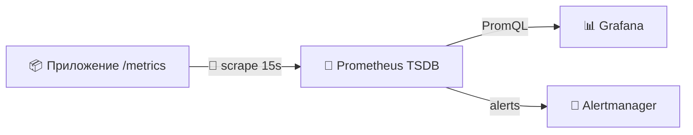
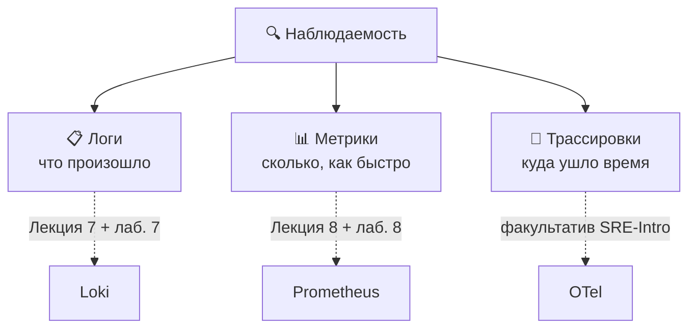
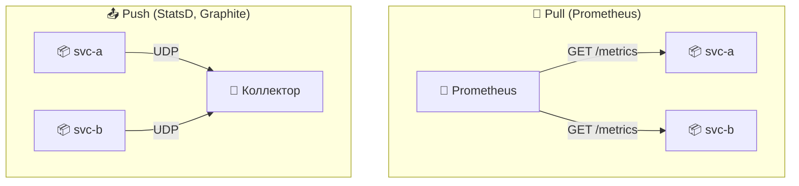
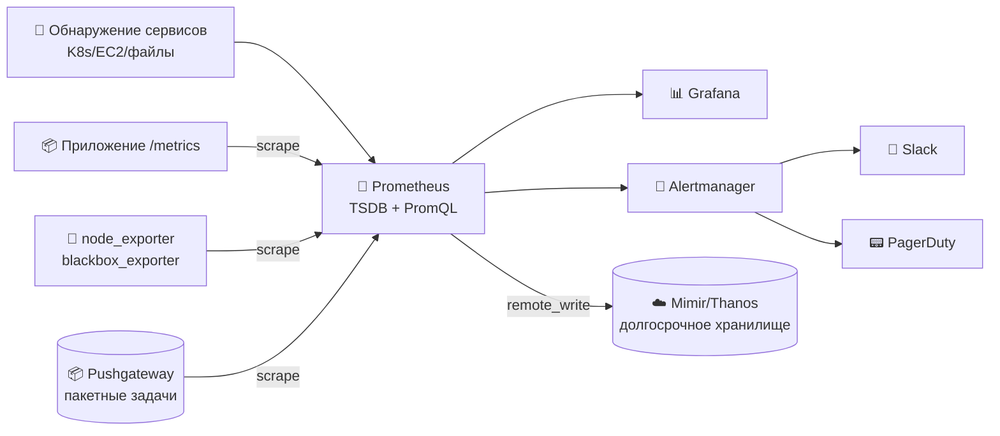
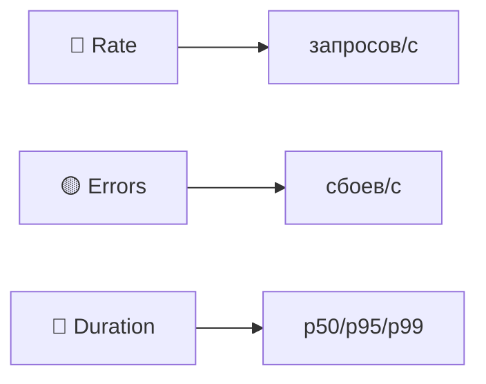
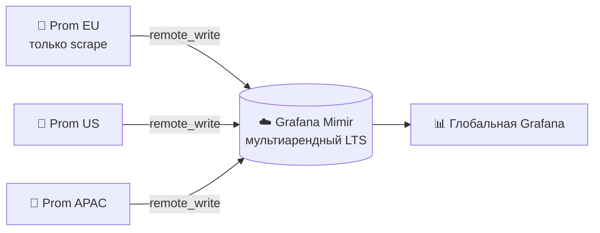

# 📌 Лекция 8 — Метрики и мониторинг с Prometheus: от догадок к измерениям

## 📍 Слайд 1 – 📊 Добро пожаловать в столп метрик

* 🌍 **Лекция 7 дала продакшену глаза — логи.** Эта лекция даёт ему *пульс* — метрики.
* ⏱️ Логи отвечают на вопрос *«что произошло?»*. Метрики отвечают на *«сколько, как быстро, как часто?»* — каждые 15 секунд, бесконечно.
* 📊 **Prometheus** — стандарт метрик, выпускник CNCF; он обеспечивает мониторинг в Spotify, GitHub, DigitalOcean и большинстве развёртываний Kubernetes на Земле.
* 🎯 Сегодня: модель скрейпинга, типы метрик, PromQL, методы RED + USE и дашборд, который вы построите в лабораторной 8.



> 🔗 **Связь с лабораторной 8:** вы инструментируете Python-приложение из лабораторной 1 через `prometheus_client`, развернёте Prometheus 3.x + Grafana 13 рядом со стеком Loki прошлой недели, напишете PromQL для **метода RED** и выпустите дашборд из 6 панелей.

---

## 📍 Слайд 2 – 🎯 Результаты обучения

| # | Результат |
|---|---------|
| 1 | 🧠 Выбирать правильный тип метрики — **counter, gauge, histogram, summary, native histogram** — для любого сигнала |
| 2 | 🔄 Объяснить, почему Prometheus **на основе pull**, и что это даёт операционно |
| 3 | 🐍 Инструментировать Python-сервис через `prometheus_client` и контролировать **кардинальность меток** |
| 4 | 🔍 Писать **PromQL** для rate, перцентилей и агрегаций по сервисам |
| 5 | 📊 Проектировать дашборды вокруг метода **RED** (сервисы) и метода **USE** (ресурсы) |

**Технологический стек, зафиксированный на май 2026:**
* 💾 **Prometheus 3.12** (последняя стабильная, май 2026) / **3.5 LTS** (поддерживается до 31 июля 2026)
* 📊 **Grafana 13.0.1+security-01** (12 мая 2026)
* 🐍 **`prometheus_client` 0.23+** для Python (в лабораторной закреплён 0.23.1; 0.25 — последняя)
* 📦 Образ контейнера **`prom/prometheus:v3.9.0`**, используемый в лабораторной 8

> 🆕 **Значения по умолчанию Prometheus 3.x** (в отличие от 2.x): UTF-8 в именах метрик/меток, **native histograms GA**, встроенный OTLP-приёмник, новый протокол remote-write 2.0. Семь feature-флагов стали значениями по умолчанию в 3.0.

---

## 📍 Слайд 3 – 🧱 Место метрик (повтор из лекции 7)



* 📋 **Логи (Loki):** неограниченный текст, высокая кардинальность, хранятся дни–недели, идеальны для *криминалистики*
* 📊 **Метрики (Prometheus):** числовые временные ряды, низкая кардинальность, хранятся месяцы, идеальны для *алертов + трендов*
* 🔗 **Трассировки:** разбивка задержки на уровне запроса; вне рамок Core, рассматривается в факультативе SRE-Intro

> 🔥 **Вместе, а не вместо.** Алерт 5xx из Prometheus поднимает дежурного. Запрос LogQL в Grafana находит стек-трейс. Трассировка говорит, какой последующий вызов был медленным. Три столпа, одна Grafana.

---

## 📍 Слайд 4 – 💸 Без метрик вы летите вслепую

Одних логов не хватает, чтобы ответить на вопросы, которые начальник задаёт в 09:00:

* *«Сколько пользователей обратились к API вчера?»* — нужен counter.
* *«Растёт ли p95 задержки неделя за неделей?»* — нужна histogram.
* *«Мы близки к исчерпанию соединений с базой?»* — нужен gauge.
* *«Изменило ли развёртывание 20 минут назад частоту ошибок?»* — нужен график, а не `grep`.

| 🔥 Симптом | 💥 Цена |
|-----------|---------|
| 🐢 Нет базовой линии | Нельзя отличить норму от поломки |
| 📅 Нет тренда | Нельзя предсказать исчерпание ёмкости |
| 🚨 Нет алертов | Простои первыми обнаруживают пользователи (или Twitter) |
| 🤷 Нет атрибуции | Замедления микросервисов становятся нераскрытыми тайнами |

> 💬 **Brendan Gregg, Netflix:** *«Вы не можете оптимизировать то, что не измеряете, и не можете измерять то, что не инструментируете».*

---

## 📍 Слайд 5 – 🔄 Pull vs Push — почему Prometheus выбрал pull



| 🔧 Аспект | 🔄 Pull | 📤 Push |
|-----------|---------|---------|
| Здоровье цели | **Бесплатно** — неудачный scrape = алерт `up == 0` | Сложно — тишина ≠ здоровье |
| Контроль частоты scrape | Им владеет Prometheus | Решает каждое приложение (хаос) |
| Обнаружение сервисов | Нативно (K8s, EC2, Consul, файлы) | Приложения должны знать коллектор |
| Направление фаервола | Исходящее от монитора | Входящее к коллектору (часто блокируется) |
| Короткоживущие задачи | ⚠️ Нужен **Pushgateway** | Нативное соответствие |

> 🔥 **Практическое правило:** pull для долгоживущих сервисов; push (через Pushgateway) только для задач в стиле cron, которые завершаются до следующего scrape. **Не используйте Pushgateway как прокси для метрик** — это хак только для случая пакетных задач.

---

## 📍 Слайд 6 – 🏗️ Архитектура Prometheus



| 🧱 Компонент | 🎯 Роль |
|-------------|---------|
| 💾 **Сервер Prometheus** | Скрейпит, хранит в TSDB, вычисляет правила, обслуживает PromQL |
| 🔌 **Экспортёры** | Переводят системы не-Prometheus (Postgres, Redis, Linux) в `/metrics` |
| 🧭 **Обнаружение сервисов** | Находят цели динамически (Kubernetes API, метки EC2, Consul…) |
| 🚨 **Alertmanager** | Дедуплицирует, группирует, маршрутизирует, заглушает алерты |
| 📦 **Pushgateway** | Принимает метрики от короткоживущих пакетных задач (используйте экономно) |
| ☁️ **Mimir / Thanos** | Горизонтальное масштабирование + мультиарендное долгосрочное хранилище (слайд 19) |

---

## 📍 Слайд 7 – 🔌 Экспортёры: слой перевода

Вы редко будете запускать чистый Prometheus в одиночку. Экосистема — это десятки **экспортёров**, которые выставляют существующие системы на `/metrics`:

| 🔌 Экспортёр | 🎯 Что выставляет |
|-------------|-----------|
| `node_exporter` | Метрики Linux-хоста (CPU, RAM, диск, сеть) |
| `postgres_exporter` | Лаг репликации Postgres, соединения, медленные запросы |
| `redis_exporter` | Redis операций/сек, память, keyspace |
| `blackbox_exporter` | Синтетические пробы — HTTP/HTTPS/TCP/DNS/ICMP |
| `cAdvisor` | CPU/память по контейнерам (встроен в kubelet) |
| `kube-state-metrics` | Состояние объектов Kubernetes — реплики deployment, фаза pod |

* 📦 **Один экспортёр на зависимость.** Лабораторная 8 скрейпит Loki и Grafana напрямую (оба нативно выставляют `/metrics` — экспортёр не нужен).
* 🐍 **Для своих приложений:** инструментируйте через **клиентскую библиотеку** (`prometheus_client` для Python), а не пишите экспортёр.

> 💡 **OpenMetrics** — спецификация в треке IETF, рождённая из формата экспозиции Prometheus — на нём говорят каждый экспортёр и клиентская библиотека.

---

## 📍 Слайд 8 – 📊 Типы метрик: Counter

**Counter** только увеличивается. Сбрасывается в ноль при перезапуске процесса.

```python
from prometheus_client import Counter

http_requests_total = Counter(
    "http_requests_total", "Total HTTP requests",
    ["method", "endpoint", "status"],
)
http_requests_total.labels("GET", "/", "200").inc()
```

**Вы почти никогда не запрашиваете counter напрямую — вы запрашиваете его `rate()`:**

```promql
# запросов в секунду за последние 5 минут
rate(http_requests_total[5m])

# частота ошибок на эндпоинт
sum by (endpoint) (rate(http_requests_total{status=~"5.."}[5m]))
```

> ⚠️ **Counters могут сбрасываться** (перезапуск pod). `rate()` и `increase()` обрабатывают переполнение автоматически — а `irate()` и прямое вычитание **нет**. Для графиков держитесь `rate()`.

---

## 📍 Слайд 9 – 📊 Типы метрик: Gauge

**Gauge** растёт *и* падает. Снимок состояния «прямо сейчас».

```python
from prometheus_client import Gauge

queue_depth = Gauge("worker_queue_depth", "Pending jobs")
queue_depth.set(42)
queue_depth.inc()      # +1
queue_depth.dec(5)     # -5
in_flight = Gauge("http_in_flight", "Concurrent requests")
in_flight.track_inprogress()  # управляется контекстом
```

**Паттерны запросов:**

```promql
# текущее значение по всем инстансам
sum(worker_queue_depth)

# насколько быстро растёт память? (производная)
deriv(process_resident_memory_bytes[10m])

# самые быстрорастущие pod'ы
topk(5, rate(container_memory_working_set_bytes[5m]))
```

> 🎯 **Используйте gauge для:** активных соединений, глубины очереди, температуры, используемой памяти, текущего числа реплик. **Всё, что может уменьшаться.**

---

## 📍 Слайд 10 – 📊 Типы метрик: Histogram

Counters говорят *сколько*. Histograms говорят *как распределены значения* — идеально для **задержки**.

```python
from prometheus_client import Histogram

request_latency = Histogram(
    "http_request_duration_seconds", "Request latency",
    ["method", "endpoint"],
    buckets=(0.005, 0.01, 0.025, 0.05, 0.1, 0.25, 0.5, 1.0, 2.5, 5.0),
)
with request_latency.labels("GET", "/api").time():
    handle_request()
```

**Классическая histogram выставляет три семейства** временных рядов на набор bucket'ов:
* `*_bucket{le="0.1"}` — кумулятивное число наблюдений ≤ 0.1 с
* `*_sum` — суммарное время
* `*_count` — общее число наблюдений

**Убойный запрос — перцентили на стороне сервера:**

```promql
# p95 задержки за последние 5 минут
histogram_quantile(0.95,
  sum by (le) (rate(http_request_duration_seconds_bucket[5m])))
```

> ⚠️ **Выбор bucket'ов важен.** Bucket'ы, не охватывающие реальное распределение, дают чудовищно неверные перцентили. Начните с дефолта SRE `(.005, .01, .025, .05, .1, .25, .5, 1, 2.5, 5, 10)` и настраивайте по продакшен-данным.

---

## 📍 Слайд 11 – ✨ Native histograms (GA в Prometheus 3.x)

**Классические histogram** заставляют заранее выбирать bucket'ы. Ошибётесь — и ваш p99 врёт вам. **Native histograms** (GA с Prometheus 3.x, стабильны в v3.8) исправляют это **экспоненциальными схемами bucket'ов**, выбираемыми автоматически.

| 🔧 Аспект | 📊 Классическая histogram | ✨ Native histogram |
|-----------|---------------------|---------------------|
| Bucket'ы | Задаются вручную на метрику | Автоматические, экспоненциальные, динамические |
| Временных рядов на метрику | Один на bucket (10–20) | **Один** |
| Разрешение | Фиксированное | Настраиваемая схема (степени 2) |
| Хранение | Дорогое (каждый bucket = ряд) | ~в 5 раз дешевле |
| `histogram_quantile()` | Работает | Работает — та же функция |

```python
# Python-клиент (0.23+): включите, передав `native_histogram_bucket_factor`
Histogram(
    "http_request_duration_seconds", "Latency",
    native_histogram_bucket_factor=1.1,  # ~10% разрешение
)
```

> 🆕 **В Prometheus 3.x они включены по умолчанию** (флаг `native-histograms` стал дефолтным в 3.0). Смешивайте свободно: одна метрика может выставлять и классическую, *и* native — клиенты договариваются через протокол scrape.

---

## 📍 Слайд 12 – 📊 Counter vs Gauge vs Histogram vs Summary

| 📊 Тип | ⬆️⬇️ Поведение | 🎯 Для чего | 🔍 Запрос через |
|---------|----------------|-----------|----------------|
| 🔢 **Counter** | Только вверх (сброс при перезапуске) | События: запросы, ошибки, байты | `rate()`, `increase()` |
| 📈 **Gauge** | Вверх и вниз | Состояние: температура, глубина очереди | напрямую, `avg()`, `max()` |
| 📊 **Histogram (классическая)** | Несколько временных рядов на метрику | Задержка, размер, длительности | `histogram_quantile()` на сервере |
| ✨ **Native histogram** | Один временной ряд, авто-bucket'ы | То же, что histogram, ~в 5 раз дешевле | `histogram_quantile()` — та же функция |
| 📐 **Summary** | Квантили вычисляются в процессе | Устаревшая отчётность квантилей | Напрямую — но **нельзя агрегировать между инстансами** |

> 🔥 **По умолчанию используйте histograms (native, если Prometheus 3.x).** Summaries — крайний случай: их заранее вычисленные квантили нельзя объединить между pod'ами, поэтому они ломаются в момент, когда вы масштабируетесь больше одной реплики.

---

## 📍 Слайд 13 – 🐍 Инструментирование Python-приложения из лабораторной 1

Изменение двух файлов, чтобы добавить метрики в сервис Flask/FastAPI:

```python
# app.py
from prometheus_client import Counter, Histogram, Gauge, generate_latest
from flask import Flask, Response, request
import time

app = Flask(__name__)

REQS = Counter("http_requests_total", "HTTP requests",
               ["method", "endpoint", "status"])
LAT  = Histogram("http_request_duration_seconds", "Latency",
                 ["method", "endpoint"])
INF  = Gauge("http_requests_in_progress", "In-flight requests")

@app.before_request
def _before():
    request._t0 = time.perf_counter()
    INF.inc()

@app.after_request
def _after(resp):
    dur = time.perf_counter() - request._t0
    endpoint = request.url_rule.rule if request.url_rule else "unknown"
    REQS.labels(request.method, endpoint, resp.status_code).inc()
    LAT.labels(request.method, endpoint).observe(dur)
    INF.dec()
    return resp

@app.route("/metrics")
def metrics():
    return Response(generate_latest(), mimetype="text/plain")
```

```txt
# requirements.txt
prometheus-client==0.23.1
```

> 🔗 **Результат лабораторной 8:** эндпоинт `/metrics` выше плюс одна **бизнес-метрика** (например, `devops_info_endpoint_calls`) — оценивается в задаче 1.

---

## 📍 Слайд 14 – 🏷️ Кардинальность меток — способ №1 уронить Prometheus по OOM

Каждая уникальная комбинация меток = один **временной ряд**. Ряд стоит ~3–5 КБ памяти. Посчитайте.

```python
# ❌ РАСПЛАВИТЬ PROMETHEUS — один ряд на пользователя, навсегда
REQS.labels(user_id=u, request_id=r).inc()

# ✅ Только ограниченные перечисления
REQS.labels(method="GET", endpoint="/api", status="200").inc()
```

| ✅ Хорошая метка (ограниченная) | ❌ Плохая метка (неограниченная) |
|------------------------|--------------------------|
| `method` (8 значений) | `user_id` (миллионы) |
| `endpoint` (десятки, нормализованные) | `request_id` (один на вызов) |
| `status_code` (~10) | `email`, `path` с ID |
| `env="prod"` (3) | `timestamp`, `trace_id` |

**Целевые значения:**
* 📊 **<1000** уникальных комбинаций меток на метрику — здорово.
* 🚨 **>100 000** — вы в нескольких часах от OOM.
* 🛡️ Отслеживайте число рядов через `prometheus_tsdb_head_series` и алертите на рост.

> 🔥 **Правило:** если значение уникально для каждого запроса или пользователя, **оно не идёт в метку**. Тот же урок, что у Loki (лекция 7), тот же радиус поражения.

---

## 📍 Слайд 15 – 🔍 PromQL, часть 1: instant vs range векторы

Любое выражение PromQL возвращает один из четырёх типов. Два, которые вы будете использовать постоянно:

```promql
# 🎯 Instant vector — один сэмпл на ряд, в момент вычисления
http_requests_total{status="500"}

# 🎯 Range vector — все сэмплы на ряд, за период
http_requests_total[5m]
```

Вы **не можете построить график по range-вектору напрямую** — его нужно свернуть функцией (`rate`, `avg_over_time`, …):

```promql
# запросов/сек, усреднённо по 5-минутным окнам
rate(http_requests_total[5m])
```

| 🔧 Оператор | 🎯 Значение |
|-------------|-----------|
| `{label="v"}` / `{label!="v"}` | Точное совпадение / отрицание |
| `{label=~"re"}` / `{label!~"re"}` | Regex / отрицающий regex |
| `[5m]`, `[1h]` | Окно ретроспективы для range-векторов |
| `offset 1h` | Сдвинуть запрос назад во времени |
| `@ 1700000000` | Привязать вычисление к метке времени Unix |

> 💡 **Практическое правило:** диапазон `[Xm]` должен быть ≥ **4× интервала scrape**, чтобы на каждое вычисление хватало сэмплов. При scrape раз в 15 с `[1m]` — минимум, который не врёт.

---

## 📍 Слайд 16 – 🔍 PromQL, часть 2: агрегация и rate()

```promql
# Суммарные запросы/сек по всему парку
sum(rate(http_requests_total[5m]))

# Запросы/сек на эндпоинт (оставить эту метку, остальное суммировать прочь)
sum by (endpoint) (rate(http_requests_total[5m]))

# Запросы/сек на pod, отбросить шумную метку
sum without (instance) (rate(http_requests_total[5m]))

# Топ-5 самых медленных эндпоинтов (p95)
topk(5,
  histogram_quantile(0.95,
    sum by (endpoint, le) (rate(http_request_duration_seconds_bucket[5m]))))

# Доля ошибок (5xx как доля от общего)
sum(rate(http_requests_total{status=~"5.."}[5m]))
  / sum(rate(http_requests_total[5m]))
```

| 🔧 Агрегатор | 🎯 Случай использования |
|---------------|-------------|
| `sum`, `avg`, `min`, `max` | Объединить ряды |
| `count` | Число совпадающих рядов |
| `topk(N, expr)` / `bottomk` | N наибольших/наименьших |
| `quantile(0.5, expr)` | Перцентиль уровня парка |
| `group by (l) / without (l)` | Отбросить или сохранить измерения меток |

> ⚠️ **Не усредняйте перцентили.** `avg(histogram_quantile(...))` — математическая бессмыслица. Всегда `histogram_quantile()` *снаружи* от `sum by (le, …)`.

---

## 📍 Слайд 17 – 🔍 PromQL, часть 3: recording rules

Некоторые запросы медленные. Некоторые нужны много раз в день. **Recording rules** вычисляют выражение PromQL по расписанию и сохраняют результат как новую метрику — как материализованное представление.

```yaml
# prometheus.rules.yml
groups:
  - name: app_red
    interval: 30s
    rules:
      - record: job:http_requests:rate5m
        expr: sum by (job) (rate(http_requests_total[5m]))

      - record: job:http_errors:ratio5m
        expr: |
          sum by (job) (rate(http_requests_total{status=~"5.."}[5m]))
            / sum by (job) (rate(http_requests_total[5m]))

      - record: job:http_latency:p95_5m
        expr: |
          histogram_quantile(0.95,
            sum by (job, le) (rate(http_request_duration_seconds_bucket[5m])))
```

* 🏷️ **Соглашение об именовании:** `level:metric:operation` — например, `job:http_requests:rate5m`. Двоеточия намеренны и зарезервированы для recording rules.
* 🚀 **Дашборды остаются быстрыми**, потому что запрашивают заранее вычисленные ряды, а не сырые bucket'ы histogram.
* 🚨 **Правила алертов** используют тот же синтаксис (`alert:` вместо `record:`) и срабатывают в Alertmanager, когда их выражение непустое в течение `for: Xm`.

---

## 📍 Слайд 18 – 🔴 Метод RED (Tom Wilkie, Weaveworks, 2015)

**Для каждого сервиса, управляемого запросами, мониторьте три вещи:**

| 🔧 Метрика | 🎯 Вопрос | 📝 PromQL |
|-----------|-------------|------------|
| 🔴 **R**ate | Насколько загружен? | `sum by (svc) (rate(http_requests_total[5m]))` |
| 🟡 **E**rrors | Как часто падает? | `sum by (svc) (rate(http_requests_total{status=~"5.."}[5m]))` |
| 🔵 **D**uration | Насколько медленно? | `histogram_quantile(0.95, sum by (svc, le) (rate(http_request_duration_seconds_bucket[5m])))` |



* 📊 **Почему именно эти три?** Они напрямую отражают опыт пользователя: *«сервис жив, корректен, быстр?»*
* 🪞 **Зеркалят четыре золотых сигнала** из книги Google SRE (Rate + Errors + Latency + Saturation) — RED отбрасывает насыщение, потому что это работа метода **USE**.
* 🎯 **Если вы мониторьте по сервису только три вещи, мониторьте эти.**

> 📖 Впервые представлен **Tom Wilkie на лондонской встрече Prometheus в 2015 году**, пока он работал в Weaveworks. Теперь это стандартная практика во всём CNCF.

---

## 📍 Слайд 19 – 📊 Метод USE (Brendan Gregg, 2012)

**RED** — для сервисов. **USE** — для **ресурсов** — CPU, RAM, диск, сеть, файловые дескрипторы.

| 🔧 Метрика | 🎯 Вопрос | 📝 Пример |
|-----------|-------------|-----------|
| 📊 **U**tilisation | Насколько загружен ресурс? | CPU на 80% |
| 🪣 **S**aturation | Сколько лишней работы в очереди? | длина run-queue > число ядер |
| ❌ **E**rrors | Есть ли события ошибок? | ошибки дискового I/O, сбросы на NIC |

```promql
# Утилизация CPU узла (node_exporter)
1 - avg by (instance) (rate(node_cpu_seconds_total{mode="idle"}[5m]))

# Насыщение памяти — страниц swap-in в секунду
rate(node_vmstat_pswpin[5m])

# Счётчик ошибок диска
rate(node_disk_io_errors_total[5m])
```

> 📖 Опубликован **Brendan Gregg (тогда Joyent, теперь Netflix/Intel) в 2012 году** как *«Thinking Methodically about Performance»* (ACM Queue). Сопровождающие чек-листы на brendangregg.com/usemethod.html до сих пор золотой стандарт экскурса по счётчикам производительности Linux.

**🎯 Рецепт:** **RED для каждого сервиса. USE для каждого ресурса. Вместе они покрывают обе половины каждого инцидента.**

---

## 📍 Слайд 20 – 📊 Дашборды Grafana для метрик

Та же Grafana из лабораторной 7 — добавьте Prometheus как второй источник данных:

```yaml
# grafana/provisioning/datasources/datasources.yml
datasources:
  - name: Prometheus
    type: prometheus
    url: http://prometheus:9090
    access: proxy
  - name: Loki
    type: loki
    url: http://loki:3100
```

**Принципы проектирования панелей (те же, что в лекции 7):**
* 🎯 **Один вопрос на дашборд** — *«Здоров ли api?»*, а не *«покажи мне всё»*.
* 🚦 **Stat-панели сверху** — красно/зелёное с первого взгляда.
* 📈 **Временные ряды в середине** — метрики RED, последний час, с порогами.
* 🔥 **Heatmap внизу** — распределение задержки (передайте ряды `*_bucket` прямо в панель heatmap).
* 🔁 **Переменные шаблонов** для `$service`, `$env`, `$instance` — один дашборд, много срезов.
* 🔗 **Углубление (drill-down) от всплеска метрики** к соответствующему запросу LogQL (Grafana позволяет связывать источники данных).

> 💡 **Heatmaps раскрывают то, что скрывают средние.** p99 в 800 мс может означать «все медленные» или «1% пользователей брошены» — heatmap покажет, что именно.

---

## 📍 Слайд 21 – 📊 Панели дашборда лабораторной 8 (PromQL)

Шесть (+) панелей, оцениваемых в задаче 3:

```promql
# 1️⃣ Частота запросов на эндпоинт
sum by (endpoint) (rate(http_requests_total[5m]))

# 2️⃣ Частота ошибок на эндпоинт
sum by (endpoint) (rate(http_requests_total{status=~"5.."}[5m]))

# 3️⃣ p95 задержки
histogram_quantile(0.95,
  sum by (endpoint, le) (rate(http_request_duration_seconds_bucket[5m])))

# 4️⃣ Heatmap задержки (напрямую питает панель Grafana Heatmap)
sum by (le) (rate(http_request_duration_seconds_bucket[5m]))

# 5️⃣ Запросы в полёте
http_requests_in_progress

# 6️⃣ Время работы сервиса (1 = вверх, 0 = вниз)
up{job="app"}
```

| Панель | Виз | Отвечает на |
|-------|-----|---------|
| 1 | Временной ряд | *«Насколько загружен?»* |
| 2 | Временной ряд | *«Как часто падает?»* |
| 3 | Временной ряд | *«Насколько медленно на 95-м перцентиле?»* |
| 4 | Heatmap | *«Как выглядит длинный хвост?»* |
| 5 | Gauge | *«Сколько сейчас в полёте?»* |
| 6 | Stat | *«Мы вообще живы?»* |

> 🔗 **Требуемое доказательство:** скриншоты всех панелей с живым трафиком от цикла `curl` по вашему приложению — оценивается в задаче 3 лабораторной 8.

---

## 📍 Слайд 22 – 🏭 Продакшен: федерация, remote_write, Mimir

Лабораторная 8 запускает **один контейнер Prometheus** с хранением 15 дней. Продакшену нужны четыре улучшения:

| 🔧 Забота | 🪜 По умолчанию в лаб. | 🏭 Продакшен |
|-----------|----------------|---------------|
| Хранение | Локальная TSDB, 15 дней | **`remote_write` в Mimir / Thanos** (годы, мультиарендность) |
| HA | Один Prometheus | **Две реплики Prometheus**, скрейпящие одни цели; Alertmanager дедуплицирует |
| Масштаб | Single binary | **Федерация** — листовой Prometheus на кластер, глобальный Prometheus агрегирует |
| Хранение | 15 дней локально | Локально 24 ч + Mimir для долгосрочного (дешёвое объектное хранилище) |
| Защита кардинальности | Нет | `relabel_configs` в `remote_write`, чтобы отбрасывать высококардинальные ряды до отправки |



> 🆕 **Mimir** (Grafana Labs, AGPL/open) заменяет Cortex и масштабируется до **1B+ активных рядов**. **Thanos** (CNCF) — альтернатива на основе sidecar: выбирайте Thanos, если уже работаете на ванильном Prometheus, Mimir — если начинаете с нуля.

---

## 📍 Слайд 23 – 🌍 Prometheus в дикой природе

* 🎵 **SoundCloud** — место рождения; открыт в 2012, вдохновлён внутренним **Borgmon** от Google.
* ☁️ **DigitalOcean** — ~1B активных рядов по региональным Prometheus + Cortex/Mimir.
* 🐙 **GitHub** — Prometheus + Grafana для инфраструктуры; публичная страница статуса — это наряженные алерты Prometheus.
* 🚀 **SpaceX** — конвейеры телеметрии питают Prometheus + кастомную TSDB для мониторинга двигателей и авионики.
* 🎬 **Netflix** — **Atlas** (их собственная TSDB) для продуктовых метрик, Prometheus широко для инфраструктуры; метод USE Брендана Грегга вышел из этой команды.
* 🏛️ **CNCF** — Prometheus был **вторым проектом, окончившим инкубацию** (август 2018, после Kubernetes). Формат экспозиции породил **OpenMetrics**, ныне черновик IETF.

> 🔥 **Общий паттерн:** Prometheus скрейпит локально для быстрых запросов и алертинга; всё отправляется в долгосрочное хранилище (Mimir / Thanos / VictoriaMetrics / Cortex) для межрегиональных дашбордов.

---

## 📍 Слайд 24 – 🎯 Ключевые выводы

1. 📊 **Метрики — второй столп.** Логи говорят *что*, метрики — *сколько / как быстро*. Используйте оба.
2. 🔄 **Pull побеждает push для сервисов** — Prometheus владеет scrape, здоровье цели бесплатно.
3. 📈 **Counter, gauge, histogram, summary, native histogram** — выбирайте по *вопросу*, а не по *значению*. Counters нуждаются в `rate()`. Histograms открывают перцентили на стороне сервера. Native histograms (GA в Prom 3.x) ~в 5 раз дешевле классических.
4. 🏷️ **Кардинальность меток — это выстрел в ногу.** Никаких user ID, request ID, временных меток. <1000 рядов на метрику.
5. 🔍 **PromQL = селектор потока → range-вектор → агрегация → квантиль.** Recording rules предвычисляют дорогие запросы.
6. 🔴 **RED** (Wilkie, 2015) для **сервисов** — Rate, Errors, Duration.
7. 📊 **USE** (Gregg, 2012) для **ресурсов** — Utilisation, Saturation, Errors.
8. 🆕 **Prometheus 3.x** поставляет UTF-8 имена, native histograms GA, OTLP-приёмник, remote-write 2.0 — модернизируйтесь при обновлении.

> 💡 **Вы не можете исправить то, что не измеряете — и не можете измерять то, что не инструментируете.**

---

## 📍 Слайд 25 – 🚀 Что дальше

**📚 Следующая лекция: *Основы Kubernetes*** — Pods, Deployments, Services, основы kubectl и почему каждая концепция наблюдаемости из лекций 7–8 перестраивается как CRD.

* ☸️ Pods, ReplicaSets, Deployments, Services
* 🔄 Самовосстановление и rolling-обновления
* 🌐 Обнаружение сервисов и ClusterIP / NodePort / LoadBalancer
* 🧪 Лабораторная 9: развернуть Python-приложение из лабораторной 1 + мониторинг из лабораторных 7/8 в реальном кластере Kubernetes

**🔬 Результаты лабораторной 8 (на этой неделе):** добавить `prometheus_client` в Python-приложение, развернуть `prom/prometheus:v3.9.0` + Grafana 13 рядом со стеком Loki из лабораторной 7, написать PromQL для метода RED, выпустить дашборд из 6+ панелей, укрепить для продакшена (healthchecks, лимиты ресурсов, retention, тома). Бонус 2,5 балла: расширить роль Ansible из лабораторных 6/7, чтобы шаблонизировать весь стек.


> 🆕 **Предпросмотр лабораторной 16:** сегодняшний стек docker-compose станет **Helm-чартом `kube-prometheus-stack`** (~v85, май 2026) с CRD **ServiceMonitor** и **PodMonitor**, автоматически обнаруживающими цели — те же метрики, тот же PromQL, нативная для Kubernetes обвязка.

**👋 До встречи на лекции 9.**

---

## 📚 Ресурсы и дополнительное чтение

**📕 Книги:**
* *Prometheus: Up & Running* — **Julien Pivotto & Brian Brazil** (O'Reilly, 2-е изд. 2023). Эталон; Brazil — core-разработчик, Pivotto — мейнтейнер сервера.
* *Site Reliability Engineering* — Beyer et al. — гл. 6 (Monitoring) и гл. 10 (Practical Alerting). Бесплатно на sre.google/books.
* *Observability Engineering* — Majors, Fong-Jones, Miranda (O'Reilly, 2022) — помещает метрики в общую картину трёх столпов.

**🔗 Ссылки:**
* 🌐 [prometheus.io/docs](https://prometheus.io/docs/) — официальная документация (3.x)
* 🌐 [Анонс Prometheus 3.0](https://prometheus.io/blog/2024/11/14/prometheus-3-0/) — UTF-8, native histograms, OTLP
* 🌐 [Основы PromQL](https://prometheus.io/docs/prometheus/latest/querying/basics/)
* 🌐 [Метод RED от Tom Wilkie (блог Grafana Labs)](https://grafana.com/blog/the-red-method-how-to-instrument-your-services/)
* 🌐 [Метод USE от Brendan Gregg](https://www.brendangregg.com/usemethod.html)
* 🌐 [Grafana Mimir](https://grafana.com/oss/mimir/) — горизонтально масштабируемое хранилище Prometheus
* 🌐 [Helm-чарт kube-prometheus-stack](https://github.com/prometheus-community/helm-charts/tree/main/charts/kube-prometheus-stack) — предпросмотр лабораторной 16

**🎓 Квиз:** квиз после лекции идёт в зачёт окна лидерборда недель 7–9.
