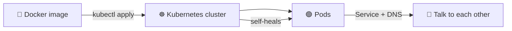
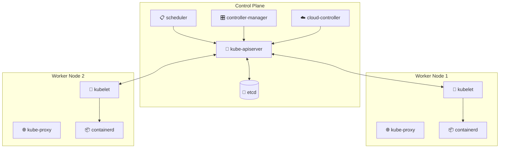
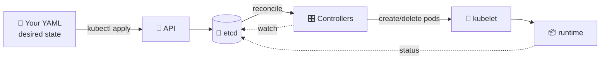
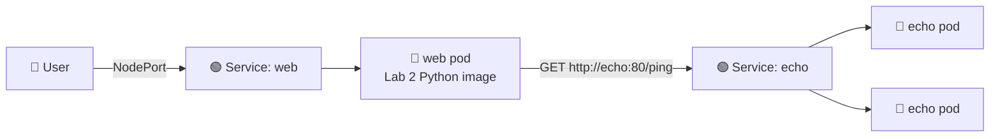
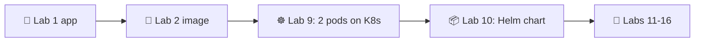

# 📌 Лекция 9 — Основы Kubernetes: оркестрация контейнеров

## 📍 Слайд 1 – ☸️ Добро пожаловать в Kubernetes

* 🌍 **Лекции 2 и 7-8 дали вам Docker-образ, логи и метрики.** Теперь мы переходим к оркестрации.
* 🚢 **Kubernetes (K8s)** = де-факто оркестратор контейнеров, созданный в Google в 2014 году; запускает ваш образ в масштабе, самовосстанавливается, выполняет раскатку вперёд и откат назад
* 🎯 Эта лекция: ментальная модель + ровно столько API, чтобы развернуть ваш образ из лабораторной 2 как настоящую *облачно-нативную* нагрузку
* 🔗 **Связь с лабораторной 9:** вы поднимете локальный кластер с помощью **k3d** (k3s-in-Docker), развернёте два pod'а (ваш Python-сервис + предоставляемый Go echo вспомогательный сервис) и свяжете их через `Service` и kube-DNS



---

## 📍 Слайд 2 – 🎯 Результаты обучения

| # | Результат |
|---|---------|
| 1 | 🧠 Объяснить, зачем существует оркестрация и какие проблемы не решает Compose |
| 2 | 🏗️ Читать и писать манифесты `Pod`, `Deployment`, `ReplicaSet`, `Service`, `Namespace` |
| 3 | 🛠️ Управлять кластером с помощью `kubectl`: `get`, `describe`, `logs`, `exec`, `apply`, `port-forward` |
| 4 | 🔗 Понимать связывание меток/селекторов — клей любого ресурса K8s |
| 5 | 🌐 Рассуждать о kube-DNS и сетевом взаимодействии сервисов (*весь смысл* запуска 2 pod'ов) |
| 6 | 🩺 Настраивать пробы liveness, readiness и startup |

**Технологический стек, зафиксированный на май 2026:** Kubernetes **1.36** "Haru" (выпущен 22 апреля 2026), **kubectl 1.36**, **k3d 5.7+** (k3s-in-Docker — стандартный локальный кластер курса), манифесты на чистом YAML (Helm — в следующей лекции).

---

## 📍 Слайд 3 – ❓ Почему Compose перестаёт быть достаточным

Вы выпустили один Python-сервис (лабораторные 1-2), подключили его к CI (лабораторная 3), подготовили VM (лабораторная 4), настроили её (лабораторные 5-6) и наблюдали за его логами + метриками (лабораторные 7-8). Один сервис, один хост, `docker compose up`. Почему это не конец истории?

* 💀 **Нет самовосстановления.** Если хост умирает, ваш сервис умирает. Перезапуск? Вы делаете его сами.
* 📈 **Нет горизонтального масштабирования.** Вырос трафик — добавить второй экземпляр? Вы вручную запускаете второй `docker run` и ставите перед ним nginx.
* 🔄 **Нет раскатки обновлений.** Развёртывание = остановка / запуск. Есть простой.
* 🌐 **Нет обнаружения сервисов.** Два сервиса на двух хостах требуют связки IP-и-порт, которую вы поддерживаете вручную.
* 🛡️ **Нет изоляции ресурсов между арендаторами.** Compose — это "один проект на каталог", а не "десять команд в кластере".

Kubernetes решает все пять проблем — но ценой более крутой кривой обучения.

> 🔥 **Проверка реальности:** для одного небольшого сервиса Compose *всё ещё* правильный ответ. K8s нужен, когда у вас ≥ 3 сервисов, несколько сред или вам нужно самовосстановление в 3 часа ночи.

---

## 📍 Слайд 4 – 📜 Краткая история

* 📅 **2003** — Google запускает **Borg** внутри компании. Большинство инженеров используют его ежедневно; вне Google никто не знает о его существовании.
* 📅 **2014 (июнь)** — Google открывает исходный код Kubernetes как духовного преемника Borg. Джо Беда, Брендан Бёрнс и Крейг Маклаки — оригинальная команда.
* 📅 **2015** — объявлен **Kubernetes 1.0**. Основан CNCF (Cloud Native Computing Foundation) с K8s в качестве стартового проекта.
* 📅 **2016-2017** — *"Kubernetes the Hard Way"* (Келси Хайтауэр) становится обязательным чтением. Появляются Helm, ArgoCD, Istio.
* 📅 **2018** — CNCF выпускает Kubernetes; управляемые предложения (EKS, GKE, AKS) достигают зрелости.
* 📅 **2020** — K8s объявляет Docker устаревшей средой выполнения (использует **containerd** напрямую). Ваши *образы* по-прежнему работают — они OCI.
* 📅 **2024-2025** — sidecar-контейнеры достигают GA (1.29 → 1.33). Pod security admission заменяет PodSecurityPolicy (окончательно удалён).
* 📅 **2026 (22 апреля)** — Kubernetes **1.36 "Haru"** — 70 улучшений: 18 переходят в Stable, 25 входят в Beta, 25 новых Alpha. Ключевые направления: усиление безопасности, поддержка AI/ML-нагрузок, масштабируемость API.

> 📖 *Kubernetes Up & Running* (Burns, Beda, Hightower) — стандартная вводная книга. 3-е издание (2022) по-прежнему точно на уровне API для 1.36.

---

## 📍 Слайд 5 – 🏗️ Архитектура: control plane + узлы



* 🚪 **kube-apiserver** — единственный компонент, с которым общаются клиенты (и другие компоненты плоскости). RESTful gRPC поверх HTTP.
* 💾 **etcd** — источник истины. Каждый Pod, каждый Secret, каждая метка живут здесь. (Планируйте DR вокруг него.)
* 📋 **scheduler** — выбирает, на каком узле должен запускаться ожидающий Pod.
* 🎛️ **controller-manager** — запускает циклы согласования (контроллер ReplicaSet, контроллер Node и т. д.). Движок "привести реальность в соответствие с желаемым состоянием".
* 🧠 **kubelet** — агент узла. Общается со средой выполнения (containerd), сообщает статус узла + pod'а обратно в API.
* 🌐 **kube-proxy** — программирует правила iptables/IPVS/nftables, чтобы виртуальные IP `Service` маршрутизировались на живые pod'ы.

> 🤔 **Подумайте:** что произойдёт, если etcd потеряет кворум? *(Ответ: кластер замирает. Никаких новых pod'ов, никаких удалений. Существующие продолжают работать.)*

---

## 📍 Слайд 6 – 🎯 Декларативная модель

Вы не говорите Kubernetes *что делать*; вы говорите ему *что вы хотите*. Control plane сам разбирается с остальным, согласовывая **желаемое состояние** (ваш YAML) с **наблюдаемым состоянием** (тем, что фактически запущено).



* ✏️ Вы **редактируете** YAML и выполняете `kubectl apply`. Готово.
* 🔁 Контроллеры непрерывно закрывают разрыв между желаемым и наблюдаемым.
* 🛡️ Убьёте pod вручную? Контроллер ReplicaSet породит другой в течение секунд.

> 📚 **Это та же парадигма, что и Terraform** (лекция 4) — декларативный IaC, с циклом согласования, *встроенным в саму платформу*.

---

## 📍 Слайд 7 – 🟢 Pod — атом K8s

**Pod** — это один или несколько контейнеров, совместно использующих одно сетевое пространство имён и тома хранилища — планируемые вместе, с управлением жизненным циклом вместе.

```yaml
apiVersion: v1
kind: Pod
metadata:
  name: hello-pod
  labels:
    app: hello
spec:
  containers:
    - name: web
      image: ghcr.io/innodevops/lab2-app:v1.0.0
      ports:
        - containerPort: 8080
```

Ключевые факты:
* 🆔 Каждый pod получает собственный IP — доступный другим pod'ам в кластере
* 💥 Pod'ы **смертны**. Они умирают, их переназначают, IP меняются. *Никогда* не полагайтесь на IP pod'а извне него.
* 📦 Многоконтейнерные pod'ы существуют для **паттерна sidecar** (агент логирования, прокси, init-помощник)
* 🏷️ **Метки** — это то, как каждый другой ресурс находит этот pod

> ⚠️ **Антипаттерн:** запускать Pod напрямую. Вы потеряете его при первой перезагрузке узла. Всегда оборачивайте в контроллер нагрузки (Deployment / StatefulSet / DaemonSet / Job).

---

## 📍 Слайд 8 – 🎁 Deployment + ReplicaSet — как вы на самом деле запускаете вещи

**Deployment** объявляет *N pod'ов по заданному шаблону*. Под капотом он управляет **ReplicaSet** (вы почти никогда не трогаете ReplicaSet напрямую).

```yaml
apiVersion: apps/v1
kind: Deployment
metadata:
  name: hello
spec:
  replicas: 3
  selector:
    matchLabels:
      app: hello
  template:
    metadata:
      labels:
        app: hello
    spec:
      containers:
        - name: web
          image: ghcr.io/innodevops/lab2-app:v1.0.0
          ports: [{containerPort: 8080}]
          resources:
            requests: {cpu: 100m, memory: 64Mi}
            limits:   {cpu: 500m, memory: 256Mi}
```

* 🔄 `kubectl set image deployment/hello web=…:v1.0.1` → **раскатка обновления** (по умолчанию: 25% maxUnavailable, 25% maxSurge)
* ⏪ `kubectl rollout undo deployment/hello` → откат к предыдущему ReplicaSet
* 📈 `kubectl scale deployment/hello --replicas=10` → масштабирование вверх

> 🔥 **Смелое утверждение:** любая "современная" stateless-нагрузка в K8s — это Deployment + Service. Освойте эту пару, и вы поймёте 70% операций с кластером.

---

## 📍 Слайд 9 – 🌐 Service — стабильный адрес для движущейся цели

Pod'ы появляются и исчезают; их IP меняются. **Service** — это стабильный виртуальный IP + DNS-имя, которое балансирует нагрузку между всеми pod'ами, соответствующими его селектору.

```yaml
apiVersion: v1
kind: Service
metadata:
  name: hello
spec:
  type: ClusterIP   # default — internal only
  selector:
    app: hello
  ports:
    - port: 80
      targetPort: 8080
```

| Тип | Где он доступен | Когда использовать |
|------|---------------------|-------------|
| **ClusterIP** | Только внутри кластера | Трафик между сервисами (по умолчанию) |
| **NodePort** | IP каждого узла:30000-32767 | Разработка / быстрый внешний доступ |
| **LoadBalancer** | Облачный провайдер создаёт внешний LB | Внешний продакшн-трафик в управляемом K8s |
| **ExternalName** | DNS CNAME на внешний хост | Миграция / проксирование legacy |

* 🌐 Внутри кластера DNS-имя `hello.default.svc.cluster.local` (сокращённо: `hello`) резолвится в ClusterIP
* ⚖️ `kube-proxy` программирует правила iptables/IPVS; трафик распределяется по кругу между здоровыми pod'ами
* 🚪 Для HTTP-входа извне используйте `Ingress` или `Gateway API` (затрагивается в бонусе лабораторной 9 + лабораторной 13)

---

## 📍 Слайд 10 – 🔗 Почему два pod'а внезапно обретают смысл

До лабораторной 8 вы запускали **один** сервис. `Service` и kube-DNS казались излишеством — "зачем стабильный IP для одной вещи?"

**Лабораторная 9 вводит ВТОРОЙ сервис** (небольшой Go-компаньон "echo", поставляемый курсом как вспомогательный в `app_go_echo/`). Теперь картина меняется:



Внезапно:
* 🌐 **kube-DNS делает реальную работу** — `echo` резолвится в балансируемый ClusterIP
* ⚖️ **Service балансирует нагрузку** между двумя pod'ами `echo` — убейте один, трафик продолжает течь
* 🏷️ **Метки важны** — `app=echo` — это то, как `Service: echo` находит свои цели, независимо от того, на какой узел они попали
* 🩺 **Пробы начинают оправдывать себя** — проба готовности pod'а `web` может упасть, если `echo` недоступен (в зависимости от того, как вы это свяжете)

> 🔗 **Это педагогическое ядро лабораторной 9.** Второй сервис — не пустая работа, это минимальная топология, в которой "сетевая модель K8s" перестаёт быть абстрактной.

---

## 📍 Слайд 11 – 🏷️ Метки и селекторы — клей

Метки — это теги ключ/значение на любом объекте K8s. Селекторы запрашивают объекты по их меткам. **Почти каждый контроллер работает через селектор**:

* 🎁 `Deployment.spec.selector` → находит pod'ы, которыми он владеет
* 🌐 `Service.spec.selector` → находит pod'ы, на которые он маршрутизирует
* 🛡️ `NetworkPolicy.podSelector` → находит pod'ы, которые он изолирует
* 📊 `ServiceMonitor.spec.selector` → находит сервисы для сбора метрик (лабораторная 16)

```yaml
metadata:
  labels:
    app: hello                   # 🎯 functional
    version: v1.2.3              # 📌 release tracking
    env: prod                    # 🚦 environment
    team: payments               # 🤝 ownership
    tier: backend                # 🧱 architecture role
```

```bash
kubectl get pods -l app=hello,env=prod         # 🎯 AND selector
kubectl get pods -l 'tier in (frontend,api)'   # 🔀 set-based selector
```

> 🔥 **Соглашение:** используйте `app.kubernetes.io/name`, `app.kubernetes.io/version`, `app.kubernetes.io/managed-by` — пространство "рекомендуемых меток". Helm и ArgoCD устанавливают их автоматически.

---

## 📍 Слайд 12 – 🛠️ kubectl — набор для выживания

Вы будете запускать их каждый день. Запомните их.

```bash
kubectl get pods,svc,deploy -A              # 🔍 list everything across all namespaces
kubectl get pod hello-abc -o yaml           # 📄 show full manifest
kubectl describe pod hello-abc              # 🩺 events + state details — your debugging starting point
kubectl logs hello-abc -f                   # 📋 tail logs; -c <container> for multi-container pods
kubectl logs hello-abc --previous           # ⏪ logs from the previous (crashed) container
kubectl exec -it hello-abc -- /bin/sh       # 🐚 shell into the pod
kubectl port-forward svc/hello 8080:80      # 🚪 tunnel a service to localhost
kubectl apply -f manifest.yaml              # ✏️ create/update declaratively
kubectl delete -f manifest.yaml             # 🗑️ delete what's in that file
kubectl rollout status deploy/hello         # 📊 watch a rolling update
kubectl rollout undo deploy/hello           # ⏪ revert to previous ReplicaSet
kubectl top pod                             # 📊 live CPU/mem (needs metrics-server)
```

> 🔧 **Совет по настройке:** `alias k=kubectl` и `kubectl completion bash` (или zsh). Запускайте `kubectl explain pod.spec.containers` для встроенной документации по схеме.

---

## 📍 Слайд 13 – 💻 Локальные кластеры с k3d

Продакшн K8s работает на управляемых сервисах (EKS, GKE, AKS). Для обучения и CI нужен кластер на вашем ноутбуке. **Этот курс стандартизируется на k3d** — он оборачивает **k3s** (лёгкий, сертифицированный CNCF Kubernetes от Rancher) в контейнеры Docker.

```bash
k3d cluster create devops \
  --image rancher/k3s:v1.36.1-k3s1 \
  --agents 2 \
  -p "8080:80@loadbalancer" -p "8443:443@loadbalancer"
```

Почему k3d вместо альтернатив:
* ⚡ **Самый быстрый + самый лёгкий** — кластер поднимается за секунды; гораздо меньше, чем VM в minikube
* 🧱 **Бесплатный многоузловой режим** — `--agents N` добавляет worker-контейнеры, так что планирование pod'ов между узлами наблюдаемо
* 🔋 **Батарейки в комплекте** — встроенный **Traefik** ingress и **klipper** LoadBalancer означают, что `Ingress` и `type: LoadBalancer` работают без дополнительной установки
* 🔁 **Одноразовый** — `k3d cluster delete devops` и начинайте заново

> 💡 **Компромисс, который нужно знать:** k3d запускает k3s, который урезает некоторые устаревшие API и поставляет **Traefik** (а не ingress-nginx) плюс klipper-lb. Для всего в этом курсе эти различия невидимы; единственное место, где это проявляется, — `ingressClassName: traefik`. Не используйте встроенный K8s из Docker Desktop — он отстаёт от upstream.

---

## 📍 Слайд 14 – 📦 Пространства имён — мультитенантность внутри кластера

**Namespace** ограничивает область действия большинства ресурсов (pod'ы, сервисы, configmap'ы, секреты, deployment'ы). Это то, как вы делите кластер между командами или средами.

```bash
kubectl create namespace dev
kubectl apply -f manifest.yaml -n dev       # 🧱 deploy into dev
kubectl get pods -n dev                     # 🔍 list pods in dev
kubectl config set-context --current --namespace=dev   # 🎯 stick to dev
```

Пространства имён по умолчанию, которые есть в каждом кластере:
* `default` — куда попадают вещи, если вы не указали иное
* `kube-system` — компоненты control plane (не трогайте)
* `kube-public` — читаемый всем; в основном информация о кластере
* `kube-node-lease` — heartbeats узлов

> 🚫 **Антипаттерн:** запускать всё в `default`. Всегда выбирайте пространство имён для каждого приложения или среды.

---

## 📍 Слайд 15 – ⚖️ Запросы ресурсов, лимиты и QoS

Каждый контейнер объявляет **requests** (scheduler резервирует столько) и **limits** (ядро убивает его, если он превышает).

```yaml
resources:
  requests:
    cpu: 100m       # 0.1 of a CPU core
    memory: 64Mi
  limits:
    cpu: 500m       # 0.5 core; CPU is *throttled* past this, not killed
    memory: 256Mi   # memory is *killed* (OOMKill) past this
```

| Класс | Requests vs Limits | Приоритет вытеснения |
|-------|--------------------|--------------------|
| **Guaranteed** | requests == limits, все контейнеры | вытесняется последним |
| **Burstable** | requests < limits | средний |
| **BestEffort** | нет requests или limits | вытесняется первым |

> ⚠️ **Продакшн-правило:** всегда задавайте requests для CPU и памяти; устанавливайте лимиты памяти агрессивно, а лимиты CPU — *только* когда шумный сосед вредит другим нагрузкам. Троттлинг CPU — частый молчаливый убийца производительности.

---

## 📍 Слайд 16 – 🩺 Пробы: liveness, readiness, startup

K8s проверяет состояние вашего pod'а через три пробы. **Они не взаимозаменяемы.**

```yaml
livenessProbe:    # 💀 if this fails, restart the container
  httpGet: {path: /healthz, port: 8080}
  initialDelaySeconds: 15
  periodSeconds: 10
readinessProbe:   # 🚦 if this fails, take the pod out of Service rotation (don't restart)
  httpGet: {path: /ready, port: 8080}
  periodSeconds: 5
startupProbe:     # 🐢 for slow-starting apps; disables the other two until it passes once
  httpGet: {path: /healthz, port: 8080}
  failureThreshold: 30
  periodSeconds: 10
```

* 💀 **Liveness** = "меня нужно убить и перезапустить?" — для дедлоков, а не временных ошибок
* 🚦 **Readiness** = "должен ли трафик идти ко мне прямо сейчас?" — для прогрева, отказов зависимостей
* 🐢 **Startup** (с 1.16, GA с 1.20) = "дайте мне длинное стартовое окно без мигания"

> 🔥 **Частая ошибка:** использовать `livenessProbe: /` против корня основного HTTP приложения. Если ваше приложение замедляется под нагрузкой, K8s перезапустит его, сделав только хуже. Liveness должен проверять *дешёвый, внутрипроцессный* сигнал.

---

## 📍 Слайд 17 – ✨ Что нового в Kubernetes 1.36 "Haru"

Выпущен 22 апреля 2026. Основные моменты, которые стоит знать:

* 🛡️ **Pod Security Admission (PSA)** продолжает развиваться — замена давно устаревшему PodSecurityPolicy
* 🤖 **Поддержка AI/ML-нагрузок** — API Device Resource Allocation, лучшие примитивы разделения GPU (alpha → beta)
* 📈 **Масштабируемость API** — улучшения кеширования apiserver снижают нагрузку на control plane в больших кластерах
* 🧱 **Sidecar-контейнеры** (`restartPolicy: Always` на init-контейнерах) — GA с 1.33; стандарт в стеках наблюдаемости (Alloy, Istio)
* 🚫 **Окончательно удалено:** несколько устаревших `v1beta1` API продолжают выводиться из эксплуатации
* 📦 **Тома образов** (alpha) — монтирование OCI-образа как тома только для чтения. Полезно для ML-моделей.

Политика поддержки N-2 означает, что кластеры на **1.34, 1.35, 1.36** находятся в стандартной поддержке. **1.33 перешёл в расширенную поддержку** с апреля 2026.

> 📚 **Источник:** [Kubernetes 1.36 release blog](https://kubernetes.io/blog/2026/04/22/kubernetes-v1-36-release/).

---

## 📍 Слайд 18 – ☁️ Продакшн: управляемый vs самостоятельно размещённый

| Подход | Примеры | Когда |
|----------|----------|------|
| ☁️ **Управляемый** | EKS (AWS), GKE (Google), AKS (Azure), DOKS, OKE | 99% команд — вы не управляете control plane |
| 🪛 **Самостоятельный на VM** | kubeadm + Ansible, kops, RKE2, Talos | Изолированные, регулируемые, с ориентацией на стоимость или сильная экспертиза по K8s в штате |
| 🚫 **С нуля своими руками** | "Kubernetes the Hard Way" (Hightower) | Только в образовательных целях — никогда не используйте это в продакшне |

**Реализм стоимости (май 2026):** пустой 3-узловой управляемый кластер (control plane + 3 небольших worker'а) обходится примерно в **$200-300/месяц** на AWS или GCP для начального уровня. Эта стоимость быстро растёт с автоскейлингом и постоянными томами.

> 🔥 **Смелое утверждение:** если у вашего CIO нет конкретной причины, используйте управляемый кластер. Control plane — самая грязная часть; пусть облако управляет ею.

---

## 📍 Слайд 19 – 🌍 Kubernetes в реальном мире

* 🎬 **Netflix** — на самом деле был сторонником Mesos примерно до 2019; теперь ~1000 микросервисов на K8s
* 💬 **GitHub** — раннеры Actions — это эфемерные pod'ы K8s; ~100M запусков pod'ов/месяц
* 🏦 **Goldman Sachs** — внутренняя торговая платформа "Marquee" работает на K8s в тысячах кластеров
* 🇨🇳 **Alibaba** — эксплуатирует кластеры K8s с **>10 000 узлов** каждый; отправлял патчи масштабируемости в upstream
* 🛰️ **SpaceX** — сервисы наземных станций Starlink работают на K8s

> 📊 **Ежегодный опрос CNCF 2024:** 96% организаций используют или оценивают Kubernetes. Война оркестраторов контейнеров закончилась; победил K8s.

---

## 📍 Слайд 20 – 🎯 Ключевые выводы

1. ☸️ **Kubernetes — это декларативная оркестрация.** Вы описываете желаемое состояние; контроллеры согласовывают.
2. 🟢 **Pod = наименьшая развёртываемая единица; Deployment = как вы на самом деле его запускаете; Service = как вы до него добираетесь.**
3. 🏷️ **Метки — это клей.** Каждый контроллер связывается через селектор.
4. 🌐 **Service + kube-DNS — это killer feature.** Это имеет смысл только когда у вас ≥ 2 сервисов — что как раз и настраивает лабораторная 9.
5. 🩺 **Пробы ≠ взаимозаменяемы.** Liveness перезапускает; readiness управляет трафиком; startup покупает время на прогрев.
6. ⚖️ **Всегда задавайте requests; будьте хирургически точны с limits.** Троттлинг CPU молчалив и болезнен.
7. 🪨 **Для локальной разработки этот курс использует k3d** — k3s-in-Docker: быстро, многоузловой, батарейки в комплекте.

> 💡 **Паттерн:** YAML → API → etcd → контроллеры → kubelet → containerd → ваш контейнер. Любая загадка K8s сводится к этой цепочке.

---

## 📍 Слайд 21 – 🧠 Смена мышления

| 😰 До K8s | ☸️ Нативный для K8s |
|---------|---------|
| "Зайти по SSH и перезапустить сервис" | `kubectl rollout restart deployment/...` |
| "Добавить экземпляр? править nginx + Compose-файл" | `kubectl scale deploy/... --replicas=N` |
| "Какой IP у продакшна?" | "DNS-имя — это `svc.namespace`" |
| "Нам нужен балансировщик нагрузки" | "Это `Service`" |
| "Подключить нового разработчика = README на 3 страницы" | `git clone && kubectl apply -k overlays/dev` |
| Самодельные проверки состояния через cron | Пробы — первоклассные в манифесте |

---

## 📍 Слайд 22 – 🚀 Что дальше

**📚 Следующая лекция: *Менеджер пакетов Helm (Helm 4)*** — потому что писать сырой YAML для каждой среды не масштабируется.

* 📦 Зачем существует Helm (DRY для манифестов K8s)
* 🧱 Анатомия чарта: `Chart.yaml`, `values.yaml`, `templates/`, `_helpers.tpl`
* 🎨 Язык шаблонов Go + функции Sprig
* 🪝 Хуки: pre-install, post-upgrade и т. д.
* 🆕 Helm **4.1** — что изменилось по сравнению с Helm 3 и почему мы используем 4 в лабораторной 10

**🔬 Результаты лабораторной 9:**
* Поднять кластер k3d (1 сервер + 2 агента)
* Развернуть Python-образ из лабораторной 2 как Deployment
* Добавить предоставленный Go echo-сервис (вспомогательный)
* Связать оба через `Service` + проверить `curl http://echo:80/ping` изнутри Python-pod'а
* Бонус 2 балла: включить Ingress с TLS-сертификатом (домен NIP.io или самоподписанный)



> 🌊 От одного контейнера к кластеру — по одному манифесту за раз.

---

## 📚 Ресурсы

* 📕 *Kubernetes Up & Running* (3e, 2022) — Burns, Beda, Hightower (по-прежнему точно на уровне API для 1.36)
* 📕 *Kubernetes in Action* (2e, 2023) — Marko Lukša (Manning)
* 📕 *Programming Kubernetes* — Hausenblas & Schimanski (O'Reilly, 2019) — для написания контроллеров
* 🎥 *Kubernetes the Hard Way* — Kelsey Hightower (бесплатно, GitHub) — установите K8s самостоятельно, один раз
* 🌐 [kubernetes.io/docs](https://kubernetes.io/docs/) — официальные; раздел concepts превосходен
* 🌐 [Kubernetes 1.36 release notes](https://kubernetes.io/blog/2026/04/22/kubernetes-v1-36-release/)
* 🌐 [learnk8s.io](https://learnk8s.io/) — визуальные, сценарные объяснения (Daniele Polencic)
* 🌐 [CNCF Cloud Native Landscape](https://landscape.cncf.io) — каждый инструмент в экосистеме на карте

**🎓 Квиз:** квиз после лекции идёт в зачёт окна лидерборда недель 7-9.
